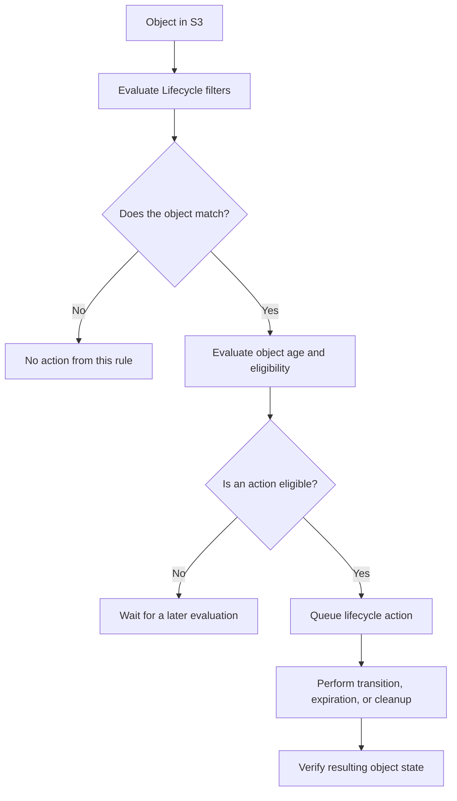

# 01- Lifecycle Rules and Filters

## Overview

Amazon S3 Lifecycle automates object transitions, expiration, and cleanup according to configurable rules. It allows backend systems to manage data retention and storage costs without requiring applications to inspect and modify every object individually.

A lifecycle configuration belongs to a general-purpose S3 bucket and contains rules. Each rule defines its status, the objects it applies to, and one or more lifecycle actions.

Common use cases include:

- Transitioning historical application logs to less expensive storage classes.
- Expiring temporary uploads and generated artifacts.
- Managing current and noncurrent object versions.
- Removing expired delete markers.
- Aborting incomplete multipart uploads.
- Applying different retention policies to different object categories.

Lifecycle rules are evaluated and executed asynchronously. They should be treated as automated policy enforcement, not as an exact-time scheduler or an immediate deletion mechanism.

## Lifecycle Rule Structure

A lifecycle rule contains three primary components:

| Component | Purpose |
|---|---|
| Rule ID | Identifies the rule within the bucket configuration |
| Status | Enables or disables the rule |
| Filter | Determines which objects are eligible |
| Actions | Specifies transitions, expiration, or incomplete multipart upload cleanup |

A bucket can have only one lifecycle configuration, containing up to 1,000 rules. Updating that configuration requires managing the complete set of rules rather than independently saving unrelated rules.

A rule can apply to every object in a bucket or to a filtered subset.

### Lifecycle rule evaluation



An eligible action might still be delayed by asynchronous processing or service constraints. Object eligibility does not imply that the action is completed immediately.

## Lifecycle Filters

Filters define the object population to which a rule applies. S3 supports filtering by key prefix, object tags, object size, and combinations of these criteria.

### Prefix filters

A prefix filter selects objects whose keys begin with a specified string.

For example, the prefix `application-logs/` can select:

```text
application-logs/api/2026/10/16.log
application-logs/worker/2026/10/16.log
application-logs/errors/error-001.json
```

It does not select:

```text
uploads/document.pdf
application-logs-archive/old.log
```

Example:

```json
{
  "ID": "ExpireApplicationLogs",
  "Status": "Enabled",
  "Filter": {
    "Prefix": "application-logs/"
  },
  "Expiration": {
    "Days": 365
  }
}
```

**Best practices**

- Use deliberate, application-owned prefixes for lifecycle boundaries.
- Include the trailing slash when a directory-like boundary is intended.
- Avoid rules against overly broad prefixes unless the entire object population has the same retention requirements.
- Treat S3 keys as object identifiers, not as actual filesystem paths.

Prefix matching is based on the object key. S3 does not infer a directory hierarchy when evaluating a lifecycle rule.

### Object tag filters

Tags allow lifecycle rules to select objects according to business or operational metadata rather than key naming alone.

Example tags:

| Key | Value | Purpose |
|---|---|---|
| `data-class` | `temporary` | Temporary processing output |
| `environment` | `production` | Production data classification |
| `retention` | `short-term` | Short retention policy |
| `dataset` | `historical` | Historical data processing |

A rule can match an object using an exact tag key and value.

```json
{
  "ID": "ExpireTemporaryObjects",
  "Status": "Enabled",
  "Filter": {
    "Tag": {
      "Key": "data-class",
      "Value": "temporary"
    }
  },
  "Expiration": {
    "Days": 14
  }
}
```

This rule selects objects tagged with `data-class=temporary`. Other tags on the objects do not prevent a match.

Tag-based policies are useful when different object classes share a prefix but have different retention requirements.

**Production considerations**

- Assign tags consistently through the upload or ingestion workflow.
- Restrict who can modify tags used by retention policies.
- Validate tag assignment before enabling destructive lifecycle actions.
- Include tag-based filters in integration tests.
- Do not assume removing a tag immediately cancels an action already queued by S3.

S3 evaluates tag-based lifecycle eligibility daily and re-evaluates relevant tags when executing an action. Because actions are asynchronous, tag changes are not a reliable last-second cancellation mechanism.

### Object size filters

Size filters select objects according to their size in bytes.

The supported filter elements are:

| Filter | Behavior |
|---|---|
| `ObjectSizeGreaterThan` | Matches objects strictly larger than the specified size |
| `ObjectSizeLessThan` | Matches objects strictly smaller than the specified size |

Example: select objects larger than 128 KiB.

```json
{
  "ID": "TransitionLargeObjects",
  "Status": "Enabled",
  "Filter": {
    "ObjectSizeGreaterThan": 131071
  },
  "Transitions": [
    {
      "Days": 60,
      "StorageClass": "STANDARD_IA"
    }
  ]
}
```

The threshold is exclusive. A value of `131071` selects objects of at least `131072` bytes, assuming the object sizes are integral byte counts.

Size filters are especially useful when managing workloads containing large numbers of small objects. Transition request costs and minimum billable object sizes can make transitions uneconomical for small objects.

### Combine multiple filters

When a rule combines different filters, S3 uses logical `AND` semantics. An object must satisfy every specified criterion.

For example, transition objects only when all of these conditions hold:

- The key begins with `analytics/`.
- The `retention` tag equals `historical`.
- The object is larger than 128 KiB.

```json
{
  "ID": "ArchiveHistoricalAnalytics",
  "Status": "Enabled",
  "Filter": {
    "And": {
      "Prefix": "analytics/",
      "Tags": [
        {
          "Key": "retention",
          "Value": "historical"
        }
      ],
      "ObjectSizeGreaterThan": 131071
    }
  },
  "Transitions": [
    {
      "Days": 90,
      "StorageClass": "GLACIER"
    }
  ]
}
```

The `And` structure supports one prefix, multiple tags with distinct tag keys, and applicable object size criteria.

S3 does not provide logical `OR` between separate filter alternatives inside a single filter. Use separate lifecycle rules when different prefixes or alternative matching conditions require the same action.

For example, if objects under both `reports/` and `exports/` require archival, create appropriately scoped rules for those prefixes.

### Understand empty filters

An empty filter applies a lifecycle rule to all objects in the bucket.

```json
{
  "ID": "BucketWideExpiration",
  "Status": "Enabled",
  "Filter": {},
  "Expiration": {
    "Days": 365
  }
}
```

This is a broad policy with potentially destructive consequences. Use it only when bucket-wide retention is explicitly intended and compatible with all applications using the bucket.

For production data, prefer a narrow filter whenever the retention requirements differ across object populations.

## Lifecycle Actions

### Transition objects between storage classes

A transition action moves eligible objects to another S3 storage class.

For example, a historical log workflow might retain active logs in S3 Standard and later transition them to an archive class.

```json
{
  "ID": "ArchiveHistoricalLogs",
  "Status": "Enabled",
  "Filter": {
    "Prefix": "application-logs/"
  },
  "Transitions": [
    {
      "Days": 90,
      "StorageClass": "GLACIER"
    }
  ]
}
```

Choose the destination class according to retrieval latency, retention duration, availability, and cost requirements.

Review the following before deploying a transition:

- The source and destination storage classes.
- Minimum storage durations and applicable early-deletion charges.
- Object-size restrictions.
- Retrieval requirements.
- Whether objects are versioned or subject to replication.
- Whether the application can tolerate archive restoration.

Current S3 Lifecycle behavior prevents objects smaller than 128 KB from transitioning by default. Explicit size filters can change eligibility, so configure them deliberately rather than assuming every object will transition.

Reference: [Transitioning objects using S3 Lifecycle](https://docs.aws.amazon.com/AmazonS3/latest/userguide/lifecycle-transition-general-considerations.html).

### Expire current objects

An expiration action makes an object eligible for expiration after the configured number of days.

```json
{
  "ID": "ExpireTemporaryUploads",
  "Status": "Enabled",
  "Filter": {
    "Prefix": "temporary-uploads/"
  },
  "Expiration": {
    "Days": 14
  }
}
```

For temporary data, confirm that the expiration period exceeds the maximum expected processing and recovery window.

Expiration behavior depends on versioning:

| Bucket state | Effect of current-version expiration |
|---|---|
| Versioning disabled | The current object is permanently deleted |
| Versioning enabled | S3 generally creates a delete marker; older versions remain |
| Versioning suspended | A delete marker or null-version behavior may apply depending on the existing object versions |

Do not treat current-version expiration as permanent deletion from a versioned bucket.

### Expire noncurrent versions

In a versioning-enabled bucket, replacing an object creates another version. Previous versions remain stored unless explicitly deleted or managed through lifecycle rules.

A noncurrent-version expiration action removes eligible older versions after the specified period of noncurrent time.

Example:

```json
{
  "ID": "ExpireOldObjectVersions",
  "Status": "Enabled",
  "Filter": {
    "Prefix": "documents/"
  },
  "NoncurrentVersionExpiration": {
    "NoncurrentDays": 90
  }
}
```

This rule is intended to remove noncurrent versions after they have been noncurrent for 90 days. Confirm whether the retention policy permits permanent removal.

Use noncurrent-version expiration to prevent historical versions from accumulating indefinitely. If the business requires a longer recovery window, configure the rule accordingly.

### Remove expired delete markers

A delete marker is a special version that makes an object appear deleted in normal object listings.

In a versioned bucket, an expired delete marker can be removed when no other object versions remain.

```json
{
  "ID": "RemoveExpiredDeleteMarkers",
  "Status": "Enabled",
  "Filter": {
    "Prefix": "documents/"
  },
  "Expiration": {
    "ExpiredObjectDeleteMarker": true
  }
}
```

Do not assume that deleting a marker deletes older object versions. Manage noncurrent versions separately when permanent deletion is permitted.

### Abort incomplete multipart uploads

Multipart uploads that are initiated but never completed can leave stored parts that incur charges.

Use `AbortIncompleteMultipartUpload` to clean up uploads that remain incomplete beyond an appropriate age.

```json
{
  "ID": "AbortStaleMultipartUploads",
  "Status": "Enabled",
  "Filter": {
    "Prefix": "uploads/"
  },
  "AbortIncompleteMultipartUpload": {
    "DaysAfterInitiation": 7
  }
}
```

Select the cleanup interval based on the maximum legitimate upload duration and the application's retry policy.

Do not choose an interval so short that it aborts valid long-running uploads. Once an incomplete upload is aborted, the client must initiate another multipart upload to continue.

## Build a Complete Lifecycle Configuration

The following example demonstrates several focused rules in one bucket configuration:

- Transition historical analytics objects after 90 days.
- Expire explicitly tagged temporary uploads after 14 days.
- Remove eligible noncurrent document versions after 90 days.
- Abort incomplete multipart uploads in the uploads prefix after seven days.

The values are illustrative. Validate retention, recovery requirements, and transition costs before deploying them.

`lifecycle.json`:

```json
{
  "Rules": [
    {
      "ID": "ArchiveHistoricalAnalytics",
      "Status": "Enabled",
      "Filter": {
        "And": {
          "Prefix": "analytics/",
          "Tags": [
            {
              "Key": "retention",
              "Value": "historical"
            }
          ],
          "ObjectSizeGreaterThan": 131071
        }
      },
      "Transitions": [
        {
          "Days": 90,
          "StorageClass": "GLACIER"
        }
      ]
    },
    {
      "ID": "ExpireTemporaryUploads",
      "Status": "Enabled",
      "Filter": {
        "Tag": {
          "Key": "data-class",
          "Value": "temporary"
        }
      },
      "Expiration": {
        "Days": 14
      }
    },
    {
      "ID": "ExpireOldDocumentVersions",
      "Status": "Enabled",
      "Filter": {
        "Prefix": "documents/"
      },
      "NoncurrentVersionExpiration": {
        "NoncurrentDays": 90
      }
    },
    {
      "ID": "AbortStaleUploads",
      "Status": "Enabled",
      "Filter": {
        "Prefix": "uploads/"
      },
      "AbortIncompleteMultipartUpload": {
        "DaysAfterInitiation": 7
      }
    }
  ]
}
```

This configuration does not enable bucket versioning, encryption, replication, or public-access protection. Those controls must be managed independently.

The expiration rules must also be reviewed against applicable retention obligations and Object Lock protections. Do not deploy the sample unchanged to a bucket containing unrelated business data.

## Deploy and Verify Lifecycle Rules

### Inspect the existing configuration

```bash
aws s3api get-bucket-lifecycle-configuration \
  --bucket "$BUCKET"
```

Review the current rules before making changes. A bucket might already contain lifecycle policies maintained by another application, infrastructure module, or operations team.

### Apply the configuration

```bash
aws s3api put-bucket-lifecycle-configuration \
  --bucket "$BUCKET" \
  --lifecycle-configuration file://lifecycle.json
```

**Important:** This command replaces the bucket's complete lifecycle configuration. Merge the intended rules with existing rules before applying the update.

Treat lifecycle changes as infrastructure changes:
- Review the configuration in version control.
- Inspect the effective rule filters.
- Obtain approval for destructive expiration rules.
- Test rules against representative objects.
- Deploy through the standard infrastructure pipeline.

### Verify the deployed configuration

```bash
aws s3api get-bucket-lifecycle-configuration \
  --bucket "$BUCKET" \
  --output json
```

Confirm that every intended rule has the correct status, filters, and actions.

For object-level verification, inspect representative objects:

```bash
aws s3api head-object \
  --bucket "$BUCKET" \
  --key "$OBJECT_KEY"
```

Review the storage class and relevant object metadata returned by the request.

Lifecycle execution is asynchronous, so the absence of an immediate transition or deletion does not necessarily indicate a configuration failure.

## Production Considerations

### Design retention policies around business requirements

Lifecycle policies should represent explicit retention rules, not arbitrary storage optimization decisions.

Define the expected retention period for each object category, including:
- Temporary uploads.
- Processed artifacts.
- Application logs.
- Customer documents.
- Historical datasets.
- Backup and recovery data.

Confirm the retention period with the appropriate business, security, or compliance owner before creating destructive rules.

### Protect versioned and replicated objects

Versioning and replication change the operational consequences of lifecycle actions.

Review:
- Current-version expiration behavior.
- Noncurrent-version expiration.
- Expired delete-marker cleanup.
- Replication status and outstanding replication work.
- Object Lock retention and legal holds.
- Cross-Region recovery requirements.

Do not use lifecycle deletion as a replacement for a documented backup or recovery strategy. Replicated objects and retained historical versions must be evaluated according to the intended recovery model.

### Account for costs

Lifecycle actions can reduce storage expenditure, but transitions and object operations can introduce charges.

Evaluate:
- Transition requests.
- Destination storage rates.
- Retrieval and restoration costs.
- Minimum storage durations and early-deletion charges.
- Object sizes and per-object overhead.
- Storage retained by noncurrent versions.
- Costs of incomplete multipart uploads.

A transition that saves little storage cost across millions of small objects may be more expensive than leaving those objects in their current class.

### Monitor policy effectiveness

Use S3 Inventory, S3 Storage Lens, Cost and Usage Reports, and relevant monitoring tools to review object counts, storage classes, and actual cost changes.

For sensitive lifecycle workflows, periodically check that:
- Intended objects match the filters.
- Unexpected object populations are not affected.
- Historical versions are managed as designed.
- Incomplete multipart uploads do not accumulate.
- Transition and expiration behavior remains compatible with the recovery model.

### Understand common failure conditions

Lifecycle actions may not occur as expected when:
- The filter does not match the object's key, tags, or size.
- The rule is disabled.
- The object has not reached the required age.
- The destination transition is not eligible.
- An object is protected by Object Lock.
- An object has a pending or failed replication status.
- A versioned object's current version is already a delete marker.
- The action is queued but asynchronous execution has not completed.

Diagnose the effective configuration and the object's state before changing a rule or widening its filter.

## Common Mistakes

| Mistake | Consequence | Prevention |
|---|---|---|
| Applying a bucket-wide filter without reviewing existing data | Unintended transitions or deletions | Prefer narrow, explicit filters |
| Assuming filters use OR logic | Some objects never match the intended rule | Use separate rules for alternative prefixes |
| Ignoring tag-based filter behavior | Objects with incorrect or missing tags are excluded | Validate tagging at ingestion |
| Using size thresholds without accounting for exclusive boundaries | Objects exactly at the threshold do not match | Test boundary sizes explicitly |
| Assuming object expiration permanently deletes every version | Older versions continue consuming storage | Configure noncurrent-version expiration separately |
| Replacing lifecycle configuration with a partial ruleset | Existing policies are removed | Retrieve, merge, review, and apply the complete configuration |
| Expecting immediate action after deployment | Operators misdiagnose normal asynchronous processing | Verify the configuration and allow for asynchronous execution |
| Ignoring incomplete multipart uploads | Unfinished parts accumulate storage charges | Configure an appropriate abort rule |
| Applying short retention without checking recovery requirements | Required historical data is removed | Review retention and recovery requirements before rollout |

## Production Readiness Checklist

- [ ] Every rule has a clear purpose and a unique, descriptive ID.
- [ ] Each filter targets the intended object population.
- [ ] Prefix boundaries and tag values have been tested.
- [ ] Object-size thresholds account for exclusive comparison boundaries.
- [ ] Small-object transition behavior has been evaluated.
- [ ] Transition and expiration periods satisfy storage and retention requirements.
- [ ] Current and noncurrent versions are managed intentionally.
- [ ] Expired delete-marker cleanup is configured where appropriate.
- [ ] Incomplete multipart uploads have an appropriate cleanup policy.
- [ ] Object Lock and replication dependencies have been reviewed.
- [ ] Existing lifecycle rules are preserved when deploying changes.
- [ ] Destructive rules have been tested and approved.
- [ ] Post-deployment verification and ongoing cost monitoring are defined.

## Authoritative References

- [Lifecycle configuration elements](https://docs.aws.amazon.com/AmazonS3/latest/userguide/intro-lifecycle-rules.html)
- [Adding filters to Lifecycle rules](https://docs.aws.amazon.com/AmazonS3/latest/userguide/intro-lifecycle-filters.html)
- [Examples of S3 Lifecycle configurations](https://docs.aws.amazon.com/AmazonS3/latest/userguide/lifecycle-configuration-examples.html)
- [Transitioning objects using S3 Lifecycle](https://docs.aws.amazon.com/AmazonS3/latest/userguide/lifecycle-transition-general-considerations.html)
- [Setting an S3 Lifecycle configuration](https://docs.aws.amazon.com/AmazonS3/latest/userguide/how-to-set-lifecycle-configuration-intro.html)
- [Troubleshooting S3 Lifecycle issues](https://docs.aws.amazon.com/AmazonS3/latest/userguide/troubleshoot-lifecycle.html)

## Key Takeaways

- Lifecycle filters define the exact object population to which transitions, expiration, and cleanup actions apply.
- Prefix, tag, and size filters combine using logical `AND`; use separate rules when alternative matching conditions require the same action.
- Versioned buckets require explicit management of current versions, noncurrent versions, and expired delete markers.
- Lifecycle actions are asynchronous, and their behavior must be evaluated alongside object-size restrictions, retention requirements, replication, and Object Lock.
- Retrieve, review, merge, and verify the complete lifecycle configuration before deploying changes because updating it can replace existing rules.