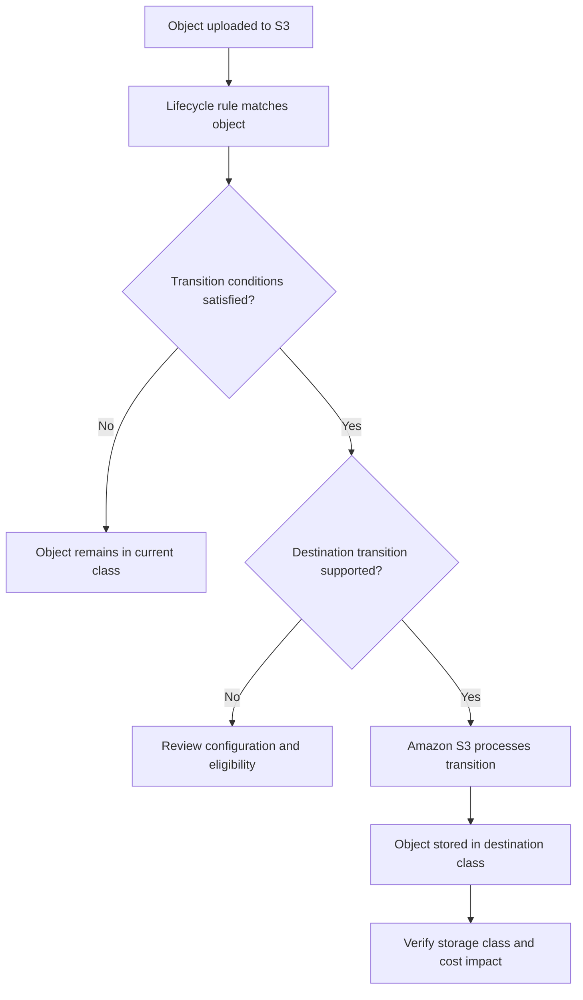

# 02- Storage Class Transition Actions

## Overview

Amazon S3 Lifecycle transition actions automatically move eligible objects between storage classes according to a defined schedule or date. They help optimize storage costs by matching the storage class to an object's expected access frequency, retention period, and retrieval requirements.

For example, an application might store newly uploaded documents in S3 Standard, transition older documents to S3 Standard-IA, and eventually archive them in S3 Glacier Flexible Retrieval.

A transition action does not delete an object. It changes the object's storage class while retaining the object data. Deletion is handled separately through lifecycle expiration actions or explicit object deletion.

Production transition policies must account for supported transition paths, minimum storage durations, object-size restrictions, transition request costs, versioning, replication status, and restoration requirements.

## Understand Lifecycle Transition Actions

### What a transition action does

A transition action defines when an eligible object should move to a destination storage class.

S3 Lifecycle evaluates the applicable configuration and processes eligible objects asynchronously. The configured transition time is therefore not necessarily the exact time at which an object's physical transition completes.

Transition actions are useful for:

- Moving older application data to lower-cost storage.
- Archiving historical logs and reports.
- Reducing the cost of retaining backups.
- Applying consistent storage policies across large object populations.
- Managing current and noncurrent versions independently.

The transition itself does not require an application to download and re-upload the object. Amazon S3 manages the operation.

### Understand the transition lifecycle



A lifecycle rule can contain multiple transition actions. Each action must be compatible with the object's current storage class, the destination class, and the applicable transition constraints.

### Distinguish transition actions from other lifecycle actions

| Action | Purpose | Example |
|---|---|---|
| `Transition` | Change the current object's storage class according to object age or a specified date | Move historical logs to Glacier Flexible Retrieval |
| `NoncurrentVersionTransition` | Change the storage class of eligible noncurrent versions | Archive older versions of frequently updated documents |
| `Expiration` | Expire current objects according to the rule | Remove temporary exports after their retention period |
| `NoncurrentVersionExpiration` | Permanently remove eligible noncurrent versions | Delete old versions after the approved retention period |
| `AbortIncompleteMultipartUpload` | Remove incomplete multipart uploads | Clean up unfinished uploads after a defined number of days |

Transition and expiration are separate operations. Combining them in a lifecycle configuration requires deliberate planning because an object may have to remain recoverable for a period even after it becomes eligible for archival.

## Understand Supported Storage Class Transitions

Amazon S3 supports a waterfall model for lifecycle transitions. Not every storage class can transition directly to every other class.

### Supported transition paths

| Current storage class | Supported lifecycle destinations |
|---|---|
| S3 Standard (`STANDARD`) | Standard-IA, Intelligent-Tiering, One Zone-IA, Glacier Instant Retrieval, Glacier Flexible Retrieval, Glacier Deep Archive |
| S3 Standard-IA (`STANDARD_IA`) | Intelligent-Tiering, One Zone-IA, Glacier Instant Retrieval, Glacier Flexible Retrieval, Glacier Deep Archive |
| S3 Intelligent-Tiering Frequent Access or Infrequent Access tier | One Zone-IA, Glacier Instant Retrieval, Glacier Flexible Retrieval, Glacier Deep Archive |
| S3 Intelligent-Tiering Archive Instant Access tier | Glacier Instant Retrieval, Glacier Flexible Retrieval, Glacier Deep Archive |
| S3 Intelligent-Tiering Archive Access tier | Glacier Flexible Retrieval, Glacier Deep Archive |
| S3 Intelligent-Tiering Deep Archive Access tier | Glacier Deep Archive |
| S3 One Zone-IA (`ONEZONE_IA`) | Glacier Flexible Retrieval, Glacier Deep Archive |
| S3 Glacier Instant Retrieval (`GLACIER_IR`) | Glacier Flexible Retrieval, Glacier Deep Archive |
| S3 Glacier Flexible Retrieval (`GLACIER`) | Glacier Deep Archive |

These paths describe supported lifecycle transitions for general-purpose buckets. Specialized bucket types and newer storage features have separate compatibility constraints; verify current service documentation before deploying a policy.

### Choose an appropriate transition path

A predictable retention workload might use the following progression:

```text
New objects
    |
    v
S3 Standard
    |
    | After 30 days
    v
S3 Standard-IA
    |
    | After 90 days from original creation
    v
S3 Glacier Flexible Retrieval
    |
    | After 365 days from original creation
    v
S3 Glacier Deep Archive
```

The day values in this example are measured from object creation, not from the preceding transition. The elapsed time between transitions must be sufficient to satisfy the destination and minimum-storage-duration constraints.

Use direct transitions when the workload and supported transition paths permit them. Intermediate classes should be introduced only when their expected access and cost characteristics justify the extra transition.

Reference: [Transitioning objects using Amazon S3 Lifecycle](https://docs.aws.amazon.com/AmazonS3/latest/userguide/lifecycle-transition-general-considerations.html).

## Configure Transition Timing

### Transition using object age

The `Days` property specifies the object age at which a transition becomes eligible.

For lifecycle rules, the specified day count is calculated from object creation time and rounded up to the next midnight UTC. For example, if an object is created at 10:30 UTC on January 1 and a transition is configured for three days after creation, the calculated transition time is January 5 at 00:00 UTC.

This distinction matters when estimating eligibility dates and validating a scheduled data-retention policy.

Example:

```json
{
  "ID": "ArchiveHistoricalReports",
  "Status": "Enabled",
  "Filter": {
    "Prefix": "reports/"
  },
  "Transitions": [
    {
      "Days": 90,
      "StorageClass": "GLACIER"
    }
  ]
}
```

This rule makes matching objects eligible for transition to S3 Glacier Flexible Retrieval at 90 days of object age, subject to applicable transition constraints.

### Transition on a specified date

You can use the `Date` property to specify a transition date rather than calculating the transition from object age.

Example:

```json
{
  "ID": "ArchiveReportsOnSchedule",
  "Status": "Enabled",
  "Filter": {
    "Prefix": "reports/"
  },
  "Transitions": [
    {
      "Date": "2027-01-01T00:00:00Z",
      "StorageClass": "GLACIER"
    }
  ]
}
```

The date must use ISO 8601 format, and the transition time is midnight UTC. A transition action uses either `Days` or `Date`, not both.

Date-based transitions are useful when a controlled migration is tied to a known schedule. Age-based transitions are generally more suitable for repeatable retention policies that apply to continuously arriving objects.

### Understand the asynchronous processing model

Lifecycle processing is managed by S3, not triggered by an application request at the exact configured timestamp. The rule determines eligibility; processing and physical movement may occur later.

For transitions to S3 Glacier Flexible Retrieval and S3 Glacier Deep Archive, processing is asynchronous. The destination storage-class billing treatment can begin when the lifecycle rule becomes eligible even if the physical transition has not yet completed.

S3 Intelligent-Tiering has a different billing transition behavior: the billing change occurs after the physical transition completes.

Do not use a lifecycle transition as a hard real-time mechanism for moving objects at an exact instant. Monitor actual outcomes and design around the documented lifecycle semantics.

## Filter Objects Before Transitioning Them

### Use prefixes to scope rules

A prefix filter limits a rule to matching object keys.

For example, the prefix `application-logs/` matches objects such as:

```text
application-logs/2026/10/api.log
application-logs/2026/10/worker.log
application-logs/2026/11/api.log
```

A prefix filter is a logical key-name filter, not a physical folder boundary. S3 object keys can contain common prefixes without requiring actual directory objects.

Avoid applying broad transition rules to a bucket containing multiple workloads with different access patterns or retention requirements.

### Use object tags for classification

Tags allow lifecycle rules to target objects based on attributes that can be assigned independently of the key name.

For example, a rule can target objects tagged with `RetentionClass=Archive`.

Example:

```json
{
  "ID": "ArchiveTaggedReports",
  "Status": "Enabled",
  "Filter": {
    "Tag": {
      "Key": "RetentionClass",
      "Value": "Archive"
    }
  },
  "Transitions": [
    {
      "Days": 180,
      "StorageClass": "DEEP_ARCHIVE"
    }
  ]
}
```

Tags are useful when storage policy follows business classification rather than a fixed prefix. Ensure that the tagging process is reliable and that the rule matches only the intended objects.

### Combine filters when necessary

A lifecycle rule can combine a prefix, one or more tags, and object-size bounds using the supported `And` filter.

For example, an application can transition only large objects under a particular prefix that carry an archival classification.

```json
{
  "ID": "ArchiveLargeClassifiedReports",
  "Status": "Enabled",
  "Filter": {
    "And": {
      "Prefix": "reports/",
      "ObjectSizeGreaterThan": 131071,
      "Tags": [
        {
          "Key": "RetentionClass",
          "Value": "Archive"
        }
      ]
    }
  },
  "Transitions": [
    {
      "Days": 180,
      "StorageClass": "DEEP_ARCHIVE"
    }
  ]
}
```

The exclusive `ObjectSizeGreaterThan` value of 131071 bytes selects objects at least 131072 bytes in size. This can help reduce transition overhead for small objects.

When multiple filter criteria are combined using `And`, all specified criteria must match.

### Account for small-object transition behavior

S3 Lifecycle has a default minimum-size behavior that prevents objects smaller than 128 KB from transitioning to storage classes unless the applicable configuration explicitly allows those smaller objects. Configurations created before the September 2024 change can retain previous behavior until modified.

Even when smaller objects can be included, transitioning them may not be economical because each object can incur transition-request charges and destination-specific minimum billing rules.

Before enabling small-object transitions:
- Analyze object counts and size distributions.
- Calculate transition request costs.
- Evaluate destination storage pricing and minimum billable sizes.
- Consider aggregating small records when independent object access and retention are unnecessary.

Reference: [Lifecycle transition constraints and considerations](https://docs.aws.amazon.com/AmazonS3/latest/userguide/lifecycle-transition-general-considerations.html).

## Manage Minimum Storage Durations

### Understand early transition costs

Several storage classes have minimum storage-duration requirements. Deleting, overwriting, or transitioning an object before the minimum duration is satisfied can result in prorated early-deletion charges for the remaining duration.

| Storage class | Minimum storage duration |
|---|---:|
| S3 Standard | None |
| S3 Intelligent-Tiering | None |
| S3 Standard-IA | 30 days |
| S3 One Zone-IA | 30 days |
| S3 Glacier Instant Retrieval | 90 days |
| S3 Glacier Flexible Retrieval | 90 days |
| S3 Glacier Deep Archive | 180 days |

These requirements apply to the relevant stored object or version. They are independent of whether your application's retention policy allows deletion.

### Design transitions around retention and access patterns

Consider a policy that moves objects to Standard-IA after 30 days and then transitions them to Glacier Flexible Retrieval after 90 days of object age.

An object remains in Standard-IA for approximately 60 days before becoming eligible for the second transition. This avoids leaving the object in Standard-IA for less than its 30-day minimum storage duration.

For more complex transition chains, calculate the actual time spent in each class. Do not assume that every transition schedule is cost-efficient simply because the final destination has a lower storage rate.

### Account for archive metadata and retrieval charges

S3 Glacier Flexible Retrieval and S3 Glacier Deep Archive incur additional per-object archive metadata storage. Transition requests and restoration operations also have applicable charges.

For workloads containing large numbers of small objects, the combined request and metadata costs can offset lower storage rates.

Before moving a dataset to an archive class, estimate:
- The number of objects to transition.
- Storage volume and object-size distribution.
- Transition request charges.
- Minimum duration and early-deletion charges.
- Expected restoration frequency and volume.
- Data-transfer charges where applicable.

Use current regional pricing rather than hardcoding pricing assumptions into permanent documentation or application logic.

## Transition Noncurrent Object Versions

### Understand transitions in versioned buckets

A versioning-enabled bucket can contain one current version and multiple noncurrent versions of an object.

The `Transition` action applies to eligible current object versions. Use `NoncurrentVersionTransitions` to define a storage-class transition for noncurrent versions based on the number of days since they became noncurrent.

For example:

```json
{
  "ID": "ArchiveOldDocumentVersions",
  "Status": "Enabled",
  "Filter": {
    "Prefix": "documents/"
  },
  "NoncurrentVersionTransitions": [
    {
      "NoncurrentDays": 90,
      "StorageClass": "GLACIER"
    }
  ]
}
```

This rule makes eligible noncurrent versions under `documents/` transition to Glacier Flexible Retrieval after 90 days as noncurrent versions, subject to transition eligibility and constraints.

Noncurrent-version retention should be designed alongside the application's rollback and recovery requirements. A previous version may still be needed to recover from an accidental overwrite, application defect, or security incident.

### Limit the number of retained newer versions

Where required, `NewerNoncurrentVersions` can be used with `NoncurrentVersionTransitions` to preserve a number of newer noncurrent versions before transitioning older versions.

When this setting is used, the rule must include a suitable `Filter`. The configured age and newer-version conditions must both be satisfied for the version to become eligible.

Do not conflate this setting with permanent version deletion. Transitioning a version changes its storage class; expiration controls when a version is removed.

Reference: [Lifecycle configuration elements](https://docs.aws.amazon.com/AmazonS3/latest/userguide/intro-lifecycle-rules.html).

## Respect Replication and Encryption Constraints

### Avoid transitioning versions while replication is pending or failed

For versioning-enabled or versioning-suspended buckets, objects with replication status `Pending` or `Failed` cannot be transitioned by the relevant lifecycle transition actions.

A transition policy should therefore be evaluated alongside the replication workflow rather than assuming that every object becomes eligible solely because it has reached the configured age.

Inspect replication configuration:

```bash
aws s3api get-bucket-replication \
  --bucket "$BUCKET"
```

For individual objects, inspect metadata where permitted:

```bash
aws s3api head-object \
  --bucket "$BUCKET" \
  --key "$OBJECT_KEY"
```

Review replication status when it is returned, and use S3 Inventory or replication monitoring to assess large object populations.

### Preserve encryption during transitions

S3 Lifecycle transitions preserve an object's encryption. A transition does not inherently decrypt the object or replace its encryption configuration.

However, access to an archived or replicated object can still depend on the required KMS permissions and key availability.

Test the applicable object-access and restoration workflows after changing storage-class policies, particularly for SSE-KMS encrypted data and cross-account recovery architectures.

Reference: [Lifecycle and other bucket configurations](https://docs.aws.amazon.com/AmazonS3/latest/userguide/lifecycle-and-other-bucket-config.html).

## Deploy Lifecycle Transition Configurations Safely

### Create a complete lifecycle configuration

The following example transitions objects under `application-logs/` through several storage classes. Its time intervals are illustrative and must be validated against the workload's access pattern and cost model.

`lifecycle.json`:

```json
{
  "Rules": [
    {
      "ID": "TransitionApplicationLogs",
      "Status": "Enabled",
      "Filter": {
        "And": {
          "Prefix": "application-logs/",
          "ObjectSizeGreaterThan": 131071
        }
      },
      "Transitions": [
        {
          "Days": 30,
          "StorageClass": "STANDARD_IA"
        },
        {
          "Days": 90,
          "StorageClass": "GLACIER"
        },
        {
          "Days": 365,
          "StorageClass": "DEEP_ARCHIVE"
        }
      ]
    }
  ]
}
```

The example excludes objects smaller than 128 KB and transitions eligible objects based on age since creation. The intervening durations must satisfy minimum storage-duration requirements, and archive retrieval behavior must be acceptable for the application.

The destination identifiers used in the S3 API and CLI include:

| Destination class | API or CLI value |
|---|---|
| Standard-IA | `STANDARD_IA` |
| One Zone-IA | `ONEZONE_IA` |
| Intelligent-Tiering | `INTELLIGENT_TIERING` |
| Glacier Instant Retrieval | `GLACIER_IR` |
| Glacier Flexible Retrieval | `GLACIER` |
| Glacier Deep Archive | `DEEP_ARCHIVE` |

### Inspect the existing configuration first

```bash
aws s3api get-bucket-lifecycle-configuration \
  --bucket "$BUCKET"
```

Review every existing rule before making changes. S3 Lifecycle configuration is a bucket-level configuration, and the following operation replaces the existing configuration with the supplied configuration.

```bash
aws s3api put-bucket-lifecycle-configuration \
  --bucket "$BUCKET" \
  --lifecycle-configuration file://lifecycle.json
```

Do not apply a partial configuration that unintentionally removes lifecycle rules maintained by other teams or workloads. Merge the proposed changes into the full intended configuration and review the final result before applying it.

### Verify the deployed rule

```bash
aws s3api get-bucket-lifecycle-configuration \
  --bucket "$BUCKET"
```

Check:
- The correct rule IDs and enabled states.
- The intended filters.
- The transition order and destination storage classes.
- The object-age thresholds.
- Compatibility with current object populations, versions, and replication.
- The impact of the configuration on other lifecycle rules.

Successful configuration deployment proves only that the rules were accepted. It does not prove that every intended object has already transitioned.

## Monitor Transition Results

### Verify object storage classes

For an individual object, inspect its metadata:

```bash
aws s3api head-object \
  --bucket "$BUCKET" \
  --key "$OBJECT_KEY"
```

Review the returned storage-class information where present. Objects using S3 Standard can have a storage class omitted from some responses because it is the default storage class.

For large datasets, use S3 Inventory to report object storage classes and compare actual results with the intended policy.

### Use appropriate monitoring and audit sources

| Source | What it helps verify |
|---|---|
| S3 Inventory | Storage-class distribution and object-level metadata at scale |
| S3 Storage Lens | Storage usage and trends across supported resource scopes |
| AWS Cost and Usage Reports | Actual storage and request cost changes |
| S3 server access logs | Best-effort records of lifecycle transition and expiration activities |
| Object metadata APIs | Storage class and other available attributes for an individual object |

S3 Lifecycle actions are not recorded as ordinary S3 object-level API activity in CloudTrail. Server access logging can capture lifecycle-related operations, but log delivery is best-effort and should not be treated as a complete accounting of all transitions.

Set operational expectations around measurable results, such as storage volume by class, transition request costs, unexpected retrieval costs, and objects that remain in a class longer than expected.

## Common Transition Configuration Mistakes

| Mistake | Impact | Prevention |
|---|---|---|
| Using an unsupported transition path | The intended transition cannot be completed as configured | Verify the supported storage-class waterfall |
| Treating `Days` as elapsed time from the previous transition | Objects can move earlier than intended or incur extra charges | Calculate all days from object creation for current-version transitions |
| Ignoring UTC rounding | Transition eligibility may not match the application's assumed date | Calculate the actual lifecycle eligibility date |
| Ignoring minimum storage duration | Early-deletion charges can offset expected savings | Calculate time spent in each storage class |
| Transitioning every small object | Request costs can exceed the storage savings | Analyze object sizes and configure suitable filters |
| Replacing the lifecycle configuration with an incomplete file | Existing lifecycle policies can disappear | Retrieve, merge, review, and deploy the complete configuration |
| Assuming the physical transition completes immediately | Monitoring and application expectations become inaccurate | Account for asynchronous lifecycle processing |
| Ignoring noncurrent versions | Historical versions remain expensive or recoverability is reduced | Define separate noncurrent-version policies |
| Ignoring replication state | Pending or failed replication can prevent transitions | Monitor replication before and after policy changes |
| Assuming transition means deletion | Data remains stored in the destination class | Configure expiration separately when deletion is permitted |
| Treating deployment success as proof of migration | Eligible objects may still await processing or remain ineligible | Verify actual object metadata and aggregate inventory reports |

## Production Readiness Checklist

- [ ] Destination storage classes follow supported transition paths.
- [ ] The transition schedule is based on a documented access and retention model.
- [ ] Day-based transitions account for object creation time and midnight UTC rounding.
- [ ] Minimum storage durations and early-deletion costs have been evaluated.
- [ ] Object-size and tag filters match the intended population.
- [ ] Large-object and small-object populations have been evaluated for cost efficiency.
- [ ] Current and noncurrent object versions have separate policies where necessary.
- [ ] Replication status and KMS-related access requirements have been considered.
- [ ] Archive restoration requirements are compatible with application recovery objectives.
- [ ] Existing lifecycle rules have been preserved during deployment.
- [ ] Storage-class results are verified through object metadata and appropriate inventory reports.
- [ ] Storage, retrieval, and transition costs are reviewed after rollout.
- [ ] Lifecycle monitoring does not rely on CloudTrail object-level events as the sole record of transitions.
- [ ] Rule changes are tested and reviewed before they affect production data.

## Authoritative References

- [Transitioning objects using Amazon S3 Lifecycle](https://docs.aws.amazon.com/AmazonS3/latest/userguide/lifecycle-transition-general-considerations.html)
- [Managing the lifecycle of objects](https://docs.aws.amazon.com/AmazonS3/latest/userguide/object-lifecycle-mgmt.html)
- [Lifecycle configuration examples](https://docs.aws.amazon.com/AmazonS3/latest/userguide/lifecycle-configuration-examples.html)
- [Lifecycle configuration elements](https://docs.aws.amazon.com/AmazonS3/latest/userguide/intro-lifecycle-rules.html)
- [Lifecycle and other bucket configurations](https://docs.aws.amazon.com/AmazonS3/latest/userguide/lifecycle-and-other-bucket-config.html)
- [Troubleshooting S3 Lifecycle issues](https://docs.aws.amazon.com/AmazonS3/latest/userguide/troubleshoot-lifecycle.html)
- [S3 storage class comparison](https://docs.aws.amazon.com/AmazonS3/latest/userguide/storage-class-intro.html)
- [Amazon S3 pricing](https://aws.amazon.com/s3/pricing/)

## Key Takeaways

- S3 Lifecycle transition actions move eligible objects between supported storage classes without requiring application-managed downloads or re-uploads.
- Transition eligibility depends on the filter, timing, current storage class, supported transition path, and applicable service constraints.
- Minimum storage durations, transition requests, archive metadata, and retrieval charges must be included in cost calculations.
- Versioned buckets require separate consideration of current and noncurrent versions, while replication status can affect transition eligibility.
- Treat lifecycle configuration deployment and actual object migration as separate concerns; verify the configuration, inspect resulting storage classes, and monitor cost and recovery impact.