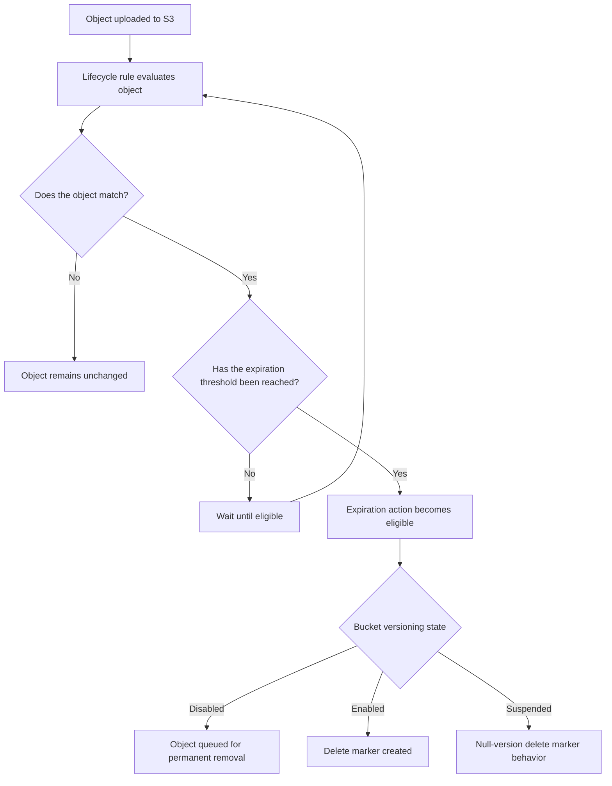

# 03- Object Expiration

## Overview

Amazon S3 Object Expiration uses S3 Lifecycle rules to remove objects when they reach a defined retention age or expiration date. It supports automated data cleanup, retention enforcement, storage-cost optimization, and management of temporary or historical data.

Object expiration is not always equivalent to immediate permanent deletion. Its behavior depends on the bucket's versioning state, the applicable lifecycle rule, and whether the object is subject to protections such as S3 Object Lock.

For production systems, expiration policies must be designed around data ownership, retention requirements, recovery windows, and application dependencies. An incorrectly scoped rule can remove current application data or permanently destroy historical versions that are still required.

Typical use cases include:

- Automatically removing temporary uploads and intermediate processing files.
- Enforcing retention periods for application logs and generated reports.
- Expiring historical application data after its approved retention period.
- Managing current and noncurrent object versions separately.
- Removing obsolete data and expired delete markers.
- Reducing storage costs without violating recovery or compliance requirements.

## How Object Expiration Works

### Lifecycle expiration processing

An S3 Lifecycle expiration rule identifies eligible objects using filters and an expiration action. Filters can select objects by prefix, tags, object size, or supported combinations of these criteria.

When an object becomes eligible, S3 processes the expiration asynchronously. The object might remain visible for some time after its eligibility date, so lifecycle expiration should not be treated as a precise deletion scheduler.

For a `Days` rule, S3 calculates eligibility using the object's age and rounds the resulting time to the next midnight UTC. Actual removal can occur later because lifecycle processing is asynchronous.



Lifecycle processing is managed by S3. Applications do not need to run a scheduled job to enumerate and delete every matching object.

However, applications must not rely on the expiration time as an exact business deadline. If a record must become inaccessible at a precise time, enforce that requirement through application authorization or another appropriate control rather than relying solely on lifecycle processing.

### Understand the bucket versioning state

| Bucket state | Result of current-version expiration | Are previous versions retained? |
|---|---|---|
| Versioning disabled | S3 queues the object for permanent removal | Version history is not available |
| Versioning enabled | S3 creates a new delete marker when the current version is an object | Yes, unless noncurrent versions are separately expired |
| Versioning suspended | S3 creates a null-version delete marker that replaces an existing null version where applicable | Existing versions with non-null version IDs can remain |

The distinction is critical for production systems. A successful expiration action in a versioned bucket does not necessarily mean that the underlying object data has been permanently deleted.

Reference: [Expiring objects in Amazon S3](https://docs.aws.amazon.com/AmazonS3/latest/userguide/lifecycle-expire-general-considerations.html).

## Configure Current-Object Expiration

### Expire temporary objects after a defined period

For nonversioned buckets, a current-object expiration rule can permanently remove matching objects after the configured age.

Consider an application that stores temporary exports under the `temporary-exports/` prefix. If these exports are needed for only 14 days, a lifecycle rule can remove them automatically.

Example `lifecycle.json`:

```json
{
  "Rules": [
    {
      "ID": "ExpireTemporaryExports",
      "Status": "Enabled",
      "Filter": {
        "Prefix": "temporary-exports/"
      },
      "Expiration": {
        "Days": 14
      }
    }
  ]
}
```

The rule selects objects whose keys begin with `temporary-exports/` and schedules expiration after the configured age.

**Production considerations**

- Ensure the prefix is dedicated to temporary data.
- Confirm that no application workflow requires the objects beyond the expiration period.
- Check whether bucket versioning is enabled before assuming expiration permanently removes data.
- Test the rule against representative objects before applying it to a production bucket.
- Preserve existing lifecycle rules when updating the bucket configuration.

### Use expiration dates for calendar-based retention

The `Date` element can define an absolute UTC expiration date instead of an age expressed in days.

```json
{
  "Rules": [
    {
      "ID": "ExpireLegacyExports",
      "Status": "Enabled",
      "Filter": {
        "Prefix": "legacy-exports/"
      },
      "Expiration": {
        "Date": "2027-01-01T00:00:00Z"
      }
    }
  ]
}
```

This example defines January 1, 2027, at midnight UTC as the expiration eligibility date for matching objects.

Use an absolute date when the business policy specifies a calendar cutoff. Use `Days` when the intended retention period is relative to object age.

Do not confuse an expiration date with a guarantee that every matching object will disappear at that exact time.

## Manage Expiration in Versioned Buckets

### Current-version expiration creates a delete marker

In a versioning-enabled bucket, S3 normally creates a delete marker when the current object version expires.

The previous data version becomes noncurrent, while the delete marker becomes the current version. Ordinary reads that do not specify a version ID behave as though the object has been deleted, but the previous data can still exist and incur storage charges.

Example lifecycle rule:

```json
{
  "Rules": [
    {
      "ID": "ExpireCurrentReports",
      "Status": "Enabled",
      "Filter": {
        "Prefix": "reports/"
      },
      "Expiration": {
        "Days": 365
      }
    }
  ]
}
```

This rule makes matching current versions eligible for expiration after 365 days. It does not permanently delete their noncurrent versions.

For example, a report uploaded 400 days ago may no longer be available through a normal object read after its expiration action has been processed, while the historical data version remains recoverable through a version-specific request.

### Permanently delete noncurrent versions

Use the `NoncurrentVersionExpiration` action to permanently delete previous versions after a defined period of noncurrent status.

```json
{
  "Rules": [
    {
      "ID": "ExpireNoncurrentReportVersions",
      "Status": "Enabled",
      "Filter": {
        "Prefix": "reports/"
      },
      "NoncurrentVersionExpiration": {
        "NoncurrentDays": 90
      }
    }
  ]
}
```

This rule permanently deletes eligible noncurrent versions after they have been noncurrent for the configured period. Such deletion is not recoverable through S3 version history.

Use a noncurrent-version retention period that reflects the required recovery window. A short retention period can reduce storage usage, but it also reduces the time available to recover from accidental overwrites or deletions.

### Retain a specified number of newer noncurrent versions

The `NewerNoncurrentVersions` option can retain a configured number of newer noncurrent versions in addition to the age threshold.

For example:

```json
{
  "NoncurrentVersionExpiration": {
    "NoncurrentDays": 30,
    "NewerNoncurrentVersions": 5
  }
}
```

This setting requires the lifecycle rule to include a `Filter`. Both the age condition and the newer-version threshold must be satisfied before an eligible version can be permanently deleted.

This approach is useful when an application needs to retain a limited history of recent changes, regardless of how frequently an object is overwritten.

Do not choose a version count arbitrarily. Evaluate the application's update frequency, incident-recovery process, and acceptable permanent data-loss window.

Reference: [Lifecycle configuration elements](https://docs.aws.amazon.com/AmazonS3/latest/userguide/intro-lifecycle-rules.html).

## Remove Expired Object Delete Markers

### Understand expired delete markers

An expired object delete marker is a delete marker that has no remaining object versions associated with its key.

These markers can remain in a versioned bucket after all underlying versions have been removed. They do not contain the original object data, but retaining large numbers of unnecessary markers can complicate inventory and version-management operations.

Use `ExpiredObjectDeleteMarker` to remove markers that meet this condition.

```json
{
  "Rules": [
    {
      "ID": "RemoveExpiredDeleteMarkers",
      "Status": "Enabled",
      "Filter": {
        "Prefix": "reports/"
      },
      "Expiration": {
        "ExpiredObjectDeleteMarker": true
      }
    }
  ]
}
```

This cleanup is relevant to versioned buckets. It does not delete a delete marker while older object versions remain under the same key.

The `ExpiredObjectDeleteMarker` option is an alternative expiration action, not a setting to combine with `Days` or `Date` in the same `Expiration` object. Use separate lifecycle rules for distinct expiration actions where needed.

### Combine current and historical version retention

A versioned bucket may require three distinct operations:

1. Expire current versions after their useful lifetime.
2. Permanently remove noncurrent versions after the recovery window.
3. Remove expired delete markers once no data versions remain.

Example combined configuration:

```json
{
  "Rules": [
    {
      "ID": "ExpireCurrentReports",
      "Status": "Enabled",
      "Filter": {
        "Prefix": "reports/"
      },
      "Expiration": {
        "Days": 365
      }
    },
    {
      "ID": "ExpireNoncurrentReportVersions",
      "Status": "Enabled",
      "Filter": {
        "Prefix": "reports/"
      },
      "NoncurrentVersionExpiration": {
        "NoncurrentDays": 90
      }
    },
    {
      "ID": "RemoveExpiredReportDeleteMarkers",
      "Status": "Enabled",
      "Filter": {
        "Prefix": "reports/"
      },
      "Expiration": {
        "ExpiredObjectDeleteMarker": true
      }
    }
  ]
}
```

Together, these rules manage the current version, historical versions, and obsolete delete markers separately.

The retention periods shown are examples. Validate the combined behavior against representative object histories before production deployment.

## Protect Data with Retention Controls

### Account for S3 Object Lock

S3 Object Lock can protect object versions from deletion or overwrite for a defined retention period or through a legal hold.

Lifecycle policies must not be treated as a mechanism to bypass these protections. S3 does not take lifecycle expiration action on noncurrent versions protected by Object Lock. Replication status can also affect whether eligible objects are processed: lifecycle does not take action on versions with `Pending` or `Failed` replication status under the documented conditions.

Before enabling expiration for protected or regulated datasets:

- Check whether Object Lock is enabled.
- Review retention modes and retain-until dates.
- Confirm whether any legal holds are active.
- Ensure the retention policy satisfies applicable legal and contractual obligations.
- Test the intended lifecycle behavior against object versions and replication workflows.

Object Lock requires versioning on general-purpose buckets. Once Object Lock is enabled for a bucket, it cannot be disabled, and versioning cannot be suspended for that bucket.

Reference: [Locking objects with Object Lock](https://docs.aws.amazon.com/AmazonS3/latest/userguide/object-lock.html).

### Enforce retention outside lifecycle where necessary

Lifecycle expiration is appropriate for automated storage cleanup, but it should not be the only enforcement mechanism for time-sensitive access restrictions.

For example, if customers must lose access to a document exactly when their entitlement expires, the application's authorization layer should evaluate the entitlement before issuing a download or presigned URL.

Lifecycle can later remove the stored data according to the approved retention policy.

This separates two independent requirements:

| Requirement | Appropriate control |
|---|---|
| Prevent unauthorized access after an exact business deadline | Application authorization and access-control mechanisms |
| Remove objects after a defined storage retention period | S3 Lifecycle expiration |
| Protect records from deletion before a required retention date | S3 Object Lock where appropriate |
| Recover previous object contents during an incident | Versioning and a tested recovery procedure |

## Deploy Lifecycle Expiration Safely

### Inspect the current configuration

Before modifying lifecycle rules, inspect the existing configuration:

```bash
aws s3api get-bucket-lifecycle-configuration \
  --bucket "$BUCKET"
```

Review every existing rule and document its purpose. Bucket lifecycle configuration is shared by the bucket, so an update must preserve unrelated rules owned by other applications or teams.

### Apply the reviewed configuration

After combining the intended changes with all existing rules, save the complete configuration in `lifecycle.json` and apply it:

```bash
aws s3api put-bucket-lifecycle-configuration \
  --bucket "$BUCKET" \
  --lifecycle-configuration file://lifecycle.json
```

**Important:** This operation replaces the bucket's complete lifecycle configuration. Do not submit a file containing only the new expiration rule unless removing all previous rules is intentional.

Verify the deployed configuration:

```bash
aws s3api get-bucket-lifecycle-configuration \
  --bucket "$BUCKET"
```

Use infrastructure as code for repeatable lifecycle configuration changes, and review destructive expiration changes through the normal production change-management process.

### Understand the impact on existing objects

New lifecycle rules apply to eligible existing objects as well as future uploads.

If a new rule specifies a 30-day retention period, an existing object already older than that threshold may become eligible for expiration soon after the rule is applied.

Before deployment:

1. Inventory the existing objects affected by the proposed filters.
2. Estimate how many objects may become eligible immediately.
3. Check bucket versioning and Object Lock configuration.
4. Verify that noncurrent-version retention is configured where required.
5. Test the policy on a dedicated prefix or representative environment.
6. Review the production change and confirm the rollback or recovery strategy.

Disabling or deleting a lifecycle rule does not restore objects that have already been permanently deleted.

## Verify and Audit Expiration

### Inspect individual objects

Use `head-object` to inspect an object's metadata:

```bash
aws s3api head-object \
  --bucket "$BUCKET" \
  --key "$OBJECT_KEY"
```

Review the response for available expiration-related metadata, including the lifecycle rule or date information exposed by the API.

For versioned objects, inspect the available versions:

```bash
aws s3api list-object-versions \
  --bucket "$BUCKET" \
  --prefix "reports/"
```

This command helps distinguish between current object versions, historical versions, and delete markers.

For large datasets, use S3 Inventory and appropriate reporting workflows to audit object versions and retention behavior at scale.

### Verify lifecycle outcomes

Measure the results of an expiration policy using indicators such as:

- Number of current objects eligible for expiration.
- Number of noncurrent versions retained.
- Number of delete markers and expired delete markers.
- Storage usage before and after policy deployment.
- Number of objects that remain beyond the expected eligibility period.
- Recovery success for objects within the intended recovery window.

Remember that expiration eligibility and actual deletion are different states. An object that is past its eligibility date may remain visible while asynchronous processing completes.

S3 Lifecycle does not provide a guaranteed exact-time deletion mechanism. Do not make application correctness depend on a specific object disappearing at a precise instant.

## Common Object Expiration Mistakes

| Mistake | Consequence | Better practice |
|---|---|---|
| Assuming expiration always permanently deletes an object | Versioned buckets can retain the data as noncurrent versions | Configure noncurrent-version expiration separately |
| Applying a rule to a shared prefix | Important production data may be removed | Use dedicated prefixes, tags, and carefully reviewed filters |
| Setting a retention period without reviewing existing objects | Existing objects already past the threshold may become eligible immediately | Inventory the affected population before deployment |
| Treating lifecycle eligibility as an exact deletion time | Objects may remain visible while processing completes | Keep lifecycle separate from exact-time authorization rules |
| Removing noncurrent versions too early | Historical recovery becomes impossible | Align version retention with recovery objectives |
| Forgetting expired delete markers | Version metadata accumulates after data versions are removed | Add an appropriate expired-delete-marker cleanup rule |
| Assuming bucket policies can block lifecycle expiration | Bucket policy denies do not stop configured lifecycle actions | Control lifecycle configuration changes through governance and change management |
| Ignoring Object Lock or replication status | Objects may not be processed as expected | Check object protection and replication state |
| Replacing lifecycle configuration with a partial file | Existing rules are unintentionally removed | Retrieve, merge, review, and deploy the full configuration |
| Assuming disabling a rule restores deleted data | Permanently deleted versions are not recreated | Maintain independent backups and test recovery |

## Production Readiness Checklist

- [ ] Each expiration rule has a documented business purpose and retention requirement.
- [ ] Rule filters match only the intended object population.
- [ ] Existing objects have been assessed for immediate expiration eligibility.
- [ ] Current-version expiration behavior is understood for the bucket's versioning state.
- [ ] Noncurrent versions have an appropriate recovery window.
- [ ] Expired delete-marker cleanup is configured where appropriate.
- [ ] Object Lock retention and legal holds have been reviewed.
- [ ] Replication status and failure scenarios have been considered.
- [ ] The complete lifecycle configuration has been reviewed before deployment.
- [ ] Changes have been tested in a controlled environment or dedicated prefix.
- [ ] Monitoring and inventory reports provide evidence of policy outcomes.
- [ ] Recovery procedures cover accidental deletion and permanent loss.
- [ ] Lifecycle rules are managed through an auditable change process.

## Authoritative References

- [Expiring objects in Amazon S3](https://docs.aws.amazon.com/AmazonS3/latest/userguide/lifecycle-expire-general-considerations.html)
- [Lifecycle configuration elements](https://docs.aws.amazon.com/AmazonS3/latest/userguide/intro-lifecycle-rules.html)
- [Examples of S3 Lifecycle configurations](https://docs.aws.amazon.com/AmazonS3/latest/userguide/lifecycle-configuration-examples.html)
- [Managing delete markers](https://docs.aws.amazon.com/AmazonS3/latest/userguide/ManagingDelMarkers.html)
- [Troubleshooting S3 Versioning](https://docs.aws.amazon.com/AmazonS3/latest/userguide/troubleshooting-versioning.html)
- [Locking objects with S3 Object Lock](https://docs.aws.amazon.com/AmazonS3/latest/userguide/object-lock.html)
- [Cataloging and analyzing data with S3 Inventory](https://docs.aws.amazon.com/AmazonS3/latest/userguide/storage-inventory.html)

## Key Takeaways

- S3 Lifecycle expiration is asynchronous; eligibility does not guarantee immediate removal at an exact time.
- In versioned buckets, current-object expiration normally creates a delete marker, so historical data can remain stored.
- Use `NoncurrentVersionExpiration` and expired-delete-marker cleanup to manage historical versions and obsolete markers separately.
- Review Object Lock, replication status, retention obligations, and existing objects before deploying destructive lifecycle changes.
- Preserve the full lifecycle configuration during updates, and verify actual outcomes through version inspection, inventory, monitoring, and recovery tests.