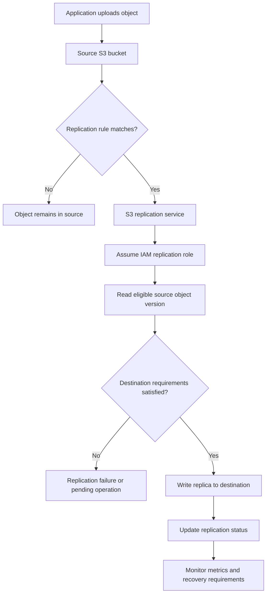

# 01- S3 Replication Fundamentals

## Overview

Amazon S3 Replication automatically copies eligible objects from a source bucket to one or more destination buckets. It supports data protection, regional resilience, cross-account data sharing, compliance requirements, and workload distribution.

Replication operates asynchronously. An object becoming available in the source bucket does not mean its replica is already available in the destination bucket. Applications that depend on replicated data must account for replication delay, failures, destination permissions, and the consistency requirements of their workflows.

Amazon S3 provides two primary replication configurations:

- **Same-Region Replication (SRR):** Copies objects between buckets in the same AWS Region.
- **Cross-Region Replication (CRR):** Copies objects between buckets in different AWS Regions.

Both configurations use replication rules, an IAM role assumed by S3, versioning-enabled buckets, and destination configuration. Advanced options provide replication metrics, replication-time controls, ownership changes, and support for encrypted objects.

This document explains the replication model, its architecture, configuration requirements, object behavior, and production considerations.

## Understand S3 Replication

### What Replication Does

Replication copies eligible object versions from a source bucket into a destination bucket according to configured rules.

Typical uses include:

- Maintaining a copy of application documents in another Region.
- Replicating objects between production and analytics accounts.
- Meeting data residency or regional recovery requirements.
- Separating operational workloads from reporting workloads.
- Maintaining another copy of data for a controlled backup strategy.
- Distributing data to teams or applications that use separate AWS accounts.

Replication does not merge two buckets into a shared filesystem. Each bucket remains an independent S3 resource with its own permissions, lifecycle policies, encryption configuration, and operational controls.

### Same-Region Replication vs Cross-Region Replication

| Characteristic | SRR | CRR |
|---|---|---|
| Source and destination | Same AWS Region | Different AWS Regions |
| Primary use cases | Account separation, log aggregation, data processing, compliance | Regional resilience, geographic distribution, disaster recovery |
| Destination bucket | Must have versioning enabled | Must have versioning enabled |
| IAM replication role | Required | Required |
| Encryption considerations | Destination encryption permissions may be needed | Destination key and Region configuration require particular attention |
| Network and regional separation | No regional separation | Provides a copy in another Region |
| Cost considerations | Storage, requests, applicable transfer and other charges | Storage, requests, inter-Region transfer and other applicable charges |
| Disaster recovery benefit | Useful for separate-account or workload isolation | Useful for regional recovery when paired with a complete recovery strategy |

Choose replication based on the business requirement rather than assuming CRR is always preferable. SRR can be sufficient for account-level separation, while CRR provides an additional regional copy.

Reference: [Replicating objects within and across Regions](https://docs.aws.amazon.com/AmazonS3/latest/userguide/replication.html).

## Understand the Replication Architecture

### Component Responsibilities

| Component | Responsibility |
|---|---|
| Source bucket | Stores the original objects and defines replication rules |
| Replication configuration | Selects eligible objects and identifies destination buckets and options |
| IAM replication role | Grants S3 permission to read eligible source versions and write replicas |
| Amazon S3 replication service | Processes eligible changes asynchronously |
| Destination bucket | Stores replicated object versions |
| AWS KMS | Provides the required cryptographic operations when supported encryption configurations require KMS |
| Amazon CloudWatch | Exposes applicable replication metrics and alarms |
| S3 Batch Operations | Supports managed batch replication for eligible existing objects and other supported batch scenarios |

### Data Flow



The replication service performs copying on behalf of the configured role. The application uploading the object does not ordinarily need to issue a second upload to the destination bucket.

For encrypted objects, the role must have the required permissions for the relevant encryption method. S3 permissions alone do not guarantee that encrypted objects can be replicated.

### Replication Is Asynchronous

The source and destination do not participate in a single atomic transaction. There can be a period when an object exists in the source but is not yet available in the destination.

Design downstream applications accordingly:

- Read newly uploaded data from the source when immediate availability is required.
- Read from the destination only when replication completion is confirmed or the application can tolerate lag.
- Track replication state for workflows that must wait for a replica.
- Provide retries and recovery procedures for failed replication.
- Avoid using a fixed delay as proof that every object has replicated.

S3 Replication Time Control (S3 RTC) provides an additional replication-time commitment for eligible configurations. It is not a replacement for application-level failure handling or destination verification.

## Configure the Required Prerequisites

### Enable Versioning on Both Buckets

S3 Replication requires versioning to be enabled on both the source and destination buckets.

Versioning gives S3 distinct object versions to replicate and helps preserve historical data when objects are overwritten or deleted.

Inspect source versioning:

```bash
aws s3api get-bucket-versioning \
  --bucket "$SOURCE_BUCKET"
```

Inspect destination versioning:

```bash
aws s3api get-bucket-versioning \
  --bucket "$DESTINATION_BUCKET"
```

Expected configuration:

```json
{
  "Status": "Enabled"
}
```

Enable versioning where necessary:

```bash
aws s3api put-bucket-versioning \
  --bucket "$SOURCE_BUCKET" \
  --versioning-configuration Status=Enabled
```

```bash
aws s3api put-bucket-versioning \
  --bucket "$DESTINATION_BUCKET" \
  --versioning-configuration Status=Enabled
```

Do not disable versioning on either bucket while replication depends on it. Disabling versioning on a destination bucket can cause replication to fail. The source bucket's versioning cannot be suspended while its replication configuration remains in place.

Versioning is not itself a backup. A principal with sufficient permissions can still delete versions, and lifecycle policies can remove data unless retention controls prevent it.

### Confirm Regional Availability

For CRR, choose a destination Region that satisfies data residency, regulatory, latency, recovery, and cost requirements.

Ensure that the relevant AWS account owners have enabled the required Regions.

Inspect the bucket locations:

```bash
aws s3api get-bucket-location \
  --bucket "$SOURCE_BUCKET"
```

```bash
aws s3api get-bucket-location \
  --bucket "$DESTINATION_BUCKET"
```

The older `GetBucketLocation` API can report `null` for the `us-east-1` Region. Do not interpret that response as proof that the bucket lacks a Region.

Use the destination Region explicitly in deployment configuration and regional KMS key references where applicable.

Reference: [Replication requirements and considerations](https://docs.aws.amazon.com/AmazonS3/latest/userguide/replication-requirements.html).

## Understand Replication Rules

### Identify Which Objects Should Be Replicated

A replication rule defines which objects qualify for replication and where their replicas should be stored.

Rules can apply to an entire bucket or select objects using supported filters, including prefixes and object tags. Use explicit filters to establish a clear replication boundary.

For example:

| Source object key | Filter | Replicated? |
|---|---|---|
| `uploads/document-001.pdf` | Prefix `uploads/` | Yes |
| `uploads/images/photo.png` | Prefix `uploads/` | Yes |
| `reports/monthly.csv` | Prefix `uploads/` | No |
| `archive/old-document.pdf` | Prefix `uploads/` | No |

Prefixes are part of object keys, not actual directories. A prefix filter selects object keys that start with the configured value.

### Configure a Basic Replication Rule

The following example replicates new objects under `uploads/` from a source bucket to a destination bucket.

`replication.json`:

```json
{
  "Role": "arn:aws:iam::111122223333:role/S3ReplicationRole",
  "Rules": [
    {
      "ID": "ReplicateUploads",
      "Priority": 1,
      "Status": "Enabled",
      "Filter": {
        "Prefix": "uploads/"
      },
      "DeleteMarkerReplication": {
        "Status": "Disabled"
      },
      "Destination": {
        "Bucket": "arn:aws:s3:::destination-bucket"
      }
    }
  ]
}
```

Replace the example account ID, IAM role ARN, and destination bucket ARN with real values.

Apply the configuration to the source bucket:

```bash
aws s3api put-bucket-replication \
  --bucket "$SOURCE_BUCKET" \
  --replication-configuration file://replication.json
```

Inspect the resulting configuration:

```bash
aws s3api get-bucket-replication \
  --bucket "$SOURCE_BUCKET"
```

**Important:** `put-bucket-replication` configures the bucket's replication configuration. When modifying existing rules, retrieve and preserve the intended existing rules rather than accidentally replacing them with a partial configuration.

This example does not create buckets, enable versioning, create the IAM role, or grant permissions. Those prerequisites must be completed independently.

### Understand Rule Priority and Multiple Destinations

A source bucket can have multiple replication rules. Rules should be designed so that their filters, priorities, and destinations are understandable and maintainable.

Before deploying overlapping rules:

- Confirm which objects each rule selects.
- Review rule priorities and any applicable rule-selection requirements.
- Verify that every destination has the required access configuration.
- Document whether objects should be copied to more than one destination.
- Validate the resulting behavior with representative test objects.

Multiple destinations can support different business requirements, such as regional recovery and centralized analytics. They also introduce additional request, storage, transfer, monitoring, and operational costs.

Reference: [Replication configuration elements](https://docs.aws.amazon.com/AmazonS3/latest/userguide/replication-add-config.html).

## Configure IAM Permissions for Replication

### Understand the Role Assumed by S3

The replication configuration specifies an IAM role that Amazon S3 assumes to replicate objects.

There are two distinct permission boundaries:

1. The deployment principal must be authorized to configure replication and create or update the related IAM resources.
2. The replication role must be authorized to read the eligible source versions and write the destination replicas.

In cross-account replication, destination bucket policies must also permit the necessary replication operations from the source account's replication role.

### Scope the Replication Policy to Required Resources

A typical replication role needs permissions corresponding to these actions:

| Resource scope | Example actions | Purpose |
|---|---|---|
| Source bucket | `s3:GetReplicationConfiguration`, `s3:ListBucket` | Read the source replication configuration and list eligible objects where required |
| Source objects | `s3:GetObjectVersionForReplication` | Read object versions for replication |
| Source objects | `s3:GetObjectVersionAcl`, `s3:GetObjectVersionTagging` | Read ACL or tag data where required by the configuration |
| Destination objects | `s3:ReplicateObject`, `s3:ReplicateDelete`, `s3:ReplicateTags` | Create replicas and replicate the supported delete and tag operations |

The actual required actions depend on the configuration, ownership mode, source object settings, and enabled capabilities. Use the [official replication permissions guidance](https://docs.aws.amazon.com/AmazonS3/latest/userguide/setting-repl-config-perm-overview.html) when constructing the production policy.

Avoid broad administrative policies such as `s3:*` on all resources. Grant only the necessary actions against the intended source and destination resources.

### Configure the Trust Policy

The role's trust relationship must allow the Amazon S3 service to assume it.

Illustrative trust policy:

```json
{
  "Version": "2012-10-17",
  "Statement": [
    {
      "Effect": "Allow",
      "Principal": {
        "Service": "s3.amazonaws.com"
      },
      "Action": "sts:AssumeRole"
    }
  ]
}
```

This example illustrates the service principal. Apply the appropriate trust restrictions and validate the role against the production account and security requirements.

### Validate Cross-Account Permissions

When the source and destination buckets belong to different accounts, both sides must be configured correctly.

- The source account owns and configures the replication role.
- The destination account authorizes the replication role through the destination bucket policy.
- The replication role receives the necessary source and destination permissions.
- KMS policies must authorize the relevant cryptographic operations when customer managed keys are used.

A bucket policy allowing the replication role to write objects does not automatically grant access to a destination KMS key.

Reference: [Setting up permissions for live replication](https://docs.aws.amazon.com/AmazonS3/latest/userguide/setting-repl-config-perm-overview.html).

## Understand What S3 Replicates

### Live Replication Applies to Eligible New Objects

After a replication configuration is established, live replication applies to eligible objects created after the configuration becomes effective.

Do not assume that adding a rule automatically copies all historical objects.

Existing objects that predate the configuration require an appropriate backfill strategy, such as S3 Batch Replication for supported scenarios.

Replication also depends on the object's eligibility, the replication rule's filters, available permissions, and any relevant encryption configuration.

### Object Metadata and Tags

Replication can copy supported object metadata and tags associated with the source object version.

Consider the downstream requirements for:
- Content type and content encoding.
- User-defined metadata.
- Object tags.
- Object ownership and access controls.
- Storage class.
- Encryption.
- Object Lock retention and legal holds, where applicable.

If a downstream service relies on tags or metadata for authorization, processing, or lifecycle transitions, verify that the values on the destination match the expected behavior.

Do not treat metadata replication as a substitute for an application-level data validation process.

### Existing Objects and Batch Replication

S3 Batch Replication supports replication of eligible existing objects and supported scenarios involving objects that were not replicated successfully or need replication on demand.

A typical backfill workflow is:

1. Identify the required source object population.
2. Confirm the destination configuration and permissions.
3. Generate or select an appropriate object manifest.
4. Create the S3 Batch Operations replication job.
5. Monitor the job and review its completion report.
6. Validate destination object availability and application access.

Batch replication is a separate managed operation. It does not mean that live replication automatically includes all objects that existed before the rule was configured.

References:

- [What does Amazon S3 replicate?](https://docs.aws.amazon.com/AmazonS3/latest/userguide/replication-what-is-isnot-replicated.html)
- [S3 Batch Replication](https://docs.aws.amazon.com/AmazonS3/latest/userguide/s3-batch-replication-batch.html)

## Understand Deletion and Versioning Behavior

### Delete Markers Are Not Replicated by Default

In a versioning-enabled source bucket, deleting an object without specifying its version ID normally creates a delete marker.

By default, S3 does not replicate delete markers to the destination. This helps protect destination data from accidental or malicious deletion through ordinary source delete operations.

If delete-marker replication is enabled for a supported rule, the marker can also be copied to the destination. The destination can then behave as though the object was deleted there as well.

Consider the following implications:

| Operation | Typical replication implication |
|---|---|
| Upload a new eligible object version | Eligible for live replication |
| Overwrite an object | Creates a new source version that can be replicated |
| Delete an object without a version ID | Creates a source delete marker; marker replication is disabled by default |
| Delete a specific source version permanently | Does not replicate the permanent deletion to remove the corresponding destination version |
| Lifecycle expiration creates a delete marker | The marker created by lifecycle expiration is not replicated, even if delete-marker replication is enabled |

Delete-marker replication is not supported for tag-based replication rules. Validate the deletion behavior with the actual replication configuration before using it as part of a data-protection strategy.

Reference: [Replicating delete markers between buckets](https://docs.aws.amazon.com/AmazonS3/latest/userguide/delete-marker-replication.html).

### Avoid Accidental Destruction of Replicas

Replication is not a guarantee that destination data will survive every source-side or destination-side administrative action.

Protect destination buckets using:
- Separate IAM roles and access boundaries.
- Bucket policies that restrict destructive operations.
- Appropriate versioning and lifecycle policies.
- S3 Object Lock when immutable retention is required.
- Cross-account separation where justified.
- Tested recovery procedures.

If delete-marker replication is enabled, an ordinary source delete can hide the replicated object in the destination as well. If the goal is independent recovery, consider whether delete-marker replication is appropriate.

A destination bucket should not be assumed to be immutable simply because it receives replicated objects.

## Replicate Encrypted Objects Correctly

### Understand Encryption Dependencies

S3 Replication can support objects encrypted using SSE-S3, SSE-KMS, DSSE-KMS, and SSE-C, subject to the applicable replication configuration and feature requirements.

For SSE-KMS or DSSE-KMS objects, the replication role requires the relevant source and destination KMS permissions. By default, the handling of KMS-encrypted objects must be explicitly considered in the replication setup.

Before replicating KMS-encrypted objects:

- Enable the relevant encrypted-object replication setting in the rule where required.
- Grant permission to decrypt or otherwise process the source encryption configuration.
- Configure the destination KMS key when destination encryption requires it.
- Ensure the destination key is in the appropriate Region.
- Update IAM and key policies to allow the necessary operations.
- Validate replica encryption and actual decryption by intended readers.

Do not infer successful encrypted replication solely from the presence of a destination object. Confirm that the destination's intended consumers can access and decrypt the object.

Reference: [Replicating encrypted objects](https://docs.aws.amazon.com/AmazonS3/latest/userguide/replication-config-for-kms-objects.html).

### Consider Replica Ownership

By default, the replica's ownership behavior follows the configured replication and ownership settings. In cross-account environments, the source object owner and destination bucket owner can differ.

If the destination account must own replicas, configure the supported destination ownership override and the required permissions.

Validate the ownership arrangement for:
- Direct destination access.
- Cross-account readers.
- Destination bucket policies.
- Encryption and KMS policies.
- Audit and recovery roles.

Object ownership, S3 permissions, and encryption permissions are separate authorization concerns.

## Monitor Replication Health

### Inspect Replication Status

S3 exposes replication status for eligible object versions.

For source objects, the key states include:

| Status | Meaning |
|---|---|
| `PENDING` | Replication is still in progress |
| `COMPLETED` | Replication completed for the applicable destination or destinations |
| `FAILED` | Replication failed |
| `REPLICA` | The object is a replica in a destination bucket |

Inspect an object:

```bash
aws s3api head-object \
  --bucket "$SOURCE_BUCKET" \
  --key "$OBJECT_KEY" \
  --query 'ReplicationStatus'
```

The result depends on the object's state and the permissions available to the caller. Do not interpret a missing replication-status field for an arbitrary object as proof that replication completed successfully.

For destination-side verification, inspect the object directly in the destination bucket and validate its metadata, version, encryption, and application-level accessibility.

### Enable Replication Metrics

Replication metrics can help identify growing backlogs, failed operations, and excessive replication delay.

Monitor applicable metrics such as:
- Operations pending replication.
- Bytes pending replication.
- Replication latency.
- Operations that failed replication.

S3 Replication Time Control enables replication metrics automatically for supported configurations. Metrics can also be enabled separately without S3 RTC.

Configure CloudWatch alarms according to business requirements. A large or increasing backlog is particularly relevant when downstream workloads or recovery objectives depend on timely replica availability.

References:

- [Using S3 Replication metrics](https://docs.aws.amazon.com/AmazonS3/latest/userguide/repl-metrics.html)
- [Meeting compliance requirements with S3 Replication Time Control](https://docs.aws.amazon.com/AmazonS3/latest/userguide/replication-time-control.html)

## Understand S3 Replication Time Control

### What S3 RTC Provides

S3 Replication Time Control is an optional feature designed for workloads requiring more predictable replication timing. It replicates 99.99% of new objects stored in S3 within 15 minutes, backed by a service-level agreement with defined terms and exclusions.

S3 RTC also supports replication metrics and event notifications for objects that exceed or subsequently pass the configured 15-minute threshold.

Consider it when:
- A documented compliance requirement specifies replication timing.
- Business continuity depends on a measurable replication objective.
- Operational teams need visibility into replication delays.
- The cost of delayed replication is significant enough to justify the feature.

S3 RTC does not make replication synchronous and does not guarantee that every individual object is always replicated within 15 minutes.

### Do Not Confuse Replication Time with Recovery Time

Replication timing measures how quickly changes are copied. It does not measure the total time required to restore an application after a regional failure.

A realistic recovery plan must also account for:
- Application deployment in the recovery Region.
- Network, DNS, and service configuration.
- IAM and KMS permissions.
- Database replication and recovery.
- Validation of replicated objects.
- Traffic cutover and rollback.
- Recovery Point Objective (RPO) and Recovery Time Objective (RTO).

Replication can reduce data-loss exposure, but a complete disaster recovery strategy must address the entire application.

## Common Replication Failure Scenarios

| Symptom | Likely causes | Diagnostic focus |
|---|---|---|
| New objects do not replicate | Disabled or incorrect rule, filter mismatch, missing role permissions | Inspect replication configuration and source object key |
| Existing objects are absent | Objects existed before live replication was configured | Plan an appropriate Batch Replication job |
| Replication status is `FAILED` | Missing permissions, destination configuration error, suspended destination versioning | Review source status, policies, and bucket configuration |
| KMS-encrypted objects fail | Missing KMS permissions or invalid encryption configuration | Inspect the source and destination key policies and replication role |
| Destination objects cannot be read | Destination policy, ownership, or KMS authorization problem | Test access with the actual destination consumer role |
| Replication is delayed | Large objects, high workload volume, destination constraints, or operational backlog | Inspect pending bytes, pending operations, and latency metrics |
| Objects disappear from destination listings after source deletion | Delete-marker replication is enabled or another destination-side process changed visibility | Inspect version history and delete markers |
| Cross-account replication fails | Destination bucket policy or ownership settings are incorrect | Validate both accounts' policies and the replication role |
| Replication configuration cannot be applied | Missing deployment permissions or invalid configuration | Inspect the AWS API error and validate the configuration document |

For an unexplained failure, follow a repeatable diagnostic sequence:

1. Inspect the rule and confirm it is enabled.
2. Verify source and destination versioning.
3. Check the source object key against the rule filters.
4. Review the replication status and relevant S3 or CloudWatch evidence.
5. Verify the replication role's trust relationship and permissions.
6. Inspect destination bucket and KMS authorization.
7. Correct the identified cause and test with a new eligible object.
8. Use supported recovery or Batch Replication procedures when previously eligible objects require backfill.

Reference: [Troubleshooting S3 Replication](https://docs.aws.amazon.com/AmazonS3/latest/userguide/replication-troubleshoot.html).

## Production Best Practices

### Separate the Replication Control Plane from Application Code

Manage replication rules, IAM roles, bucket policies, versioning, and encryption through infrastructure as code wherever practical.

Application code should not need broad administrative permissions to configure the bucket replication infrastructure.

Use separate deployment and runtime roles so that application workers cannot alter replication rules or disable critical controls.

### Treat Replication as a Managed Asynchronous Workflow

Replication is an AWS-managed feature, but the application and operations teams remain responsible for defining success criteria and responding to failures.

For workflows that require confirmed replication:
- Record the source object key and version identifier.
- Track the required destination or destinations.
- Poll or consume relevant status events when appropriate.
- Apply bounded retries and operational timeouts.
- Distinguish temporary delay from terminal failure.
- Make downstream processing idempotent.
- Verify destination access before declaring a recovery operation successful.

Avoid making a single fixed delay the only mechanism for determining replica readiness.

### Separate Replication from Backup and Disaster Recovery

Replication can propagate data into another bucket, but it does not automatically provide a complete independent backup.

Consider the following risks:
- Accidental deletion or overwrite.
- Malicious changes by privileged principals.
- Shared administrative credentials.
- Incorrect destination lifecycle policies.
- KMS key unavailability or deletion.
- Regional or account-level configuration dependencies.

Use appropriate account separation, retention protections, versioning, Object Lock where required, and tested recovery procedures.

### Control Cost and Data Growth

Replication creates destination storage and incurs applicable request and transfer charges.

Estimate the impact of:
- Number and size of objects.
- Number of destination buckets.
- Cross-Region data transfer.
- Destination storage classes.
- KMS operations.
- Replication metrics and event notifications.
- Retention of old object versions.
- Lifecycle transitions and expirations.

Review destination lifecycle rules carefully. They apply independently from the source bucket's lifecycle configuration, and replication arrival time can interact with object-age-based transitions and expiration.

### Test Recovery, Not Just Configuration

A replication configuration that exists is not proof that the recovery process works.

Periodically test:
- Object availability and expected versions in the destination.
- Decryption and authorized access.
- Recovery of representative application workflows.
- Regional or account isolation assumptions.
- Detection and recovery of failed replication.
- Data restoration and cleanup procedures.
- RPO and RTO measurements against business targets.

Document which capabilities were actually exercised. Do not claim regional failover is proven when only object replication was tested.

## Production Readiness Checklist

- [ ] The replication use case and business requirements are documented.
- [ ] Source and destination buckets have versioning enabled.
- [ ] Source and destination Regions satisfy account and residency requirements.
- [ ] Replication rules select the intended object population.
- [ ] The replication role uses least-privilege permissions.
- [ ] Cross-account destination policies and ownership settings are validated.
- [ ] Encryption and KMS permissions are configured for relevant objects.
- [ ] Existing objects have an explicit backfill plan where required.
- [ ] Delete-marker behavior matches the data-protection strategy.
- [ ] Replication status and applicable metrics are monitored.
- [ ] Replication Time Control is enabled when justified by timing requirements.
- [ ] Destination lifecycle and retention policies are independently reviewed.
- [ ] Application workflows handle replication delay and failure.
- [ ] Recovery tests verify actual destination access and decryption.
- [ ] Replication cost and destination storage growth are monitored.

## Authoritative References

- [Amazon S3 Replication overview](https://docs.aws.amazon.com/AmazonS3/latest/userguide/replication.html)
- [Replication requirements and considerations](https://docs.aws.amazon.com/AmazonS3/latest/userguide/replication-requirements.html)
- [Setting up live replication](https://docs.aws.amazon.com/AmazonS3/latest/userguide/replication-how-setup.html)
- [Replication configuration elements](https://docs.aws.amazon.com/AmazonS3/latest/userguide/replication-add-config.html)
- [Replication permissions](https://docs.aws.amazon.com/AmazonS3/latest/userguide/setting-repl-config-perm-overview.html)
- [What does S3 replicate?](https://docs.aws.amazon.com/AmazonS3/latest/userguide/replication-what-is-isnot-replicated.html)
- [S3 Batch Replication](https://docs.aws.amazon.com/AmazonS3/latest/userguide/s3-batch-replication-batch.html)
- [Replicating encrypted objects](https://docs.aws.amazon.com/AmazonS3/latest/userguide/replication-config-for-kms-objects.html)
- [Replicating delete markers](https://docs.aws.amazon.com/AmazonS3/latest/userguide/delete-marker-replication.html)
- [S3 Replication metrics](https://docs.aws.amazon.com/AmazonS3/latest/userguide/repl-metrics.html)
- [S3 Replication Time Control](https://docs.aws.amazon.com/AmazonS3/latest/userguide/replication-time-control.html)
- [Troubleshooting S3 Replication](https://docs.aws.amazon.com/AmazonS3/latest/userguide/replication-troubleshoot.html)

## Key Takeaways

- S3 Replication asynchronously copies eligible object versions, and both source and destination buckets must have versioning enabled.
- Live replication applies to eligible objects created after the configuration becomes effective; use an appropriate batch workflow to backfill existing objects.
- Cross-account access, encrypted objects, destination ownership, and delete-marker behavior require explicit configuration and testing.
- Monitor replication status, pending operations, latency, and failures; use S3 Replication Time Control when predictable replication timing is a business requirement.
- Treat replication as one component of data protection and disaster recovery, and validate recovery by testing actual destination access, decryption, and application readiness.
You've reached the maximum length for this conversation, but you can keep talking by starting a new chat.
Start new chat