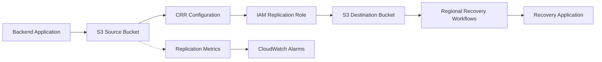
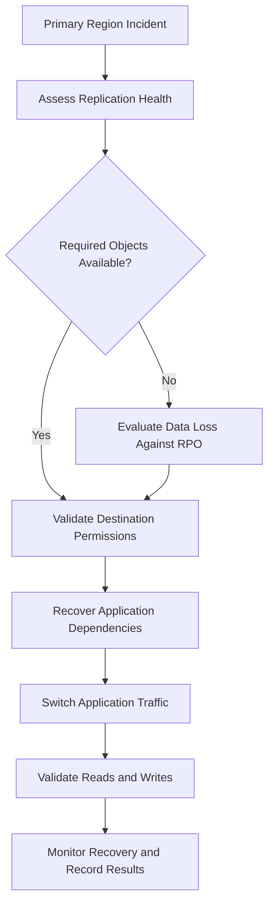

# 02- Cross-Region Replication (CRR)

## Overview

Amazon S3 Cross-Region Replication (CRR) automatically copies eligible objects from a source bucket in one AWS Region to a destination bucket in another AWS Region. It is part of S3 Replication and operates asynchronously after an eligible object is created or modified.

CRR is useful when an application requires geographic separation of data, regional disaster recovery, cross-account data sharing, or lower-latency access for users in different geographic areas.

CRR does not automatically make an application multi-Region, provide synchronous writes, or guarantee that every destination object is immediately available after a source write. Applications must account for replication delay, failures, permissions, encryption, and recovery procedures.

Common use cases include:

- Maintaining a copy of critical application documents in a second Region.
- Meeting geographic data-storage or compliance requirements.
- Supporting regional recovery strategies.
- Sharing datasets with a separate AWS account.
- Distributing frequently accessed content closer to users.
- Maintaining copies for regional analytics or downstream processing.

Reference: [Replicating objects within and across Regions](https://docs.aws.amazon.com/AmazonS3/latest/userguide/replication.html).

## Understand the CRR Architecture

### Core components

| Component | Responsibility |
|---|---|
| Source bucket | Stores original objects and initiates replication according to the configured rules |
| Destination bucket | Receives the replicated object versions |
| Replication configuration | Defines eligible objects, destinations, and replication behavior |
| IAM replication role | Grants Amazon S3 permission to read eligible source objects and create replicas |
| AWS KMS keys | Provide the required cryptographic operations when replicating KMS-encrypted objects |
| Replication metrics | Help identify pending, failed, and delayed replication |
| S3 Batch Replication | Replicates eligible existing objects or retries selected historical replication work |

### Reference architecture



The source bucket remains the primary write location in a typical one-way CRR configuration. Amazon S3 asynchronously creates eligible replicas in the destination bucket.

The destination bucket does not automatically become the active bucket for application writes during a regional outage. Application failover, endpoint changes, database recovery, authorization, and consistency decisions are separate responsibilities.

### What CRR does and does not provide

| Capability | CRR behavior |
|---|---|
| Cross-Region object copies | Supported |
| Automatic replication of eligible new objects | Supported |
| Automatic replication of all historical objects | Not by default; use S3 Batch Replication |
| Synchronous cross-Region writes | Not supported |
| Immediate destination consistency after every source write | Not guaranteed |
| Replication of eligible object metadata and tags | Supported |
| Automatic replication of every bucket-level configuration | Not supported |
| Automatic bidirectional synchronization | Not provided by a single one-way rule |
| Regional application failover | Requires additional architecture and operational procedures |
| Detection of every replication failure without configuration | Not guaranteed; enable and monitor appropriate metrics |

## Choose CRR for the Right Requirements

### Disaster recovery

Use CRR when a second Region must contain a copy of important objects and the primary Region may become unavailable.

Examples include:
- User-uploaded documents.
- Original media and generated assets.
- Application exports.
- Historical reports.
- Selected backup objects.

Define recovery point objectives (RPOs) and recovery time objectives (RTOs) before implementing replication.

- **RPO:** The amount of recent data the business can afford to lose during recovery.
- **RTO:** The maximum acceptable time to restore the required service.

CRR reduces the amount of data that might need to be recovered from the source Region, but its asynchronous nature means that recently written objects may not yet exist at the destination.

Measure actual replication delay and test regional recovery rather than assuming replication automatically satisfies an RPO.

### Compliance and geographic separation

CRR can maintain object copies in a designated Region to support geographic separation requirements.

Before adopting it, verify:
- Approved source and destination Regions.
- Applicable data residency requirements.
- Whether the destination must belong to a different AWS account.
- Required retention and immutability controls.
- Encryption and key-management requirements.
- Audit and evidence requirements.

Replication is not, by itself, proof of compliance. A destination copy may be inaccessible, encrypted with an unavailable key, or subject to incorrect retention settings.

### Lower-latency access

CRR can place copies in multiple Regions, but the application must determine which copy to read. A single replication rule does not automatically route clients to the closest destination.

Depending on the requirements, consider CloudFront, application-level regional routing, or S3 Multi-Region Access Points alongside replication.

Reference: [S3 Multi-Region Access Points](https://docs.aws.amazon.com/AmazonS3/latest/userguide/MultiRegionAccessPoints.html).

## Establish CRR Prerequisites

### Enable versioning on both buckets

Both the source and destination general purpose buckets must have S3 Versioning enabled.

Versioning allows S3 to identify and replicate object versions rather than treating each key as an unversioned mutable object.

Enable versioning on the source:

```bash
aws s3api put-bucket-versioning \
  --bucket "$SOURCE_BUCKET" \
  --versioning-configuration Status=Enabled \
  --region "$SOURCE_REGION"
```

Enable versioning on the destination:

```bash
aws s3api put-bucket-versioning \
  --bucket "$DESTINATION_BUCKET" \
  --versioning-configuration Status=Enabled \
  --region "$DESTINATION_REGION"
```

Verify both configurations:

```bash
aws s3api get-bucket-versioning \
  --bucket "$SOURCE_BUCKET" \
  --region "$SOURCE_REGION"

aws s3api get-bucket-versioning \
  --bucket "$DESTINATION_BUCKET" \
  --region "$DESTINATION_REGION"
```

After replication is configured, do not suspend versioning on either bucket. Suspending destination versioning causes replication failures, and disabling source versioning while a replication configuration exists is not permitted.

### Select the destination Region and account

Choose the destination according to recovery requirements, compliance, supported features, and transfer costs.

For cross-account replication, the destination account must authorize the source account's replication role to write the required replicas.

For a new destination bucket in `ap-southeast-1`, for example:

```bash
aws s3api create-bucket \
  --bucket "$DESTINATION_BUCKET" \
  --region "$DESTINATION_REGION" \
  --create-bucket-configuration \
    LocationConstraint="$DESTINATION_REGION"
```

Bucket names must be globally unique within the applicable S3 namespace. Confirm that the source and destination Region values match the intended architecture.

For some Regions, especially `us-east-1`, bucket creation uses different CLI parameters. Consult the [AWS CLI create-bucket reference](https://docs.aws.amazon.com/cli/latest/reference/s3api/create-bucket.html).

### Apply secure bucket defaults

Recommended baseline controls include:
- Block Public Access enabled unless an explicitly reviewed requirement says otherwise.
- S3 Object Ownership set to Bucket owner enforced where appropriate.
- Default encryption configured for the intended data classification.
- Least-privilege access policies.
- Separate source and destination lifecycle policies.
- Appropriate audit and monitoring coverage.

CRR copies object data and supported object metadata. It does not automatically duplicate the complete source bucket configuration, including its lifecycle rules, bucket policies, event notification settings, or replication configuration.

Configure destination resources independently.

## Configure the IAM Replication Role

### Understand the permission model

Amazon S3 assumes an IAM role to perform replication on behalf of the source bucket.

The role requires permission to inspect source replication configuration and read eligible object versions. It also requires permission to create replicas in the destination bucket.

For a cross-account design, the destination bucket's resource policy must allow the replication role to write the replicas.

The effective permissions must satisfy the applicable IAM policies, bucket policies, KMS key policies, and other authorization controls.

### Configure the role trust policy

The following trust policy allows the Amazon S3 service principal to assume the replication role.

`trust-policy.json`:

```json
{
  "Version": "2012-10-17",
  "Statement": [
    {
      "Effect": "Allow",
      "Principal": {
        "Service": "s3.amazonaws.com"
      },
      "Action": "sts:AssumeRole"
    }
  ]
}
```

Create the role:

```bash
aws iam create-role \
  --role-name S3CRRReplicationRole \
  --assume-role-policy-document file://trust-policy.json
```

In a production deployment, apply any additional supported trust-policy restrictions required by your security model and validate the service's role-assumption requirements.

### Grant source and destination permissions

The following example illustrates a least-privilege policy for replicating eligible object versions and their relevant metadata. Replace the account, bucket, and role values with the actual resource identifiers.

`replication-policy.json`:

```json
{
  "Version": "2012-10-17",
  "Statement": [
    {
      "Sid": "ReadSourceReplicationConfiguration",
      "Effect": "Allow",
      "Action": [
        "s3:GetReplicationConfiguration",
        "s3:ListBucket"
      ],
      "Resource": "arn:aws:s3:::SOURCE_BUCKET_NAME"
    },
    {
      "Sid": "ReadSourceObjectVersions",
      "Effect": "Allow",
      "Action": [
        "s3:GetObjectVersionForReplication",
        "s3:GetObjectVersionAcl",
        "s3:GetObjectVersionTagging"
      ],
      "Resource": "arn:aws:s3:::SOURCE_BUCKET_NAME/*"
    },
    {
      "Sid": "WriteDestinationReplicas",
      "Effect": "Allow",
      "Action": [
        "s3:ReplicateObject",
        "s3:ReplicateDelete",
        "s3:ReplicateTags"
      ],
      "Resource": "arn:aws:s3:::DESTINATION_BUCKET_NAME/*"
    }
  ]
}
```

Attach the policy:

```bash
aws iam put-role-policy \
  --role-name S3CRRReplicationRole \
  --policy-name S3CRRReplicationPolicy \
  --policy-document file://replication-policy.json
```

These permissions are a baseline, not a universal policy for every replication configuration. Object Lock, KMS encryption, replica ownership changes, annotations, and additional features can require further permissions.

Keep source and destination resource scopes as narrow as the replication design allows.

### Authorize cross-account replication

When the destination bucket belongs to a different account, its bucket policy must authorize the source replication role.

A simplified example:

```json
{
  "Version": "2012-10-17",
  "Statement": [
    {
      "Sid": "AllowSourceReplicationRole",
      "Effect": "Allow",
      "Principal": {
        "AWS": "arn:aws:iam::111122223333:role/S3CRRReplicationRole"
      },
      "Action": [
        "s3:ReplicateObject",
        "s3:ReplicateDelete",
        "s3:ReplicateTags"
      ],
      "Resource": "arn:aws:s3:::DESTINATION_BUCKET_NAME/*"
    }
  ]
}
```

This policy must be adapted to the actual destination ownership model and required actions. The source role also needs its identity-based permissions.

For cross-account replication, the destination bucket cannot be configured as a Requester Pays bucket. Ensure the source and destination Region and account configurations meet S3 replication requirements.

## Configure a Basic CRR Rule

### Define the replication configuration

The following example replicates objects under the `documents/` prefix to a destination bucket in another Region.

`replication.json`:

```json
{
  "Role": "arn:aws:iam::111122223333:role/S3CRRReplicationRole",
  "Rules": [
    {
      "ID": "ReplicateDocumentsToRecoveryRegion",
      "Status": "Enabled",
      "Priority": 1,
      "Filter": {
        "Prefix": "documents/"
      },
      "DeleteMarkerReplication": {
        "Status": "Disabled"
      },
      "Destination": {
        "Bucket": "arn:aws:s3:::DESTINATION_BUCKET_NAME"
      }
    }
  ]
}
```

The configuration intentionally disables delete-marker replication. This helps preserve destination copies when a source object is deleted through a normal delete operation.

The `Filter` restricts replication to objects with keys beginning with `documents/`. Use an empty prefix or another appropriate filter when the entire bucket should be replicated.

### Apply the configuration

The deployment identity needs permission to configure source bucket replication and pass the replication role to Amazon S3.

```bash
aws s3api put-bucket-replication \
  --bucket "$SOURCE_BUCKET" \
  --replication-configuration file://replication.json \
  --region "$SOURCE_REGION"
```

Inspect the resulting configuration:

```bash
aws s3api get-bucket-replication \
  --bucket "$SOURCE_BUCKET" \
  --region "$SOURCE_REGION"
```

**Important:** `put-bucket-replication` replaces the existing replication configuration. When updating an existing bucket, inspect its current rules and merge the intended change instead of unintentionally removing other rules.

### Verify the initial setup

Upload a test object:

```bash
printf 'CRR verification\n' > crr-test.txt

aws s3api put-object \
  --bucket "$SOURCE_BUCKET" \
  --key "documents/crr-test.txt" \
  --body crr-test.txt \
  --region "$SOURCE_REGION"
```

Check replication status on the source:

```bash
aws s3api head-object \
  --bucket "$SOURCE_BUCKET" \
  --key "documents/crr-test.txt" \
  --region "$SOURCE_REGION" \
  --query ReplicationStatus
```

The value may be `PENDING`, `COMPLETED`, or `FAILED` for a source object when a replication status is available. A destination replica can report `REPLICA`.

Because replication is asynchronous, the destination object may not appear immediately. Retry verification with bounded backoff rather than assuming the first unsuccessful lookup indicates permanent failure.

Once the object has replicated, inspect the destination:

```bash
aws s3api head-object \
  --bucket "$DESTINATION_BUCKET" \
  --key "documents/crr-test.txt" \
  --region "$DESTINATION_REGION"
```

A successful source upload alone does not prove that replication is functioning. Verify the actual destination copy and its encryption, ownership, and metadata properties.

## Replicate KMS-Encrypted Objects

### Understand the additional requirements

By default, S3 does not replicate objects encrypted with SSE-KMS or DSSE-KMS. KMS-encrypted object replication must be explicitly enabled in the replication configuration.

For such workloads, verify:
- Source KMS permissions for decryption.
- Destination KMS permissions for encryption.
- The validity and availability of the required KMS keys.
- The destination key's Region.
- Relevant KMS key policies and cross-account permissions.
- KMS request-rate quotas for high-throughput replication.

The destination KMS key must be valid and in the same Region as the destination bucket. A replication configuration can be accepted even when a configured key is invalid, so a successful configuration API response is not proof that encrypted replication works.

### Extend the replication configuration

For a workload using SSE-KMS, add the source-selection criteria and destination encryption configuration to the appropriate rule.

```json
{
  "Role": "arn:aws:iam::111122223333:role/S3CRRReplicationRole",
  "Rules": [
    {
      "ID": "ReplicateEncryptedDocuments",
      "Status": "Enabled",
      "Priority": 1,
      "Filter": {
        "Prefix": "documents/"
      },
      "DeleteMarkerReplication": {
        "Status": "Disabled"
      },
      "SourceSelectionCriteria": {
        "SseKmsEncryptedObjects": {
          "Status": "Enabled"
        }
      },
      "Destination": {
        "Bucket": "arn:aws:s3:::DESTINATION_BUCKET_NAME",
        "EncryptionConfiguration": {
          "ReplicaKmsKeyID": "arn:aws:kms:DESTINATION_REGION:444455556666:key/DESTINATION_KEY_ID"
        }
      }
    }
  ]
}
```

This example illustrates the KMS-specific rule fields. It does not replace the required IAM permissions, KMS key policies, source and destination bucket configurations, or the rest of the deployment.

The replication role needs the relevant source-key `kms:Decrypt` and destination-key `kms:Encrypt` permissions. When replicating plaintext objects to a destination bucket that uses SSE-KMS by default, the role may also require `kms:GenerateDataKey` for destination encryption.

For cross-account SSE-KMS replication, use a suitable customer managed key in the destination account. AWS managed KMS keys cannot be used for cross-account access in this scenario.

Reference: [Replicating objects encrypted with KMS keys](https://docs.aws.amazon.com/AmazonS3/latest/userguide/replication-config-for-kms-objects.html).

### Monitor KMS throttling

Heavy replication workloads involving KMS-encrypted objects can encounter KMS request throttling.

Recommended controls:
- Estimate source and destination KMS request demand.
- Monitor KMS request metrics and throttling errors.
- Validate quotas in the relevant Regions.
- Request quota increases where needed.
- Test large transfers before production cutover.

Distinguish KMS authorization failures from KMS throttling. Expanding permissions does not resolve a request-rate quota problem.

## Handle Existing Objects with S3 Batch Replication

### Understand the difference between live and batch replication

Live CRR does not automatically replicate all objects that existed before the rule was configured.

S3 Batch Replication can replicate eligible existing objects and can be used for selected replication recovery workflows.

Use Batch Replication when:
- Enabling CRR for a bucket that already contains data.
- Changing replication destinations and needing historical copies.
- Replicating eligible objects that were not replicated previously.
- Performing an approved backfill for a new disaster recovery Region.

### Use a controlled backfill process

A production backfill should:

1. Inventory the objects and versions that need replication.
2. Confirm source and destination permissions, versioning, encryption, and retention settings.
3. Estimate object count, data volume, request costs, and transfer costs.
4. Create an S3 Batch Replication job using an appropriate manifest.
5. Monitor job progress and failed-object reports.
6. Retry eligible failures after correcting the root cause.
7. Verify destination availability and object metadata.
8. Record the results and update the recovery runbook.

Batch Replication is not an unconditional repair mechanism. Some historical object states and deleted destination versions require different recovery actions, such as copying an eligible source version to create a new source version.

Reference: [Replicating existing objects with Batch Replication](https://docs.aws.amazon.com/AmazonS3/latest/userguide/s3-batch-replication-batch.html).

## Understand Deletion and Versioning Behavior

### Delete markers are not the same as version deletion

In a versioned bucket, a normal delete request without a version ID typically creates a delete marker. This makes the key appear deleted to normal reads, while previous versions remain stored.

By default, delete-marker replication in modern replication configurations is disabled. It can be enabled for eligible rules that are not tag-based.

When delete-marker replication is disabled:
- A normal delete at the source does not automatically hide the destination object.
- Previously replicated destination versions can remain available.
- The destination can preserve data against accidental or malicious source deletions.

When delete-marker replication is enabled, the destination can reflect normal source delete-marker behavior. However, replication does not automatically propagate permanent deletion of an explicitly selected source version ID to the destination.

Lifecycle-created delete markers also have different behavior from user-created delete markers and are not replicated through the delete-marker replication feature.

### Choose deletion behavior deliberately

For disaster recovery and backup-like protection, retaining destination copies when objects are deleted at the source may be desirable.

For synchronization requirements, delete-marker replication may be appropriate when the destination should reflect source deletions from the current object view.

Do not assume CRR by itself guarantees an immutable backup. If an attacker or operator can alter source data, replicated deletion behavior and destination permissions determine the impact. Consider S3 Object Lock, restricted destination access, and independent retention controls when data protection requires them.

Reference: [Replicating delete markers between buckets](https://docs.aws.amazon.com/AmazonS3/latest/userguide/delete-marker-replication.html).

## Enable Replication Time Control When Required

### Understand the latency objective

S3 Replication Time Control (S3 RTC) is designed for workloads that need more predictable replication timing. It provides an SLA for replicating 99.99% of new objects within 15 minutes when the feature is enabled and the workload is within its applicable service constraints.

S3 RTC also enables replication metrics for the associated rule.

Use it when a documented requirement calls for a measurable replication-latency objective. Do not treat the SLA as a guarantee that every object is available at the destination within 15 minutes.

### Configure S3 RTC

A replication rule can include a 15-minute replication time threshold and associated metrics:

```json
{
  "Role": "arn:aws:iam::111122223333:role/S3CRRReplicationRole",
  "Rules": [
    {
      "ID": "CRRWithReplicationTimeControl",
      "Status": "Enabled",
      "Priority": 1,
      "Filter": {
        "Prefix": "documents/"
      },
      "DeleteMarkerReplication": {
        "Status": "Disabled"
      },
      "Destination": {
        "Bucket": "arn:aws:s3:::DESTINATION_BUCKET_NAME",
        "ReplicationTime": {
          "Status": "Enabled",
          "Time": {
            "Minutes": 15
          }
        },
        "Metrics": {
          "Status": "Enabled",
          "EventThreshold": {
            "Minutes": 15
          }
        }
      }
    }
  ]
}
```

This example illustrates the RTC rule elements for eligible objects. If the bucket already has replication rules, merge these changes with the existing configuration. KMS-specific rules require the additional encryption configuration described earlier.

S3 RTC incurs additional costs. Evaluate the SLA, request charges, inter-Region transfer charges, and the business value of lower replication latency.

Reference: [S3 Replication Time Control](https://docs.aws.amazon.com/AmazonS3/latest/userguide/replication-time-control.html).

## Monitor Replication Health

### Use replication status

For eligible replicated objects, inspect the source replication status and destination object state.

| Status | Meaning |
|---|---|
| `PENDING` | Replication is in progress |
| `COMPLETED` | Replication to the relevant destination has completed |
| `FAILED` | Replication failed |
| `REPLICA` | The object is a replica |

A status field may be absent for objects outside the applicable replication-status behavior. Do not interpret an absent field alone as proof of success or failure.

### Inspect source replication status

```bash
aws s3api head-object \
  --bucket "$SOURCE_BUCKET" \
  --key "$OBJECT_KEY" \
  --region "$SOURCE_REGION" \
  --query '{ReplicationStatus:ReplicationStatus,VersionId:VersionId}'
```

For versioned objects, use the appropriate version ID when inspecting a specific object version.

### Inspect destination replicas

```bash
aws s3api head-object \
  --bucket "$DESTINATION_BUCKET" \
  --key "$OBJECT_KEY" \
  --region "$DESTINATION_REGION" \
  --query '{ReplicationStatus:ReplicationStatus,VersionId:VersionId,StorageClass:StorageClass,ServerSideEncryption:ServerSideEncryption,SSEKMSKeyId:SSEKMSKeyId}'
```

Verify the actual object properties against the intended recovery design. Do not compare only ETags and assume they will always match across encryption methods and copy operations.

### Establish actionable monitoring

Monitor:
- Pending replication operations.
- Replication failures.
- Replication latency.
- Failed RTC thresholds where applicable.
- KMS access-denied or throttling errors.
- Destination bucket versioning and configuration.
- Cross-Region data transfer and replication costs.

Use CloudWatch replication metrics for rules configured with the appropriate metrics settings, and define alarms according to business RPOs. For example, alert when replication latency exceeds a workload-specific threshold or when failures remain unresolved.

A recovery runbook should explain who investigates a failed replication, how the source object and KMS permissions are checked, how eligible failures are retried, and how destination consistency is verified.

Reference: [Troubleshooting replication](https://docs.aws.amazon.com/AmazonS3/latest/userguide/replication-troubleshoot.html).

## Design Regional Recovery Procedures

CRR should be one part of a tested regional recovery architecture rather than the entire recovery strategy.

A recovery design should address:
- How the application identifies that the primary Region is unavailable.
- How destination access is authorized.
- How the application switches reads and writes.
- How databases and other stateful dependencies are recovered.
- How replication lag is measured and acknowledged.
- How to prevent conflicting writes during failover.
- How to restore the original topology after the incident.
- How to validate consistency before resuming normal traffic.



If applications write directly to the destination bucket after failover, plan how those new objects will be synchronized back. A single one-way rule does not automatically create bidirectional synchronization.

For multi-Region write requirements, evaluate bidirectional replication and S3 Multi-Region Access Points. Define conflict handling, ownership, delete semantics, and metadata synchronization before enabling two-way rules.

Replication must not be mistaken for a complete application failover solution.

## Account for Cost and Operational Trade-Offs

CRR introduces costs beyond ordinary object storage.

| Cost category | Considerations |
|---|---|
| Destination storage | Replicated objects consume storage in the destination Region |
| Replication requests | Replicated operations incur applicable request charges |
| Inter-Region transfer | Data transfer charges depend on the source and destination Regions |
| KMS requests | Encrypted replication can use source and destination KMS operations |
| S3 RTC | Additional feature charges apply |
| Monitoring | Metrics, logging, inventory, and alarms may incur charges |
| Batch Replication | Historical backfills create request, storage, and transfer costs |
| Recovery operations | Data retrieval, application failover, and validation have operational costs |

Before enabling CRR for a large bucket, estimate the initial and ongoing replication volume, object counts, destination storage class, KMS request rates, and expected transfer charges.

Use filters where only a subset of the data requires cross-Region replication. Validate that the selected filter covers all required object keys and that the recovery objectives remain achievable.

## Production Readiness Checklist

- [ ] Both source and destination buckets have versioning enabled.
- [ ] Source and destination Regions and accounts are explicitly documented.
- [ ] The destination bucket policy and replication role permissions follow least privilege.
- [ ] Existing replication configurations were reviewed before changes were applied.
- [ ] Object filters match the intended data population.
- [ ] Existing data requiring replication has a Batch Replication plan.
- [ ] SSE-KMS or DSSE-KMS replication has the necessary opt-in configuration and permissions.
- [ ] Destination KMS keys are valid, correctly scoped, and available in the destination Region.
- [ ] Delete-marker and permanent-version-deletion behavior is documented.
- [ ] Destination ownership, retention, and lifecycle settings meet recovery requirements.
- [ ] Replication metrics and alarms cover the applicable RPO and latency thresholds.
- [ ] RTC is enabled only where its SLA and additional cost are justified.
- [ ] Cross-Region transfer and destination storage costs have been estimated.
- [ ] Regional recovery procedures have been tested rather than inferred from the presence of replicas.
- [ ] Failover and failback include application state, write routing, and consistency validation.

## Authoritative References

- [Amazon S3 Replication overview](https://docs.aws.amazon.com/AmazonS3/latest/userguide/replication.html)
- [Replication requirements and considerations](https://docs.aws.amazon.com/AmazonS3/latest/userguide/replication-requirements.html)
- [Setting up live replication](https://docs.aws.amazon.com/AmazonS3/latest/userguide/replication-how-setup.html)
- [Replication configuration elements](https://docs.aws.amazon.com/AmazonS3/latest/userguide/replication-add-config.html)
- [What S3 Replication does and does not replicate](https://docs.aws.amazon.com/AmazonS3/latest/userguide/replication-what-is-isnot-replicated.html)
- [Replicating KMS-encrypted objects](https://docs.aws.amazon.com/AmazonS3/latest/userguide/replication-config-for-kms-objects.html)
- [Replicating delete markers](https://docs.aws.amazon.com/AmazonS3/latest/userguide/delete-marker-replication.html)
- [S3 Batch Replication](https://docs.aws.amazon.com/AmazonS3/latest/userguide/s3-batch-replication-batch.html)
- [S3 Replication Time Control](https://docs.aws.amazon.com/AmazonS3/latest/userguide/replication-time-control.html)
- [Troubleshooting replication](https://docs.aws.amazon.com/AmazonS3/latest/userguide/replication-troubleshoot.html)

## Key Takeaways

- CRR asynchronously copies eligible S3 object versions between Regions; it does not provide synchronous writes or automatic application failover.
- Enable versioning on both buckets and configure least-privilege replication permissions, including destination bucket authorization for cross-account designs.
- Treat KMS encryption, existing-object backfills, delete-marker behavior, and destination ownership as explicit replication design decisions.
- Monitor replication status and latency, and use S3 Replication Time Control when a documented replication SLA justifies its additional cost.
- Validate regional recovery through end-to-end tests covering object availability, permissions, application dependencies, RPO, RTO, and failback.
You've reached the maximum length for this conversation, but you can keep talking by starting a new chat.
Start new chat