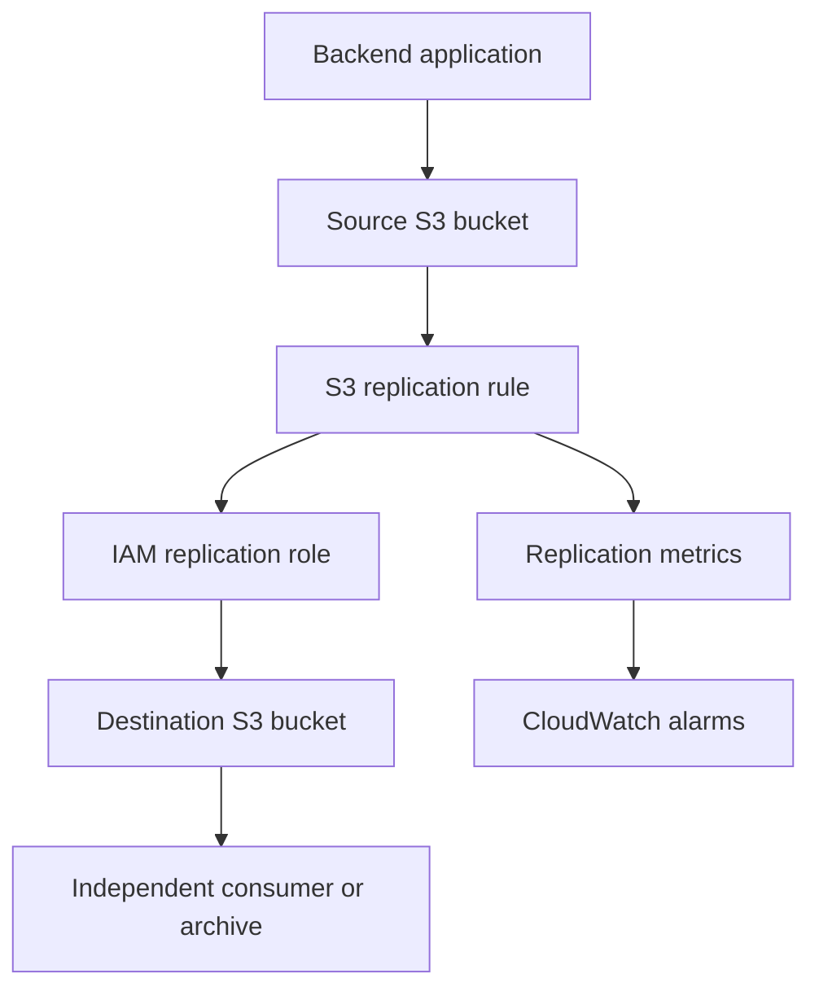

# 03- Same-Region Replication (SRR)

## Overview

Amazon S3 Same-Region Replication (SRR) automatically and asynchronously copies objects from a source S3 bucket to one or more destination buckets in the same AWS Region. Replication can operate between buckets owned by the same AWS account or by different accounts, provided the required permissions and configuration are in place.

SRR is useful when applications need multiple copies of data within a Region for data separation, centralized storage, compliance requirements, log aggregation, or independent access patterns.

SRR is not a synchronous write operation. A successful source upload does not guarantee that the destination replica is immediately available. Applications that require read-after-write access must read from the source or explicitly handle replication status and destination availability.

Use SRR when the primary requirement is to copy objects within a Region. Use Cross-Region Replication (CRR) when copies must reside in a different Region for geographic separation or regional disaster recovery.

## Same-Region Replication Architecture

### Components and responsibilities

| Component | Responsibility |
|---|---|
| Source bucket | Receives the original objects and stores their versions |
| Destination bucket | Stores replicated object versions |
| Replication rule | Defines which objects are replicated and where they are sent |
| IAM replication role | Authorizes S3 to read source objects and write destination replicas |
| S3 Versioning | Preserves object versions and supports replication |
| CloudWatch | Provides replication metrics and alerting when configured |
| S3 Batch Replication | Replicates existing objects or retries eligible objects that previously failed replication |

### Data flow



The application writes to the source bucket. Amazon S3 evaluates the applicable replication rule and asynchronously copies eligible objects to the destination bucket using the configured replication role.

The application does not need to implement its own copy loop, but it must account for replication delay, failures, permissions, and object version behavior.

## When to Use SRR

### Suitable use cases

**Centralized logging:** Replicate application logs from several source buckets into a dedicated logging bucket in the same Region. Apply separate read permissions and retention controls to the destination.

**Environment separation:** Maintain copies of application data in a separate bucket for downstream processing, reporting, or controlled access by another team.

**Compliance and data governance:** Maintain a separately managed copy when a requirement calls for data duplication within the same Region. Validate the specific compliance requirement before treating replication as sufficient.

**Cross-account data sharing:** Replicate selected objects into another account so that a receiving team can manage access and retention independently.

**Operational data distribution:** Maintain destination copies for consumers that need different permissions or processing workflows from those accessing the source.

### When SRR is insufficient

SRR alone does not provide:

- Geographic disaster recovery across Regions.
- Synchronous replication or immediate destination consistency after every upload.
- Automatic replication of objects that existed before the rule was configured.
- Complete bidirectional synchronization between buckets.
- A guaranteed independent backup against every deletion, compromise, or administrative error.

For regional disaster recovery, evaluate CRR. For version recovery, evaluate S3 Versioning. For protection against unauthorized deletion or retention violations, consider S3 Object Lock and separate administrative controls where appropriate.

## Prerequisites

### Enable Versioning on Both Buckets

Both source and destination general purpose buckets must have versioning enabled before configuring replication.

Enable versioning on the source:

```bash
aws s3api put-bucket-versioning \
  --bucket "$SOURCE_BUCKET" \
  --versioning-configuration Status=Enabled \
  --region "$AWS_REGION"
```

Enable versioning on the destination:

```bash
aws s3api put-bucket-versioning \
  --bucket "$DESTINATION_BUCKET" \
  --versioning-configuration Status=Enabled \
  --region "$AWS_REGION"
```

Verify both configurations:

```bash
aws s3api get-bucket-versioning \
  --bucket "$SOURCE_BUCKET" \
  --region "$AWS_REGION"

aws s3api get-bucket-versioning \
  --bucket "$DESTINATION_BUCKET" \
  --region "$AWS_REGION"
```

Do not configure replication until both buckets report `Status: Enabled`.

Versioning is a prerequisite, not a complete backup strategy. It preserves versions according to the bucket's configuration, but those versions can still be exposed to destructive lifecycle changes or privileged administrative actions.

### Define a Dedicated Replication Role

Amazon S3 assumes an IAM role to perform replication operations. The role should have a trust policy that allows the S3 service principal to assume it.

Example trust policy:

```json
{
  "Version": "2012-10-17",
  "Statement": [
    {
      "Effect": "Allow",
      "Principal": {
        "Service": "s3.amazonaws.com"
      },
      "Action": "sts:AssumeRole"
    }
  ]
}
```

Create the role using IAM or infrastructure as code, then attach a policy scoped to the intended source and destination buckets.

For a basic same-account replication workflow, an example permissions policy is:

```json
{
  "Version": "2012-10-17",
  "Statement": [
    {
      "Sid": "ReadSourceReplicationConfiguration",
      "Effect": "Allow",
      "Action": [
        "s3:GetReplicationConfiguration",
        "s3:ListBucket"
      ],
      "Resource": "arn:aws:s3:::SOURCE_BUCKET_NAME"
    },
    {
      "Sid": "ReadSourceObjectVersions",
      "Effect": "Allow",
      "Action": [
        "s3:GetObjectVersionForReplication",
        "s3:GetObjectVersionAcl",
        "s3:GetObjectVersionTagging"
      ],
      "Resource": "arn:aws:s3:::SOURCE_BUCKET_NAME/*"
    },
    {
      "Sid": "WriteDestinationReplicas",
      "Effect": "Allow",
      "Action": [
        "s3:ReplicateObject",
        "s3:ReplicateDelete",
        "s3:ReplicateTags"
      ],
      "Resource": "arn:aws:s3:::DESTINATION_BUCKET_NAME/*"
    }
  ]
}
```

Replace the example bucket names with the actual resource names. Review the required actions against the object ownership model, replication configuration, and enabled features.

For cross-account replication, the destination bucket owner must also configure the necessary destination-side authorization. Additional permissions are required for KMS-encrypted objects and other specialized configurations.

Follow least privilege and avoid granting the replication role unrestricted S3 access.

## Configure a Same-Region Replication Rule

### Create the replication configuration

The following configuration replicates eligible objects under the `application-data/` prefix into a destination bucket in the same Region.

Save it as `replication.json`:

```json
{
  "Role": "arn:aws:iam::123456789012:role/s3-srr-replication-role",
  "Rules": [
    {
      "ID": "ApplicationDataSameRegionReplication",
      "Priority": 1,
      "Status": "Enabled",
      "Filter": {
        "Prefix": "application-data/"
      },
      "DeleteMarkerReplication": {
        "Status": "Disabled"
      },
      "Destination": {
        "Bucket": "arn:aws:s3:::example-destination-bucket"
      }
    }
  ]
}
```

This is an illustrative same-account configuration. Replace the account ID, role ARN, and destination bucket ARN. Confirm that the destination bucket is in the same Region as the source.

Apply the rule:

```bash
aws s3api put-bucket-replication \
  --bucket "$SOURCE_BUCKET" \
  --replication-configuration file://replication.json \
  --region "$AWS_REGION"
```

The command replaces the source bucket's replication configuration. Before applying it to an existing production bucket, retrieve and review the current configuration so that unrelated rules are preserved.

Inspect the resulting configuration:

```bash
aws s3api get-bucket-replication \
  --bucket "$SOURCE_BUCKET" \
  --region "$AWS_REGION"
```

### Filter rules carefully

A replication rule can target the entire source bucket or a subset of objects using a prefix, object tags, or supported combinations of filters.

Use narrow, meaningful prefixes when only specific data requires replication. This limits unnecessary replica storage and helps maintain clear ownership boundaries.

For example:

```text
application-data/
    customer-documents/
    customer-exports/
    processed-reports/
```

A rule targeting `application-data/customer-documents/` does not automatically cover objects outside that prefix.

Object tags can help classify data, but tag-based filtering has implications for delete-marker replication. Validate the supported combination of filters and deletion behavior before deployment.

## Understand Object and Delete Behavior

### New and updated objects

Live replication applies to eligible objects created or updated after the rule is enabled. Replication is asynchronous, and destination availability can lag behind the source write.

Applications should not assume that a successful `PutObject` or multipart upload implies that the replica already exists.

When consumers require the destination copy, design the workflow to confirm replication completion or handle temporary absence.

### Existing objects

Objects that existed before replication was enabled are not automatically copied by live replication.

Use S3 Batch Replication to replicate existing objects, objects that previously failed replication, or eligible replicas that need to be copied to another destination.

A production migration should include an inventory of the intended object population, a Batch Replication job, completion reports, and verification of the resulting replicas.

### Delete markers and version-specific deletion

In a versioned bucket, an ordinary delete request typically creates a delete marker rather than permanently deleting all object versions.

Delete-marker replication is disabled by default for the illustrated modern filtered rule. When enabled for a supported non-tag-based rule, delete markers can also be replicated to the destination.

Deleting a specific object version in the source does not automatically delete the corresponding version from the destination. This behavior helps protect destination data from some accidental or malicious deletions.

Lifecycle-generated delete markers have different behavior and are not automatically replicated merely because delete-marker replication is enabled.

**Best practice:** Make deletion semantics an explicit design decision. Do not assume that SRR automatically makes the destination mirror all source deletions.

Reference: [Replicating delete markers](https://docs.aws.amazon.com/AmazonS3/latest/userguide/delete-marker-replication.html).

## Replicate KMS-Encrypted Objects

S3 does not replicate SSE-KMS or DSSE-KMS encrypted objects by default. To include them, configure replication appropriately and provide the required KMS permissions.

Evaluate the following for encrypted data:

- The replication role must have the necessary access to decrypt source objects and encrypt destination replicas.
- The source and destination KMS key policies must authorize the required operations.
- The destination key must be usable in the destination bucket's Region.
- Cross-account workflows require appropriate permissions in both accounts.
- Encryption-context conditions must match the configuration, including S3 Bucket Keys if enabled.

Do not troubleshoot encrypted replication as an S3-only permission problem. A role may have permission to read and replicate an object at the S3 layer while still lacking the KMS permissions needed to process its encrypted data.

Reference: [Replicating KMS-encrypted objects](https://docs.aws.amazon.com/AmazonS3/latest/userguide/replication-config-for-kms-objects.html).

## Monitor Replication Health

### Enable replication metrics

S3 Replication metrics can expose:
- `BytesPendingReplication`: bytes waiting to be replicated.
- `OperationsPendingReplication`: operations waiting to be replicated.
- `ReplicationLatency`: observed replication delay for the rule.

These metrics are available through CloudWatch when replication metrics are enabled. S3 Replication Time Control (S3 RTC) enables replication metrics automatically, while metrics can also be enabled independently.

Configure alarms according to workload requirements, such as sustained increases in pending bytes or operations, or latency above the application threshold.

Metrics and alarms incur applicable CloudWatch charges.

### Inspect object replication status

Inspect an object from the source bucket:

```bash
aws s3api head-object \
  --bucket "$SOURCE_BUCKET" \
  --key "application-data/example.json" \
  --query 'ReplicationStatus' \
  --output text
```

Possible states include `PENDING`, `COMPLETED`, and `FAILED` for the relevant replication workflow. Objects outside the configured rule may not have a replication status.

An object showing `FAILED` requires diagnosis rather than assuming automatic recovery. Review the replication role, bucket configuration, encryption permissions, destination authorization, and available failure evidence. Use Batch Replication when eligible objects must be retried.

### Use S3 Replication Time Control when timing matters

S3 Replication Time Control is an optional feature for workloads requiring a predictable replication window. AWS documents an SLA for replicating 99.99% of new objects within 15 minutes when S3 RTC applies.

It adds cost and should be selected when the timing requirement justifies it, rather than enabled for every bucket by default.

S3 RTC does not apply to S3 Batch Replication jobs. Batch jobs have their own progress and completion reporting mechanisms.

References:

- [Monitoring S3 replication](https://docs.aws.amazon.com/AmazonS3/latest/userguide/replication-metrics.html)
- [S3 Replication Time Control](https://docs.aws.amazon.com/AmazonS3/latest/userguide/replication-time-control.html)

## Cost and Performance Considerations

SRR avoids cross-Region data transfer charges associated with CRR, but replication is not free.

Budget for:
- Destination storage.
- Replication PUT and related requests.
- Applicable KMS requests for encrypted data.
- CloudWatch metrics and alarms.
- S3 RTC when enabled.
- Batch Operations and other migration-related costs.

Replication increases stored data volume and request activity. If the destination has lifecycle rules, retention settings, or a different storage class, evaluate the combined behavior rather than treating the destination as a passive copy.

For high-volume workloads, use scoped replication rules and monitor pending operations. Large objects and busy workloads can take longer to replicate; do not use unverified fixed delays as a substitute for checking replication status.

## Validation and Operational Runbook

After configuration, validate the full workflow using a dedicated test object.

1. Confirm both buckets have versioning enabled.
2. Inspect the replication rule and role permissions.
3. Upload a new object under the configured prefix.
4. Check its source replication status.
5. Verify the object is present in the destination bucket.
6. Validate the replica's content, metadata, and encryption as applicable.
7. Test an object outside the prefix to confirm filtering works.
8. Test deletion behavior in a non-production environment.
9. Verify replication metrics or event notifications if configured.
10. Document recovery, retry, and destination-access procedures.

Example verification:

```bash
aws s3api put-object \
  --bucket "$SOURCE_BUCKET" \
  --key "application-data/replication-test.txt" \
  --body "./replication-test.txt" \
  --region "$AWS_REGION"

aws s3api head-object \
  --bucket "$SOURCE_BUCKET" \
  --key "application-data/replication-test.txt" \
  --query 'ReplicationStatus' \
  --output text

aws s3api head-object \
  --bucket "$DESTINATION_BUCKET" \
  --key "application-data/replication-test.txt" \
  --region "$AWS_REGION"
```

Because replication is asynchronous, a destination lookup can temporarily return not found before the replica arrives. For automated testing, poll with a bounded timeout and fail the test if replication does not complete within the defined acceptance threshold. Do not treat an immediate destination lookup as a reliable replication test.

## Common Mistakes

| Mistake | Impact | Prevention |
|---|---|---|
| Enabling replication without source and destination versioning | Replication cannot be correctly configured or performed | Verify both bucket configurations first |
| Assuming existing objects are replicated automatically | Historical objects are missing from the destination | Use S3 Batch Replication |
| Treating SRR as synchronous | Destination consumers can observe temporary absence | Design for asynchronous replication |
| Assuming all deletions are mirrored | Source and destination contents can diverge | Define delete-marker and version-deletion behavior explicitly |
| Omitting KMS permissions | Encrypted objects fail replication | Validate S3 and KMS authorization separately |
| Replacing existing rules with an incomplete configuration | Other replication workflows can be unintentionally removed | Retrieve, review, merge, and verify configuration changes |
| Assuming replicas are independent backups | Deletion, retention, or administrative actions can affect recovery | Evaluate versioning, Object Lock, separate administrative controls, and recovery procedures |
| Ignoring replication metrics | Replication failures or backlogs can go unnoticed | Enable appropriate metrics, alerts, and operational review |

## Production Readiness Checklist

- [ ] Source and destination buckets are in the same intended AWS Region.
- [ ] Versioning is enabled on both buckets.
- [ ] The replication role uses a narrowly scoped trust policy and permissions.
- [ ] Filters and rule priorities match the intended object population.
- [ ] Existing-object migration has been addressed with S3 Batch Replication where required.
- [ ] KMS-encrypted objects have the appropriate replication and key permissions.
- [ ] Delete-marker and version-specific deletion behavior is documented.
- [ ] Destination storage, lifecycle, and retention behavior has been reviewed.
- [ ] Replication status and pending-work metrics are monitored where appropriate.
- [ ] S3 RTC is enabled only when the timing requirement justifies the additional cost.
- [ ] A test object has been verified in the destination.
- [ ] Failure handling, retry procedures, and recovery responsibilities are documented.
- [ ] Existing replication rules are preserved during configuration updates.

## Authoritative References

- [Replicating objects within and across Regions](https://docs.aws.amazon.com/AmazonS3/latest/userguide/replication.html)
- [Replication requirements and considerations](https://docs.aws.amazon.com/AmazonS3/latest/userguide/replication-requirements.html)
- [Setting up live replication](https://docs.aws.amazon.com/AmazonS3/latest/userguide/replication-how-setup.html)
- [What S3 replication does and does not replicate](https://docs.aws.amazon.com/AmazonS3/latest/userguide/replication-what-is-isnot-replicated.html)
- [Replicating KMS-encrypted objects](https://docs.aws.amazon.com/AmazonS3/latest/userguide/replication-config-for-kms-objects.html)
- [Monitoring replication metrics](https://docs.aws.amazon.com/AmazonS3/latest/userguide/replication-metrics.html)
- [S3 Replication Time Control](https://docs.aws.amazon.com/AmazonS3/latest/userguide/replication-time-control.html)

## Key Takeaways

- SRR asynchronously copies eligible objects between S3 buckets in the same Region and requires versioning on both buckets.
- Live replication covers eligible objects written after configuration; use S3 Batch Replication for existing objects and eligible retries.
- Replication is not synchronous, complete bidirectional synchronization, or a standalone disaster recovery strategy.
- Validate deletion behavior, encryption permissions, destination access, and replication health instead of assuming every object is copied successfully.
- Monitor replication progress, test actual destination availability, and account for replica storage and request costs.