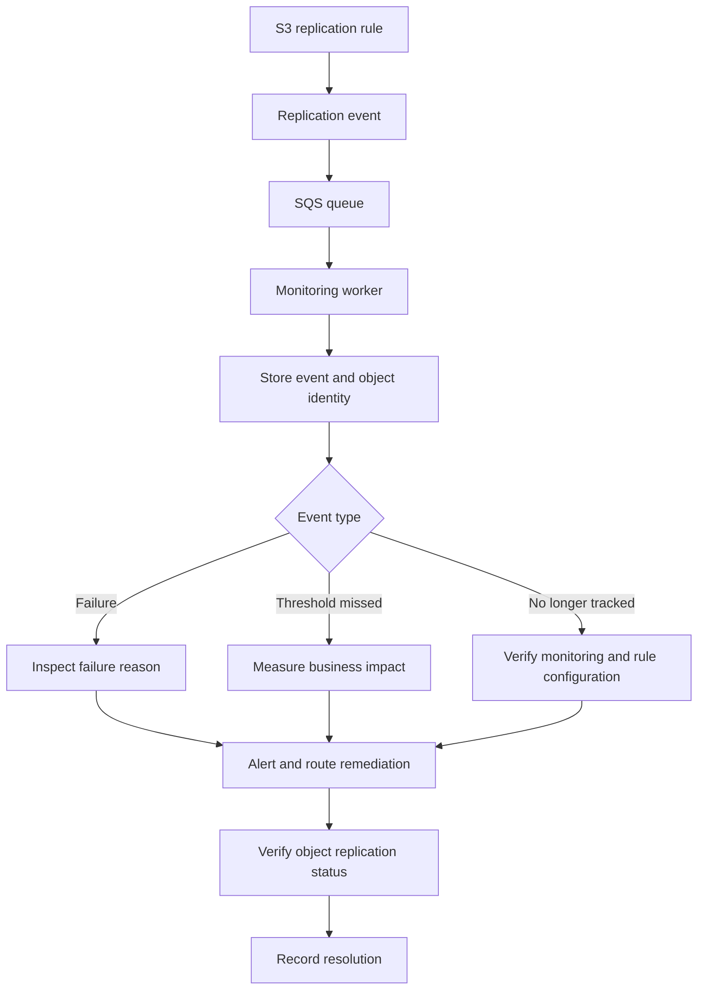

# Replication Metrics and Monitoring

## Overview

Amazon S3 replication copies eligible objects from a source bucket to one or more destination buckets using Same-Region Replication (SRR), Cross-Region Replication (CRR), or other supported replication configurations.

Configuring replication does not guarantee that every eligible object has already reached its destination. Replication can be delayed or fail because of IAM permissions, destination bucket configuration, AWS KMS authorization, object eligibility, or other operational problems.

Production systems must monitor replication progress and detect failures before they affect disaster recovery, compliance, cross-account distribution, or application availability.

Amazon S3 provides several complementary monitoring mechanisms:

- **S3 Replication metrics:** Measure pending work, replication latency, and failed operations through Amazon CloudWatch.
- **S3 Replication event notifications:** Identify individual objects that fail replication or miss configured replication thresholds.
- **Object replication status:** Inspect the replication state of individual objects.
- **S3 Storage Lens:** Analyze replication activity and configuration across a broader storage environment.
- **S3 Batch Replication reports:** Investigate large-scale replication of existing objects and identify failures in batch jobs.

The objective is to combine these mechanisms into an observable, recoverable replication architecture rather than relying on the presence of a replication rule alone.

## Understand S3 Replication Metrics

### Available CloudWatch metrics

When replication metrics are enabled on a replication rule, Amazon S3 publishes replication-related CloudWatch metrics.

| Metric | Meaning | Primary operational use |
|---|---|---|
| `BytesPendingReplication` | Total bytes of objects awaiting replication for a rule | Identify accumulated replication backlog |
| `OperationsPendingReplication` | Number of pending replication operations | Detect growing queues of replication work |
| `ReplicationLatency` | Maximum replication delay for a rule, measured in seconds | Detect replication falling behind the source |
| `OperationsFailedReplication` | Number of failed replication operations aggregated over a one-minute interval | Detect replication failures requiring investigation |

These metrics complement each other. A backlog of pending bytes indicates outstanding work, while latency helps establish how far replication is behind. Failed operations provide a separate signal that work is not completing successfully.

For live SRR and CRR, pending-work metrics and latency concern newly replicated objects. `OperationsFailedReplication` also covers applicable failures involving objects processed through S3 Batch Replication.

Reference: [Using S3 Replication metrics](https://docs.aws.amazon.com/AmazonS3/latest/userguide/repl-metrics.html).

### Understand metric dimensions and Regions

Replication metrics are associated with replication rules. Each rule can have its own identifier, filter, and destination, allowing monitoring to distinguish critical data from unrelated object populations.

Metric visibility depends on where Amazon S3 publishes each metric:

| Metric | Publication Region |
|---|---|
| `BytesPendingReplication` | Destination bucket Region |
| `OperationsPendingReplication` | Destination bucket Region |
| `ReplicationLatency` | Destination bucket Region |
| `OperationsFailedReplication` | Source bucket Region |

For cross-Region replication, configure your monitoring queries and dashboards to retrieve metrics from the appropriate Regions.

Use the replication rule identifier to correlate a metric with the configuration responsible for the workload. Review each rule's filters and destination when interpreting a metric.

### Understand metric delivery limitations

S3 replication metrics are delivered to CloudWatch on a best-effort basis. Their completeness and timeliness are not guaranteed.

Consequently:

- Do not interpret a missing data point as proof that replication has completed.
- Do not interpret zero pending bytes as proof that every historical object has been replicated.
- Do not depend on CloudWatch metrics alone to identify every failed object.
- Use object-level status and event notifications to investigate individual failures.
- Use S3 Batch Replication completion reports when processing existing objects in bulk.

A Batch Replication job that fails to start entirely might not emit replication metrics. For example, missing permissions or a filter that matches no eligible objects can prevent the job from running as intended.

Reference: [Monitoring replication with metrics, event notifications, and statuses](https://docs.aws.amazon.com/AmazonS3/latest/userguide/replication-metrics.html).

## Enable Replication Metrics

### Configure metrics on a replication rule

Replication metrics can be enabled independently of S3 Replication Time Control (S3 RTC). Enable them when operational visibility is required even if the application does not need the additional replication-time commitment offered by S3 RTC.

The following example enables replication metrics for objects under the `critical-documents/` prefix.

`replication.json`:

```json
{
  "Role": "arn:aws:iam::123456789012:role/s3-replication-role",
  "Rules": [
    {
      "ID": "CriticalDocumentsReplication",
      "Priority": 1,
      "Status": "Enabled",
      "Filter": {
        "Prefix": "critical-documents/"
      },
      "DeleteMarkerReplication": {
        "Status": "Disabled"
      },
      "Destination": {
        "Bucket": "arn:aws:s3:::example-destination-bucket",
        "Metrics": {
          "Status": "Enabled"
        }
      }
    }
  ]
}
```

This example assumes the replication role, destination bucket, permissions, and versioning configuration already exist. Replace the example resource identifiers before deployment. Delete-marker replication is disabled deliberately; enable it only when the required deletion behavior and applicable rule constraints are understood.

Apply the configuration:

```bash
aws s3api put-bucket-replication \
  --bucket "$SOURCE_BUCKET" \
  --replication-configuration file://replication.json
```

**Important:** `put-bucket-replication` replaces the source bucket's replication configuration. Retrieve and preserve existing rules before applying a change to a bucket already used by other workloads.

Inspect the resulting configuration:

```bash
aws s3api get-bucket-replication \
  --bucket "$SOURCE_BUCKET"
```

Verify that the intended rule is enabled and its destination contains the expected metrics configuration.

Reference: [AWS CLI get-bucket-replication](https://docs.aws.amazon.com/cli/latest/reference/s3api/get-bucket-replication.html).

### View metrics in the AWS console

Metrics can be viewed through the source bucket's Metrics tab or directly in CloudWatch.

In the S3 console, select the source general purpose bucket, open its Metrics tab, select the relevant replication rule, and display its charts.

In CloudWatch, use the appropriate Region and metric dimensions for the replication rule. For cross-Region replication, avoid assuming that all metrics appear in the source Region.

### Understand monitoring costs

S3 Replication metrics are charged at the same rate as CloudWatch custom metrics. Costs depend on the enabled metrics, metric configuration, and current pricing.

Enable metrics according to operational needs:
- Monitor business-critical rules individually.
- Use rule filters to separate operationally important datasets.
- Review metric and alarm costs as the number of monitored rules grows.
- Avoid duplicating custom metrics when the native replication metrics already provide sufficient visibility.

Reference: [Amazon CloudWatch pricing](https://aws.amazon.com/cloudwatch/pricing/).

## Monitor Replication Backlog and Latency

### Monitor pending bytes

`BytesPendingReplication` measures the amount of data awaiting replication for a rule.

A sustained or rapidly increasing backlog may indicate that replication is not keeping pace with incoming data, that destination processing is delayed, or that replication work is experiencing other constraints.

Evaluate the metric against normal workload behavior. A temporary increase during a large upload is different from a backlog that continues growing after the upload has finished.

Track:
- Current pending bytes.
- Maximum pending bytes over the monitoring interval.
- Duration of elevated backlog.
- Correlation with ingestion volume.
- Replication latency and failed-operation counts.

### Monitor pending operations

`OperationsPendingReplication` indicates the number of operations still awaiting replication.

This metric is useful when the workload generates many small objects, where operation counts may increase significantly without a proportionate increase in pending bytes.

For example, a document service that creates thousands of small JSON and metadata objects might experience a large pending-operation count even when the total backlog in bytes is relatively small.

Use pending operations together with pending bytes to distinguish a high-volume, small-object workload from a smaller number of large objects.

### Monitor replication latency

`ReplicationLatency` measures the maximum replication delay for a rule in seconds.

Use it to detect deviations from the replication performance expected by the application.

For example, a disaster-recovery workload may require newly uploaded objects to reach another Region within a defined operational window. A rise in replication latency can indicate that the recovery copy is becoming less current.

Set latency thresholds according to the business recovery objective rather than selecting arbitrary values.

### Interpret metrics together

| Observation | Possible interpretation | Recommended investigation |
|---|---|---|
| Pending bytes increase continuously | Replication is falling behind the incoming workload | Compare backlog growth with ingestion rate and latency |
| Pending operations increase while bytes remain low | Many small objects or operations are waiting | Inspect request patterns and rule filters |
| Latency rises sharply | Replication delay is increasing | Review failure events, configuration changes, and destination health |
| Failed operations increase | Replication operations are failing | Inspect object-level event notifications and failure reasons |
| Pending metrics fall to zero unexpectedly | Backlog may have cleared, or metrics may no longer be available | Verify object statuses and rule configuration |
| Metrics disappear after a destination is deleted | Destination deletion may have stopped the corresponding metric publication | Inspect replication configuration and destination resources |
| Batch Replication produces no metrics | The job may not have run or may not match the intended objects | Inspect job status, permissions, filters, and completion reports |

Do not diagnose an incident from a single metric. Correlate the available signals with object statuses and replication configuration.

## Configure S3 Replication Time Control

### Understand the purpose of S3 RTC

S3 Replication Time Control provides a defined replication-time commitment for eligible objects covered by an appropriately configured replication rule.

AWS documents that S3 RTC replicates most uploaded objects within seconds and provides a 15-minute commitment for 99.9% of eligible objects.

S3 RTC automatically enables replication metrics and provides replication-time threshold events. Metrics generally become available within 15 minutes of enabling RTC on the relevant rule.

Use RTC when the business needs stronger replication-time guarantees and visibility into threshold breaches, such as for compliance or defined recovery objectives.

Do not enable RTC merely because replication is useful. Evaluate the workload's requirements and the additional service cost.

Reference: [Meeting compliance requirements with S3 Replication Time Control](https://docs.aws.amazon.com/AmazonS3/latest/userguide/replication-time-control.html).

### Enable S3 RTC

The following configuration fragment illustrates the destination settings for a replication rule that uses RTC.

```json
{
  "Bucket": "arn:aws:s3:::example-destination-bucket",
  "Metrics": {
    "Status": "Enabled",
    "EventThreshold": {
      "Minutes": 15
    }
  },
  "ReplicationTime": {
    "Status": "Enabled",
    "Time": {
      "Minutes": 15
    }
  }
}
```

This fragment belongs inside the `Destination` object of a complete replication rule. The complete configuration must also include the source bucket's replication role, an enabled rule, the appropriate filter and priority, and the other required rule fields.

Before deploying RTC, verify:
- Source and destination configuration.
- Replication-role permissions.
- Encryption and KMS compatibility.
- Destination Region and cost implications.
- The application's required replication-time commitment.
- Monitoring and notification destinations.

### Monitor RTC threshold events

RTC supports event notifications that identify objects that miss or subsequently exceed the 15-minute replication threshold.

Use these events to trigger operational workflows rather than repeatedly polling every object.

For example, a recovery-readiness system could send an alert to an incident queue when a critical object misses the threshold, then correlate the event with the relevant replication rule and object version.

RTC adds threshold visibility; it does not eliminate the need to investigate replication failures or verify actual destination availability.

## Configure Replication Event Notifications

### Understand the supported event types

S3 can emit replication-specific events through supported S3 Event Notification destinations, including Amazon SQS, Amazon SNS, and AWS Lambda.

| Event type | Purpose | RTC required? |
|---|---|---|
| `s3:Replication:OperationFailedReplication` | Reports an object that failed replication | No; replication metrics must be enabled |
| `s3:Replication:OperationMissedThreshold` | Reports an eligible object that missed the RTC 15-minute threshold | Yes |
| `s3:Replication:OperationReplicatedAfterThreshold` | Reports an object that replicated after missing the RTC threshold | Yes |
| `s3:Replication:OperationNotTracked` | Reports an eligible live-replication object that is no longer tracked by replication metrics | No RTC requirement is specified for this event |

Use failure events for object-level diagnostics and RTC threshold events when the workload requires the corresponding time commitment.

Reference: [Receiving replication failure events](https://docs.aws.amazon.com/AmazonS3/latest/userguide/replication-metrics-events.html).

### Design an event-driven incident workflow



Recommended responsibilities:

- **S3:** Produces the replication event.
- **SQS:** Buffers events so temporary consumer outages do not immediately lose processing opportunities.
- **Monitoring worker:** Parses events, records incident evidence, and applies retry and idempotency controls.
- **Database or observability store:** Records affected object identifiers, failure reasons, and resolution state.
- **Alerting system:** Routes material failures to the owning team.

S3 events and downstream delivery should be treated as an asynchronous integration. Consumers must handle retries and duplicate processing safely.

### Preserve enough event information for investigation

An event can include the source bucket, object key, version ID, replication rule ID, destination bucket, operation, and failure reason.

Persist sufficient information to identify the affected object and distinguish repeated failures from separate versions of the same key.

Use the object version ID where available. An S3 key alone does not uniquely identify an object version in a versioned bucket.

Do not place presigned URLs, credentials, or other unnecessary sensitive information in incident payloads.

## Inspect Object-Level Replication Status

### Check a specific object

Use `head-object` to inspect the replication status of an object in the source bucket.

```bash
aws s3api head-object \
  --bucket "$SOURCE_BUCKET" \
  --key "critical-documents/report.pdf"
```

Review the `ReplicationStatus` field when it is returned.

For source objects, relevant values include:

| Status | Meaning |
|---|---|
| `PENDING` | Replication is in progress or awaiting completion |
| `COMPLETED` | Replication completed for the applicable replication operation |
| `FAILED` | The replication operation failed |

A destination replica can report `REPLICA`.

The status is useful for diagnosing individual objects but should not be treated as a complete inventory of the bucket's replication health.

### Understand what object status proves

For a source object, `COMPLETED` means the applicable replication operation completed. It does not prove that every object in the dataset is replicated or that the destination application can successfully read the object.

Recovery verification should also check:
- Destination object existence.
- Expected version and metadata.
- Required tags and retention properties.
- Destination access permissions.
- KMS decrypt permissions where applicable.
- Application-level availability.

For large object populations, use S3 Inventory, Batch Operations, or other appropriate audit workflows rather than issuing a `head-object` request for every object without considering the request volume and cost.

Reference: [Getting replication status information](https://docs.aws.amazon.com/AmazonS3/latest/userguide/replication-status.html).

## Monitor Replication with S3 Storage Lens

S3 Storage Lens provides broader visibility into storage usage and data protection across an AWS environment.

Replication-related metrics can help answer questions such as:
- How many objects or bytes have been replicated?
- Which buckets have replication configured?
- Are replication destinations valid?
- How does replication behavior vary across storage estates?

Free Storage Lens metrics provide a useful starting point. Advanced metrics add broader replication configuration and data protection insights, depending on the enabled configuration and available metric set.

Use Storage Lens for fleet-level analysis and governance. Use CloudWatch replication metrics and object-level events for operational alerts and incident investigation.

Reference: [Monitoring replication with metrics, event notifications, and statuses](https://docs.aws.amazon.com/AmazonS3/latest/userguide/replication-metrics.html).

## Build Actionable CloudWatch Alarms

### Establish an alerting strategy

Avoid alerting on every temporary backlog increase. Define thresholds based on observed workload characteristics and business requirements.

| Alarm | Example condition | Response |
|---|---|---|
| Replication latency | Maximum latency exceeds the target for a sustained period | Investigate delayed replication |
| Pending bytes | Backlog exceeds the expected operating range | Examine ingestion rate and destination progress |
| Pending operations | Pending operations remain elevated | Inspect object request volume and backlog duration |
| Failed operations | Failed-operation metric becomes nonzero | Investigate object-level failure events |
| RTC threshold breach | Threshold event is received | Assess whether the impacted object affects the recovery objective |
| Monitoring or destination anomaly | Expected signals disappear or configuration checks fail | Verify metric availability, rule configuration, and destination resources |

These are alert design patterns, not universal threshold values. Tune thresholds using production baselines and workload-specific requirements.

For metric-based alarms, use the relevant metric statistics and Region. For example, `ReplicationLatency`, `BytesPendingReplication`, and `OperationsPendingReplication` commonly use the `Maximum` statistic.

### Handle missing data deliberately

CloudWatch metrics are delivered on a best-effort basis. Missing data can occur for legitimate reasons, including gaps in reporting or the absence of new metric points.

For replication metric alarms, AWS recommends setting missing-data treatment to **Treat missing data as ignore (maintain the alarm state)**. This avoids automatically converting missing samples into healthy or unhealthy states.

Complement metric alarms with independent checks of replication configuration, destination availability, object-level status, and event delivery.

### Define operational runbooks

Every critical replication alarm should identify:
- The owning service or team.
- The affected rule and source/destination buckets.
- The required dashboard and diagnostic commands.
- The business impact if replication remains delayed.
- The procedure for identifying failed objects.
- The corrective action for common permission or configuration failures.
- The criteria for confirming recovery.

An alert without an investigative procedure increases notification volume without improving recovery time.

## Troubleshoot Common Replication Monitoring Failures

### Metrics are absent

**Possible causes:**
- Replication metrics are not enabled on the intended rule.
- RTC was recently enabled and metrics have not appeared yet.
- The monitoring query uses the wrong Region or dimensions.
- The destination bucket has been deleted.
- The Batch Replication job failed to run.

**Diagnostic steps:**

```bash
aws s3api get-bucket-replication \
  --bucket "$SOURCE_BUCKET"
```

Check the destination's `Metrics` configuration and confirm the replication rule ID. For RTC, allow for the documented reporting delay after enabling the feature. For Batch Replication, inspect job status, filters, permissions, and the completion report rather than relying only on CloudWatch metrics.

### Pending bytes or latency keeps increasing

**Possible causes:**
- Incoming writes are exceeding replication throughput.
- Replication is failing repeatedly.
- The destination configuration is invalid.
- The replication role or destination KMS key does not permit the required operations.

**Diagnostic steps:**

1. Correlate pending bytes, pending operations, latency, and failed operations.
2. Review replication failure notifications.
3. Inspect the current replication configuration.
4. Verify IAM and KMS permissions.
5. Check representative source objects and destination copies.
6. Determine whether the backlog is still growing or has begun recovering.

A falling backlog is a useful signal but is not sufficient proof of complete recovery.

### Failed-operation metrics increase

**Possible causes:**
- The replication role cannot be assumed.
- Destination bucket permissions are missing.
- Destination bucket versioning or Object Lock configuration is incompatible.
- The destination KMS key is missing, disabled, or unauthorized.
- Required permissions for tags, retention, legal holds, or other replicated attributes are missing.

**Diagnostic steps:**

Use `s3:Replication:OperationFailedReplication` notifications to obtain the affected object and failure reason. Compare the reported reason with the replication role, destination bucket policy, and KMS key policy.

Correct the underlying configuration before retrying failed objects.

### RTC thresholds are missed

**Possible causes:**
- Replication latency has exceeded the configured time threshold.
- The destination is not keeping pace with the source.
- A persistent configuration or permission failure is preventing completion.

**Diagnostic steps:**

Inspect the RTC threshold event, identify the affected object version, and correlate its event timestamp with replication metrics and failure events. After remediation, confirm the object is accessible at the destination rather than assuming that the expiration of the alarm means recovery is complete.

## Cost, Security, and Operational Considerations

### Cost management

Replication monitoring introduces cost through CloudWatch custom metrics, alarms, notifications, downstream processing, and observability storage. RTC has additional service pricing considerations.

Review monitoring costs alongside the cost of replication traffic and destination storage. Use detailed per-rule metrics for workloads where the operational benefit justifies their cost.

### Security

Replication monitoring often spans multiple accounts and Regions. Apply least privilege to:
- Read replication configuration.
- Inspect object versions and status.
- Consume SQS or SNS notifications.
- Publish incident records and alerts.
- Access KMS-related diagnostic information.

Do not grant broad bucket or KMS permissions simply to make a monitoring dashboard work.

### Operational resilience

Maintain monitoring independently from the application whose data is being replicated wherever practical. An incident affecting the source workload should not automatically disable the alarms or dashboards needed to assess replication health.

For disaster recovery, periodically validate the destination through controlled recovery exercises. Monitoring indicates replication activity; it does not by itself prove that the destination can support production traffic.

## Production Readiness Checklist

- [ ] Replication metrics are enabled on every critical rule.
- [ ] CloudWatch metric queries use the correct Region and dimensions.
- [ ] Pending bytes, pending operations, latency, and failed operations are monitored together.
- [ ] Alarms use workload-specific thresholds and deliberate missing-data treatment.
- [ ] RTC is enabled where its time commitment is a documented requirement.
- [ ] Replication failure and RTC threshold events are delivered to an operationally managed destination.
- [ ] Consumers handle retries, duplicates, and partial failures safely.
- [ ] Event records preserve object keys, version IDs, rule IDs, and failure reasons where available.
- [ ] Object-level replication status is checked during incidents.
- [ ] Batch Replication jobs are monitored independently of live replication metrics.
- [ ] Storage Lens is used where broader replication governance is required.
- [ ] Monitoring roles follow least-privilege access policies.
- [ ] Runbooks identify diagnostic commands, ownership, remediation, and recovery verification.
- [ ] Destination object accessibility is validated during disaster-recovery tests.
- [ ] Monitoring and replication costs are reviewed periodically.

## Authoritative References

- [Using S3 Replication metrics](https://docs.aws.amazon.com/AmazonS3/latest/userguide/repl-metrics.html)
- [Monitoring replication with metrics, event notifications, and statuses](https://docs.aws.amazon.com/AmazonS3/latest/userguide/replication-metrics.html)
- [Receiving replication failure events](https://docs.aws.amazon.com/AmazonS3/latest/userguide/replication-metrics-events.html)
- [Meeting compliance requirements with S3 Replication Time Control](https://docs.aws.amazon.com/AmazonS3/latest/userguide/replication-time-control.html)
- [Getting replication status information](https://docs.aws.amazon.com/AmazonS3/latest/userguide/replication-status.html)
- [Viewing replication metrics in S3 Storage Lens](https://docs.aws.amazon.com/AmazonS3/latest/userguide/storage-lens-replication-metrics.html)
- [AWS CLI get-bucket-replication](https://docs.aws.amazon.com/cli/latest/reference/s3api/get-bucket-replication.html)
- [Amazon CloudWatch pricing](https://aws.amazon.com/cloudwatch/pricing/)

## Key Takeaways

- Enable S3 Replication metrics on critical rules and monitor pending bytes, pending operations, latency, and failures together.
- Use object-level event notifications and replication status to investigate failures that aggregate CloudWatch metrics cannot identify.
- Treat S3 Replication Time Control as a business-driven replication-time commitment, not a substitute for monitoring and recovery procedures.
- Use S3 Storage Lens for broader replication governance and Batch Replication reports for existing-object replication jobs.
- Validate actual destination object availability and decryption during recovery exercises instead of treating successful replication metrics as proof of disaster-recovery readiness.
You've reached the maximum length for this conversation, but you can keep talking by starting a new chat.
Start new chat