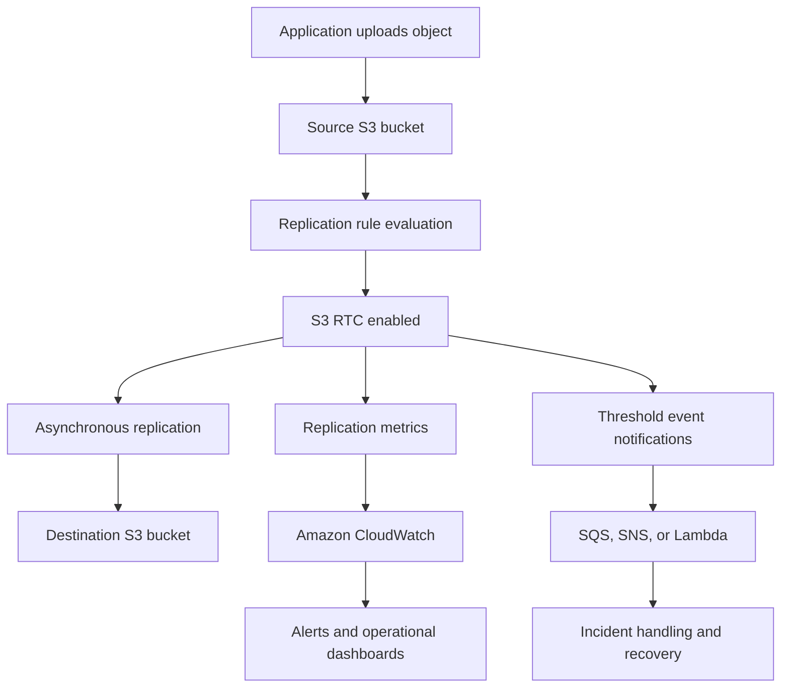

# Replication Time Control (RTC)

## Overview

Amazon S3 Replication Time Control (S3 RTC) is a capability of S3 live replication that provides predictable replication latency for workloads with business, operational, or compliance requirements.

Standard Same-Region Replication (SRR) and Cross-Region Replication (CRR) replicate objects asynchronously. Although most objects are replicated quickly, replication latency can vary with object size, request volume, available bandwidth, destination configuration, and other workload conditions.

S3 RTC adds a defined 15-minute replication threshold, replication metrics, threshold-based event notifications, and a service-level agreement (SLA).

AWS designs S3 RTC to replicate 99.99% of new objects within 15 minutes. The associated SLA commits to replicating at least 99.9% of eligible objects within 15 minutes during a monthly billing period, subject to its terms and exclusions.

Use S3 RTC when replication latency is a measurable business requirement rather than merely a desirable operational characteristic.

Typical workloads include:
- Cross-Region disaster recovery with a defined replication-lag objective.
- Cross-account data distribution with predictable replication requirements.
- Compliance workloads requiring timely copies in a separate Region or account.
- Critical business records that must become available in a destination bucket promptly.
- Applications that monitor replication completion before allowing downstream processing.

S3 RTC does not provide synchronous replication, guarantee immediate destination availability, or automatically implement application failover.

## Understand S3 RTC Architecture

### Components and responsibilities

| Component | Responsibility |
|---|---|
| Source S3 bucket | Receives new objects and evaluates replication rules |
| Replication rule | Defines the object scope, destination, and replication behavior |
| S3 replication IAM role | Authorizes S3 to perform the required replication operations |
| Destination S3 bucket | Stores the replicated object |
| S3 RTC | Adds a 15-minute replication threshold and associated SLA |
| S3 Replication metrics | Reports pending work, failures, and replication latency |
| Amazon CloudWatch | Stores replication metrics and supports alarms |
| S3 Event Notifications | Reports relevant replication failures and threshold events |
| Amazon SQS, SNS, or AWS Lambda | Consumes or routes configured replication events |

### Replication data flow



The application can continue operating against the source bucket while replication proceeds. Destination consumers must not assume that an object is already available immediately after the source upload succeeds.

For applications that depend on destination availability, use replication status or a controlled completion workflow rather than treating the source upload response as proof that replication has finished.

## Understand the 15-Minute SLA

### Distinguish the design target from the SLA commitment

| Property | Meaning |
|---|---|
| Design target | AWS designs S3 RTC to replicate 99.99% of new objects within 15 minutes |
| SLA commitment | At least 99.9% of eligible objects are replicated within 15 minutes during the applicable monthly billing period |
| Threshold | 15 minutes |
| Measurement scope | Applicable replication activity evaluated under the SLA terms |
| Exception handling | Metrics and event notifications help detect threshold breaches and subsequent replication |
| Scope limitation | S3 RTC applies to live replication rules, not S3 Batch Replication jobs |

The SLA is not a per-object guarantee that every object will replicate within 15 minutes. Some objects can exceed the threshold because of errors, unusual workload conditions, configuration problems, or other circumstances.

Read the current [S3 RTC documentation](https://docs.aws.amazon.com/AmazonS3/latest/userguide/replication-time-control.html) and applicable [S3 RTC SLA](https://aws.amazon.com/s3/sla/) before using the feature to satisfy contractual or regulatory requirements.

### Do not treat RTC as synchronous replication

S3 RTC does not make source and destination writes a single atomic operation.

A successful upload to the source bucket can occur before the corresponding destination object is available. A consumer in another Region may therefore observe replication lag.

If the business operation requires the destination copy to exist before returning success, build an application-level workflow that tracks replication completion and applies the required response or retry behavior.

Do not use a 15-minute replication target as a substitute for transaction consistency across Regions.

## Determine When S3 RTC Is Appropriate

### Select the replication capability based on requirements

| Requirement | Recommended approach |
|---|---|
| Replicate new objects to another bucket without an explicit latency SLA | SRR or CRR, depending on Region placement |
| Replicate new objects with a defined 15-minute replication objective | SRR or CRR with S3 RTC |
| Replicate existing objects after replication was configured | S3 Batch Replication |
| Retry objects that previously failed replication | Investigate the failure and use an appropriate retry or Batch Replication workflow |
| Make application reads available from multiple Regions | Replication plus an independently designed routing and failover strategy |
| Require immediate cross-Region consistency | S3 RTC is not sufficient; redesign the application consistency model |

RTC should be enabled on the replication rules whose business requirements justify its additional cost.

For example, a company may require RTC for financial records and customer-submitted documents while using standard replication for reconstructible analytics output.

### Define the replication-lag objective

Before deployment, document:
- Which objects require RTC.
- Which destination account and Region will receive replicas.
- The maximum acceptable replication lag.
- Which consumers rely on the destination copy.
- What happens when replication exceeds 15 minutes.
- Which business operations must stop, continue, or fall back.
- How the team will detect, investigate, and recover from replication failures.

Do not enable RTC across an entire bucket without considering whether every object requires the same replication objective.

## Configure the Prerequisites

### Enable versioning on both buckets

S3 live replication requires versioning to be enabled on both the source and destination general purpose buckets.

Inspect the source bucket:

```bash
aws s3api get-bucket-versioning \
  --bucket "$SOURCE_BUCKET"
```

Inspect the destination bucket:

```bash
aws s3api get-bucket-versioning \
  --bucket "$DESTINATION_BUCKET"
```

For a new configuration, enable versioning where appropriate:

```bash
aws s3api put-bucket-versioning \
  --bucket "$SOURCE_BUCKET" \
  --versioning-configuration Status=Enabled

aws s3api put-bucket-versioning \
  --bucket "$DESTINATION_BUCKET" \
  --versioning-configuration Status=Enabled
```

Review existing versioning and lifecycle policies before making changes. Versioning affects object deletion, storage consumption, recovery, and retention behavior.

### Create the replication IAM role

The replication configuration references an IAM role that Amazon S3 assumes to replicate eligible objects.

The role's trust policy must allow the S3 service to assume it. Its permissions must cover the required source-object operations and destination replication operations.

Evaluate these permission categories:

| Permission area | Considerations |
|---|---|
| Source objects | Permissions to read eligible objects and their versions |
| Destination objects | Permissions to replicate objects and associated metadata |
| Source and destination KMS keys | Required cryptographic access when replicating SSE-KMS encrypted objects |
| Ownership and account boundaries | Appropriate authorization for cross-account replication |
| Object tags and metadata | Required permissions for configured tags, annotations, and associated attributes |

Use a dedicated role with least-privilege permissions. Do not assign broad administrator permissions merely to get replication working.

Follow the relevant [S3 replication requirements](https://docs.aws.amazon.com/AmazonS3/latest/userguide/replication-requirements.html) and validate the trust and permissions policies before enabling the rule.

### Account for encrypted objects

SSE-KMS encrypted objects require additional permissions and appropriate key configuration. For cross-Region replication, the destination KMS key must be usable in the destination Region.

Confirm that:
- The replication role can access the source encryption key as required.
- The destination key policy permits the required replication operations.
- The replication configuration explicitly addresses encrypted objects where necessary.
- KMS request quotas can accommodate replication traffic.
- Replicas can be decrypted by the intended destination principals.

A valid S3 replication rule does not automatically make KMS authorization valid.

## Enable S3 RTC with AWS CLI

### Define a replication configuration

The following example configures RTC for objects under the `critical/` prefix in the source bucket.

Save the configuration as `replication.json`:

```json
{
  "Role": "arn:aws:iam::123456789012:role/S3ReplicationRole",
  "Rules": [
    {
      "ID": "CriticalDataReplication",
      "Status": "Enabled",
      "Priority": 1,
      "Filter": {
        "Prefix": "critical/"
      },
      "DeleteMarkerReplication": {
        "Status": "Disabled"
      },
      "Destination": {
        "Bucket": "arn:aws:s3:::destination-bucket",
        "Metrics": {
          "Status": "Enabled",
          "EventThreshold": {
            "Minutes": 15
          }
        },
        "ReplicationTime": {
          "Status": "Enabled",
          "Time": {
            "Minutes": 15
          }
        }
      }
    }
  ]
}
```

Replace the example role ARN and destination bucket ARN with the actual resources. Review delete-marker behavior against the application's deletion and recovery requirements.

The `Metrics.EventThreshold.Minutes` and `ReplicationTime.Time.Minutes` values must be `15` for S3 RTC.

The example assumes that versioning, required IAM permissions, destination configuration, and any KMS permissions have already been established.

### Apply the configuration

```bash
aws s3api put-bucket-replication \
  --bucket "$SOURCE_BUCKET" \
  --replication-configuration file://replication.json
```

Inspect the result:

```bash
aws s3api get-bucket-replication \
  --bucket "$SOURCE_BUCKET"
```

**Important:** `put-bucket-replication` sets the bucket's replication configuration. When editing an existing bucket, retrieve and preserve all existing rules that must remain active. Do not replace a production configuration with a single-rule example without reviewing its existing contents.

Use infrastructure as code for repeatable deployments. Store the configuration in version control, validate changes through review, and apply the same checks to development, staging, and production.

Reference: [Configuring S3 Replication Time Control](https://docs.aws.amazon.com/AmazonS3/latest/userguide/replication-time-control.html).

## Monitor Replication Latency and Backlog

### Enable and inspect replication metrics

S3 RTC automatically enables S3 Replication metrics for the configured rule.

The key metrics include:

| Metric | Operational meaning | Recommended response |
|---|---|---|
| `BytesPendingReplication` | Size of data awaiting replication | Investigate sustained growth or a backlog that does not drain |
| `OperationsPendingReplication` | Number of operations awaiting replication | Investigate increasing pending operations or unusually slow completion |
| `ReplicationLatency` | Replication latency in seconds | Alert on sustained latency approaching or exceeding the 15-minute threshold |
| `OperationsFailedReplication` | Number of failed replication operations | Investigate failures promptly and identify affected objects |

RTC metrics generally become available within 15 minutes of enabling the feature.

Use the S3 console or CloudWatch to inspect these metrics at the replication-rule level. Configure alarms based on workload volume, normal latency, the 15-minute threshold, and the required incident response.

Reference: [Using S3 Replication metrics](https://docs.aws.amazon.com/AmazonS3/latest/userguide/repl-metrics.html).

### Build actionable CloudWatch alarms

A useful monitoring strategy should distinguish between:
- A short-lived backlog that is draining normally.
- Sustained replication latency that threatens the SLA objective.
- A backlog increasing because incoming work exceeds processing capacity.
- A replication failure caused by IAM, bucket policy, or KMS configuration.
- A capacity or transfer-rate constraint that needs operational intervention.

Use a combination of replication latency, pending operations, pending bytes, and failure metrics rather than relying on one metric alone.

Define clear alarm ownership and escalation paths. A metric alert without an investigation procedure does not provide adequate operational control.

### Configure threshold event notifications

S3 RTC supports events that identify objects whose replication exceeds the 15-minute threshold and objects that subsequently replicate after that threshold.

Important event types include:

- `s3:Replication:OperationMissedThreshold`
- `s3:Replication:OperationReplicatedAfterThreshold`

S3 replication metrics can also support failure-event notifications for failed replication operations. Metrics and RTC threshold notifications have different prerequisites, so configure the corresponding feature required for each event.

These events can be routed through supported destinations such as Amazon SQS, Amazon SNS, or AWS Lambda.

Reference: [Receiving S3 replication failure and threshold events](https://docs.aws.amazon.com/AmazonS3/latest/userguide/replication-metrics-events.html).

### Design event consumers to be idempotent

Replication events should be treated as operational signals rather than a guarantee that every event will be delivered exactly once or in a particular order.

For an event-driven backend:
- Record the source bucket, object key, version ID, event type, and event timestamp where available.
- Make alert and recovery handling idempotent.
- Deduplicate repeated events when required.
- Preserve enough context to investigate the affected object.
- Send persistent processing failures to a suitable dead-letter or recovery workflow.
- Avoid repeatedly launching expensive remediation jobs for the same failure.

For compliance-sensitive workloads, retain an auditable record of threshold breaches and their final disposition.

## Plan Request Rates and Data Transfer Capacity

### Include replication traffic in capacity estimates

S3 replication generates additional operations on the source and destination buckets. Request-rate planning must account for replication traffic as well as application traffic.

Estimate the total expected request rate by considering:
- Incoming object uploads.
- Replication source-object reads and metadata operations.
- Destination replication writes.
- Additional replication destinations.
- Concurrent application reads and writes.
- Object sizes and expected replication throughput.

Amazon S3 can scale to sustained higher request rates, but a sudden increase can temporarily produce HTTP `503` responses while the service adapts. Replication latency can rise during these periods.

Reference: [S3 replication performance guidelines](https://docs.aws.amazon.com/AmazonS3/latest/userguide/replication-time-control.html).

### Review replication transfer-rate quotas

S3 RTC has a default replication data-transfer quota of 1 Gbps. Workloads expected to exceed that rate should request an appropriate quota increase through AWS Support or Service Quotas.

Include annotation data in the transfer-rate calculation where applicable.

Do not assume that RTC eliminates capacity constraints or guarantees that arbitrarily large volumes of new objects will be replicated within the target time.

Plan peak throughput rather than sizing exclusively for average daily traffic.

### Evaluate KMS request quotas

When replication includes SSE-KMS encrypted objects, AWS KMS request-rate quotas also affect replication.

A workload that replicates large numbers of objects can consume a substantial portion of the available KMS request quota. Throttling can delay replication even when the S3 replication rule is valid.

Monitor KMS request rates and throttling metrics. Request quota increases where justified, and test replication under a representative workload before a high-volume production migration.

## Understand Costs and SLA Exclusions

### Include all relevant charges

S3 RTC incurs costs beyond ordinary storage.

| Cost category | What to evaluate |
|---|---|
| RTC data transfer | Additional S3 RTC transfer charges |
| Replication requests | Applicable requests generated by replication |
| Destination storage | Storage occupied by replicas |
| Cross-Region transfer | Applicable inter-Region data-transfer charges for CRR |
| S3 Replication metrics | CloudWatch custom-metric charges |
| Object retrieval or storage-class charges | Costs associated with the selected storage classes |
| KMS operations | Applicable KMS charges and request quotas |
| Monitoring and recovery | CloudWatch alarms, event delivery, processing, and operational costs |

Use current pricing for the actual source and destination Regions. For high-volume workloads, estimate both normal replication costs and the costs of replication bursts or recovery operations.

Reference: [Amazon S3 pricing](https://aws.amazon.com/s3/pricing/).

### Understand the SLA exclusions

The S3 RTC SLA has documented exclusions. In particular, the SLA does not apply during periods when applicable S3 request-rate performance guidelines or the replication transfer-rate quota are exceeded.

KMS throttling, misconfiguration, permission problems, and application or integration failures also require separate operational consideration.

Before relying on the SLA:
- Confirm that the workload remains within the applicable performance guidelines.
- Validate the replication role and destination permissions.
- Review KMS limits where encrypted objects are involved.
- Establish monitoring and investigate threshold breaches promptly.
- Read the current SLA terms for the exact commitment, measurement, exclusions, and service-credit conditions.

Do not use expected SLA credits as a substitute for a robust recovery plan.

## Handle Replication Failures and Threshold Breaches

### Follow a repeatable diagnostic workflow

When an object misses the 15-minute threshold, use the following sequence:

1. Identify the source bucket, object key, object version, replication rule, and destination.
2. Inspect the object's replication status and relevant S3 Replication metrics.
3. Check whether pending operations, pending bytes, or latency are increasing for the affected rule.
4. Review failed-operation metrics and applicable replication event notifications.
5. Validate source and destination permissions, bucket versioning, and KMS access.
6. Check for request-rate pressure, transfer-rate constraints, and throttling.
7. Determine whether the object eventually replicated or remains failed.
8. Apply the appropriate correction and verify destination availability.
9. Record the incident, affected objects, remediation, and prevention measures.

Start with the replication status of the source object:

```bash
aws s3api head-object \
  --bucket "$SOURCE_BUCKET" \
  --key "$OBJECT_KEY"
```

For a versioned object, inspect the specific version where required:

```bash
aws s3api head-object \
  --bucket "$SOURCE_BUCKET" \
  --key "$OBJECT_KEY" \
  --version-id "$VERSION_ID"
```

Review the returned replication status when available. A successful source-object inspection does not prove that the destination object is available.

Check the current replication configuration:

```bash
aws s3api get-bucket-replication \
  --bucket "$SOURCE_BUCKET"
```

Check whether the corresponding object or version exists in the destination:

```bash
aws s3api head-object \
  --bucket "$DESTINATION_BUCKET" \
  --key "$OBJECT_KEY"
```

If the object uses a different destination key or access boundary, use the effective replication mapping and appropriate destination credentials.

### Correct the underlying problem before retrying

Common causes include:
- Replication rules that do not match the intended prefix or tags.
- Missing IAM permissions or an incorrect role trust policy.
- Destination bucket policy restrictions.
- Missing KMS permissions or key configuration.
- Request-rate pressure or transfer-rate quota exhaustion.
- Objects uploaded before replication was configured.
- Replication configuration changes that replaced previous rules.

Resolve the underlying issue before retrying failed work. Repeatedly triggering copy or replication operations without correcting the root cause can increase cost and make incident diagnosis harder.

### Use S3 Batch Replication for existing or previously failed objects

S3 RTC is designed for live replication. It does not provide the 15-minute RTC SLA for S3 Batch Replication jobs.

When historical objects need to be replicated, or previously failed objects need another attempt, use S3 Batch Replication where supported. Use S3 Batch Operations job status and completion reports to track the work.

Do not assume enabling RTC automatically copies objects that existed before the live replication rule was configured.

Reference: [Replicating existing objects with S3 Batch Replication](https://docs.aws.amazon.com/AmazonS3/latest/userguide/replication.html).

## Integrate RTC into Disaster Recovery

### Treat replication as one component of the recovery design

S3 RTC helps make destination replicas available within a more predictable window. It does not implement complete Regional disaster recovery.

A production recovery design should also define:
- Which Region or account becomes active during an incident.
- How application traffic is redirected.
- How destination IAM and KMS permissions are validated.
- How replicated data and application metadata are reconciled.
- How missing or lagging objects are handled.
- Whether writes are permitted during failover.
- How split-brain behavior and duplicate processing are prevented.
- How failback is validated after the primary Region recovers.

For example, if a Django application uses S3 for uploaded documents and PostgreSQL for document metadata, replication of the S3 objects alone does not replicate the PostgreSQL records. The recovery process must address both systems and their consistency relationships.

### Validate recovery with practical tests

Regularly test:
- Reading an expected replicated object from the destination.
- Decrypting encrypted replicas using the recovery role.
- Retrieving objects with the expected version and metadata.
- Application behavior when an object has not yet replicated.
- Failover routing and authorization changes.
- Recovery of objects that failed replication.
- Reconciliation of database references with available destination objects.

Measure recovery time and data loss exposure separately from the RTC replication threshold. Replication latency, recovery point objective (RPO), and recovery time objective (RTO) are related but distinct operational requirements.

## Production Readiness Checklist

- [ ] RTC is enabled only on replication rules that require a defined replication objective.
- [ ] Source and destination buckets have versioning enabled.
- [ ] The replication IAM role uses least-privilege permissions.
- [ ] Cross-account, KMS, and destination bucket authorization have been validated where applicable.
- [ ] Existing replication rules were preserved during configuration updates.
- [ ] The object filters match the intended data population.
- [ ] Replication metrics are available and operational dashboards are configured.
- [ ] CloudWatch alarms cover sustained latency, growing backlogs, and failed operations.
- [ ] Threshold events are routed to an owned operational workflow.
- [ ] Event consumers are idempotent and failures can be investigated.
- [ ] Request rates, replication throughput, and KMS quotas have been assessed.
- [ ] The additional RTC, transfer, request, storage, and monitoring costs are understood.
- [ ] The team understands the SLA commitment and its exclusions.
- [ ] Batch Replication is available as an appropriate path for historical or eligible failed objects.
- [ ] Disaster-recovery tests cover destination access, encryption, application routing, and data reconciliation.
- [ ] RTC is not treated as synchronous replication or a complete automatic failover mechanism.

## Authoritative References

- [Amazon S3 Replication Time Control](https://docs.aws.amazon.com/AmazonS3/latest/userguide/replication-time-control.html)
- [S3 replication requirements and considerations](https://docs.aws.amazon.com/AmazonS3/latest/userguide/replication-requirements.html)
- [S3 Replication metrics](https://docs.aws.amazon.com/AmazonS3/latest/userguide/repl-metrics.html)
- [S3 replication failure and threshold events](https://docs.aws.amazon.com/AmazonS3/latest/userguide/replication-metrics-events.html)
- [S3 replication troubleshooting](https://docs.aws.amazon.com/AmazonS3/latest/userguide/replication-troubleshoot.html)
- [Amazon S3 replication overview](https://docs.aws.amazon.com/AmazonS3/latest/userguide/replication.html)
- [Amazon S3 pricing](https://aws.amazon.com/s3/pricing/)
- [AWS Service Level Agreements](https://aws.amazon.com/legal/service-level-agreements/)

## Key Takeaways

- Use S3 RTC when new objects require a predictable 15-minute replication objective; distinguish the 99.99% design target from the 99.9% monthly SLA commitment.
- Enable versioning on both buckets, configure the replication role correctly, and validate KMS and cross-account permissions where applicable.
- Monitor replication latency, pending work, failures, and threshold events, and assign clear ownership for investigating breaches.
- Account for RTC data transfer, replication requests, destination storage, CloudWatch metrics, KMS quotas, and the SLA's documented exclusions.
- Treat RTC as asynchronous replication, and validate application failover, historical-object recovery, and end-to-end disaster recovery independently.
You've reached the maximum length for this conversation, but you can keep talking by starting a new chat.
Start new chat