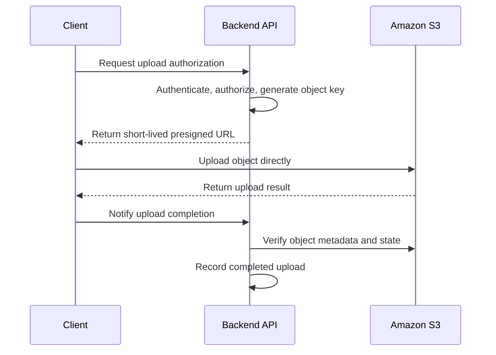

# 01- S3 Request Performance

## Overview

Amazon S3 is designed to support high request rates and parallel object transfers. Production performance depends on more than the storage service itself: application concurrency, network throughput, connection reuse, object size, request distribution, retry behavior, and downstream processing all influence end-to-end latency and throughput.

A well-designed S3 workload should maximize useful parallelism without overwhelming application resources or creating unnecessary requests.

This document covers request-level performance optimization for general purpose S3 buckets, with practical recommendations for Python backends, distributed workers, data-processing systems, and high-throughput applications.

The primary objectives are to:

- Reduce request latency and improve throughput.
- Scale uploads and downloads using bounded concurrency.
- Handle transient errors without creating retry storms.
- Optimize large-object transfers and repeated reads.
- Identify whether S3, networking, application processing, or another dependency is the bottleneck.
- Measure improvements before deploying performance changes to production.

## Understand S3 Request Performance

### Request rate and prefix scaling

Amazon S3 automatically scales to support high request rates. AWS documents the following performance guidance for general purpose buckets:

| Request category | Baseline documented by AWS, per partitioned prefix |
|---|---:|
| GET and HEAD requests | At least 5,500 requests per second |
| PUT, COPY, POST, and DELETE requests | At least 3,500 requests per second |

These figures are request-rate guidance, not guaranteed application throughput or universal hard limits. Actual performance depends on workload characteristics, and scaling to a new request pattern occurs gradually.

A prefix is the beginning portion of an object key. For example, `uploads/2026/10/report.pdf` belongs to the `uploads/2026/10/` prefix.

S3 has no fixed limit on the number of prefixes in a bucket. Workloads that require more aggregate request capacity can distribute requests across multiple prefixes where that distribution is useful.

**Important:** Modern S3 applications do not need random object-key prefixes merely to avoid a historical partitioning bottleneck. Logical key naming is appropriate. Distribute a workload when measured request patterns and performance behavior justify it rather than adding artificial complexity preemptively.

Reference: [Amazon S3 performance design patterns](https://docs.aws.amazon.com/AmazonS3/latest/userguide/optimizing-performance-design-patterns.html).

### Distinguish latency, throughput, and request rate

These measurements describe different aspects of performance.

| Metric | Meaning | Example optimization |
|---|---|---|
| Request latency | Time required to complete an individual operation | Reuse connections, reduce network distance, retry transient slow requests |
| Throughput | Amount of data transferred per unit of time | Multipart uploads, parallel downloads, larger efficient transfers |
| Request rate | Number of operations completed per second | Bounded concurrency, workload distribution, batched application processing |
| Time to first byte | Time until response data starts arriving | Reduce connection setup overhead and use a suitable network path |
| End-to-end processing time | Total time from application initiation to completed business operation | Optimize S3 transfer, validation, database operations, and downstream processing |
| Error and retry rate | Frequency of unsuccessful requests and retries | Correct configuration, gradual scaling, bounded retries, and backoff |

A workload can have a high request rate but low data throughput when it processes many small objects. Conversely, a workload transferring a few large objects can saturate its network while issuing relatively few requests.

Choose optimization techniques according to the limiting metric.

## Establish a Performance Baseline

Before changing concurrency, multipart settings, or bucket organization, measure the current workload.

### Capture representative workload characteristics

Record:

- Object count and object-size distribution.
- Average and peak request rates.
- Upload and download data volumes.
- Latency percentiles, including p50, p95, and p99.
- HTTP 4xx and 5xx responses.
- Retry counts and total transfer duration.
- Application CPU and memory utilization.
- Network bandwidth and connection utilization.
- KMS request volume when SSE-KMS is used.
- Cost per processed object or transferred gigabyte.

Use representative test data. A benchmark that transfers one large file does not predict the behavior of a workload processing millions of small files.

### Separate the stages of request latency

For an application upload, the end-to-end duration may include:

1. Request validation and authorization.
2. Local file preparation or database lookup.
3. DNS resolution and connection establishment.
4. TLS negotiation when a connection is established.
5. Data transfer to S3.
6. S3 request processing.
7. Application post-processing and state updates.

Measure the stages independently when possible. If data transfer is fast but the API still responds slowly, increasing S3 concurrency may not solve the actual problem.

### Benchmark under controlled conditions

Use a representative environment and vary one parameter at a time.

For example, measure transfer performance with concurrency levels of 1, 2, 4, and 8. Compare the results while watching network utilization, CPU usage, memory, retry rate, and latency percentiles.

Do not assume the highest concurrency value is the best. Additional parallelism can increase memory use, connection contention, API request volume, and downstream pressure without increasing completed throughput.

## Scale Requests with Bounded Concurrency

### Use parallel requests when the workload supports them

Multiple concurrent requests can improve aggregate throughput by making better use of available network capacity.

Suitable workloads include:
- Uploading independent files from a processing pipeline.
- Downloading multiple objects for an ETL job.
- Processing independent datasets with Celery workers.
- Transferring large objects through multipart operations.
- Serving multiple independent downloads.

Parallelism is less useful when the application is CPU-bound, constrained by disk I/O, limited by a downstream service, or already saturating the available network.

### Use workload-aware concurrency limits

For a backend service, concurrency should be bounded at multiple levels:

- Per file or transfer.
- Per worker process.
- Per application instance.
- Across the deployment when a shared downstream capacity limit exists.

For example, if each application instance allows 8 simultaneous file transfers and 10 instances run concurrently, the system can initiate up to 80 concurrent transfers. If each transfer also uses 8 internal multipart operations, the potential number of active part requests can be substantially higher.

Model these limits together rather than setting every concurrency parameter independently.

### Avoid serial processing of independent objects

A sequential loop can leave available network capacity unused:

```python
for file_path in file_paths:
    s3_client.upload_file(file_path, bucket, object_key(file_path))
```

For independent objects, bounded parallel processing can improve throughput. The following example uses a thread pool and limits the number of simultaneous file uploads.

```python
from concurrent.futures import ThreadPoolExecutor, as_completed
from pathlib import Path
from typing import Iterable

import boto3
from botocore.config import Config
from boto3.s3.transfer import TransferConfig


BUCKET = "example-private-bucket"

client = boto3.client(
    "s3",
    region_name="ap-south-1",
    config=Config(
        retries={
            "mode": "standard",
            "total_max_attempts": 6,
        },
        max_pool_connections=16,
        connect_timeout=5,
        read_timeout=120,
    ),
)

transfer_config = TransferConfig(
    multipart_threshold=64 * 1024 * 1024,
    multipart_chunksize=16 * 1024 * 1024,
    max_concurrency=4,
    use_threads=True,
)


def upload_file(file_path: Path) -> str:
    key = f"ingestion/{file_path.name}"

    client.upload_file(
        str(file_path),
        BUCKET,
        key,
        Config=transfer_config,
    )

    return key


def upload_many(file_paths: Iterable[Path]) -> list[str]:
    paths = list(file_paths)
    uploaded: list[str] = []

    with ThreadPoolExecutor(max_workers=4) as executor:
        futures = {
            executor.submit(upload_file, path): path
            for path in paths
        }

        for future in as_completed(futures):
            path = futures[future]
            try:
                uploaded.append(future.result())
            except Exception:
                # Record the file and failure in application logging.
                # The caller should apply its retry or recovery policy.
                raise RuntimeError(
                    f"Upload failed for {path}"
                ) from future.exception()

    return uploaded
```

This example intentionally sets both file-level and multipart-level concurrency. Its maximum parallelism is not simply four; each sufficiently large transfer can run multiple part operations.

The multipart threshold, part size, connection pool, timeouts, retry count, and worker count are starting values for benchmarking, not universal production defaults. Use unique, controlled object keys and define overwrite behavior explicitly.

For workloads where individual files can fail independently, record each outcome and continue processing eligible files instead of allowing one exception to terminate the entire batch.

### Tune connection pools

AWS SDK HTTP connection pools reuse connections and reduce repeated connection establishment overhead.

The `max_pool_connections` setting in Botocore controls the size of its connection pool. It should be appropriate for the intended concurrency.

A pool that is too small can limit concurrency or cause connection contention. A very large pool consumes resources and does not guarantee better throughput.

Reuse configured clients rather than creating a new S3 client for every request. In multiprocess deployments, create or initialize clients appropriately within each process rather than sharing live client connections across process forks.

Reference: [Performance guidelines for Amazon S3](https://docs.aws.amazon.com/AmazonS3/latest/userguide/optimizing-performance-guidelines.html).

## Optimize Large-Object Uploads

### Use multipart upload for large files

Multipart upload divides one object into independently uploaded parts that S3 combines when the upload is completed.

It provides:
- Concurrent transfer of parts.
- Retry of failed parts without retransmitting the entire object.
- Better recovery from intermittent network failures.
- Improved ability to use available bandwidth.

AWS recommends multipart upload for objects of 100 MB or larger. The most suitable threshold depends on network reliability, expected object size, concurrency, and the cost of additional requests.

For Python, Boto3's `upload_file()` transfer manager can handle multipart uploads automatically according to its transfer configuration.

Example:

```python
from boto3.s3.transfer import TransferConfig

transfer_config = TransferConfig(
    multipart_threshold=100 * 1024 * 1024,
    multipart_chunksize=16 * 1024 * 1024,
    max_concurrency=8,
    use_threads=True,
)

s3_client.upload_file(
    "large-dataset.parquet",
    "example-private-bucket",
    "datasets/large-dataset.parquet",
    Config=transfer_config,
)
```

Tune part size and concurrency based on object size and measurements. More parts create additional requests and can increase memory and scheduling overhead.

Incomplete multipart uploads can continue to incur storage charges. Use an appropriate lifecycle rule to abort incomplete multipart uploads after a suitable period, while accounting for legitimate long-running uploads.

Reference: [Multipart upload overview](https://docs.aws.amazon.com/AmazonS3/latest/userguide/mpuoverview.html).

### Understand the reliability trade-offs

A multipart transfer can fail before completion even if some parts were successfully uploaded. The application should distinguish between:

- A completed upload.
- A failed upload that can be retried.
- An incomplete multipart upload requiring cleanup.
- An ambiguous outcome where the client did not receive confirmation.

Do not assume that a client timeout proves the object was not created. Verify object state where necessary before retrying a non-idempotent business operation.

Use SDK-managed transfer mechanisms unless specialized control over individual parts is required.

## Optimize Large-Object Downloads

### Use byte-range requests

The S3 `GetObject` operation supports the HTTP `Range` header. Applications can request selected byte ranges rather than downloading an entire object.

Concurrent range requests can improve throughput and limit the amount of data retransferred if an individual request fails.

Example:

```python
response = s3_client.get_object(
    Bucket="example-private-bucket",
    Key="datasets/large-dataset.parquet",
    Range="bytes=0-1048575",
)

with response["Body"] as body:
    first_megabyte = body.read()
```

The example downloads the first 1 MiB of the object. It does not download the complete file.

For parallel downloads, divide the object into non-overlapping byte ranges and write each response to its correct location. Ensure that the client knows the expected object size and handles changes to the object between range requests.

### Preserve object consistency across range requests

If the underlying object is overwritten while multiple ranges are being downloaded, the ranges could otherwise correspond to different object versions.

For operations requiring a consistent snapshot, use version-aware access or appropriate conditional requests, and ensure every part refers to the same object state.

For objects originally uploaded through multipart upload, aligning download ranges with the original part boundaries can improve performance in suitable workloads.

### Avoid over-parallelizing downloads

Start with one request, measure throughput, and increase concurrency gradually. High concurrency is not useful when the client network or disk cannot accept the incoming data.

Bound the number of outstanding range requests and use temporary files or a controlled streaming destination for large datasets. Avoid loading entire multi-gigabyte objects into application memory without a clear reason.

## Reuse Data Through Caching

### Use CloudFront for repeated content delivery

When many users request the same objects, Amazon CloudFront can cache content at edge locations and reduce repeated origin requests.

A common architecture is:


CloudFront is particularly useful for:
- Images, documents, and static assets.
- Software packages and downloadable datasets.
- Publicly distributable objects.
- Content delivered to geographically distributed clients.

Use an appropriate cache policy and control how object updates invalidate cached content. Immutable versioned object keys can reduce invalidation requirements.

For private content, enforce access through signed URLs, signed cookies, or the relevant application authorization design. A cache hit must not bypass the intended authorization boundary.

### Cache metadata where it is safe

Applications often repeatedly fetch the same object metadata before serving or processing content.

Consider caching stable metadata such as object size, content type, and application-owned identifiers in a database or Redis when doing so removes repeated HEAD requests.

Invalidate or update the cache when the object changes. If the application needs to distinguish object versions, store version-aware identifiers or the relevant validation metadata.

Avoid building a cache that can indefinitely return stale authorization decisions or object references after deletion or replacement.

## Reduce Network Latency

### Keep compute and storage in the same Region where appropriate

For workloads running on Amazon EC2, ECS, EKS, or Lambda, place compute and S3 storage in a suitable Region unless latency, residency, availability, or disaster recovery requirements dictate otherwise.

Cross-Region data access adds network latency and can introduce data-transfer costs. For distributed processing systems, moving compute closer to the data is often preferable to repeatedly transferring large datasets between Regions.

Within a VPC, consider an S3 VPC endpoint when appropriate. A gateway endpoint for general purpose S3 buckets can provide private routing without requiring a NAT gateway for the S3 traffic covered by its route table.

Validate endpoint policies, bucket policies, route tables, and DNS behavior before introducing endpoint-specific restrictions.

### Evaluate S3 Transfer Acceleration

S3 Transfer Acceleration uses AWS edge locations and the AWS network to accelerate transfers between geographically distributed clients and an S3 bucket.

Consider it for workloads that frequently transfer large amounts of data from distant client locations to a centralized bucket.

Before enabling it:
- Benchmark the normal endpoint against the accelerated endpoint.
- Test representative client locations and upload sizes.
- Compare throughput, latency, and cost.
- Confirm compatibility with the application's request-signing and endpoint configuration.

Transfer Acceleration is not guaranteed to improve every request. It is most useful when network distance and the path between the client and the Region are significant bottlenecks.

Reference: [Amazon S3 Transfer Acceleration](https://docs.aws.amazon.com/AmazonS3/latest/userguide/transfer-acceleration.html).

## Design Retries and Timeouts Correctly

### Use SDK retries for transient failures

Large distributed services can temporarily return retryable errors, including HTTP 500 and 503 responses. Request latency can also vary with network conditions.

Use the AWS SDK's retry support instead of implementing an uncontrolled retry loop around every operation.

The standard retry mode provides retry behavior for supported transient errors and throttling conditions. Configure an appropriate total attempt count and timeouts for the application's request budget.

Retries increase the total number of requests. When many workers retry simultaneously, poorly designed retry logic can intensify load during an incident.

### Apply bounded backoff and jitter

A retry strategy should:
- Retry only eligible failures.
- Use exponential backoff with jitter when implementing custom retries.
- Bound the total number of attempts.
- Respect the remaining application deadline.
- Preserve request identifiers and relevant failure details.
- Avoid retrying permanent authorization, validation, or configuration errors indefinitely.

SDKs handle many common transient errors automatically. Add application-level retries only when necessary for the business operation, and avoid unintentionally stacking two unbounded retry mechanisms.

### Distinguish upload failure from ambiguous completion

Suppose an application uploads an object successfully, but the response is lost before the client receives it. A subsequent retry may overwrite the same key.

This can be safe when the operation is intentionally idempotent, the key is stable, and overwrite behavior is acceptable. It may be unsafe when each upload represents a separate business event or an immutable artifact.

Use deterministic operation identifiers, controlled object-key generation, and application-level state tracking to reconcile ambiguous outcomes.

### Align timeouts with transfer sizes

A read timeout of a few seconds can be inappropriate for an operation transferring a large object over a constrained connection.

Set timeouts based on expected transfer duration, network variability, the maximum acceptable operation duration, and the behavior of the surrounding API or worker.

For interactive APIs, consider asynchronous processing or direct client-to-S3 uploads instead of increasing HTTP timeouts indefinitely.

## Use Presigned URLs for Direct Transfers

### Keep the backend out of the data path when possible

For a large file upload, routing the entire payload through a Django or FastAPI application can consume application bandwidth, worker capacity, memory, and connection slots.

A direct upload architecture allows the backend to authorize an operation and issue a presigned URL. The client then transfers the data directly to S3.



The application still owns authorization and business state. It must not trust a client-side completion message without appropriate verification.

For large uploads, design the direct upload flow around multipart upload when required. The backend can manage upload initiation and completion while authorized clients or workers transfer individual parts.

### Validate after upload

Before marking an uploaded object as available:
- Verify that the expected object exists.
- Check actual size and relevant metadata.
- Validate content independently of client-provided headers.
- Perform malware scanning or content processing when required.
- Record the final object version or other stable identifier where appropriate.

Presigned URLs are temporary capabilities, not a substitute for access control, validation, encryption, or secure key design.

## Optimize High-Request-Rate Workloads

### Distribute workloads based on observed behavior

If an application sustains high request rates against the same prefix, evaluate the actual request distribution and service responses.

Potential strategies include:
- Bounded concurrent workers.
- Logical distribution of objects across workload prefixes.
- Separating independent read and write workloads.
- Reducing duplicate GET and HEAD requests.
- Aggregating very small records where appropriate.
- Using asynchronous queues to smooth bursts.

Adding more prefixes does not instantly allocate additional capacity, and it does not solve every bottleneck. S3 automatically scales based on access patterns, but abrupt increases in traffic can temporarily produce elevated 503 responses while the service adjusts.

Avoid hardcoding assumptions that every prefix provides an immediately available fixed performance quota.

### Reduce unnecessary object requests

Object storage workloads often create avoidable request overhead by performing extra operations for every file.

For example:
- Listing an entire bucket before processing each task.
- Issuing HEAD followed by GET when required metadata is already available.
- Checking for object existence before every upload.
- Repeatedly downloading the same reference object.
- Writing many tiny fragments that could be safely aggregated.

Replace repeated scans with S3 Inventory, manifests, application metadata, or a purpose-built index where appropriate.

S3 provides strong read-after-write consistency for object writes and list operations. Do not add arbitrary propagation delays or polling solely to wait for a successful write to become visible.

Reference: [Amazon S3 consistency model](https://docs.aws.amazon.com/AmazonS3/latest/userguide/Welcome.html#ConsistencyModel).

## Optimize Python Backend Integrations

### Keep the S3 service layer reusable

In Django, Django REST Framework, FastAPI, and Flask applications, centralize S3 client configuration and transfer operations in a service layer.

The service layer should own:
- Client configuration and credential resolution.
- Bucket and key selection.
- Transfer thresholds and concurrency.
- Retries and timeout configuration.
- Error classification and structured logging.
- Presigned URL generation.
- Transfer and completion-state verification.

Do not embed S3 performance settings independently in every API route. A shared service layer makes it possible to benchmark and adjust the configuration consistently.

### Avoid blocking API capacity with large transfers

In an API application, consider the runtime model:

- A synchronous Django or Flask worker can remain occupied during a long transfer.
- An asynchronous FastAPI route does not become non-blocking merely because a blocking Boto3 call is invoked inside it.
- Moving work to Celery can protect API worker capacity, but introduces queue latency and additional operational concerns.
- Direct client uploads can remove much of the payload transfer from the application path.

For background processing, use bounded task concurrency and tune worker counts alongside the S3 transfer manager's internal concurrency.

### Handle errors at the correct layer

Use structured logs with:
- Bucket and object identifier where safe.
- Operation type.
- Transfer duration and bytes transferred.
- Attempt count.
- AWS request identifiers when available.
- Error code and HTTP status.
- Correlation ID for the originating business operation.

Avoid logging presigned URLs, credentials, sensitive object metadata, or private customer data.

The API should translate storage errors into appropriate application outcomes without leaking internal credentials or AWS request details to clients.

## Monitor and Diagnose Performance

### Track meaningful signals

Use CloudWatch S3 request metrics when enabled, application telemetry, and relevant infrastructure metrics to evaluate performance.

Recommended indicators include:

| Signal | Why it matters |
|---|---|
| GET, PUT, and other operation counts | Confirms actual request volume |
| First-byte and total request latency | Identifies slow S3 operations |
| 5xx and 503 response counts | Indicates transient service or scaling-related issues |
| Retry count and retry duration | Reveals additional load and latency caused by retries |
| Upload and download throughput | Shows whether network capacity is being used effectively |
| CPU, memory, and network utilization | Identifies application-side bottlenecks |
| Queue depth and oldest task age | Reveals whether workers can keep up with ingestion |
| KMS request metrics and throttling | Helps diagnose encrypted workload bottlenecks |
| Transfer cost and request cost | Confirms whether an optimization is economically justified |

Use the appropriate metric source for the desired granularity. S3 request metrics are configurable, and metric availability can differ from basic storage and bucket metrics. Application-level measurements are often necessary for complete end-to-end latency analysis.

### Diagnose 503 responses methodically

When 503 responses increase:

1. Determine which S3 operations are failing and whether errors affect a specific prefix or workload.
2. Check whether request volume recently increased sharply.
3. Inspect retry counts, concurrency, and application resource pressure.
4. Verify whether errors coincide with deployment or network changes.
5. Reduce sudden request-rate growth where possible and allow scaling to adapt.
6. Confirm whether SDK retries successfully recover or whether failures persist.
7. Reassess request distribution, connection use, and workload design.

Do not respond to every 503 by immediately increasing concurrency. More concurrency can increase error volume and worsen the situation.

## Common Performance Mistakes

| Mistake | Consequence | Better practice |
|---|---|---|
| Uploading every file sequentially | Leaves network capacity unused | Use bounded parallel transfers |
| Setting unlimited concurrency | Exhausts memory, connections, or downstream capacity | Establish explicit concurrency budgets |
| Using single-part uploads for every large file | Poor recovery and transfer efficiency | Use multipart upload where appropriate |
| Downloading large objects into memory in full | High memory usage and potential worker exhaustion | Stream data or use byte-range requests |
| Creating a fresh S3 client per operation | Adds connection setup overhead | Reuse correctly configured clients |
| Retrying permanent failures | Wastes requests and increases latency | Classify errors and bound attempts |
| Retrying all workers simultaneously | Can create retry storms | Use SDK retries or bounded backoff with jitter |
| Randomizing every object key by default | Adds naming and operational complexity | Use logical keys and measure request distribution |
| Proxying all large uploads through API workers | Consumes backend bandwidth and worker capacity | Consider direct uploads using presigned URLs |
| Ignoring incomplete multipart uploads | Generates avoidable storage costs | Apply a suitable cleanup lifecycle rule |
| Benchmarking from one client environment | Produces misleading conclusions | Test representative object sizes, networks, and regions |
| Tuning only for average latency | Hides tail-latency and failure behavior | Track p95, p99, errors, and retries |

## Production Readiness Checklist

- [ ] Request latency, throughput, request rate, and error-rate baselines are documented.
- [ ] Upload and download concurrency limits are bounded at application and transfer-manager levels.
- [ ] SDK clients are reused appropriately and connection pools match expected workload concurrency.
- [ ] Large uploads use a tested multipart configuration.
- [ ] Large downloads use streaming or parallel byte-range retrieval when beneficial.
- [ ] Retries are bounded and respect application deadlines.
- [ ] Timeouts are appropriate for expected object sizes and network conditions.
- [ ] APIs avoid unnecessarily proxying large payloads through application workers.
- [ ] Presigned URL flows validate the completed upload before accepting it as trusted application data.
- [ ] High request rates are distributed based on measured workload needs rather than historical prefix-randomization rules.
- [ ] S3 and application telemetry can identify latency, throughput, 5xx responses, and retry patterns.
- [ ] Performance benchmarks include realistic object sizes, request concurrency, and network conditions.
- [ ] Incomplete multipart uploads are managed through an explicit cleanup policy.
- [ ] Performance changes are validated for security, reliability, and cost before full rollout.

## Authoritative References

- [Performance design patterns for Amazon S3](https://docs.aws.amazon.com/AmazonS3/latest/userguide/optimizing-performance-design-patterns.html)
- [Performance guidelines for Amazon S3](https://docs.aws.amazon.com/AmazonS3/latest/userguide/optimizing-performance-guidelines.html)
- [Multipart upload overview](https://docs.aws.amazon.com/AmazonS3/latest/userguide/mpuoverview.html)
- [Downloading objects and byte-range requests](https://docs.aws.amazon.com/AmazonS3/latest/userguide/download-objects.html)
- [Amazon S3 Transfer Acceleration](https://docs.aws.amazon.com/AmazonS3/latest/userguide/transfer-acceleration.html)
- [Boto3 S3 transfer configuration](https://boto3.amazonaws.com/v1/documentation/api/latest/guide/s3.html)
- [S3 request metrics](https://docs.aws.amazon.com/AmazonS3/latest/userguide/metrics-dimensions.html)

## Key Takeaways

- Measure latency, throughput, request rate, retries, and application resource utilization before tuning an S3 workload.
- Use bounded concurrency, multipart transfers, byte-range downloads, and reusable SDK clients to improve throughput without exhausting resources.
- Design retries and timeouts for transient failures, and avoid retry storms or ambiguous duplicate business operations.
- Use CloudFront, direct presigned uploads, and suitable network paths to reduce repeated requests and unnecessary application data transfer.
- Optimize based on measured workload behavior, not outdated assumptions about random prefixes or a single universal concurrency setting.
You've reached the maximum length for this conversation, but you can keep talking by starting a new chat.
Start new chat