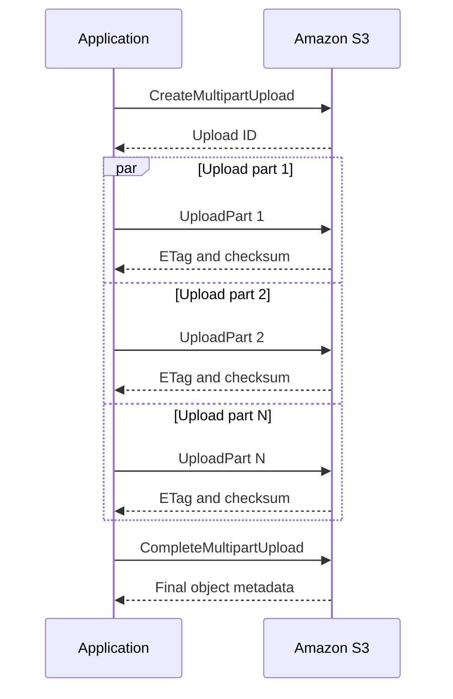
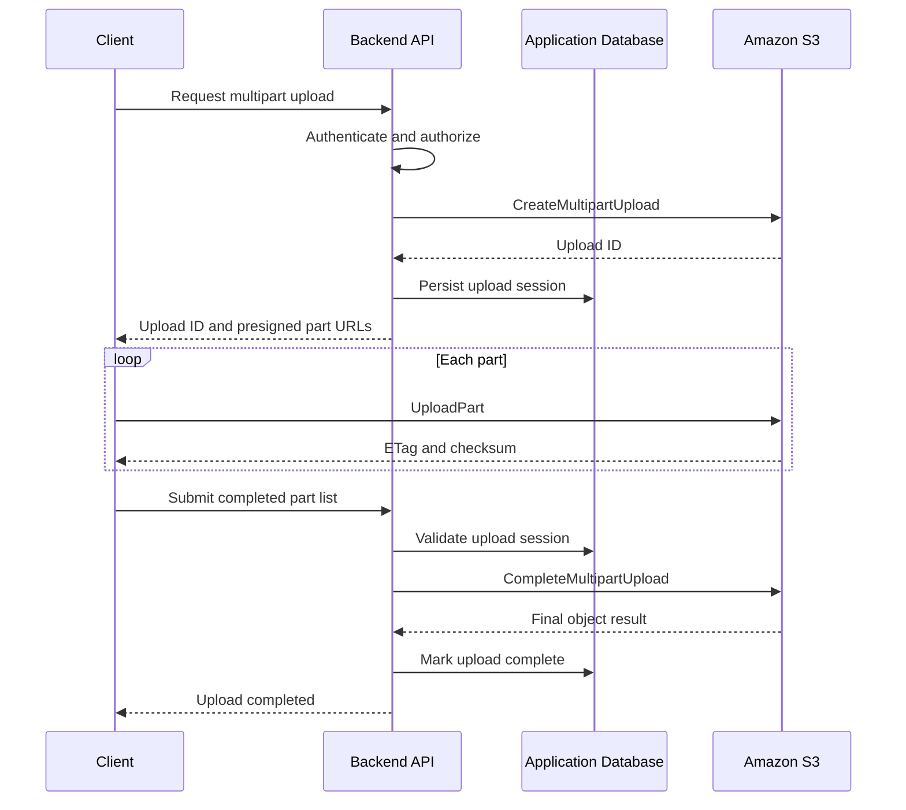

# 03- Multipart Upload Performance

## Overview

Amazon S3 multipart upload divides a large object into independently uploadable parts. Amazon S3 assembles the parts into the final object when the application completes the upload.

Multipart upload is a key performance technique for transferring large files because it supports parallel requests, retries at the part level, and workflows that can resume after interruptions.

For production backend systems, the objective is not simply to increase concurrency. It is to maximize useful network throughput while controlling memory consumption, CPU utilization, request overhead, failure recovery, and cost.

Typical use cases include:
- Large video, image, and document uploads.
- Data lake ingestion and analytics exports.
- Database backups and application-generated archives.
- Direct client-to-S3 uploads using presigned URLs.
- High-throughput ingestion from distributed workers.
- Large object transfers over unreliable networks.

## Understand the Multipart Upload Lifecycle

A multipart upload consists of three principal stages.

1. **Initiate:** Create a multipart upload and receive an upload ID.
2. **Upload parts:** Transfer numbered parts independently, potentially in parallel.
3. **Complete:** Submit the uploaded part numbers and corresponding ETags to assemble the object.

If the transfer cannot be completed, the application can retry failed parts or abort the upload to release the resources associated with the incomplete transfer.



Each part is associated with an upload ID and a part number. Parts can be uploaded independently and out of order. Uploading another part with an existing part number replaces the previously uploaded part at that number.

The application must preserve the required part identifiers and ETags to complete the upload correctly.

Multipart upload improves transfer performance and recoverability, but it does not automatically provide application-level resumability. A resumable workflow must persist the upload ID and enough state to recover after process or machine failure.

## Know the Multipart Upload Limits

Current general-purpose S3 multipart upload specifications include the following limits.

| Property | Limit or behavior |
|---|---|
| Maximum object size | 50 TB, approximately 48.8 TiB |
| Maximum parts per upload | 10,000 |
| Valid part numbers | 1–10,000 |
| Part size | 5 MiB to 5 GiB |
| Minimum size of the final part | No minimum size |
| Maximum parts returned by one `ListParts` response | 1,000 |
| Maximum multipart uploads returned by one `ListMultipartUploads` response | 1,000 |

A single `PutObject` request supports objects up to 5 GB. For large files, multipart upload is generally worth considering at around 100 MB, although the appropriate threshold depends on the workload.

Consult the current [S3 multipart upload limits](https://docs.aws.amazon.com/AmazonS3/latest/userguide/qfacts.html) before implementing an uploader, especially when working with unusually large objects or specialized bucket types.

### Calculate part count before transferring

For an object of size \(S\) and configured part size \(P\), the approximate part count is:

\[
N = \left\lceil \frac{S}{P} \right\rceil
\]

For example, a 100 GiB file divided into 64 MiB parts requires:

\[
N = \frac{100 \times 1024}{64} = 1600
\]

This is within the 10,000-part limit.

For very large objects, choose a part size that keeps the part count below 10,000, with sufficient headroom for changes in object size.

## Choose an Appropriate Part Size

Part size directly affects throughput, retry cost, request overhead, and resource utilization.

| Part size | Advantages | Trade-offs |
|---|---|---|
| 8–16 MiB | Smaller retries and finer-grained progress | More requests for large objects |
| 32–64 MiB | Practical starting range for many large-file workloads | Requires benchmarking and resource monitoring |
| 128–256 MiB | Fewer requests for very large objects | Failed parts require more data to be retransmitted |
| Near 5 GiB | Useful only for specialized transfer patterns | Large retry cost and higher per-part buffering pressure |

These values are tuning candidates, not universal performance guarantees.

### Smaller parts

Smaller parts provide finer-grained retries and progress reporting. They can be beneficial over unstable networks, where retransmitting a large part would be expensive.

However, a large file divided into small parts creates more requests and completion metadata. Excessively small parts can increase overhead and limit throughput.

### Larger parts

Larger parts reduce the number of upload requests needed for a given object size.

They are useful when:
- The source network is stable.
- Each request can transfer data efficiently.
- The workload contains very large objects.
- Request overhead is significant relative to data transfer time.

The trade-off is that a failed part may need to be retransmitted in full, depending on where the failure occurs and the upload implementation.

### Benchmark rather than guess

Measure several combinations of part size and concurrency using representative object sizes and network conditions.

A useful initial benchmark matrix might be:

| Test | Part size | Per-upload concurrency |
|---|---:|---:|
| Baseline | 16 MiB | 4 |
| Balanced | 64 MiB | 4 |
| Higher parallelism | 64 MiB | 8 |
| Larger parts | 128 MiB | 4 |

Record throughput, elapsed time, retry count, memory use, CPU utilization, and request failures. Repeat tests enough times to distinguish sustained performance from temporary network variation.

## Tune Concurrency for Network Throughput

### Understand request parallelism

A sequential uploader transfers one part at a time. A concurrent uploader transfers multiple parts simultaneously, allowing it to use more of the available network bandwidth.

Approximate aggregate throughput can be expressed as:

\[
T \approx \min(C \times t_p,\ B,\ D)
\]

Where:

- \(T\) is achievable transfer throughput.
- \(C\) is the number of active requests.
- \(t_p\) is the effective throughput of one request.
- \(B\) is the available network bandwidth.
- \(D\) is the effective source-read or destination-write throughput.

This is a conceptual model. Real-world performance also depends on request latency, TCP behavior, SDK implementation, TLS overhead, retries, and network contention.

Concurrency stops helping when the workload is already constrained by bandwidth, CPU, storage I/O, or downstream limits.

### Avoid excessive concurrency

Increasing concurrency can improve throughput, but it also increases pressure on:
- Memory and I/O buffers.
- Socket and connection pools.
- CPU used for checksums, encryption, and TLS.
- NAT gateways and other shared network infrastructure.
- S3 request volume.
- Other workloads sharing the same host.

Start with modest concurrency and increase it only when metrics show available headroom.

For example, eight concurrent 64 MiB parts can represent up to 512 MiB of part data in flight. Actual memory consumption depends on the SDK and its buffering strategy, so this calculation should be treated as a resource-planning warning rather than an exact memory prediction.

For containers, establish CPU and memory limits and test under those limits. Avoid configuring concurrency solely from the host's maximum network capacity.

## Configure Multipart Upload in Python with Boto3

Boto3 provides managed transfer support through `upload_file()`. It handles multipart initiation, part transfers, concurrency, retries, and completion when appropriate for the configured transfer settings.

```python
import os
from pathlib import Path

import boto3
from boto3.s3.transfer import TransferConfig


def upload_large_file(
    file_path: str,
    bucket: str,
    object_key: str,
    region: str = "ap-south-1",
) -> None:
    path = Path(file_path)

    if not path.is_file():
        raise FileNotFoundError(f"File does not exist: {path}")

    s3_client = boto3.client("s3", region_name=region)

    transfer_config = TransferConfig(
        multipart_threshold=64 * 1024 * 1024,
        multipart_chunksize=64 * 1024 * 1024,
        max_concurrency=8,
        use_threads=True,
    )

    s3_client.upload_file(
        str(path),
        bucket,
        object_key,
        Config=transfer_config,
    )


if __name__ == "__main__":
    upload_large_file(
        file_path=os.environ["UPLOAD_FILE_PATH"],
        bucket=os.environ["S3_BUCKET"],
        object_key=os.environ["S3_OBJECT_KEY"],
    )
```

This example uses:
- A 64 MiB multipart threshold.
- A 64 MiB part size.
- Up to eight concurrent transfer requests managed by the transfer implementation.
- Threaded transfer execution.

Boto3 obtains credentials through its standard credential provider chain. Use IAM roles, workload identity, or another approved credential provider instead of hardcoding access keys.

### Important implementation considerations

**Threshold and part size are different settings.** The threshold determines when the managed transfer chooses multipart upload, while the chunk size determines the part size used by multipart transfers.

**Managed transfers do not automatically make every upload resumable across process restarts.** If durable recovery is required, build or select an uploader that persists multipart state and reconciles it with S3.

**Do not blindly use the same settings for every workload.** A small API upload, a 50 GiB backup, and a batch ingestion worker can have different throughput and resource constraints.

Reference: [Boto3 managed file transfers](https://boto3.amazonaws.com/v1/documentation/api/latest/guide/s3.html#file-transfer-configuration).

## Optimize AWS CLI Multipart Transfers

The AWS CLI high-level `s3` commands support configurable multipart thresholds, part sizes, and concurrent requests.

For example, tune a dedicated CLI profile for a transfer host:

```bash
aws configure set profile.s3-perf.s3.multipart_threshold 64MB
aws configure set profile.s3-perf.s3.multipart_chunksize 64MB
aws configure set profile.s3-perf.s3.max_concurrent_requests 20
```

Use the configured profile for uploads:

```bash
aws s3 cp ./database-backup.tar \
  "s3://${BUCKET}/backups/database-backup.tar" \
  --profile s3-perf
```

The high-level `aws s3` commands use managed transfer behavior. The `s3api` commands expose lower-level S3 operations and should not be assumed to have identical transfer management.

The values above are illustrative. Test them against the actual host capacity and workload before adopting them for production.

The AWS CLI supports additional tuning, including bandwidth limits. See the [AWS CLI S3 configuration reference](https://docs.aws.amazon.com/cli/latest/topic/s3-config.html).

## Implement Direct-to-S3 Uploads for Backend APIs

For large uploads from browsers or mobile applications, a backend does not need to proxy the entire file through an API server.

A common architecture is:

1. The client requests an upload session from the backend.
2. The backend authenticates the caller and authorizes the target object.
3. The backend creates a multipart upload and stores its upload ID and state.
4. The backend issues presigned `UploadPart` URLs for authorized part numbers.
5. The client uploads parts directly to S3, potentially in parallel.
6. The client submits the uploaded-part results to the backend.
7. The backend validates the session and completes the multipart upload.
8. The backend records the final object state and makes the object available.



This approach reduces API bandwidth and application-server memory pressure. However, it shifts some transfer management to the client, so the protocol must handle retries, incomplete sessions, expiration of presigned URLs, and interrupted uploads.

### Protect the upload completion boundary

The backend should not blindly accept an arbitrary upload ID or part list from the client.

Validate that:
- The upload session belongs to the authenticated user or tenant.
- The bucket and object key match the server-created session.
- The upload has not expired or already been completed.
- Part numbers are valid and unique.
- Part identifiers correspond to the expected upload.
- The final object satisfies application-level requirements.

After completion, validate the object metadata and other required integrity properties before marking it available for downstream processing.

Presigned URLs are temporary bearer capabilities. Keep expiration periods appropriate, do not log complete URLs, and do not expose URLs for objects the caller is not authorized to manage.

Reference: [Multipart upload overview](https://docs.aws.amazon.com/AmazonS3/latest/userguide/mpuoverview.html).

## Build Reliable Retry and Resume Behavior

### Retry only what failed

One of the main advantages of multipart upload is that a failed part can be retransmitted without restarting the entire object upload.

A reliable uploader should distinguish between:
- A transient network failure.
- A throttling or temporary service error.
- Expired or invalid credentials.
- An authorization failure.
- A request-signing or configuration error.
- An unrecoverable source-file change.

Retry transient failures with bounded exponential backoff and jitter. Respect SDK retry behavior rather than introducing an additional aggressive retry loop around every SDK operation.

Do not repeatedly retry permanent failures such as an invalid authorization policy. Detect them, surface the cause, and stop the upload safely.

### Persist resumable upload state

A resumable uploader may need to persist the following information:

| Field | Purpose |
|---|---|
| Application upload ID | Identifies the application's upload session |
| S3 upload ID | Identifies the multipart upload in S3 |
| Bucket and object key | Identifies the intended destination |
| Source identity | Helps detect a changed source file |
| Part size and expected object size | Supports correct part planning |
| Completed part numbers | Tracks transfer progress |
| Part ETags and checksums | Provides data for completion and integrity validation |
| Session status and expiry | Prevents invalid or duplicate completion |
| Ownership metadata | Enforces authorization and tenant isolation |

Store session state in a durable database when uploads must survive application restarts, worker replacement, or browser interruptions.

Use conditional state transitions or transactions to prevent concurrent completion attempts. An idempotent completion workflow should account for the case where S3 completes the object successfully but the application loses the response before updating its database.

In that case, inspect the destination object and reconcile state rather than assuming the operation failed.

## Clean Up Incomplete Multipart Uploads

Multipart uploads consume storage for uploaded parts until the upload is completed or aborted. Incomplete uploads can therefore create unexpected storage costs.

Use two complementary cleanup mechanisms:

- **Application cleanup:** Abort expired sessions whose owners have abandoned the upload.
- **S3 Lifecycle cleanup:** Configure an `AbortIncompleteMultipartUpload` rule as a safety net.

Example lifecycle configuration:

```json
{
  "Rules": [
    {
      "ID": "AbortIncompleteMultipartUploads",
      "Status": "Enabled",
      "Filter": {
        "Prefix": ""
      },
      "AbortIncompleteMultipartUpload": {
        "DaysAfterInitiation": 7
      }
    }
  ]
}
```

The seven-day period is illustrative. Choose a value based on expected upload duration, network conditions, and resumability requirements.

Inspect incomplete multipart uploads:

```bash
aws s3api list-multipart-uploads \
  --bucket "$BUCKET"
```

The API response is paginated. A production cleanup process must handle continuation markers when more results exist.

Abort a specific upload only after confirming that it is no longer needed:

```bash
aws s3api abort-multipart-upload \
  --bucket "$BUCKET" \
  --key "$OBJECT_KEY" \
  --upload-id "$UPLOAD_ID"
```

Do not indiscriminately abort every incomplete upload in a shared production bucket. Other clients or workers may still be actively uploading parts.

Reference: [Aborting incomplete multipart uploads](https://docs.aws.amazon.com/AmazonS3/latest/userguide/mpu-abort-incomplete-mpu-lifecycle-config.html).

## Validate Data Integrity

### Do not treat ETags as universal content hashes

An ETag is useful for identifying an uploaded part during multipart completion, but it is not universally the MD5 digest of the complete object.

Multipart upload, encryption, and other factors can affect ETag semantics. Applications that require content integrity should use supported S3 checksum mechanisms and validate the checksum according to the upload workflow.

Recommended practices:
- Use S3-supported checksum algorithms where appropriate.
- Preserve the required part numbers and ETags for completion.
- Validate the final object size.
- Validate final checksums where available.
- Keep application metadata and database records consistent with the completed object.
- Test behavior when an upload is interrupted or completion is ambiguous.

Do not calculate a checksum over one local version of a file and then upload a file that has changed underneath the transfer process.

For file-based uploads, keep the source immutable during transfer or validate its identity before and after uploading.

## Optimize Uploads from Different Environments

### Select the correct transfer architecture

| Environment | Recommended approach | Main optimization |
|---|---|---|
| Browser or mobile client | Presigned multipart upload | Transfer directly to S3 instead of proxying data through the backend |
| Django or FastAPI server | Boto3 managed transfer | Tune part size and concurrency according to worker resources |
| Celery worker | Managed transfer with bounded worker concurrency | Avoid multiplying per-upload concurrency by an excessive number of active tasks |
| EC2 ingestion host | Managed transfer or suitable transfer manager | Measure network, disk, CPU, and memory limits |
| Large cross-Region client transfer | Multipart upload; evaluate Transfer Acceleration where appropriate | Benchmark network path and end-to-end cost |
| Containerized processing workload | Managed transfer with explicit resource limits | Prevent memory and connection exhaustion |

### Account for concurrency across workers

Per-upload concurrency is only one level of parallelism.

For example, if eight Celery tasks each upload with a maximum concurrency of eight, the process can generate up to 64 concurrent part requests, excluding other requests.

Use a global concurrency limit or queue-based admission control when the combined load can overwhelm the worker fleet, network infrastructure, or other shared resources.

Monitor:
- Active upload sessions.
- Active part requests.
- Worker CPU and memory.
- Network throughput.
- Retry rate and failure rate.
- Request latency.
- Incomplete multipart upload storage.

Scale out only when there is measurable workload demand and the downstream service can handle the resulting request volume.

### Evaluate Transfer Acceleration separately

S3 Transfer Acceleration can help clients transfer data over long geographic distances by using AWS edge network infrastructure. It is not automatically faster for every client or Region.

Benchmark uploads with and without acceleration using representative clients and object sizes. Evaluate the resulting latency, throughput, and applicable charges before enabling it as a production default.

See [S3 performance guidelines](https://docs.aws.amazon.com/AmazonS3/latest/userguide/optimizing-performance-guidelines.html).

## Measure Performance and Cost

A meaningful benchmark should compare the same source data under controlled conditions.

Track the following metrics:

| Metric | Why it matters |
|---|---|
| Total upload duration | Measures end-to-end completion time |
| Effective throughput | Measures useful data transferred per second |
| Part latency | Reveals slow requests and concurrency bottlenecks |
| Retry count | Highlights network instability or transient failures |
| Completion latency | Identifies delays after parts have uploaded |
| CPU utilization | Detects checksum, TLS, or client-side processing pressure |
| Peak memory | Detects buffering and concurrency problems |
| Network utilization | Shows whether the available bandwidth is being used |
| Incomplete upload count and stored bytes | Detects abandoned transfers and related cost |
| Total request count | Helps explain request overhead and cost |

Effective throughput can be estimated as:

\[
\text{Throughput} =
\frac{\text{Bytes successfully uploaded}}
{\text{Elapsed seconds}}
\]

Record both median and high-percentile transfer times. A configuration with a high average throughput can still be unsuitable if it performs poorly under congestion or retries.

Use representative network paths, file sizes, source storage, and container limits. Avoid comparing configurations while unrelated workloads are saturating the same host.

## Common Multipart Upload Mistakes

| Mistake | Impact | Prevention |
|---|---|---|
| Using very small parts for huge objects | Excessive request overhead and potential part-count exhaustion | Calculate part count before starting |
| Increasing concurrency without measurement | Memory, CPU, and network contention | Benchmark with bounded concurrency |
| Keeping no durable upload state | Transfers cannot resume after process failure | Persist upload IDs and completed-part metadata |
| Retrying every error indefinitely | Wasted resources and delayed failure detection | Use bounded retries with backoff and jitter |
| Assuming ETags are always MD5 checksums | Incorrect integrity conclusions | Use supported checksum mechanisms |
| Ignoring incomplete uploads | Storage charges from uncompleted parts | Configure lifecycle cleanup and operational monitoring |
| Trusting client-supplied completion metadata without validation | Incorrect object assembly or unauthorized uploads | Validate session ownership, parts, and destination |
| Proxying all large files through API workers | Increased bandwidth, latency, and resource pressure | Use direct-to-S3 uploads when appropriate |
| Treating a lost completion response as definite failure | Duplicate processing or inconsistent application state | Reconcile S3 state and implement idempotent completion |
| Running too many concurrent background transfers | Worker exhaustion and request storms | Apply global concurrency controls and queue backpressure |

## Production Readiness Checklist

- [ ] Multipart upload is used where object size and workload characteristics justify it.
- [ ] The configured part size respects the S3 minimum, maximum, and part-count limits.
- [ ] Part size and concurrency have been benchmarked using representative files.
- [ ] Worker memory, CPU, network capacity, and connection usage remain within limits.
- [ ] Retry behavior is bounded and distinguishes transient from permanent failures.
- [ ] Resumable workflows persist sufficient state to recover after interruptions.
- [ ] Upload sessions enforce ownership, authorization, and destination constraints.
- [ ] Integrity checks use the supported checksum behavior for the selected upload workflow.
- [ ] Completion handling is idempotent and reconciles ambiguous outcomes.
- [ ] Abandoned sessions have an explicit application cleanup process.
- [ ] S3 Lifecycle aborts stale incomplete multipart uploads.
- [ ] Presigned upload URLs have appropriate permissions and expiration.
- [ ] Upload throughput, retries, failures, and incomplete storage are monitored.
- [ ] Transfer Acceleration is enabled only when benchmarking justifies the additional cost.
- [ ] Large uploads have been tested under realistic network interruptions and worker restarts.

## Authoritative References

- [Amazon S3 multipart upload overview](https://docs.aws.amazon.com/AmazonS3/latest/userguide/mpuoverview.html)
- [Amazon S3 multipart upload limits](https://docs.aws.amazon.com/AmazonS3/latest/userguide/qfacts.html)
- [Uploading objects using multipart upload](https://docs.aws.amazon.com/AmazonS3/latest/userguide/mpu-upload-object.html)
- [Boto3 S3 file transfer configuration](https://boto3.amazonaws.com/v1/documentation/api/latest/guide/s3.html#file-transfer-configuration)
- [AWS CLI S3 transfer configuration](https://docs.aws.amazon.com/cli/latest/topic/s3-config.html)
- [Amazon S3 performance guidelines](https://docs.aws.amazon.com/AmazonS3/latest/userguide/optimizing-performance-guidelines.html)
- [Amazon S3 performance design patterns](https://docs.aws.amazon.com/AmazonS3/latest/userguide/optimizing-performance-design-patterns.html)
- [Aborting incomplete multipart uploads](https://docs.aws.amazon.com/AmazonS3/latest/userguide/mpu-abort-incomplete-mpu-lifecycle-config.html)

## Key Takeaways

- Multipart upload improves throughput and recovery by transferring independent parts, but its effectiveness depends on part size, concurrency, and available resources.
- Keep part counts within S3 limits, and benchmark practical part sizes instead of assuming that larger parts or greater concurrency are always faster.
- Build durable, idempotent upload workflows when transfers must survive client or worker restarts.
- Validate authorization, checksums, completion state, and source-file consistency before treating an upload as successful.
- Combine application-level cleanup with S3 Lifecycle rules to prevent abandoned multipart uploads from accumulating storage costs.