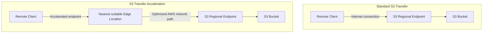
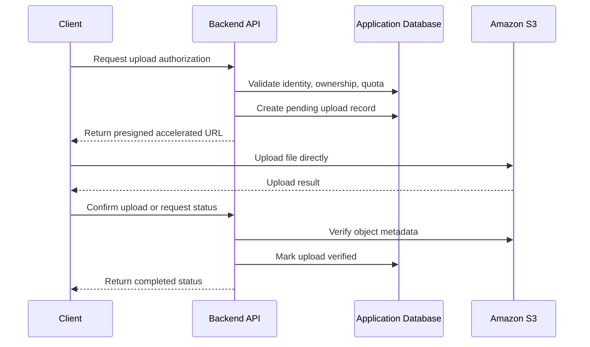

# 04- S3 Transfer Acceleration

## Overview

Amazon S3 Transfer Acceleration is a bucket-level feature that improves data transfer performance between geographically distant clients and an Amazon S3 general purpose bucket. It uses globally distributed Amazon CloudFront edge locations to receive client traffic and routes it to S3 over an optimized network path.

Transfer Acceleration is particularly useful when a backend application receives large uploads from customers distributed across countries or continents, while the application stores all objects in a centralized S3 bucket.

Without acceleration, a client transfers data directly to the S3 endpoint in the bucket's Region. With acceleration, the client connects to an S3 Transfer Acceleration endpoint, and AWS routes the transfer through an appropriate edge location.

The objective is to reduce the network latency and performance variability associated with long-distance transfers, not to increase the capacity of the client's internet connection.

## How S3 Transfer Acceleration Works

### Standard transfer versus accelerated transfer

In a standard transfer, the client establishes a connection to the S3 endpoint in the bucket's Region. Long-distance network paths can introduce significant latency, especially when transferring large files or when the client is located far from the bucket.

With Transfer Acceleration, the client connects to a globally distributed edge location. Traffic then follows an optimized AWS network path toward the destination bucket.



The exact performance improvement depends on the source location, destination Region, network conditions, file size, connection behavior, and transfer configuration.

### Request flow

The accelerated transfer flow is:

1. The application obtains a destination object key and appropriate upload authorization.
2. The client connects to the bucket's S3 Transfer Acceleration endpoint.
3. AWS receives the request at an appropriate edge location.
4. Data is routed toward the S3 bucket over an optimized network path.
5. S3 processes the upload and stores the object according to the bucket's configuration.
6. The application validates the upload and updates its business state as required.

Transfer Acceleration does not replace S3 authorization, encryption, object validation, or application-level upload tracking.

## When to Use Transfer Acceleration

### Recommended workloads

| Workload | Recommendation | Reason |
|---|---|---|
| Global customer uploads | Strong candidate | Clients may be far from the centralized bucket |
| Large files uploaded across continents | Strong candidate | Long-distance network optimization can improve throughput |
| Media ingestion from international clients | Evaluate | Large video, audio, and image uploads may benefit |
| Global document submission platform | Evaluate | Performance depends on user geography and file sizes |
| Frequent regional uploads close to the bucket | Benchmark first | The standard endpoint may already be efficient |
| Thousands of small files | Benchmark first | Connection setup and per-request overhead may dominate |
| Server-to-S3 transfers within the same Region | Usually unnecessary | Regional networking is often already efficient |
| Static website content delivery | Consider CloudFront instead | Transfer Acceleration is not a general-purpose content caching solution |
| Client devices with very limited bandwidth | Limited benefit | Acceleration cannot exceed the client's practical network capacity |

Use Transfer Acceleration when measurements show that the improvement justifies its additional cost.

### When it is not the right solution

Transfer Acceleration does not solve every performance problem.

Consider other optimizations when the bottleneck is:

- A slow client disk or application process.
- CPU-intensive file preparation or encryption.
- Insufficient client-side network bandwidth.
- Poor upload concurrency or ineffective multipart settings.
- Repeated downloads that would benefit from CDN caching.
- Excessive application-server buffering or proxy limits.

Diagnose the bottleneck before introducing another infrastructure feature.

## Requirements and Limitations

### Bucket requirements

Transfer Acceleration has specific requirements:

- It applies to S3 general purpose buckets, not directory buckets.
- The bucket must have Transfer Acceleration enabled.
- The bucket name must be DNS-compliant and must not contain periods (`.`).
- Requests must use virtual-hosted-style addressing.
- The bucket must be in an AWS Region supported by Transfer Acceleration.
- The acceleration endpoint must be used for the transfer to benefit from the feature.

After enabling Transfer Acceleration, allow time for the configuration to propagate. AWS documents that performance improvements can take up to 30 minutes to become available.

Consult the current [Transfer Acceleration documentation](https://docs.aws.amazon.com/AmazonS3/latest/userguide/transfer-acceleration.html) before deploying the feature, especially when selecting a bucket Region or integrating with an existing network architecture.

### Endpoint formats

The standard IPv4-compatible acceleration endpoint is:

```text
https://<bucket-name>.s3-accelerate.amazonaws.com
```

For supported IPv6 connectivity, the dual-stack endpoint is:

```text
https://<bucket-name>.s3-accelerate.dualstack.amazonaws.com
```

For example, an accelerated upload to `uploads-example` can target:

```text
https://uploads-example.s3-accelerate.amazonaws.com/customer-files/report.zip
```

Use the endpoint supported by the configured AWS SDK or CLI. Avoid manually constructing signed requests unless the application correctly implements the relevant endpoint and AWS Signature Version 4 requirements.

### Operational limitations

Transfer Acceleration has additional data-transfer charges. Performance improvements are workload-dependent, and enabling the feature does not guarantee that every upload will be faster.

The acceleration endpoint is intended for object operations, not every S3 bucket-management operation. Use the normal regional S3 endpoint for bucket creation, deletion, and other operations that are not supported through the acceleration endpoint.

## Enable and Verify Transfer Acceleration

### Enable acceleration with AWS CLI

Set the bucket name using an environment variable:

```bash
export BUCKET="uploads-example"
```

Enable acceleration:

```bash
aws s3api put-bucket-accelerate-configuration \
  --bucket "$BUCKET" \
  --accelerate-configuration '{"Status":"Enabled"}'
```

The caller must have permission to configure Transfer Acceleration, including `s3:PutAccelerateConfiguration`.

Inspect the configuration:

```bash
aws s3api get-bucket-accelerate-configuration \
  --bucket "$BUCKET"
```

An enabled configuration returns a status similar to:

```json
{
  "Status": "Enabled"
}
```

The `Status` field can also be `Suspended`, which disables acceleration.

The bucket owner normally controls this configuration and can delegate the required permissions where appropriate.

### Verify bucket eligibility and Region

Before enabling the feature, verify the bucket's Region:

```bash
aws s3api get-bucket-location \
  --bucket "$BUCKET"
```

The API returns the bucket's location constraint. A `null` location constraint represents `us-east-1`.

Confirm that the selected Region supports Transfer Acceleration using the current AWS documentation. Also verify that the bucket name has no periods and that the client uses the correct acceleration endpoint.

### Suspend acceleration

When measurements no longer justify the cost, suspend the configuration:

```bash
aws s3api put-bucket-accelerate-configuration \
  --bucket "$BUCKET" \
  --accelerate-configuration '{"Status":"Suspended"}'
```

Suspending acceleration does not delete stored objects. Applications that use the acceleration endpoint must be updated to use the standard endpoint or otherwise configured to handle the suspended state.

Do not suspend acceleration until dependent clients, SDK configurations, and presigned URL workflows have been reviewed.

## Configure Transfer Acceleration with Boto3

### Create an acceleration-enabled S3 client

Use the AWS SDK for Python (Boto3) with the acceleration endpoint enabled.

```python
import os

import boto3
from botocore.config import Config

aws_region = os.environ["AWS_REGION"]

s3_client = boto3.client(
    "s3",
    region_name=aws_region,
    config=Config(
        s3={
            "use_accelerate_endpoint": True,
        },
        retries={
            "mode": "standard",
            "max_attempts": 8,
        },
        connect_timeout=10,
        read_timeout=120,
    ),
)
```

Credentials should come from the standard AWS credential provider chain, such as an IAM role, workload identity, or an approved local development profile. Do not hardcode AWS access keys in application code.

Use an appropriate timeout policy for the workload. A read timeout that works for small files may not be suitable for very large uploads over slower networks.

### Upload a large file using managed transfers

Boto3's managed transfer APIs can automatically use multipart uploads for files above the configured threshold.

```python
import os
from pathlib import Path

import boto3
from boto3.s3.transfer import TransferConfig
from botocore.config import Config

bucket = os.environ["S3_BUCKET"]
file_path = Path(os.environ["UPLOAD_FILE"])
object_key = f"ingestion/{file_path.name}"

s3_client = boto3.client(
    "s3",
    region_name=os.environ["AWS_REGION"],
    config=Config(
        s3={"use_accelerate_endpoint": True},
        retries={"mode": "standard", "max_attempts": 8},
        connect_timeout=10,
        read_timeout=120,
    ),
)

transfer_config = TransferConfig(
    multipart_threshold=64 * 1024 * 1024,
    multipart_chunksize=16 * 1024 * 1024,
    max_concurrency=8,
    use_threads=True,
)

s3_client.upload_file(
    str(file_path),
    bucket,
    object_key,
    Config=transfer_config,
)
```

This example uses a 64 MiB multipart threshold, 16 MiB parts, and up to eight concurrent transfer tasks. These settings are illustrative and should be benchmarked against actual file sizes, network conditions, available memory, and workload concurrency.

**Production considerations:**

- Bound the number of simultaneous uploads across application workers.
- Account for multipart buffers and concurrent transfer memory usage.
- Handle exceptions and record failed upload attempts.
- Validate the completed object before marking the application workflow as successful.
- Avoid accepting untrusted user input directly as an unrestricted object key.
- Use managed multipart operations rather than implementing multipart state management without a clear requirement.

For asynchronous ingestion workflows, a Celery worker can perform the upload outside the request-response path. This avoids tying up web workers while large files are transferred.

## Use Transfer Acceleration with Presigned URLs

### Generate URLs using the accelerated endpoint

Presigned URLs let clients transfer files directly to S3 without routing the file contents through the backend application.

When acceleration is required, generate the URL using an S3 client configured for the acceleration endpoint.

```python
import os

import boto3
from botocore.config import Config

s3_client = boto3.client(
    "s3",
    region_name=os.environ["AWS_REGION"],
    config=Config(
        s3={"use_accelerate_endpoint": True},
    ),
)

upload_url = s3_client.generate_presigned_url(
    "put_object",
    Params={
        "Bucket": os.environ["S3_BUCKET"],
        "Key": "customer-uploads/generated-object-id.bin",
        "ContentType": "application/octet-stream",
    },
    ExpiresIn=900,
)
```

The generated URL uses the configured acceleration endpoint. The client must upload using the method and signed headers expected by the URL.

The signing identity needs the relevant S3 permissions, and the bucket's policies and other applicable security controls must allow the operation.

### Recommended direct-upload architecture



The backend authorizes the upload and manages application state, while the client transfers the content directly to S3.

Treat a successful client upload response as evidence of a transfer, not necessarily proof that the object satisfies all business requirements. Verify the expected object, size, ownership, and other relevant properties before processing it.

Presigned URLs are bearer capabilities. Use short expirations, trusted object-key generation, authorization checks, and careful logging practices.

## Optimize Multipart Uploads

### Why multipart upload matters

Multipart upload divides a large object into parts that can be uploaded concurrently. It improves throughput when multiple connections can use the available network capacity and allows failed parts to be retried without restarting the entire object upload.

Transfer Acceleration and multipart upload address different performance aspects:

- Transfer Acceleration optimizes the network path between distant clients and S3.
- Multipart upload enables parallel transfer, more granular retries, and efficient handling of large objects.

They can be used together.

### Select multipart settings based on measurements

| Parameter | Purpose | Tuning consideration |
|---|---|---|
| Multipart threshold | Determines when managed transfers switch to multipart upload | Avoid multipart overhead for very small files |
| Part size | Controls the size of each part | Larger parts reduce request count but increase per-part retry cost |
| Concurrency | Controls the number of simultaneous transfer tasks | Higher concurrency can improve throughput but increases memory and connection pressure |
| Connect timeout | Limits time spent establishing a connection | Account for client network conditions |
| Read timeout | Limits waiting for request data or responses | Must accommodate the expected request duration |
| Retry policy | Determines recovery behavior after transient failures | Use bounded retries and avoid uncontrolled request amplification |

S3 multipart uploads have service-defined limits and minimum part-size constraints, apart from the final part. Verify current limits in the [Multipart Upload documentation](https://docs.aws.amazon.com/AmazonS3/latest/userguide/mpuoverview.html).

Do not choose maximum concurrency simply because it is available. Benchmark the combined effect of worker count, transfer concurrency, part size, and network capacity.

### Clean up incomplete multipart uploads

Failed or abandoned multipart uploads can leave uploaded parts that continue to incur storage charges.

Configure an appropriate lifecycle rule to abort incomplete multipart uploads after a defined period, and verify that the retention period is compatible with legitimate long-running uploads.

For example, the following lifecycle fragment aborts incomplete multipart uploads after seven days:

```json
{
  "Rules": [
    {
      "ID": "AbortIncompleteMultipartUploads",
      "Status": "Enabled",
      "Filter": {
        "Prefix": ""
      },
      "AbortIncompleteMultipartUpload": {
        "DaysAfterInitiation": 7
      }
    }
  ]
}
```

Merge this rule with the bucket's existing lifecycle configuration before deployment. Replacing a lifecycle configuration with an incomplete document can remove existing retention or transition rules.

## Benchmark Before Enabling in Production

### Use the S3 Transfer Acceleration Speed Comparison tool

AWS provides a speed comparison tool that benchmarks accelerated and standard upload paths using multipart uploads.

Reference: [S3 Transfer Acceleration Speed Comparison](https://docs.aws.amazon.com/AmazonS3/latest/userguide/transfer-acceleration-speed-comparison.html).

Benchmark representative source locations against the intended bucket Region rather than relying on a single test from an administrator's workstation.

Include:

- Small, medium, and large files.
- Clients in multiple geographic regions.
- Repeated tests at different times.
- Comparable network conditions and transfer settings.
- Upload success rates and retry counts.
- End-to-end completion time and effective throughput.
- The additional acceleration charges associated with the workload.

Compare the standard and accelerated endpoints using the same object characteristics and a controlled test procedure.

### Calculate effective throughput

For a file with size \(S\) bytes transferred in \(T\) seconds, effective throughput is:

\[
\text{Throughput} = \frac{S}{T}
\]

To compare acceleration against standard transfer:

\[
\text{Speedup} =
\frac{\text{Standard transfer time}}
{\text{Accelerated transfer time}}
\]

A speedup greater than 1 indicates that the accelerated transfer completed faster in that measurement.

For meaningful production decisions, measure distributions such as p50 and p95 completion times instead of relying only on a single average. Compare results by source geography and file size, because acceleration benefits can vary significantly across client populations.

### Establish an adoption threshold

Define a measurable threshold before rollout. For example, a team may require a meaningful reduction in p95 upload time for large international uploads without unacceptable additional cost or failure rates.

Roll out to a representative subset of clients, collect operational data, and expand only when the measured benefit satisfies the agreed criteria.

Avoid enabling the feature globally without a baseline and an evaluation plan.

## Monitor Performance, Reliability, and Cost

### Monitor application-level transfer metrics

Instrument the upload workflow so that performance and failures can be analyzed independently of the underlying S3 service.

Useful metrics include:

| Metric | Why it matters |
|---|---|
| Upload duration | Measures end-to-end completion time |
| Effective throughput | Identifies transfer bottlenecks |
| Upload success rate | Detects reliability regressions |
| Retry count | Identifies transient network failures or poor settings |
| Multipart part failures | Helps diagnose individual transfer problems |
| Pending upload count | Reveals bottlenecks in asynchronous ingestion |
| Verification latency | Separates transfer time from post-upload processing |
| Acceleration-enabled traffic volume | Supports cost attribution and adoption analysis |
| Cost per successful upload | Measures the overall economic impact |

Include structured fields such as bucket identifier, object key or internal upload ID, file size, source geography where available, transfer mode, and completion status. Avoid logging presigned URLs or sensitive customer metadata.

CloudWatch can provide AWS-side metrics and operational visibility, while application metrics help correlate transfer performance with client behavior and business outcomes. Configure any additional request-level logging or tracing needed to investigate failures.

### Evaluate total cost

Transfer Acceleration introduces additional transfer charges that vary according to the applicable AWS pricing rules and request path.

Consider the following factors:

- Number of accelerated bytes transferred.
- Source geography and destination Region.
- File size and transfer frequency.
- Expected throughput or latency improvements.
- Retry overhead and incomplete uploads.
- Backend compute or infrastructure costs affected by the design.
- Business impact of upload delays.

Use the current [Amazon S3 pricing page](https://aws.amazon.com/s3/pricing/) to estimate the charges applicable to your workload.

A practical comparison is:

\[
\text{Net benefit} =
\text{Value of improved transfers}
-
\text{Additional acceleration cost}
\]

The value of improved transfers may include reduced user waiting time, fewer failed uploads, and less operational effort. These benefits should be measured or explicitly justified rather than assumed.

## Common Mistakes and Troubleshooting

| Symptom or mistake | Likely cause | Recommended action |
|---|---|---|
| Acceleration configuration is rejected | Unsupported bucket configuration or incorrect permissions | Verify bucket eligibility and `s3:PutAccelerateConfiguration` access |
| Accelerated requests fail with endpoint errors | Bucket name, addressing style, or endpoint is incorrect | Use a DNS-compatible bucket name without periods and the supported virtual-hosted endpoint |
| No measurable performance improvement | Client is near the bucket, file is too small, or another bottleneck dominates | Benchmark actual workload sizes and locations |
| SDK upload works with the standard endpoint but not acceleration | SDK endpoint configuration or request signing is incorrect | Verify the SDK's acceleration setting and Region |
| Presigned URL upload fails | The URL was signed for a different endpoint or the client did not send required signed headers | Generate the URL using the intended accelerated client and match the signed request |
| Throughput remains low | Client bandwidth, memory, disk, concurrency, or server processing is limiting performance | Measure all resource and network bottlenecks before increasing concurrency |
| Costs rise without meaningful improvement | Acceleration is used by workloads that do not benefit | Measure performance and cost by workload and suspend acceleration where justified |
| Upload jobs remain pending | Application-level verification or asynchronous processing is failing | Separate transfer status from verification and processing status |
| Unexpected upload failures appear during rollout | Clients use stale URLs, inconsistent endpoint configuration, or unsupported network paths | Test the full client workflow and roll out incrementally |

For production incidents, diagnose the endpoint, bucket configuration, Region, request-signing behavior, network path, and client transfer settings in a systematic order. Do not assume that every timeout or upload failure is caused by Transfer Acceleration itself.

## Production Readiness Checklist

- [ ] The workload has demonstrated a real long-distance transfer bottleneck.
- [ ] The bucket is a supported general purpose bucket in a supported Region.
- [ ] The bucket name is DNS-compliant and contains no periods.
- [ ] Transfer Acceleration is enabled and its status has been verified.
- [ ] SDK clients and presigned URL generation use the intended acceleration endpoint.
- [ ] Standard and accelerated transfer performance have been benchmarked using representative clients and files.
- [ ] Multipart thresholds, part sizes, concurrency, timeouts, and retries are tuned for the workload.
- [ ] IAM permissions and bucket policies continue to enforce the intended access controls.
- [ ] Encryption, upload validation, and application-level object ownership checks remain in place.
- [ ] Incomplete multipart uploads are cleaned up through a suitable lifecycle policy.
- [ ] Performance, reliability, and cost metrics are available for the rollout.
- [ ] Rollback procedures account for SDK configuration and client-generated presigned URLs.
- [ ] The additional acceleration cost is justified by measured performance or business benefits.

## Authoritative References

- [Configuring fast, secure file transfers using Amazon S3 Transfer Acceleration](https://docs.aws.amazon.com/AmazonS3/latest/userguide/transfer-acceleration.html)
- [Enabling and using S3 Transfer Acceleration](https://docs.aws.amazon.com/AmazonS3/latest/userguide/transfer-acceleration-examples.html)
- [S3 Transfer Acceleration Speed Comparison](https://docs.aws.amazon.com/AmazonS3/latest/userguide/transfer-acceleration-speed-comparison.html)
- [Amazon S3 performance guidelines](https://docs.aws.amazon.com/AmazonS3/latest/userguide/optimizing-performance-guidelines.html)
- [Amazon S3 performance design patterns](https://docs.aws.amazon.com/AmazonS3/latest/userguide/optimizing-performance-design-patterns.html)
- [Amazon S3 pricing](https://aws.amazon.com/s3/pricing/)

## Key Takeaways

- Use S3 Transfer Acceleration when geographically distant clients upload data to a centralized S3 bucket and measurements demonstrate meaningful improvement.
- Verify bucket eligibility, Region support, DNS-compatible naming, and acceleration endpoint configuration before rollout.
- Combine acceleration with appropriately tuned multipart transfers, bounded concurrency, reliable retry behavior, and application-level verification.
- Benchmark standard versus accelerated transfers across representative file sizes and client locations, and monitor the effect on reliability and total cost.
- Treat acceleration as a targeted network optimization, not a replacement for secure uploads, sound architecture, or performance bottleneck analysis.