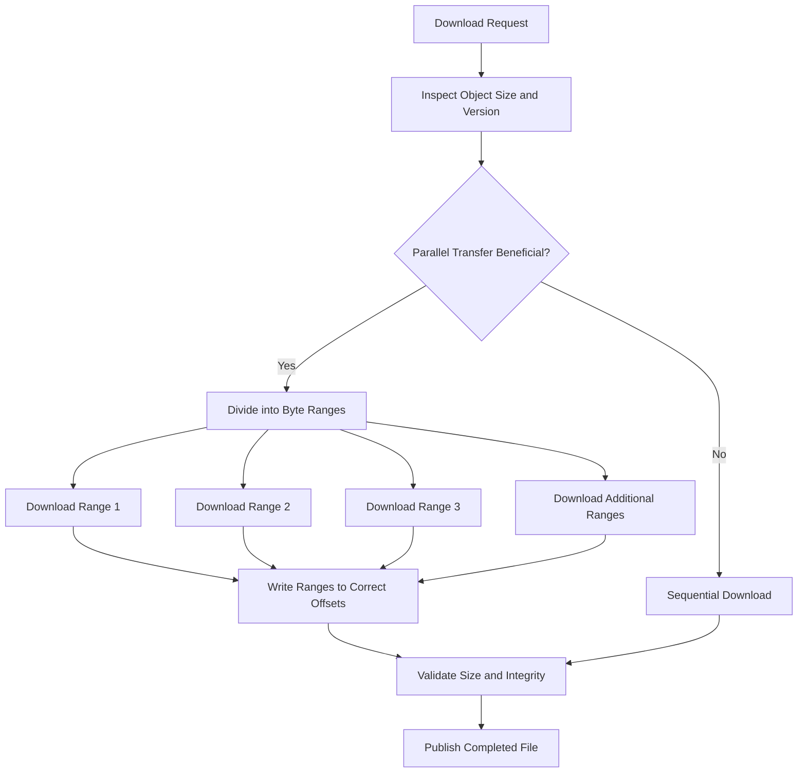
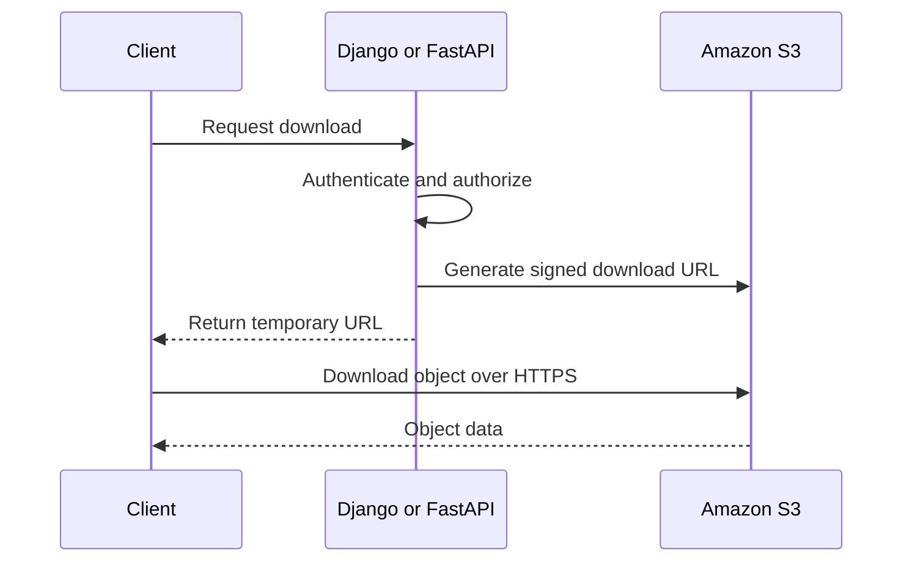

# 05- Parallel Transfers and Large-Object Downloads

## Overview

Large Amazon S3 objects can take significant time to download when transferred through a single request, particularly when network bandwidth, connection latency, or application throughput requirements are high.

Parallel downloads improve throughput by dividing an object into byte ranges and retrieving those ranges concurrently. AWS SDK transfer managers can manage this process, including request concurrency, retries, and transfer buffering.

For production backend systems, the objective is not to maximize concurrency unconditionally. It is to achieve predictable throughput while controlling memory consumption, network utilization, disk I/O, connection pools, retry behavior, and overall infrastructure cost.

This document covers parallel downloads using Boto3 and AWS CLI, explicit byte-range requests, large-file integrity, and operational tuning.

## Understand Parallel Downloads

### Sequential versus parallel downloads

A sequential download retrieves an object through one `GetObject` request and streams its response into a local file.

A parallel download divides an object into multiple byte ranges. Each range is retrieved independently, and the resulting data is written to the correct position in the destination file.

For example, a 512 MiB object divided into eight 64 MiB ranges can be downloaded using eight concurrent requests, provided the client has sufficient resources and the workload benefits from parallelism.



S3 supports byte-range retrieval through the HTTP `Range` header. A successful partial-content response typically uses HTTP `206 Partial Content`.

A single S3 `GetObject` request cannot retrieve multiple separate byte ranges in one request. Parallel downloading uses separate requests for separate ranges.

### When parallel downloads help

Parallel transfers are particularly useful when:
- Objects are large enough to justify multiple requests.
- A single connection cannot fully utilize the available network bandwidth.
- Network latency limits the throughput of sequential downloads.
- Multiple download workers can operate without exhausting shared resources.
- A workload repeatedly transfers large artifacts, datasets, backups, or media files.

Parallelism may provide little benefit for small objects, disk-bound systems, low-bandwidth connections, or workloads already limited by the destination's write throughput.

Start with the standard SDK transfer manager and benchmark the result before implementing custom transfer logic.

## Understand the Main Performance Parameters

| Parameter | Purpose | Operational consideration |
|---|---|---|
| Transfer threshold | Determines when managed transfers use parallel range-based downloading | A higher threshold reduces parallelization of medium-sized objects |
| Chunk size | Determines the size of individual transfer ranges | Larger chunks reduce request count but increase the amount of work associated with a failed range |
| Maximum concurrency | Limits concurrent transfer requests for a managed transfer | Increasing it can improve throughput but consumes more connections and resources |
| I/O queue size | Controls queued download data in supported transfer implementations | Larger queues may increase memory consumption |
| I/O chunk size | Controls buffered data processing for writes | Increasing it may help when disk writing is the bottleneck |
| Retry configuration | Controls recovery from transient failures | Excessive retries increase transfer duration and request load |
| Bandwidth limit | Caps the transfer manager's bandwidth where supported | Useful for protecting shared network capacity |
| Thread usage | Controls whether managed transfers use threads | Disabling threads removes transfer concurrency in the classic implementation |

Boto3 provides `TransferConfig` for tuning these settings. Defaults are a reasonable baseline, but they should be validated against the application workload and installed SDK version.

Reference: [Boto3 file transfer configuration](https://docs.aws.amazon.com/boto3/latest/guide/s3.html).

## Configure Parallel Downloads with Boto3

### Use managed downloads by default

The high-level `download_file()` method handles the transfer workflow and can use concurrent range requests for sufficiently large objects.

```python
import boto3
from boto3.s3.transfer import TransferConfig

s3_client = boto3.client("s3", region_name="ap-south-1")

GiB = 1024**3
MiB = 1024**2

transfer_config = TransferConfig(
    multipart_threshold=64 * MiB,
    multipart_chunksize=32 * MiB,
    max_concurrency=8,
    max_io_queue=100,
    io_chunksize=256 * 1024,
    num_download_attempts=5,
    use_threads=True,
)

s3_client.download_file(
    "example-data-bucket",
    "exports/large-dataset.parquet",
    "/var/tmp/large-dataset.parquet",
    Config=transfer_config,
)
```

The object and local file paths are examples and must be replaced with the intended resources.

The configuration uses:
- A 64 MiB threshold for selecting the managed parallel-transfer path.
- 32 MiB transfer chunks.
- Up to eight concurrent transfer requests per managed transfer.
- Thread-based concurrency.
- A bounded I/O queue and configurable download retry attempts.

`multipart_threshold` and `multipart_chunksize` are transfer-manager configuration names; their use does not mean that a download performs an S3 multipart upload. The download manager can use byte-range GET requests to retrieve parts concurrently.

### Select concurrency based on measurements

Increasing `max_concurrency` can improve throughput when the network is underutilized. It can also increase contention when multiple transfers run simultaneously.

For example, if an application downloads ten large objects concurrently and each transfer permits eight concurrent requests, the combined workload can generate approximately 80 active transfer requests, excluding other API operations.

The actual number depends on transfer scheduling, retries, and SDK implementation details.

Use controlled benchmarks rather than assuming that a higher value always produces a faster download.

### Account for memory and connection usage

A useful initial resource model is:

\[
\text{Active requests} \approx
\text{Concurrent transfers}
\times
\text{Per-transfer concurrency}
\]

This is an approximation for capacity planning, not a guaranteed request count.

Buffered data memory can grow with the number of active requests, chunk sizes, and configured I/O queues. Disk writes, response buffering, Python thread scheduling, and HTTP connection pools can become bottlenecks before S3 throughput does.

Tune concurrency together with:
- HTTP connection-pool capacity.
- Worker count and thread usage.
- Container memory limits.
- Available disk space and write throughput.
- Network bandwidth and CPU capacity.
- Other services sharing the same host or network interface.

## Download Large Objects Safely

### Pin downloads to a consistent object version

A large download may require multiple range requests. If the object is overwritten between requests, retrieving the ranges independently from different object versions can produce an inconsistent result.

For versioned buckets, use the same `VersionId` for the entire download. This ensures that the transfer targets a single immutable object version.

The following example downloads a known version into a temporary file, verifies its size, and then atomically publishes it on the local filesystem.

```python
import os
import tempfile
from pathlib import Path

import boto3
from boto3.s3.transfer import TransferConfig

BUCKET = "example-data-bucket"
KEY = "exports/large-dataset.parquet"
DESTINATION = Path("/var/data/large-dataset.parquet")
VERSION_ID = "REPLACE_WITH_OBJECT_VERSION_ID"

GiB = 1024**3
MiB = 1024**2

s3_client = boto3.client("s3", region_name="ap-south-1")

config = TransferConfig(
    multipart_threshold=64 * MiB,
    multipart_chunksize=32 * MiB,
    max_concurrency=8,
    use_threads=True,
)

DESTINATION.parent.mkdir(parents=True, exist_ok=True)

metadata = s3_client.head_object(
    Bucket=BUCKET,
    Key=KEY,
    VersionId=VERSION_ID,
)

expected_size = metadata["ContentLength"]

with tempfile.NamedTemporaryFile(
    dir=DESTINATION.parent,
    prefix=f".{DESTINATION.name}.",
    suffix=".partial",
    delete=False,
) as temp_file:
    temp_path = Path(temp_file.name)

try:
    s3_client.download_file(
        BUCKET,
        KEY,
        str(temp_path),
        ExtraArgs={"VersionId": VERSION_ID},
        Config=config,
    )

    actual_size = temp_path.stat().st_size

    if actual_size != expected_size:
        raise IOError(
            f"Downloaded size mismatch: expected {expected_size}, "
            f"received {actual_size}"
        )

    os.replace(temp_path, DESTINATION)

except Exception:
    temp_path.unlink(missing_ok=True)
    raise
```

The destination file is not replaced until the managed transfer completes and the expected size matches. The temporary file is created in the same directory to support atomic replacement on the same filesystem.

This example assumes that the target object version exists and that the runtime has the required S3 permissions. Use a fresh, application-controlled temporary filename for each concurrent transfer.

A matching size is not, by itself, proof of data integrity. For high-assurance workflows, also validate an appropriate S3 checksum or an application-defined cryptographic digest.

### Handle unversioned objects carefully

If bucket versioning is not enabled, use conditional requests to prevent ranges from being read from a different object representation.

A low-level `GetObject` request supports `IfMatch`, allowing the caller to require a matching ETag. When implementing manual range downloads, consistently apply the same precondition to every request.

An ETag is an opaque validator, not a universal MD5 checksum. Multipart uploads and other object configurations can produce ETags that do not represent the MD5 digest of the entire object.

Where possible, use version IDs for reliable object-version pinning.

Reference: [Amazon S3 GetObject API](https://docs.aws.amazon.com/AmazonS3/latest/API/API_GetObject.html).

## Use Explicit Byte-Range Requests

### Understand byte-range boundaries

HTTP byte ranges are inclusive. A request with:

```http
Range: bytes=0-1048575
```

requests the first 1 MiB of the object.

For an object whose total size is \(S\), a chunk starting at byte \(a\) with length \(L\) ends at:

\[
b = \min(a + L - 1,\ S - 1)
\]

The next range starts at \(b + 1\). Correct range planning must avoid gaps and overlaps.

### Retrieve a specific range with the AWS CLI

The following command downloads a selected portion of an object:

```bash
aws s3api get-object \
  --bucket "$BUCKET" \
  --key "exports/large-dataset.parquet" \
  --range "bytes=0-1048575" \
  ./first-megabyte.bin
```

The local file contains only the requested range, not the full object. The command uses a 1 MiB range.

Inspect the object's length before generating range boundaries:

```bash
aws s3api head-object \
  --bucket "$BUCKET" \
  --key "exports/large-dataset.parquet" \
  --query '{Length:ContentLength,ETag:ETag,VersionId:VersionId}'
```

For manual range downloading, each range must be written to the appropriate offset or assembled in the correct order.

### Build a custom range downloader only when necessary

A custom range downloader may be justified when an application needs:
- Custom scheduling across several objects.
- Direct control over byte-range boundaries.
- Specialized retry or checkpoint behavior.
- Integration with a distributed download queue.
- Application-specific partial-download or resume semantics.

A production implementation must include:
- Bounded concurrency and queue sizes.
- Object-version or conditional-request consistency.
- Exact byte-range calculations.
- Per-range retry and failure handling.
- Non-overlapping writes or ordered chunk assembly.
- Disk-capacity checks and partial-file cleanup.
- Final size and checksum verification.
- Atomic publication after successful validation.

Prefer the managed Boto3 transfer manager unless these additional controls provide a clear operational benefit.

## Tune AWS CLI Downloads

### Use the AWS CLI transfer manager

The AWS CLI `aws s3` command set supports concurrent transfers and configurable parameters.

Example:

```bash
aws s3 cp \
  "s3://${BUCKET}/exports/large-dataset.parquet" \
  "./large-dataset.parquet"
```

The command uses the CLI's configured transfer settings. It does not require manual byte-range handling for ordinary large-file downloads.

To tune the default profile, use the configuration file at `~/.aws/config`:

```ini
[default]
region = ap-south-1

s3 =
    max_concurrent_requests = 20
    max_queue_size = 1000
    multipart_threshold = 64MB
    multipart_chunksize = 32MB
    max_bandwidth = 100MB/s
    io_chunksize = 256KB
```

These settings are illustrative. Validate the accepted units and configuration syntax for the installed AWS CLI version before deployment.

The `max_concurrent_requests` option controls the maximum number of concurrent requests used by CLI S3 transfers. `max_bandwidth` places a bandwidth limit on supported transfer operations.

**Important:** The CLI transfer configuration is profile-specific and applies to the relevant CLI transfer commands. Do not confuse it with Boto3's `TransferConfig`, which is configured in application code.

Reference: [AWS CLI S3 configuration](https://docs.aws.amazon.com/cli/latest/topic/s3-config.html).

### Apply tuning incrementally

A safe optimization sequence is:

1. Record baseline download duration and throughput.
2. Measure object sizes and concurrent transfer counts.
3. Increase request concurrency modestly.
4. Benchmark representative objects under realistic load.
5. Inspect host memory, disk throughput, network utilization, and error rates.
6. Adjust chunk size or I/O settings only when measurements identify a bottleneck.
7. Repeat under concurrent production-like workload conditions.

Avoid deploying aggressive global CLI settings without considering other users and processes that share the same machine.

## Improve End-to-End Download Architecture

### Let clients download large files directly when appropriate

For customer downloads, routing the full object through a Django or FastAPI worker consumes application bandwidth, worker time, and memory or socket resources.

A common architecture authorizes the request in the backend and then issues a short-lived presigned URL. The client downloads the object directly from S3, while the application avoids proxying the file bytes.



For repeated downloads of public or appropriately authorized content, CloudFront can reduce origin traffic and improve delivery performance through caching. For private content, configure a private origin and appropriate access controls rather than exposing the bucket.

### Avoid unbounded background concurrency

Celery workers, Kubernetes jobs, and other distributed workers can multiply effective download concurrency.

If each worker runs several concurrent transfers, increasing the number of workers can produce unexpectedly high network and connection demand.

Use explicit concurrency limits at both levels:
- Per-transfer request concurrency.
- Number of simultaneously active transfer jobs.

For workloads requiring centralized fairness, consider a queue or semaphore-based admission-control mechanism. Assign limits according to available bandwidth and destination storage capacity.

## Handle Retries and Partial Failures

### Distinguish request retries from transfer retries

A retry can occur at different levels:
- The AWS SDK retries retryable API errors, such as certain throttling and server-side errors.
- The managed transfer implementation handles download-stream failures according to its configuration.
- The application may retry an entire transfer job after a terminal failure.

These layers are not interchangeable. A failed range should not automatically cause every successfully downloaded range to be fetched again when a custom implementation can safely resume the remaining work.

Use bounded retries with backoff and jitter for application-level retries. Avoid launching many synchronized retries when S3 or the network is experiencing elevated errors.

### Define a clear completion condition

Treat a download as complete only when:
1. Every required transfer request succeeds.
2. All expected byte ranges are present.
3. The destination has the expected length.
4. An appropriate integrity check passes.
5. The final file can be atomically published or marked available.

Use a unique temporary file for each job attempt. Failed downloads should never be exposed as completed application artifacts.

For custom resumable workflows, persist the object version, expected size, completed ranges, and integrity information. Discard checkpoints when the source object's identity changes.

## Measure and Diagnose Performance

### Use meaningful metrics

| Metric | What it reveals |
|---|---|
| Total download duration | End-to-end transfer performance |
| Effective throughput | Whether parallelism improves data transfer |
| Request count per object | Impact of chunk size and concurrency |
| Retry and failed-request counts | Reliability and network or service issues |
| Network utilization | Whether network capacity is the bottleneck |
| Disk write throughput and latency | Whether local storage limits performance |
| Worker CPU and memory | Resource impact of transfer concurrency |
| Time to first byte | Connection and request latency |
| Checksum failure count | Integrity issues in the transfer pipeline |
| Queue wait time | Whether download demand exceeds available workers |

Calculate average effective throughput as:

\[
\text{Throughput} =
\frac{\text{Downloaded bytes}}{\text{Elapsed seconds}}
\]

Use bytes per second or convert consistently to MiB/s. Compare runs with the same object size, Region, client environment, destination disk, and workload profile.

For a valid comparison, record cold and warm client behavior separately when connection reuse, DNS resolution, caching, or repeated reads affect the workload.

### Distinguish common bottlenecks

| Observation | Likely explanation | Recommended investigation |
|---|---|---|
| Low throughput with low CPU and disk usage | Network path, connection latency, or low concurrency | Test modestly higher request concurrency |
| High CPU and low throughput | CPU overhead, checksumming, compression, or TLS processing | Profile the client and review CPU capacity |
| Network is saturated | Available bandwidth is the limiting factor | Avoid increasing concurrency without a capacity reason |
| High disk write latency | Destination storage is limiting throughput | Test a suitable faster storage device |
| More concurrency increases errors | Resource contention, connection limits, or transient failures | Reduce concurrency and inspect error categories |
| Downloads complete but validation fails | Incomplete, mixed-version, or corrupted data | Verify object pinning, ranges, checksums, and temporary-file lifecycle |
| Small files become slower | Request setup overhead exceeds the benefit of parallelism | Use the default sequential or managed transfer behavior |

Use CloudWatch and application metrics as appropriate for the infrastructure. S3 request metrics are useful for service-side activity, but client-side measurements are required to understand the entire transfer path.

## Common Mistakes

| Mistake | Impact | Better practice |
|---|---|---|
| Increasing concurrency without benchmarking | Resource contention and reduced overall throughput | Tune against a representative workload |
| Using very small chunks for enormous objects | Excessive request overhead | Choose chunk sizes based on object size and request cost |
| Using very large chunks with excessive concurrency | Higher buffering and retry costs | Bound memory use and test failure recovery |
| Sharing a single file object's seek pointer across threads | Overlapping or incorrectly positioned writes | Use safe offset writes or independent chunk files |
| Mixing ranges from changing object versions | Corrupted or internally inconsistent files | Pin a version or use conditional requests |
| Treating ETag as a universal content checksum | Incorrect integrity assumptions | Validate supported checksums or application-defined digests |
| Downloading through application workers unnecessarily | Higher worker occupancy and infrastructure cost | Consider direct presigned downloads |
| Ignoring partial files after failures | Incorrect artifacts may be consumed by downstream systems | Download to temporary files and publish only after validation |
| Overlooking destination disk capacity | Failed or incomplete downloads | Check available disk space and set concurrency limits |
| Running excessive downloads in every Celery worker | Network and connection-pool exhaustion | Limit both job-level and request-level concurrency |
| Retrying indefinitely during an outage | Amplified load and delayed recovery | Use bounded retries, backoff, and failure monitoring |

## Production Readiness Checklist

- [ ] Managed Boto3 or AWS CLI downloads are used unless custom range logic is justified.
- [ ] Thresholds, chunk sizes, and concurrency are benchmarked with representative objects.
- [ ] Aggregate concurrency is bounded across all workers and active jobs.
- [ ] Connection pools, network capacity, disk throughput, and memory limits are considered.
- [ ] Large downloads use version IDs or suitable conditional requests where consistency matters.
- [ ] Temporary download files are isolated from published artifacts.
- [ ] File size and appropriate integrity checks are validated before publication.
- [ ] Retry behavior is bounded, observable, and safe under partial failure.
- [ ] Incomplete files are removed or resumed through a documented mechanism.
- [ ] Direct client downloads are considered for large customer-facing objects.
- [ ] Download duration, throughput, errors, retries, and resource utilization are monitored.
- [ ] Concurrency changes are tested under realistic simultaneous workload conditions.
- [ ] The deployment has a controlled way to reduce concurrency when resources are saturated.

## Authoritative References

- [Amazon S3 performance design patterns](https://docs.aws.amazon.com/AmazonS3/latest/userguide/optimizing-performance-design-patterns.html)
- [Boto3 file transfer configuration](https://docs.aws.amazon.com/boto3/latest/guide/s3.html)
- [Boto3 S3 transfer customization reference](https://docs.aws.amazon.com/boto3/latest/reference/customizations/s3.html)
- [Amazon S3 GetObject API](https://docs.aws.amazon.com/AmazonS3/latest/API/API_GetObject.html)
- [Downloading S3 objects and byte ranges](https://docs.aws.amazon.com/AmazonS3/latest/userguide/download-objects.html)
- [AWS CLI S3 configuration](https://docs.aws.amazon.com/cli/latest/topic/s3-config.html)

## Key Takeaways

- Use managed SDK or CLI transfer facilities first; they provide parallel transfer behavior, retries, and configurable limits.
- Tune concurrency and chunk size through measurement while accounting for aggregate worker count, memory, network capacity, and disk throughput.
- Pin large downloads to a stable object version or use conditional requests to avoid mixing data from different object representations.
- Validate the final size and an appropriate checksum, and publish completed downloads atomically rather than exposing partial files.
- Treat parallel downloading as an end-to-end capacity problem, including application workers, HTTP connections, network bandwidth, destination storage, and retry behavior.