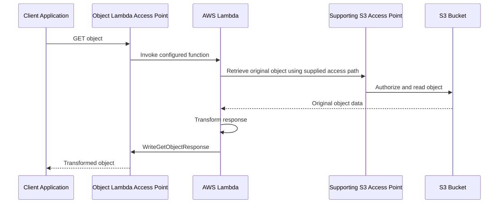

# 01- S3 Object Lambda

## Overview

Amazon S3 Object Lambda allows custom AWS Lambda functions to transform data returned by Amazon S3 requests without modifying the original stored object. It can filter records, redact sensitive fields, resize images, change data formats, or customize object listings before returning results to an application.

The capability sits between the requesting application and the underlying S3 object data. Applications can consume a transformed representation through an Object Lambda Access Point while the original object remains unchanged.

**Important availability limitation:** Since November 7, 2025, S3 Object Lambda has been available only to existing customers already using the service and selected AWS Partner Network (APN) partners. AWS has stated that it will prioritize security and availability improvements rather than introduce new capabilities. New implementations should evaluate the alternatives described in this document rather than assume Object Lambda can be enabled for a new account.

Reference: [Amazon S3 Object Lambda availability change](https://docs.aws.amazon.com/AmazonS3/latest/userguide/amazons3-ol-change.html).

## What S3 Object Lambda Solves

Applications frequently need different representations of the same stored data. Maintaining a separate S3 object for every representation creates additional storage, synchronization, and invalidation concerns.

For example, an application might store a customer report in its original form but need to redact personally identifiable information (PII) before returning it to an analytics consumer.

S3 Object Lambda enables such transformations at retrieval time.

Common use cases include:

- Redacting sensitive fields from JSON or CSV data.
- Dynamically resizing or watermarking images.
- Compressing or converting file formats.
- Filtering records according to consumer requirements.
- Enriching returned data with additional information.
- Customizing object metadata or the result of supported listing operations.

### Benefits and trade-offs

| Benefit | Trade-off |
|---|---|
| Original objects remain unchanged | Transformation logic introduces request-time processing |
| Multiple consumers can receive different representations | Each representation requires correct authorization and transformation rules |
| No need to persist every derived copy | Frequently requested transformations may repeatedly consume Lambda resources |
| Integrates with S3 access points and supported clients | Requires access-point configuration and compatible API operations |
| Can enforce response-level filtering or redaction | Incorrect transformation logic can expose sensitive information |
| Can be used with CloudFront in supported architectures | Caching and invalidation must account for transformed content |

Object Lambda is a retrieval-time processing mechanism, not a replacement for S3 storage, an ordinary event-driven processing pipeline, or a general-purpose API execution platform.

## Architecture and Request Flow

### Core components

S3 Object Lambda relies on three main components.

| Component | Responsibility |
|---|---|
| Amazon S3 bucket | Stores the original object |
| Supporting S3 access point | Provides the Lambda workflow with access to the underlying S3 data |
| S3 Object Lambda Access Point | Associates the supporting access point with a Lambda function and exposes the transformed request path |
| AWS Lambda | Executes application-specific transformation logic |
| Requesting application | Requests the object and receives the transformed response |

A standard S3 access point is required as the supporting access point. An Object Lambda Access Point is associated with exactly one supporting access point.

### Request lifecycle



The exact flow depends on the API operation and configuration. For supported `GET` requests, the Lambda event contains an operation context, including a presigned URL that can be used to retrieve the original object.

### Transformation does not change the stored object

Suppose an object contains:

```json
{
  "customer_id": 1042,
  "name": "Example User",
  "email": "user@example.com"
}
```

A transformation could return a redacted response:

```json
{
  "customer_id": 1042,
  "name": "Example User",
  "email": "[REDACTED]"
}
```

The source object remains unchanged. Another authorized consumer accessing the underlying object through a different access path could receive the original data.

**Security implication:** Every access path to the source data must be evaluated independently. Response transformation does not replace S3 authorization, and it does not protect data if an unauthorized application can bypass the transformation and read the original object.

## Understand Supported S3 Operations

S3 Object Lambda supports transforming responses to the following request types:

| Operation | Typical use |
|---|---|
| `GET` | Transform object contents before returning them |
| `LIST` | Customize supported object-listing responses |
| `HEAD` | Customize supported object metadata responses |

Only supported operations configured on the Object Lambda Access Point invoke the associated Lambda function. Other requests follow standard S3 behavior and do not receive an Object Lambda transformation.

Important limitations include:

- `POST Object` is not supported through Object Lambda Access Points.
- `CopyObject` when the Object Lambda Access Point is used as the source is not supported.
- `SelectObjectContent` is not supported.
- Object Lambda does not provide general bucket-management operations such as creating or deleting buckets.
- Request handling is subject to AWS Lambda quotas and the Object Lambda response deadline.
- `Range` and `partNumber` requests require careful configuration and transformation semantics.

Reference: [Best practices and guidelines for S3 Object Lambda](https://docs.aws.amazon.com/AmazonS3/latest/userguide/olap-best-practices.html).

## Configure a Lambda Transformation

The following implementation illustrates a small-object transformation using Python and Boto3. It retrieves the original object from the supplied presigned URL, converts its text to uppercase, and returns the result through `WriteGetObjectResponse`.

This is a reference implementation for an existing eligible Object Lambda environment, not a claim that a new customer can provision the service.

### Python implementation

```python
import logging

import boto3
import requests
from botocore.config import Config

logger = logging.getLogger()
logger.setLevel(logging.INFO)

s3 = boto3.client(
    "s3",
    config=Config(signature_version="s3v4"),
)


def handler(event, context):
    object_context = event["getObjectContext"]

    output_route = object_context["outputRoute"]
    output_token = object_context["outputToken"]
    input_url = object_context["inputS3Url"]

    try:
        # This example is intentionally limited to small text objects.
        response = requests.get(
            input_url,
            timeout=(3, 20),
        )
        response.raise_for_status()

        transformed = response.content.upper()

        s3.write_get_object_response(
            RequestRoute=output_route,
            RequestToken=output_token,
            Body=transformed,
            ContentType="text/plain; charset=utf-8",
            ContentLength=len(transformed),
        )

        return {"statusCode": 200}

    except Exception:
        logger.exception(
            "Object transformation failed",
            extra={"request_id": context.aws_request_id},
        )

        # Report a controlled error to the requesting client.
        try:
            s3.write_get_object_response(
                RequestRoute=output_route,
                RequestToken=output_token,
                StatusCode=500,
                ErrorCode="TransformationFailed",
                ErrorMessage="The requested object could not be processed.",
            )
        except Exception:
            logger.exception("Failed to return Object Lambda error response")

        raise
```

The example requires `boto3` and `requests`. Package dependencies appropriately for the chosen Lambda runtime, and verify the Boto3 version supports `write_get_object_response`.

The example is appropriate only for small, bounded text objects. It reads the entire source and transformed response into memory, so large-object processing requires a different strategy.

### Understand the operation context

For a `GET` invocation, the event supplies fields such as:

| Field | Purpose |
|---|---|
| `getObjectContext.inputS3Url` | Presigned URL for retrieving the requested object |
| `getObjectContext.outputRoute` | Routing information for returning the response |
| `getObjectContext.outputToken` | Token associating the response with the original request |
| `userRequest` | Information about the requesting client's original request |
| `userIdentity` | Identity context supplied for the invocation |

The Lambda function must use the corresponding output route and token when calling `WriteGetObjectResponse`. Treat the supplied presigned URL and request context as sensitive operational data.

A successful `WriteGetObjectResponse` call delivers the response to the original requester. Returning a normal JSON payload from the Lambda handler is not a substitute for that call.

Reference: [Writing Lambda functions for S3 Object Lambda Access Points](https://docs.aws.amazon.com/AmazonS3/latest/userguide/olap-writing-lambda.html).

## Handle Response Metadata Correctly

A transformation may change more than the response body. It can affect content type, content length, content encoding, cache headers, and other HTTP metadata.

For example, converting a JPEG image to WebP requires a matching content type and correct response bytes. Returning transformed bytes while preserving incompatible source metadata can cause clients and intermediaries to interpret the result incorrectly.

Define response metadata deliberately:

- Set `ContentType` to match the actual transformed representation.
- Set `ContentLength` when known.
- Set `ContentEncoding` only when the body is actually encoded accordingly.
- Preserve or replace `ContentDisposition` according to the download behavior.
- Set cache-related headers according to the sensitivity and lifetime of the transformed result.
- Return appropriate HTTP status codes when transformation is denied or cannot be completed.

Do not copy all source headers blindly. Metadata must describe the returned representation, not necessarily the original object.

## Optimize Memory and Latency

### Use streaming for large responses

The simplest implementation loads an entire object into memory before transforming it. That approach can become expensive or unreliable for large objects.

Memory demand can include:

- The original response body.
- Intermediate transformation buffers.
- The transformed response body.
- Parsing and serialization overhead.

For large objects, use streaming processing when the transformation permits incremental output. For operations such as image resizing, that need substantial portions or all of the original image, carefully size Lambda memory and execution limits.

### Respect the response deadline

S3 Object Lambda allows up to 60 seconds to stream a complete response to the requester. The effective time available can be lower because of the Lambda timeout or the caller's own timeout.

Design the request path to account for:

- Original object retrieval latency.
- Transformation CPU and memory consumption.
- Calls to external services.
- Response delivery time.
- Retry behavior and client timeouts.

Avoid external API dependencies in latency-sensitive transformations unless their failure modes are understood and bounded.

### Keep transformations deterministic where possible

A deterministic transformation produces the same output for the same source version and transformation parameters.

This is helpful for testing, caching, incident investigation, and consistent application behavior.

If a transformation depends on external state or user-specific attributes, explicitly define how those inputs affect output and cache behavior.

## Apply Security and Authorization Controls

S3 Object Lambda must be used by authenticated principals over HTTPS. It is not designed to expose transformed objects through anonymous public access.

### Separate access permissions by component

There are several distinct authorization boundaries:

| Component | Permissions to evaluate |
|---|---|
| Calling application | Required S3 permissions on the Object Lambda Access Point and permission to invoke the configured Lambda function |
| Supporting access point | Access-point policy and underlying bucket authorization |
| Lambda execution role | Permission to perform transformation-related operations and call `WriteGetObjectResponse` |
| KMS key | Required decryption permissions and key policy when objects use SSE-KMS |
| Administrative or deployment role | Permission to configure access points, Lambda associations, and relevant resource policies |

Scope each role to the required resources and actions. An S3 permission does not automatically grant KMS permission, and a Lambda invocation permission does not automatically grant access to the original S3 object.

### Prefer the supplied presigned URL for source access

AWS recommends using the presigned URL supplied in the Object Lambda event whenever possible. This helps preserve the intended request's access boundary and reduces the risk of a confused-deputy problem caused by a Lambda execution role with broader permissions than the original caller.

Avoid constructing new source-object paths from untrusted client input. Do not allow a transformation function to retrieve arbitrary buckets or keys merely because its execution role can access them.

### Handle encryption correctly

With server-side encryption, S3 decrypts the object before supplying data to Lambda for the relevant transformation. Consequently, the transformation function processes plaintext and must be treated as part of the sensitive-data boundary.

S3 Object Lambda rejects `GET` and `HEAD` requests for objects encrypted with SSE-C through its Object Lambda Access Point. Client-side encryption presents a separate requirement: the processing function must have access to the appropriate decryption keys if the transformation requires plaintext.

Do not log object contents, encryption keys, presigned URLs, or sensitive request headers.

Reference: [Security considerations for S3 Object Lambda Access Points](https://docs.aws.amazon.com/AmazonS3/latest/userguide/olap-security.html).

## Integrate with Backend Applications

Existing applications can call an eligible Object Lambda Access Point through compatible S3 SDK operations.

For example, a Boto3 client can retrieve an object using the Object Lambda Access Point ARN as the `Bucket` value:

```python
import boto3


def download_transformed_object(
    access_point_arn: str,
    object_key: str,
) -> bytes:
    client = boto3.client("s3")

    response = client.get_object(
        Bucket=access_point_arn,
        Key=object_key,
    )

    try:
        return response["Body"].read()
    finally:
        response["Body"].close()
```

Use this pattern only where the account is eligible for S3 Object Lambda and the access point is correctly configured.

### Use a service layer in Django or FastAPI

Do not embed transformation configuration or AWS-specific authorization logic directly into every API route.

A reusable service layer should be responsible for:

- Resolving the intended access point.
- Validating the requested object key.
- Enforcing tenant and object-level authorization.
- Calling the S3 SDK.
- Mapping AWS errors to application-level responses.
- Enforcing download size and timeout policies.
- Recording safe operational metadata.

For example, a FastAPI route should authorize the current user and call a service method rather than accepting an arbitrary access-point ARN from the client.

Keep the storage interface replaceable. This is especially important because new implementations may need to migrate away from Object Lambda due to its current availability restrictions.

## Use CloudFront and Caching Carefully

Object Lambda can be used as an origin for CloudFront in supported configurations. This can be useful for transformations such as image resizing, metadata removal, or format conversion.

However, cached transformed responses introduce additional correctness and security requirements.

The cache key must account for every request parameter that changes the representation, such as image dimensions or output format. If output varies by identity or authorization context, ensure responses cannot be served to another user who is not authorized to receive the same content.

Review:
- Cache key design and normalization.
- Time-to-live settings.
- Cache invalidation requirements.
- Authorization at the origin.
- Response headers for sensitive content.
- Behavior after the source object changes.

Do not assume a cached transformed response is automatically invalidated when the source object or external transformation data changes.

Reference: [Transforming objects with S3 Object Lambda](https://docs.aws.amazon.com/AmazonS3/latest/userguide/transforming-objects.html).

## Monitor and Troubleshoot Failures

### Monitor request and transformation behavior

For existing eligible deployments, enable the supported CloudWatch request metrics for Object Lambda Access Points and configure relevant CloudTrail data events.

Monitor:
- Request count and latency.
- Lambda duration, throttles, and errors.
- Time spent retrieving source objects.
- Transformation failure rate.
- Response delivery failures.
- Memory consumption and timeout frequency.
- Cost per request and transformation.

Avoid logging object contents or sensitive values while collecting diagnostic information.

### Diagnostic workflow

| Symptom | Possible cause | Verification and corrective action |
|---|---|---|
| HTTP 403 | Missing caller permission, access-point policy denial, missing Lambda invocation permission, or source access failure | Identify which authorization layer rejected the request; inspect applicable IAM and resource policies |
| HTTP 500 | Lambda exception, timeout, or failure to complete `WriteGetObjectResponse` | Inspect Lambda logs and metrics, validate the event structure, and verify output delivery |
| Truncated response | Transformation or response stream failed before completion | Inspect function errors, response body handling, and timeout settings |
| Incorrect response format | Content metadata does not match transformed bytes | Validate output encoding, content type, and response headers |
| Slow object retrieval | Large objects, inefficient transformations, or external calls | Measure source retrieval, transformation duration, and response delivery separately |
| Range request behaves incorrectly | Transformation does not preserve byte-range semantics or configuration is incomplete | Review range and part-number support and test the exact client requests |
| Original data is exposed | Another access path bypasses the transformation | Audit bucket and access-point policies and remove unintended direct access |

A failed `WriteGetObjectResponse` call must be investigated independently from a failure to fetch the original object. Both can cause the overall request to fail but require different remediation.

Use the [S3 Object Lambda troubleshooting guide](https://docs.aws.amazon.com/AmazonS3/latest/userguide/olap-debugging-lambda.html) for supported error details.

## Alternatives for New Implementations

Because S3 Object Lambda is no longer available to new customers, select the replacement according to the workload rather than attempting to reproduce the access-point mechanism in every case.

| Alternative | Best suited for | Trade-offs |
|---|---|---|
| Dynamic Image Transformation for Amazon CloudFront | On-demand image resizing, format conversion, and image delivery | Requires CloudFront-oriented configuration and an appropriate transformation solution |
| Lambda behind API Gateway | Authenticated HTTP data transformation and API-centric processing | Adds API configuration, authorization, and request/response handling |
| Lambda Function URL | Direct HTTP access to a Lambda transformation | Requires deliberate authentication, access control, throttling, and request validation |
| CloudFront with Lambda integration | Request- or response-oriented customization close to content delivery | Function runtime and execution constraints affect implementation choices |
| Client-side processing | Transformations that can safely and efficiently run in the requesting application | Logic must be distributed to clients and may expose data the client should not receive |
| Precomputed S3 derivatives | Repeated transformations, large workloads, and predictable output variants | Requires additional storage, processing workflows, and cache or derivative invalidation |

For sensitive-data redaction, ensure that access control occurs before data is exposed to the client. Moving transformation logic to a client is not a safe substitute when the client must never receive the original sensitive values.

For repeated image transformations, use a CloudFront-oriented image transformation solution or generate and store derivatives through a controlled processing pipeline.

Reference: [Amazon S3 Object Lambda availability change and alternatives](https://docs.aws.amazon.com/AmazonS3/latest/userguide/amazons3-ol-change.html).

## Production Readiness Checklist

- [ ] Existing service eligibility has been verified before planning a deployment.
- [ ] The source bucket, supporting access point, Object Lambda Access Point, and Lambda function have clearly defined responsibilities.
- [ ] Only supported API operations rely on transformation behavior.
- [ ] IAM policies and KMS permissions follow least-privilege principles.
- [ ] The Lambda function uses the supplied source access path where appropriate.
- [ ] Sensitive information, presigned URLs, and request tokens are excluded from logs.
- [ ] Response metadata accurately describes the transformed representation.
- [ ] Large-object behavior, memory consumption, and timeout limits have been tested.
- [ ] Range requests and part-number requests are explicitly tested when used.
- [ ] Transformation failures return controlled responses and are observable.
- [ ] CloudWatch metrics, Lambda logs, and relevant CloudTrail data events are configured.
- [ ] CloudFront caching cannot expose one user's transformed response to another.
- [ ] A migration path to a supported alternative is documented for new or changing requirements.

## Authoritative References

- [Transforming objects with S3 Object Lambda](https://docs.aws.amazon.com/AmazonS3/latest/userguide/transforming-objects.html)
- [Creating Object Lambda Access Points](https://docs.aws.amazon.com/AmazonS3/latest/userguide/olap-create.html)
- [Writing Lambda functions for S3 Object Lambda Access Points](https://docs.aws.amazon.com/AmazonS3/latest/userguide/olap-writing-lambda.html)
- [S3 Object Lambda best practices](https://docs.aws.amazon.com/AmazonS3/latest/userguide/olap-best-practices.html)
- [S3 Object Lambda security considerations](https://docs.aws.amazon.com/AmazonS3/latest/userguide/olap-security.html)
- [S3 Object Lambda troubleshooting](https://docs.aws.amazon.com/AmazonS3/latest/userguide/olap-debugging-lambda.html)
- [S3 Object Lambda availability change](https://docs.aws.amazon.com/AmazonS3/latest/userguide/amazons3-ol-change.html)

## Key Takeaways

- S3 Object Lambda transforms supported `GET`, `LIST`, and `HEAD` responses without modifying the original object.
- Its availability has been restricted since November 7, 2025, so new projects should evaluate supported alternatives first.
- Correct response delivery depends on the Object Lambda request context, the matching output route and token, and successful completion of `WriteGetObjectResponse`.
- Authorization, encryption, response metadata, caching, and transformation timeouts must be handled as separate production concerns.
- Design transformation services so their processing logic can be reused if the retrieval architecture must migrate to CloudFront, API Gateway, Lambda Function URLs, or precomputed derivatives.