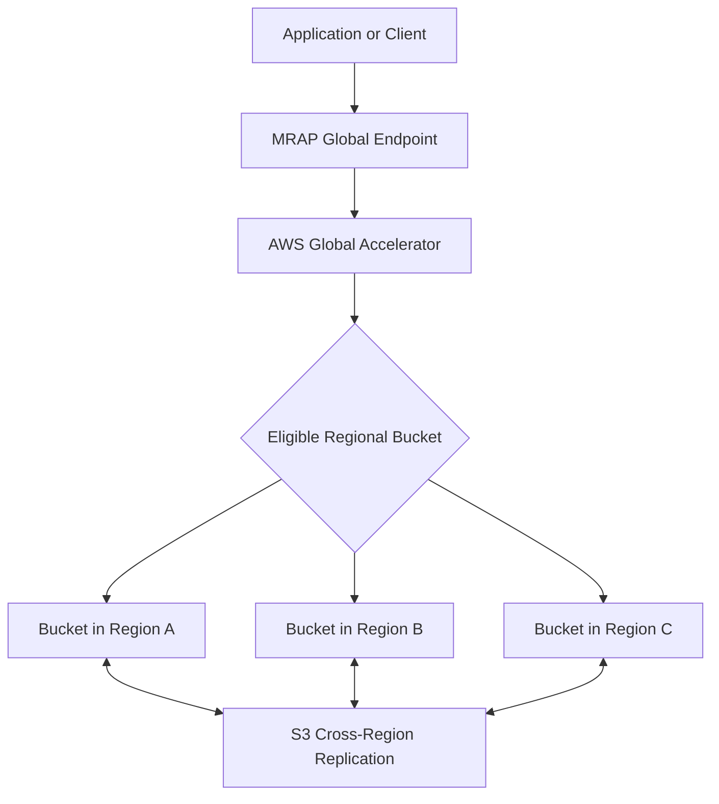
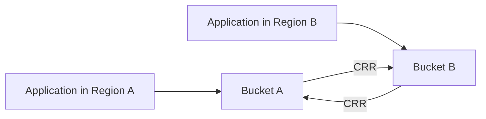

# S3 Multi-Region Access Points

## Overview

Amazon S3 Multi-Region Access Points (MRAPs) provide a single global endpoint for accessing S3 buckets located in multiple AWS Regions. Amazon S3 routes requests through this endpoint to an eligible bucket based on network proximity and the configured routing state.

MRAPs simplify multi-Region application design by allowing applications to use one logical S3 endpoint instead of selecting Regional bucket endpoints themselves. They also support controlled traffic failover between Regions and integrate with S3 Cross-Region Replication (CRR).

An MRAP does not automatically synchronize object data between buckets. Replication, access control, conflict management, and disaster recovery must be designed separately.

Use MRAPs when a workload needs one or more of the following:
- Lower-latency access for geographically distributed clients.
- A shared S3 endpoint across multiple Regions.
- Controlled traffic shifting during Regional disruptions.
- Multi-Region storage architectures that use replicated datasets.
- Centralized routing for applications that write or read S3 objects from different Regions.

Do not introduce an MRAP merely because an application needs backup storage. A single-Region bucket with an appropriate backup or replication strategy may be simpler and less expensive.

## Understand MRAP Architecture

### Core components

| Component | Responsibility |
|---|---|
| MRAP global endpoint | Provides a common endpoint for data-access requests across associated buckets |
| AWS Global Accelerator | Supports global network routing and acceleration for MRAP requests |
| Regional S3 buckets | Store objects in their respective AWS Regions |
| S3 Cross-Region Replication | Copies eligible objects and, when configured, relevant replica metadata between buckets |
| MRAP access policy | Defines access permitted through the MRAP |
| Bucket and IAM policies | Enforce applicable access permissions for requests and underlying resources |
| AWS KMS | Provides key management for objects encrypted with SSE-KMS or other supported KMS-backed encryption |
| Amazon CloudWatch and AWS CloudTrail | Support operational monitoring and auditing |

### Request flow



The routing layer selects an eligible bucket based on the request's network proximity and the MRAP routing configuration. It does not inspect object contents to determine which bucket contains a requested key.

Consequently, a request can reach a bucket that does not contain the requested object. CRR helps keep replicated object sets available across the associated buckets.

### MRAP is not a globally consistent database

An MRAP provides a global access endpoint, not a globally synchronized storage layer.

S3 provides strong read-after-write consistency for object operations within a bucket. However, CRR is asynchronous, so a newly created or modified object may not yet be present in another Region.

Consider a client uploading `reports/annual.pdf` through an MRAP. The request may be routed to a bucket in Region A. A subsequent request from another geographic location may be routed to Region B. Until replication completes, the second request can return `404 Not Found`.

**Production rule:** Treat replication lag as a distributed-system concern. Never assume that a successful write through an MRAP means every Regional bucket immediately contains the new object.

Reference: [MRAP request routing](https://docs.aws.amazon.com/AmazonS3/latest/userguide/MultiRegionAccessPointRequestRouting.html).

## Select the Right Routing Strategy

### Active-active

In an active-active configuration, multiple associated Regions accept traffic. MRAP routes requests to an eligible active Region based on proximity and availability.

Use this approach when:
- Applications operate in multiple geographic locations.
- Multiple Regions must serve normal traffic.
- The workload benefits from proximity-based routing.
- The application can tolerate asynchronous replication and has a defined strategy for concurrent writes.

Advantages:
- Requests can be served from geographically closer Regions.
- Multiple Regions participate in normal operation.
- Regional traffic disruptions can be handled through the remaining eligible Regions.

Trade-offs:
- Concurrent writes to the same key can create conflicting versions or application-level ambiguity.
- Replication is asynchronous.
- Application behavior must account for object propagation delays.
- Operating and monitoring multiple Regional copies adds complexity.

For workloads that modify shared objects, prefer immutable object keys or implement explicit application-level ownership and conflict-resolution rules.

### Active-passive

In an active-passive configuration, the active Region receives traffic while the passive Region remains available for controlled failover.

Use this approach when:
- A primary Region handles normal application requests.
- A secondary Region provides disaster recovery.
- Business requirements define a primary and standby Regional environment.
- Operations teams need explicit control over traffic shifting.

Advantages:
- Normal writes can be concentrated in one Region.
- Recovery procedures can be rehearsed without relying on automatic traffic changes alone.
- The standby Region can serve as an alternate request destination during an incident.

Trade-offs:
- Replication lag can result in missing recent writes during failover.
- The secondary Region must have the required data, permissions, and application dependencies.
- Recovery requires operational validation, not merely changing routing status.

MRAP failover controls can redirect new traffic between active and passive Regions within approximately two minutes under the documented failover mechanism. This is a routing capability, not a guarantee that the entire application has recovered within that time.

### Compare the strategies

| Decision factor | Active-active | Active-passive |
|---|---|---|
| Normal traffic | Multiple Regions | Active Region only |
| Latency optimization | Strong fit for geographically distributed traffic | Primarily optimized for the active Region |
| Write distribution | Writes may occur in different Regions | Writes normally concentrate in the active Region |
| Conflict management | Requires explicit consideration for shared mutable objects | Simpler under single-writer operation |
| Recovery operation | Redirect traffic to surviving active Regions or adjust routing | Shift traffic to the standby Region |
| Replication direction | Usually bidirectional for shared mutable datasets | Bidirectional replication is recommended when writes can continue after failover |
| Operational complexity | Higher | Lower during normal operation, but failover must be rehearsed |

## Configure MRAPs and Regional Buckets

### Plan the Regional topology first

Before creating an MRAP, identify the Regional buckets and define their responsibilities.

For example, a document platform might use:

| Resource | Purpose |
|---|---|
| Bucket in `ap-south-1` | Primary application storage |
| Bucket in `eu-west-1` | Regional replica for European access and recovery |
| Bucket in `us-east-1` | Regional replica for customers and recovery in the Americas |
| MRAP endpoint | Common endpoint used by application services |

Choose Regions based on latency, data residency, recovery objectives, application dependencies, and AWS service availability.

The MRAP itself does not create a complete multi-Region application. Databases, message queues, credentials, encryption keys, networking, and deployment pipelines must also support the intended recovery architecture.

### Validate naming and service constraints

MRAP names must be unique within an AWS account, contain 3–50 characters, begin with a lowercase letter or number, and cannot contain uppercase letters, underscores, or periods. Names cannot begin or end with a hyphen and cannot be changed after creation.

Amazon S3 supports up to 100 MRAPs per account and up to 17 Regions per MRAP, subject to the current service quotas and Regional availability.

Additional considerations:
- S3 on Outposts buckets are not supported.
- Associated buckets must satisfy MRAP requirements.
- Account opt-in requirements apply when using opt-in Regions.
- The MRAP alias is generated by AWS and cannot be edited or reused.
- Bucket policies, permissions, versioning, encryption, and replication must be configured for the intended application workflows.

Reference: [MRAP restrictions and limitations](https://docs.aws.amazon.com/AmazonS3/latest/userguide/MultiRegionAccessPointRestrictions.html).

### Create the MRAP

Create the Regional buckets and configure their required security and versioning settings before associating them with the MRAP.

An MRAP can be created using the S3 console, supported AWS CLI operations, SDKs, or infrastructure-as-code tools. The console provides a guided workflow for selecting Regions and buckets and configuring associated replication rules.

For programmatic creation and management, MRAP control-plane requests must be directed to the `us-west-2` Region. Data-plane requests through the global endpoint do not require the caller to select a target bucket Region.

MRAP control-plane operations can be asynchronous. When using the CLI or SDK, track the returned operation token until the operation succeeds or fails. Do not assume that submission of a create or update request means provisioning has completed.

Reference: [Creating Multi-Region Access Points](https://docs.aws.amazon.com/AmazonS3/latest/userguide/CreatingMultiRegionAccessPoints.html).

## Configure Cross-Region Replication

### Why replication is essential

MRAP routing is based on proximity and routing state, not on object availability within each bucket.

Without suitable replication, an object uploaded to one Regional bucket may be unavailable when a later request reaches another bucket.

CRR establishes the data distribution required for the MRAP architecture to serve the intended object population across Regions.

### Use bidirectional replication for shared writable datasets

When multiple Regional buckets are updated through an MRAP, configure bidirectional replication where required to synchronize objects across Regions.

For example:



Each replication rule requires appropriate configuration and permissions. Do not assume that creating an MRAP automatically establishes every replication requirement for the application.

For failover scenarios, AWS recommends two-way replication and replica modification synchronization when appropriate. Replica modification synchronization helps propagate supported metadata changes, such as tags and relevant object metadata, between replicated objects.

### Account for asynchronous replication

Replication is not a synchronous commit across all Regions. A source write can succeed before its replica is available elsewhere.

For latency-sensitive or availability-critical systems:
- Measure replication lag.
- Use S3 Replication Time Control (S3 RTC) where predictable replication timing is required.
- Design application workflows to tolerate temporarily missing replicas.
- Avoid assuming a fixed replication delay without monitoring actual behavior.
- Define recovery-point objectives based on accepted data-loss exposure.

S3 RTC is designed to replicate 99.99% of new objects within 15 minutes and is backed by a service-level agreement under its documented terms. It incurs additional charges and does not provide synchronous replication.

### Handle existing objects

Replication rules generally apply to eligible objects created after the rule is configured. Existing objects require an appropriate backfill strategy, such as S3 Batch Replication or a controlled migration.

Before using an MRAP for production traffic:
1. Identify the required object population.
2. Configure the intended replication rules.
3. Backfill eligible existing objects where necessary.
4. Verify object presence and relevant metadata in each Region.
5. Test reads through the MRAP from different locations and routing states.
6. Measure replication lag and confirm the documented recovery objectives.

Reference: [Configuring replication for MRAPs](https://docs.aws.amazon.com/AmazonS3/latest/userguide/MultiRegionAccessPointBucketReplication.html).

### Prevent concurrent-write ambiguity

Bidirectional replication does not turn multiple Regional buckets into a conflict-free shared database.

Two applications may write the same object key in different Regions before their changes have replicated. Versioning preserves object versions but does not independently decide which version represents the business-correct result.

Recommended approaches include:
- Use immutable object keys, such as UUID-based upload identifiers.
- Assign a single authoritative writer for each object or tenant.
- Use application-level version numbers or conditional writes where supported.
- Store business metadata and state transitions in an appropriate transactional data store.
- Define how concurrent updates are detected, rejected, reconciled, or superseded.

For workloads requiring strong coordination over shared mutable state, an MRAP alone is not sufficient.

## Design Failover and Recovery

### Define the failover procedure before production

For active-passive MRAPs, establish a documented runbook that identifies the primary Region, standby Region, approved failover authority, and validation steps.

A safe failover sequence is:

1. Detect and confirm a Regional service disruption.
2. Evaluate replication status and the potential recovery point.
3. Verify that the standby bucket and its KMS keys, IAM permissions, and required data are usable.
4. Shift MRAP routing to the standby Region using the approved control mechanism.
5. Verify that new requests reach the intended Region.
6. Validate read, write, delete, and relevant application workflows.
7. Monitor errors, replication activity, latency, and application health.
8. Keep the recovery Region authoritative until a planned failback is approved.

A routing change does not terminate existing connections. Existing requests continue until they reach a success or failure state.

### Inspect the current routing configuration

Use the following command to retrieve the MRAP's route configuration.

```bash
aws s3control get-multi-region-access-point-routes \
  --region us-east-1 \
  --account-id "$AWS_ACCOUNT_ID" \
  --mrap "$MRAP_ARN"
```

Use one of the supported Regions for MRAP failover-control requests, such as `us-east-1`, `us-west-2`, `eu-west-1`, `ap-southeast-2`, or `ap-northeast-1`. Confirm current Regional requirements before deployment.

### Initiate a controlled traffic shift

The following example sets one configured bucket to active and another to passive.

```bash
aws s3control submit-multi-region-access-point-routes \
  --region us-east-1 \
  --account-id "$AWS_ACCOUNT_ID" \
  --mrap "$MRAP_ARN" \
  --route-updates \
    Bucket="$PRIMARY_BUCKET",TrafficDialPercentage=100 \
    Bucket="$SECONDARY_BUCKET",TrafficDialPercentage=0
```

Review the actual bucket names and intended routing state before executing this command. It changes live routing and should be restricted to an authorized operator or deployment workflow.

After a failover, verify the route configuration and monitor request traffic through CloudWatch. Test application behavior rather than considering the successful route update sufficient evidence of recovery.

### Plan failback separately

Returning traffic to the original Region can be more complex than redirecting requests.

Before failback:
- Confirm the original Region is healthy.
- Check replication status and recent object changes.
- Verify that any writes performed during failover have propagated or are otherwise reconciled.
- Confirm that application state is consistent with the chosen writer.
- Perform a controlled routing change.
- Validate application behavior and monitor for errors.

Do not switch traffic back merely because the original Region is reachable. Establish which Region contains the authoritative data and how any replication lag will be handled.

## Configure Access Control and Encryption

### Apply least-privilege authorization

An MRAP has its own resource policy and works with the applicable IAM and underlying bucket permissions.

For cross-account requests, the MRAP policy, caller's IAM policy, and underlying bucket policy must permit the requested operation. Same-account access and configurations that delegate bucket access control to the MRAP have different policy evaluation requirements, so validate the chosen design explicitly.

A simplified MRAP resource policy granting a backend role read and write access might look like this:

```json
{
  "Version": "2012-10-17",
  "Statement": [
    {
      "Sid": "BackendObjectAccess",
      "Effect": "Allow",
      "Principal": {
        "AWS": "arn:aws:iam::123456789012:role/DocumentServiceRole"
      },
      "Action": [
        "s3:GetObject",
        "s3:PutObject"
      ],
      "Resource": [
        "arn:aws:s3::123456789012:accesspoint/REPLACE-WITH-MRAP-ALIAS",
        "arn:aws:s3::123456789012:accesspoint/REPLACE-WITH-MRAP-ALIAS/object/*"
      ]
    }
  ]
}
```

Replace the example account, role, and MRAP alias with actual values. Add only the permissions required by the application; deletion, listing, tagging, multipart operations, and other actions need their own authorization analysis.

This policy is not a complete bucket policy or deployment configuration. Confirm that the underlying buckets permit the intended request path, or configure the documented MRAP access-control delegation pattern.

Important distinctions:
- MRAP policies govern access through the MRAP endpoint.
- Direct requests to a bucket can continue to follow the bucket's own access controls.
- Explicit denies and Block Public Access settings remain important.
- An MRAP does not make a private bucket public or replace IAM controls.
- A successful S3 authorization check does not imply KMS decryption permissions are available.

Reference: [MRAP permissions](https://docs.aws.amazon.com/AmazonS3/latest/userguide/MultiRegionAccessPointPermissions.html).

### Preserve encryption and KMS access across Regions

For SSE-KMS objects replicated across Regions, configure the required source and destination key permissions and replication-role access.

Validate:
- The required KMS keys are available in the relevant Regions.
- Replication roles can perform the necessary source and destination operations.
- Application roles can read encrypted objects in every eligible Region.
- Cross-account key policies authorize the intended callers where applicable.
- Key lifecycle procedures preserve disaster-recovery access.

A replicated object is not a recoverable object if the destination key is disabled, scheduled for deletion, or inaccessible to the recovery principal.

For a full review, see the dedicated encryption and key-management documentation in the S3 security and best-practices sections.

## Integrate MRAPs with Backend Applications

### Use the MRAP ARN with compatible SDKs

For SDK-based object operations, use the MRAP ARN where the S3 request expects a bucket identifier.

An MRAP ARN has this form:

```text
arn:aws:s3::123456789012:accesspoint/REPLACE-WITH-MRAP-ALIAS
```

The alias and ARN are not interchangeable. Store the correct ARN in environment-specific configuration rather than constructing it throughout the codebase.

MRAP requests require AWS Signature Version 4A (SigV4A). Use a current compatible AWS SDK and ensure its required signing dependencies are available. Supported SDKs can automatically use SigV4A for MRAP requests.

### Example with Boto3

```python
import os

import boto3
from botocore.exceptions import BotoCoreError, ClientError


MRAP_ARN = os.environ["S3_MRAP_ARN"]

s3 = boto3.client("s3")


def upload_document(key: str, content: bytes) -> None:
    try:
        s3.put_object(
            Bucket=MRAP_ARN,
            Key=key,
            Body=content,
            ContentType="application/pdf",
        )
    except (ClientError, BotoCoreError) as exc:
        # Log the failure with a request or correlation ID where available.
        raise RuntimeError("Failed to upload document through MRAP") from exc


def download_document(key: str) -> bytes:
    try:
        response = s3.get_object(
            Bucket=MRAP_ARN,
            Key=key,
        )
        body = response["Body"]
        try:
            return body.read()
        finally:
            body.close()
    except (ClientError, BotoCoreError) as exc:
        raise RuntimeError("Failed to download document through MRAP") from exc
```

This example illustrates MRAP access using Boto3. In production, use bounded retries for retryable failures, avoid loading very large files entirely into memory, and preserve structured AWS error details for diagnosis.

For large uploads and downloads, use the SDK's transfer utilities or streaming operations as appropriate. Confirm that the selected SDK operations support MRAP ARNs.

### Keep storage logic in a service layer

Django, Django REST Framework, FastAPI, Flask, and Celery workloads should call a shared storage service rather than duplicating S3 request logic in views, route handlers, or workers.

The service layer should handle:
- Object-key generation and tenant isolation.
- Authorization before issuing access or presigned URLs.
- Upload validation and metadata management.
- SDK retries, timeouts, and exception classification.
- MRAP ARN configuration.
- Correlation IDs and structured logging.
- Object-level checks required by the business workflow.

For multi-Region workloads, do not assume two successful requests reach the same physical bucket. Any logic dependent on a specific Regional copy should use an explicit design for routing, version selection, or Regional access rather than relying on MRAP proximity routing.

Reference: [Making requests through an MRAP](https://docs.aws.amazon.com/AmazonS3/latest/userguide/MultiRegionAccessPointRequests.html).

## Understand Supported Operations and Limitations

An MRAP is primarily a global endpoint for supported S3 object operations, not a replacement for every bucket management API.

| Capability | Consideration |
|---|---|
| `GetObject` and `PutObject` | Supported through an MRAP ARN |
| `HeadObject` and `ListObjectsV2` | Supported, subject to permissions and the supported operation model |
| Multipart upload operations | Supported for the documented multipart operations |
| `CopyObject` | An MRAP is supported as the destination, not as the source |
| S3 Batch Operations | Not supported for MRAPs |
| Bucket lifecycle and replication management | Configure and manage these on the underlying buckets using the appropriate control-plane APIs |
| Private network connectivity | Use a supported S3 interface endpoint and AWS PrivateLink configuration where required |
| S3 gateway endpoints | Cannot be used to access data through an MRAP |
| Anonymous access | Not supported |
| CloudFront integration | Configure the MRAP as a custom origin where applicable rather than assuming it is a standard S3 origin |

Check the current compatibility list before depending on an operation or service integration. API and SDK support can vary by operation and version.

Reference: [MRAP supported operations](https://docs.aws.amazon.com/AmazonS3/latest/userguide/MrapOperations.html).

## Monitor Performance, Replication, and Failover

### Monitor data-access traffic

Use CloudWatch to observe traffic patterns, errors, request activity, and relevant Regional changes. Use CloudTrail and, where configured, S3 server access logs to investigate requests made through the MRAP.

MRAP requests can appear in logs under the MRAP hostname, while direct bucket requests appear under the relevant bucket hostname. Distinguish between these request paths when investigating access failures.

### Monitor replication health

For the underlying buckets, enable appropriate replication metrics and use S3 RTC when required by the recovery objective.

Monitor:
- Replication latency.
- Failed replication operations.
- Pending replication bytes and operations where relevant metrics are available.
- Object availability in each Region.
- Metadata synchronization where configured.
- Replication behavior after failover.

Do not treat an MRAP health check as evidence that all Regional copies contain the latest writes.

### Maintain operational runbooks

Document:
- Normal routing configuration.
- How to retrieve and validate current routes.
- How to perform a traffic shift.
- How to evaluate replication lag.
- How to test read and write access in a recovery Region.
- How to reconcile conflicting or missing data.
- How to perform and validate failback.
- Who can authorize each action.

Use staged failover exercises to validate routing, permissions, application behavior, and recovery procedures before a real Regional incident occurs.

Reference: [MRAP monitoring and logging](https://docs.aws.amazon.com/AmazonS3/latest/userguide/MultiRegionAccessPointMonitoring.html).

## Evaluate Costs Before Deployment

MRAPs introduce costs beyond ordinary storage charges.

Include the following in the cost model:

| Cost component | Why it matters |
|---|---|
| MRAP data routing | MRAP request routing incurs applicable charges |
| Internet acceleration | Applicable acceleration or routing charges depend on traffic paths and usage |
| S3 requests | GET, PUT, multipart, and other operations remain chargeable |
| Regional data transfer | Replication and cross-Region data movement can incur transfer charges |
| Storage | Every Regional replica consumes storage |
| S3 RTC | Additional charges apply when enabled |
| CloudWatch | Replication metrics and monitoring incur applicable charges |
| Recovery operations | Temporary increases in requests, data transfer, restoration, and application processing can affect incident costs |

Review the current [Amazon S3 pricing](https://aws.amazon.com/s3/pricing/) before committing to the architecture.

Estimate normal operation, failover, recovery testing, and restoration costs. An active-active architecture can improve latency, but it may also duplicate storage and increase replication and request traffic.

## Common MRAP Design Mistakes

| Mistake | Why it fails | Better approach |
|---|---|---|
| Assuming MRAP automatically replicates data | Routing does not copy objects between buckets | Configure and verify CRR |
| Expecting immediate cross-Region visibility | Replication is asynchronous | Design for replication lag and missing replicas |
| Using active-active without a write-conflict strategy | Concurrent updates can create ambiguous business state | Use immutable keys or application-level conflict handling |
| Treating failover as complete application recovery | Databases, credentials, encryption keys, and workers may still be unavailable | Test end-to-end recovery |
| Ignoring existing objects when enabling replication | Historical objects may be absent from destination buckets | Backfill with an appropriate migration or replication process |
| Assuming bucket policies and the MRAP policy are interchangeable | The effective authorization path depends on resource and identity policies | Test same-account and cross-account access explicitly |
| Ignoring KMS dependencies | Replicas may exist but remain unreadable | Validate destination key access |
| Assuming failover terminates existing connections | Existing requests continue until completion or failure | Make clients resilient to in-flight errors |
| Using an MRAP for an unsupported S3 operation | An MRAP supports a defined set of object operations | Check operation compatibility before design |
| Returning traffic to the primary Region immediately | The original copy may be stale or recovery may be incomplete | Validate data state and application health before failback |

## Production Readiness Checklist

- [ ] Regional buckets are selected according to latency, compliance, and recovery requirements.
- [ ] The MRAP's routing strategy is explicitly defined as active-active or active-passive.
- [ ] Required objects and versions are present in every eligible Region.
- [ ] Replication rules, roles, and KMS permissions are tested.
- [ ] Bidirectional replication is configured when required by the write and failover design.
- [ ] The application has a documented strategy for concurrent writes and replication delays.
- [ ] MRAP, IAM, bucket, and KMS permissions follow least-privilege principles.
- [ ] SDK and CLI versions support the required MRAP operations and SigV4A signing.
- [ ] CloudWatch monitoring and applicable CloudTrail logging are configured.
- [ ] Traffic-shifting and failback procedures have been exercised.
- [ ] Recovery-point and recovery-time objectives are measured rather than assumed.
- [ ] Request, replication, routing, storage, and data-transfer costs have been estimated.
- [ ] Unsupported operations and integration constraints have been reviewed.
- [ ] The incident runbook identifies the authorized operators and validation steps.
- [ ] Existing objects, Regional replicas, and recovery access are verified before production cutover.

## Authoritative References

- [Managing Multi-Region Access Points](https://docs.aws.amazon.com/AmazonS3/latest/userguide/MultiRegionAccessPoints.html)
- [Creating Multi-Region Access Points](https://docs.aws.amazon.com/AmazonS3/latest/userguide/CreatingMultiRegionAccessPoints.html)
- [MRAP request routing](https://docs.aws.amazon.com/AmazonS3/latest/userguide/MultiRegionAccessPointRequestRouting.html)
- [Configuring replication for MRAPs](https://docs.aws.amazon.com/AmazonS3/latest/userguide/MultiRegionAccessPointBucketReplication.html)
- [MRAP permissions](https://docs.aws.amazon.com/AmazonS3/latest/userguide/MultiRegionAccessPointPermissions.html)
- [MRAP failover controls](https://docs.aws.amazon.com/AmazonS3/latest/userguide/MrapFailover.html)
- [MRAP routing states](https://docs.aws.amazon.com/AmazonS3/latest/userguide/FailoverConfiguration.html)
- [Using MRAPs with supported operations](https://docs.aws.amazon.com/AmazonS3/latest/userguide/MrapOperations.html)
- [Monitoring and logging MRAP requests](https://docs.aws.amazon.com/AmazonS3/latest/userguide/MultiRegionAccessPointMonitoring.html)
- [AWS SDK support for MRAPs](https://docs.aws.amazon.com/sdkref/latest/guide/feature-s3-mrap.html)
- [Amazon S3 pricing](https://aws.amazon.com/s3/pricing/)

## Key Takeaways

- An MRAP provides a single global endpoint and proximity-based routing; it does not replicate or globally synchronize object data.
- Configure and monitor CRR so that eligible Regional buckets contain the objects required by the application.
- Choose active-active or active-passive routing according to write patterns, conflict handling, and recovery objectives.
- Validate IAM, bucket, MRAP, and KMS permissions and ensure compatible SDKs use SigV4A.
- Treat failover and failback as data-recovery procedures that require replication checks, application validation, and controlled routing changes.
You've reached the maximum length for this conversation, but you can keep talking by starting a new chat.
Start new chat