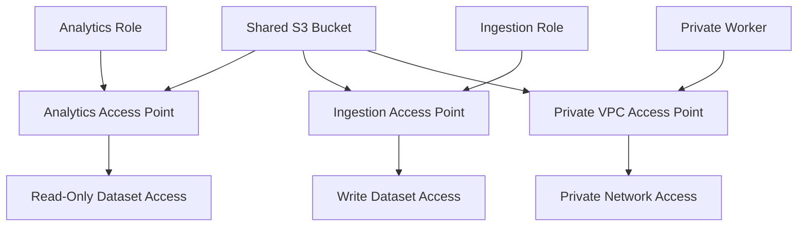
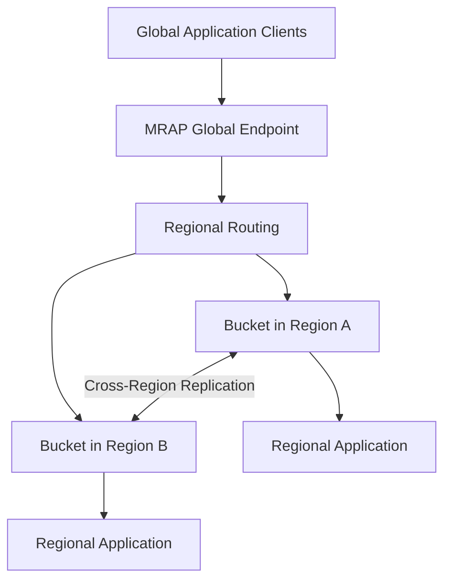
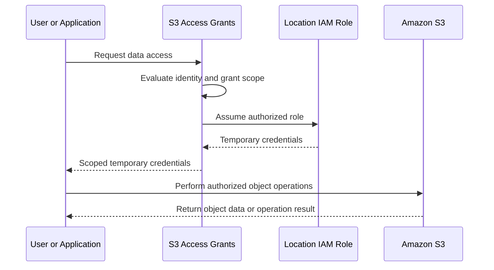
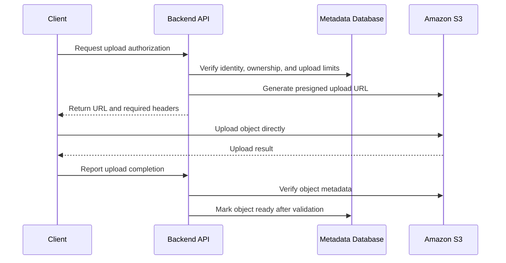

# 03- Advanced Object Access Patterns

## Overview

Amazon S3 provides several mechanisms for controlling how applications, users, and services access object data. Beyond direct bucket access, production architectures can use S3 Access Points, Multi-Region Access Points, S3 Access Grants, and transformation layers to implement specialized access patterns.

These capabilities address different architectural problems:

- **S3 Access Points:** Provide application-specific access endpoints with independent policies and network controls.
- **S3 Multi-Region Access Points (MRAPs):** Provide a global endpoint that routes requests to supported S3 buckets across multiple AWS Regions.
- **S3 Access Grants:** Provide scalable, prefix-scoped access management using temporary credentials.
- **S3 Object Lambda:** Allows eligible existing customers to transform data during supported read operations.
- **Presigned URLs:** Delegate temporary, narrowly scoped access to clients without distributing application credentials.

These mechanisms are complementary rather than interchangeable. Selecting the right approach requires understanding authorization, routing, consistency, trust boundaries, and failure behavior.

## Choose the Appropriate Access Pattern

| Requirement | Recommended approach | Primary consideration |
|---|---|---|
| Separate permissions for different applications accessing one bucket | S3 Access Points | Access point policies operate alongside bucket and IAM policies |
| Restrict data access to a VPC | VPC-restricted S3 Access Point | Network restrictions must match the application architecture |
| Provide regional routing across replicated buckets | Multi-Region Access Points | Routing does not itself replicate objects |
| Grant many users access to different dataset prefixes | S3 Access Grants | Requires registered locations, grants, and appropriate IAM roles |
| Allow a customer to upload directly to S3 | Presigned upload URL | Validate the uploaded object before trusting it |
| Allow temporary downloads without proxying file contents through the backend | Presigned download URL | Treat the URL as a bearer capability |
| Transform objects as they are read | Application processing, Lambda, or an eligible existing Object Lambda integration | Account for latency, processing cost, and service availability |
| Enforce a common policy across several applications | IAM and bucket policies, optionally combined with access points | Preserve a clear authorization model |

Do not introduce additional access layers without a specific requirement. More endpoints and policies can improve isolation, but they also increase configuration and troubleshooting complexity.

## Amazon S3 Access Points

### Understand access points

An S3 Access Point is a named endpoint associated with a data source, such as a general purpose S3 bucket. It provides a dedicated policy and network configuration for requests made through that endpoint.

Access points are useful when multiple applications share a bucket but require different access boundaries.

For example, a data platform might use one bucket containing multiple datasets:

- An analytics application needs read access to reporting data.
- An ingestion service needs write access to incoming records.
- An internal application needs access only to a specific prefix.
- A private worker must access the data through a VPC.

Instead of placing all application-specific access logic into one large bucket policy, separate access points can express these boundaries independently.

### Access point architecture



Each access point exposes a distinct access path to the same underlying bucket. The access point does not create an independent copy of the data.

### Understand authorization behavior

Access point authorization involves multiple controls.

| Control | Responsibility |
|---|---|
| IAM identity policy | Defines permissions available to the calling principal |
| Access point policy | Defines permissions applicable to requests made through that access point |
| Bucket policy | Governs access to the underlying bucket and can constrain access through access points |
| Block Public Access | Prevents applicable public-access configurations and access paths |
| VPC and endpoint policies | Enforce additional network and request restrictions where configured |

A permission granted by one policy does not automatically bypass a restriction imposed by another applicable policy.

When diagnosing `AccessDenied`, identify the actual request principal, endpoint, bucket, object key, and all applicable policy conditions.

### Create an access point

The following AWS CLI example creates an access point for a general purpose bucket:

```bash
aws s3control create-access-point \
  --account-id "$AWS_ACCOUNT_ID" \
  --name analytics-read \
  --bucket "$BUCKET_NAME"
```

The name must be unique within the account and Region. Replace the environment variables with the intended account and bucket.

To create an access point restricted to a VPC:

```bash
aws s3control create-access-point \
  --account-id "$AWS_ACCOUNT_ID" \
  --name private-worker \
  --bucket "$BUCKET_NAME" \
  --vpc-configuration VpcId="$VPC_ID"
```

A VPC-origin access point requires the requesting application to use the supported private access path. Confirm that the VPC, networking, endpoint policies, DNS, and IAM configuration are compatible with the selected access mechanism.

Inspect the access point:

```bash
aws s3control get-access-point \
  --account-id "$AWS_ACCOUNT_ID" \
  --name analytics-read
```

### Use access point policies deliberately

Access point policies are resource-based policies. A policy can restrict access to a particular application role and object prefix.

For example, an access point policy might grant a dedicated reporting role read access to objects beneath `reports/`.

```json
{
  "Version": "2012-10-17",
  "Statement": [
    {
      "Sid": "AllowReportingRead",
      "Effect": "Allow",
      "Principal": {
        "AWS": "arn:aws:iam::123456789012:role/ReportingApplicationRole"
      },
      "Action": [
        "s3:GetObject"
      ],
      "Resource": "arn:aws:s3:ap-south-1:123456789012:accesspoint/analytics-read/object/reports/*"
    }
  ]
}
```

This is an illustrative access point policy, not a complete authorization configuration. The role's identity permissions, bucket policy, access point configuration, and any explicit denies must also be evaluated. Listing objects may require separate permissions and corresponding bucket-level resource permissions.

Deploy the policy using a reviewed file:

```bash
aws s3control put-access-point-policy \
  --account-id "$AWS_ACCOUNT_ID" \
  --name analytics-read \
  --policy file://access-point-policy.json
```

**Production recommendations**

- Use separate access points for applications with materially different permissions.
- Restrict each application to the object prefixes and operations it requires.
- Prefer private network origins for workloads that should not access S3 over public network paths.
- Avoid allowing an application to bypass its intended access point through a broader direct-bucket permission.
- Test expected and denied requests before rollout.
- Include policy changes in infrastructure-as-code and code review.

Access points for general purpose buckets primarily support object operations. Do not assume they replace the bucket-level configuration APIs used for lifecycle rules, replication, or bucket management.

References: [Managing access with S3 Access Points](https://docs.aws.amazon.com/AmazonS3/latest/userguide/access-points.html) and [Using S3 Access Points](https://docs.aws.amazon.com/AmazonS3/latest/userguide/using-access-points.html).

## Amazon S3 Multi-Region Access Points

### Understand global access routing

A Multi-Region Access Point provides a global endpoint for accessing supported S3 buckets in multiple AWS Regions.

Instead of requiring an application to select a regional bucket endpoint directly, the application uses the MRAP endpoint. S3 uses AWS Global Accelerator to route requests toward an appropriate bucket in an active Region.

MRAPs are useful for geographically distributed applications, regional traffic management, and architectures that require a controlled approach to regional failover.

They do not eliminate the need to design replication, authorization, data consistency, and recovery procedures.

### Understand the architecture



The global endpoint provides request routing, while replication provides the mechanism for transferring eligible object changes between regional buckets.

These are separate responsibilities.

### Distinguish routing from replication

An MRAP does not automatically synchronize the buckets behind it.

| Concern | Responsibility |
|---|---|
| Route a request to an active regional bucket | MRAP |
| Replicate eligible object changes | S3 Cross-Region Replication (CRR) |
| Maintain regional bucket authorization | Bucket policies, IAM, access point policies, and applicable KMS policies |
| Define which Regions receive traffic | MRAP routing configuration |
| Establish regional recovery objectives | Application architecture and tested recovery procedures |
| Resolve conflicting concurrent writes | Application data model and write-coordination strategy |

A successfully routed request can still fail because the selected bucket lacks the required object, contains an older replica, or has different permissions.

### Select an active-active or active-passive design

| Design | Behavior | Suitable workload |
|---|---|---|
| Active-active | Multiple active Regions can receive traffic; requests are routed according to MRAP routing behavior | Globally distributed applications that can tolerate asynchronous replication and possible regional data divergence |
| Active-passive | One Region receives normal traffic while another remains passive until failover | Applications that require an explicitly controlled primary Region and a defined disaster-recovery procedure |

Active-active routing can improve geographic access performance, but it does not provide a globally serialized write model. Applications must account for concurrent writes, asynchronous replication, and possible conflicts involving the same object key.

Active-passive routing simplifies traffic ownership, but failover still requires application-level readiness, valid permissions, adequate destination capacity, and an understood replication recovery point.

### Design replication before enabling failover

A production multi-Region design should define:

- Which bucket is authoritative during normal operation.
- Whether writes are allowed in both Regions.
- Which objects and metadata must be replicated.
- How destination KMS keys and policies are configured.
- How replication lag affects recovery objectives.
- How clients and background workers behave during a Region transition.
- How writes made after failover are replicated back when required.

For active-passive recovery, a common approach is to combine MRAP failover controls with appropriately configured CRR and bidirectional replication where required.

Two-way replication and replica modification synchronization can help keep regional datasets aligned, but they do not remove all concurrent-write or application consistency concerns.

### Understand failover behavior

MRAP failover controls allow routing status changes between supported Regions.

Before treating failover as automated disaster recovery, verify:

1. The destination bucket has the required objects and permissions.
2. Replication has been configured and measured.
3. Regional application components can operate independently.
4. Monitoring detects regional failures and replication problems.
5. The team can shift routing and verify that traffic reaches the intended Region.
6. The application has a policy for any missing, delayed, or conflicting data.

AWS documents that routing changes can take approximately two minutes to propagate after a failover control operation. Treat this as service behavior guidance, not a guaranteed end-to-end application recovery time. Existing requests and connections can also have their own outcomes.

Reference: [MRAP failover controls](https://docs.aws.amazon.com/AmazonS3/latest/userguide/MrapFailover.html).

### Apply MRAP operational controls

- Use the MRAP ARN or supported endpoint form with an AWS SDK that supports the required signing behavior.
- Use a supported SDK configuration for SigV4a where required; do not manually sign MRAP requests with a fixed single-Region SigV4 assumption.
- Verify bucket and MRAP policy interactions for every participating Region.
- Monitor replication status separately from request-routing health.
- Test failover under realistic request load.
- Document recovery objectives and residual data-loss exposure.
- Avoid assuming that routing to the nearest Region necessarily gives the lowest application latency for every workload.

Reference: [Managing Multi-Region Access Points](https://docs.aws.amazon.com/AmazonS3/latest/userguide/MultiRegionAccessPoints.html).

## Amazon S3 Access Grants

### Use Access Grants for scalable data permissions

S3 Access Grants provides a way to manage access to S3 datasets through grants scoped to buckets, prefixes, or objects. It can issue temporary credentials for users and applications that are authorized to access those locations.

It is particularly useful for analytics environments, centralized data lakes, and systems where large numbers of human identities or applications need different levels of access to shared object data.

Traditional IAM and bucket policies remain suitable for many workloads. Access Grants becomes more attractive when managing all dataset-level permissions through static policies becomes difficult.

### Understand the access flow



The workflow involves four main configurations:

1. Create an S3 Access Grants instance in the intended Region.
2. Register the applicable S3 bucket or prefix as a location and associate an IAM role.
3. Create grants for the intended identities and access levels.
4. Request temporary credentials and use them to perform supported S3 operations.

Grants can specify `READ`, `WRITE`, or `READWRITE` permissions. The resulting temporary credentials are scoped to the grant's authorized data location.

### Apply Access Grants appropriately

Consider this model for a multi-tenant data platform:

| Identity | Authorized prefix | Permission |
|---|---|---|
| Finance analyst | `finance/` | `READ` |
| Data ingestion service | `incoming/` | `WRITE` |
| Reporting application | `reports/` | `READ` |
| Data processing worker | `incoming/` and authorized output location | Required read/write permissions |

The registered location role, grant configuration, IAM permissions, and relevant S3 bucket settings must agree. Access Grants does not make an otherwise inaccessible bucket universally accessible.

Where corporate directory identities are involved, review the IAM Identity Center integration and the relevant identity propagation requirements.

### Manage temporary credentials securely

Treat vended credentials as short-lived access capabilities.

- Do not persist temporary secret access keys in source code or logs.
- Request credentials only for the required scope and duration.
- Refresh credentials safely before expiration.
- Avoid distributing credentials between tenants.
- Confirm that the grant does not include neighboring prefixes or operations.
- Audit grant creation, modification, and deletion.
- Test both authorized and unauthorized access paths.

S3 Access Grants is not a replacement for application authentication. The application must still establish the user's identity before requesting access on that user's behalf.

Reference: [Getting started with S3 Access Grants](https://docs.aws.amazon.com/AmazonS3/latest/userguide/access-grants-get-started.html).

## Advanced Temporary Access with Presigned URLs

Presigned URLs are a useful access pattern when the application should authorize an operation without proxying the entire file transfer through its backend.

### Use direct upload and download flows



The backend remains responsible for authentication, authorization, object-key generation, and recording metadata. S3 handles the actual transfer.

For an upload workflow:
- Generate object keys on the server rather than trusting arbitrary client-supplied keys.
- Scope the signature to the intended HTTP operation and object.
- Require the signed headers and encryption settings that your design depends on.
- Enforce size and content restrictions through an appropriate upload architecture.
- Treat client-reported completion as untrusted until the object has been verified.
- Prevent unvalidated objects from becoming publicly available or being processed as trusted content.

A presigned PUT URL does not, by itself, enforce every application-level file validation rule. The signed request parameters and applicable S3 controls must be evaluated, and the application should validate the stored object before accepting it as complete.

### Avoid credential and URL leakage

- Use short expiration times consistent with transfer size and client reliability.
- Do not log complete signed URLs or expose them to analytics systems.
- Prevent URL reuse from overwriting important objects by using unique keys or other explicit object-write controls.
- Avoid assuming URL expiration revokes access earlier than the configured expiry; signature credentials and relevant authorization changes also influence effective access.
- Use HTTPS and verify the required request headers.
- Store durable object references in the application database instead of storing the entire presigned URL.

For long-running transfers, account for URL expiration, interrupted uploads, multipart upload completion, and retry behavior.

Reference: [Using presigned URLs](https://docs.aws.amazon.com/AmazonS3/latest/userguide/using-presigned-url.html).

## S3 Object Lambda and Read-Time Transformation

S3 Object Lambda was designed to invoke custom Lambda processing while supported S3 `GET`, `LIST`, and `HEAD` requests are handled. Use cases include filtering returned data, modifying object metadata, resizing images, and redacting content from responses.

However, **S3 Object Lambda has a significant availability restriction**: since November 7, 2025, it has been available only to existing customers already using the service and select AWS Partner Network partners. New customers should not design new systems around it as an assumed generally available option.

Existing eligible customers can continue using it, but AWS has announced no plans for new capabilities.

### Choose an alternative for new architectures

| Requirement | Alternative |
|---|---|
| Transform images dynamically for web delivery | CloudFront with an appropriate image transformation solution |
| Redact or process sensitive data at request time | Lambda invoked through API Gateway, CloudFront, or a Lambda function URL |
| Create normalized data for repeated access | Process objects during ingestion and store derived objects |
| Transform data already being analyzed by an application | Perform transformation in the application when suitable |

The best design depends on whether transformations must occur on every read, whether results can be cached, and whether the transformation is computationally expensive.

Repeatedly processing the same object during every download can increase latency and cost. If the transformation is deterministic and reusable, creating a derived object during ingestion may be more efficient.

Reference: [S3 Object Lambda availability change](https://docs.aws.amazon.com/AmazonS3/latest/userguide/amazons3-ol-change.html).

## Authorization, Monitoring, and Troubleshooting

### Diagnose access failures systematically

When an advanced access pattern fails, do not begin by broadly expanding IAM permissions.

Follow this diagnostic sequence:

1. Identify the exact request endpoint and operation.
2. Identify the effective caller, including any assumed role or temporary credentials.
3. Verify the bucket, access point, object key, and Region.
4. Inspect the relevant identity, bucket, access point, and endpoint policies.
5. Verify the applicable network origin and request-signing configuration.
6. For encrypted objects, inspect KMS permissions and key state separately.
7. For MRAP requests, verify routing state, destination object availability, and replication status.
8. For Access Grants, verify the registered location, grant scope, credential expiration, and location role.
9. Reproduce the request using a controlled test identity.
10. Add a regression test for the identified failure.

### Monitor the appropriate signals

| Capability | Useful monitoring signals |
|---|---|
| Access Points | S3 request errors, denied requests, changes to access point policies, and network-path failures |
| Multi-Region Access Points | Regional request distribution, error rates, routing changes, and replication lag |
| Access Grants | Grant configuration changes, failed access requests, credential-expiration issues, and denied operations |
| Presigned URLs | Signature failures, expired credentials, rejected headers, incomplete uploads, and unexpected overwrite attempts |
| Transformation workflows | Lambda duration, errors, throttling, request volume, and processing cost |

Use CloudTrail for relevant management and data-event auditing. Configure appropriate S3 data-event coverage when object access activity must be investigated; it should not be assumed that all object-level API activity is recorded by default.

For multi-Region applications, request routing and successful replication must be monitored separately. A healthy endpoint does not prove that every destination contains the latest object version.

## Common Design Mistakes

| Mistake | Consequence | Better practice |
|---|---|---|
| Treating an access point as a separate data store | Teams misunderstand shared-object and policy behavior | Document the underlying bucket and access boundary |
| Assuming an access point policy overrides a bucket policy | Legitimate requests may still be denied | Evaluate all applicable policies |
| Assuming MRAP automatically replicates objects | A routed request may encounter missing or stale data | Configure and monitor replication independently |
| Treating active-active routing as globally consistent writes | Concurrent updates can create application-level conflicts | Define ownership and conflict-handling rules |
| Assuming regional failover is instantaneous | Applications may experience transient errors or recovery delays | Test failover and retry behavior |
| Using broad static policies for large, changing user populations | Policy management becomes difficult to maintain | Evaluate S3 Access Grants for granular dataset access |
| Storing temporary credentials in application records | Credentials may outlive their intended control boundary | Use scoped temporary credentials and secure refresh workflows |
| Treating presigned URLs as durable authorization records | Expired or leaked URLs produce unexpected access behavior | Store object identifiers and issue URLs when authorized |
| Building a new application around S3 Object Lambda availability | New customers may be unable to adopt the capability | Select a currently accessible transformation architecture |
| Debugging every failure by granting `s3:*` | Root causes remain hidden and least privilege is lost | Diagnose endpoint, policies, identity, and encryption separately |

## Production Readiness Checklist

- [ ] Each access mechanism has a clearly defined business or architectural purpose.
- [ ] Application roles and access point policies follow least-privilege principles.
- [ ] Bucket policies are consistent with access point and cross-account access requirements.
- [ ] Private access paths have been validated from the intended network.
- [ ] MRAP routing and replication behavior are configured and tested independently.
- [ ] Multi-Region recovery procedures define acceptable replication lag and data-loss exposure.
- [ ] Access Grants locations and grants are scoped to the intended identities and prefixes.
- [ ] Temporary credentials and presigned URLs are protected from leakage.
- [ ] Upload completion includes object verification and necessary content validation.
- [ ] Transformation workflows use a currently available architecture appropriate to the workload.
- [ ] CloudTrail and application monitoring cover the operations needed for security investigation.
- [ ] Expected and denied access paths have automated regression tests.
- [ ] Infrastructure-as-code captures access policies, routing configuration, and network restrictions.
- [ ] Operational runbooks document failure diagnosis, recovery, and safe configuration changes.

## Authoritative References

- [S3 Access Points](https://docs.aws.amazon.com/AmazonS3/latest/userguide/access-points.html)
- [S3 Access Point aliases and addressing](https://docs.aws.amazon.com/AmazonS3/latest/userguide/access-points-naming.html)
- [S3 Multi-Region Access Points](https://docs.aws.amazon.com/AmazonS3/latest/userguide/MultiRegionAccessPoints.html)
- [MRAP routing and failover controls](https://docs.aws.amazon.com/AmazonS3/latest/userguide/MrapFailover.html)
- [S3 Access Grants](https://docs.aws.amazon.com/AmazonS3/latest/userguide/access-grants.html)
- [Accessing S3 data with Access Grants credentials](https://docs.aws.amazon.com/AmazonS3/latest/userguide/access-grants-get-data.html)
- [Using S3 presigned URLs](https://docs.aws.amazon.com/AmazonS3/latest/userguide/using-presigned-url.html)
- [S3 Object Lambda availability change](https://docs.aws.amazon.com/AmazonS3/latest/userguide/amazons3-ol-change.html)
- [CloudTrail data events for S3](https://docs.aws.amazon.com/AmazonS3/latest/userguide/cloudtrail-logging-s3-info.html)

## Key Takeaways

- Use S3 Access Points to establish application-specific access policies and network boundaries over shared object data.
- Use Multi-Region Access Points for regional request routing, but design replication, write consistency, and recovery independently.
- Consider S3 Access Grants when many users or applications require scalable, prefix-scoped access through temporary credentials.
- Treat presigned URLs as temporary bearer capabilities and verify uploaded objects before trusting them.
- Account for S3 Object Lambda's current availability restrictions when designing read-time transformation architectures.
You've reached the maximum length for this conversation, but you can keep talking by starting a new chat.
Start new chat