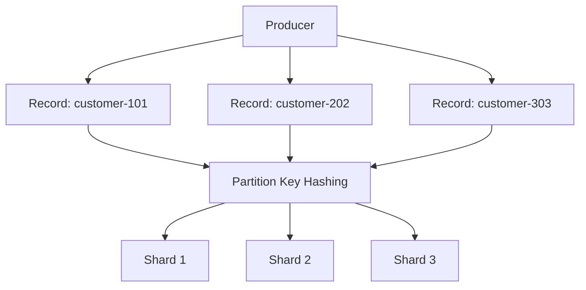
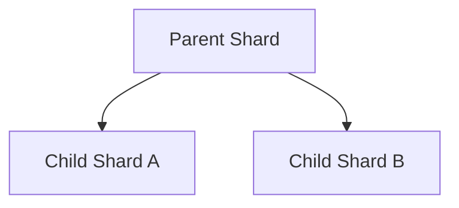
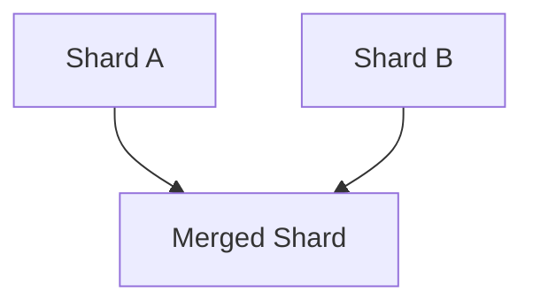
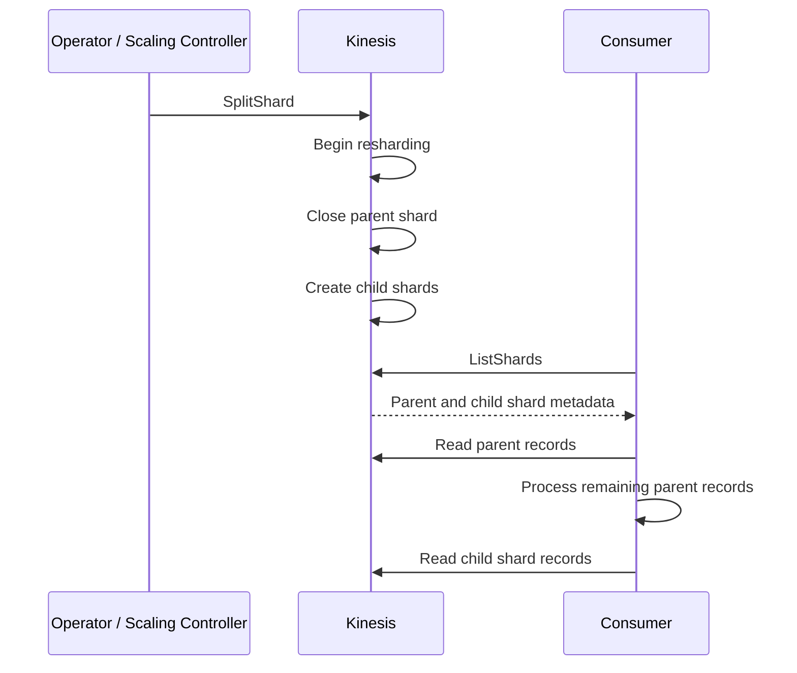

# 01- Shard Scaling and Resharding

## Overview

Amazon Kinesis Data Streams uses **shards** as the fundamental units of capacity, parallelism, and data distribution within a stream.

Each shard provides a fixed amount of read and write capacity. As ingestion volume, consumer throughput, or data-processing requirements change, the stream may need additional or fewer shards.

**Shard scaling** adjusts the stream's capacity by changing its shard count. **Resharding** is the process of splitting or merging shards to redistribute capacity and partition-key workloads.

Understanding resharding is important for production systems because an incorrect scaling strategy can cause:
- Write throttling when producers exceed shard limits.
- Read throttling when consumers exceed shard read limits.
- Hot shards caused by uneven partition-key distribution.
- Increased costs from excessive shard capacity.
- Temporary processing complexity while shard topology changes.

Kinesis supports both manual shard management and service-managed capacity modes. The appropriate approach depends on workload predictability, throughput requirements, and operational control.

## Shard Fundamentals

A shard is a uniquely identified sequence of records in a Kinesis stream. Each shard has its own sequence-number space and acts as an independent unit of ingestion and consumption.

A stream consists of one or more shards.

### Shard Capacity

For provisioned-capacity streams, a shard provides the following baseline capacity:

| Operation | Per-shard capacity |
|---|---:|
| Write throughput | 1 MB/second or 1,000 records/second |
| Read throughput using shared fan-out | 2 MB/second |
| Maximum record size | 10 MiB |
| Enhanced fan-out consumer | Dedicated read throughput of 2 MB/second per shard per registered consumer |

The write limits are subject to both byte and record-rate constraints. A workload can throttle even when it remains below the byte limit if it exceeds the records-per-second limit.

The maximum record size is not the same as the shard's sustained write throughput. A large record can consume a substantial portion of the shard's available capacity.

### Shard Count and Stream Capacity

For a provisioned stream with \(N\) shards, the approximate aggregate capacity is:

\[
WriteCapacity = N \times 1\ MB/second
\]

\[
ReadCapacity = N \times 2\ MB/second
\]

\[
WriteRecordCapacity = N \times 1000\ records/second
\]

For example, a stream with 10 provisioned shards has approximately:

- 10 MB/second aggregate write capacity.
- 10,000 records/second aggregate write capacity.
- 20 MB/second shared-consumer read capacity.

These are aggregate theoretical limits. Actual throughput depends on partition-key distribution, record sizes, consumer behavior, and service limits.

## Partition Keys and Shard Distribution

Kinesis uses partition keys to determine which shard receives a record.

A partition key is hashed using MD5 to produce a 128-bit hash value. Each shard owns a portion of the stream's hash-key space.



The partition key determines the shard assignment unless the producer explicitly supplies a valid `ExplicitHashKey`.

### Even Distribution

A high-cardinality partition key generally provides more opportunities for distributing records across shards.

Examples:

- Customer ID.
- Device ID.
- Order ID.
- Account ID.

However, high cardinality alone does not guarantee even distribution. If a small number of keys generate most of the traffic, those keys can still create hot shards.

### Hot Shards

A hot shard occurs when a particular shard receives disproportionately high traffic compared with other shards.

Example:

A stream has 10 shards, but one customer generates 60% of all records. If the partition key is the customer ID, all records for that customer map to the same shard.

Increasing the stream's shard count does not necessarily solve this problem because the same partition key continues mapping to one hash-key range.

Possible solutions include:

- Distributing traffic across more partition keys.
- Using a composite partition key where ordering requirements permit.
- Applying controlled key salting.
- Using explicit hash keys for specialized distribution requirements.
- Separating exceptionally high-volume tenants into dedicated streams.

**Important:** Changing partition-key strategy can affect ordering guarantees. Records with the same partition key are mapped to the same shard, which is important when consumers depend on per-key ordering.

## What Is Resharding?

Resharding changes the hash-key ranges assigned to shards.

Kinesis supports two primary resharding operations:

- **Split:** Divides one shard into two child shards.
- **Merge:** Combines two adjacent shards into one parent shard.

Resharding changes the stream's shard topology without requiring producers to create a new stream.

### Split Shard

A split operation divides a parent shard's hash-key range into two smaller ranges.



Use splitting when:

- A shard consistently approaches its write capacity.
- A shard is experiencing read throttling.
- Additional parallelism is required.
- A portion of the hash-key range needs more capacity.

A split increases the shard count by one.

### Merge Shards

A merge operation combines two adjacent shards into one shard.



Use merging when:

- Traffic has decreased.
- The stream has excessive provisioned capacity.
- Multiple adjacent shards are consistently underutilized.
- Infrastructure cost needs to be reduced.

A merge decreases the shard count by one.

Only adjacent shards can be merged because their hash-key ranges must form a continuous range.

## Resharding Lifecycle

Resharding is an asynchronous control-plane operation. It does not immediately replace the existing shard topology.

When a shard is split or merged:

1. Kinesis begins the resharding operation.
2. The parent shard enters a closing state.
3. New child shard metadata is created.
4. Records already accepted into the parent shard remain available for consumption.
5. Consumers must process the parent shard's remaining records.
6. Consumers discover and process the child shards.

The exact processing transition depends on the consumer implementation and its shard-discovery mechanism.



A consumer must not assume that shard IDs remain stable or that the original shard count remains unchanged.

## Parent and Child Shard Relationships

Kinesis maintains lineage information when shards are split or merged.

This lineage is important because consumers need to understand which shards must be processed before downstream shards.

For a split:

- One parent shard produces two child shards.
- Both children contain records from the parent shard's hash-key ranges.

For a merge:

- Two parent shards produce one child shard.
- The merged shard inherits lineage from both parents.

Consumers that maintain checkpoints must account for these relationships.

A child shard may become eligible for processing only after its parent shard has been fully processed, depending on the consumer's ordering requirements and processing framework.

For applications that require strict per-partition-key ordering, checkpoint and lineage handling must be designed carefully.

## Manual Resharding

Manual resharding is appropriate when traffic patterns are predictable and operators need direct control over shard capacity.

AWS provides the following APIs:

| API | Purpose |
|---|---|
| `SplitShard` | Split one shard into two |
| `MergeShards` | Merge two adjacent shards |
| `ListShards` | Retrieve shard metadata and lineage |
| `DescribeStreamSummary` | Retrieve stream-level information |
| `UpdateShardCount` | Scale a provisioned stream to a requested shard count |

### Split a Shard Using AWS CLI

```bash
aws kinesis split-shard \
    --stream-name orders-stream \
    --shard-to-split shardId-000000000001 \
    --new-starting-hash-key 170141183460469231731687303715884105727
```

The new starting hash key determines the boundary between the two child shards.

The selected value must be within the parent's hash-key range and must produce two valid ranges.

### Merge Shards Using AWS CLI

```bash
aws kinesis merge-shards \
    --stream-name orders-stream \
    --shard-to-merge shardId-000000000001 \
    --adjacent-shard-to-merge shardId-000000000002
```

The shards must be adjacent in the stream's hash-key space.

### Inspect Shard Metadata

```bash
aws kinesis list-shards \
    --stream-name orders-stream
```

The response includes information such as:

- Shard ID.
- Starting hash key.
- Ending hash key.
- Starting sequence number.
- Ending sequence number.
- Parent shard IDs.

Use shard metadata to verify the stream topology and identify lineage relationships.

## Scaling with UpdateShardCount

`UpdateShardCount` changes the shard count of a provisioned stream to a requested target.

It is useful when the goal is to increase or decrease total stream capacity without manually specifying every split and merge operation.

Example:

```bash
aws kinesis update-shard-count \
    --stream-name orders-stream \
    --target-shard-count 20 \
    --scaling-type UNIFORM_SCALING
```

The operation performs uniform scaling by redistributing the stream's hash-key space across the requested number of shards.

The API is asynchronous. Monitor the stream's scaling status and verify the resulting shard topology rather than assuming the operation completed immediately.

`UpdateShardCount` has service constraints, including limits on scaling changes and target shard counts. It should not be treated as an unrestricted substitute for manual resharding.

## Automatic Scaling and On-Demand Mode

Kinesis Data Streams supports on-demand capacity mode, which removes the need to provision shard counts manually for typical workloads.

In on-demand mode:

- AWS manages stream capacity.
- Capacity adjusts based on observed traffic.
- Producers do not need to calculate shard counts in advance.
- Applications still need to handle throttling and workload bursts appropriately.

On-demand mode is useful when traffic is unpredictable or when operational simplicity is more important than direct shard-level capacity management.

Provisioned mode is useful when:

- Traffic is predictable.
- Capacity requirements are well understood.
- Fine-grained shard management is required.
- Cost optimization requires explicit capacity planning.

| Characteristic | Provisioned mode | On-demand mode |
|---|---|---|
| Capacity management | Customer manages shard count | AWS manages capacity |
| Manual resharding | Supported | Not normally required |
| Capacity planning | Explicit | Based on observed and configured workload |
| Cost model | Provisioned shard capacity | On-demand throughput pricing |
| Operational control | Greater shard-level control | Less manual capacity management |
| Suitable workload | Predictable traffic | Variable or unpredictable traffic |

On-demand mode has its own throughput limits and scaling behavior. It should not be interpreted as unlimited capacity or instantaneous response to arbitrary traffic spikes.

## Consumer Behavior During Resharding

Resharding affects consumers because the stream's shard topology changes.

A consumer must discover new shards and correctly process records from both parent and child shards.

### Kinesis Client Library

The Kinesis Client Library (KCL) manages many consumer responsibilities, including:

- Shard discovery.
- Lease management.
- Worker coordination.
- Checkpointing.
- Parent-child shard processing.
- Recovery from worker failures.

For production applications, KCL is generally preferable to implementing shard coordination manually when building a distributed consumer.

A consumer using KCL should still implement:

- Idempotent record processing.
- Durable checkpoints.
- Failure handling.
- Monitoring of processing lag.
- Appropriate worker capacity.

### Custom Consumers

A custom consumer using the Kinesis API must handle shard discovery and lineage explicitly.

Typical operations include:

1. Call `ListShards` to discover available shards.
2. Create a shard iterator using `GetShardIterator`.
3. Retrieve records using `GetRecords`.
4. Persist processing checkpoints.
5. Detect closed shards.
6. Discover child shards.
7. Process child shards according to lineage requirements.

A custom implementation must also handle expired iterators, throttling, transient failures, and worker reassignment.

## Python Example: Inspecting Shards with Boto3

The following example retrieves shard metadata and displays hash-key ranges and parent relationships.

```python
import boto3
from botocore.exceptions import BotoCoreError, ClientError

kinesis = boto3.client(
    "kinesis",
    region_name="us-east-1",
)

STREAM_NAME = "orders-stream"


def list_stream_shards(stream_name: str) -> list[dict]:
    shards = []
    next_token = None

    try:
        while True:
            if next_token:
                response = kinesis.list_shards(
                    NextToken=next_token
                )
            else:
                response = kinesis.list_shards(
                    StreamName=stream_name
                )

            shards.extend(response.get("Shards", []))

            next_token = response.get("NextToken")

            if not next_token:
                break

        return shards

    except (ClientError, BotoCoreError) as exc:
        raise RuntimeError(
            f"Unable to list shards for {stream_name}"
        ) from exc


def display_shards(shards: list[dict]) -> None:
    for shard in shards:
        sequence_range = shard["SequenceNumberRange"]

        print(
            {
                "shard_id": shard["ShardId"],
                "starting_hash_key": (
                    shard["HashKeyRange"]["StartingHashKey"]
                ),
                "ending_hash_key": (
                    shard["HashKeyRange"]["EndingHashKey"]
                ),
                "parent_shard_id": shard.get(
                    "ParentShardId"
                ),
                "adjacent_parent_shard_id": shard.get(
                    "AdjacentParentShardId"
                ),
                "ending_sequence_number": sequence_range.get(
                    "EndingSequenceNumber"
                ),
            }
        )


if __name__ == "__main__":
    shards = list_stream_shards(STREAM_NAME)
    display_shards(shards)
```

For production use, account for pagination tokens, stream state transitions, API throttling, and concurrent resharding operations. The returned shard list is a snapshot, not a permanent topology definition.

## Capacity Planning

Shard capacity should be calculated using both record count and data volume.

Let:

- \(R\) = incoming records per second.
- \(S\) = average record size in bytes.
- \(W\) = required write throughput in bytes per second.

Then:

\[
W = R \times S
\]

The minimum shard count based on write throughput is approximately:

\[
N_{write} =
\left\lceil
\frac{W}{1\ MB/second}
\right\rceil
\]

The minimum shard count based on record rate is:

\[
N_{records} =
\left\lceil
\frac{R}{1000}
\right\rceil
\]

A basic provisioned shard estimate is:

\[
N = \max(N_{write}, N_{records})
\]

Add capacity headroom for traffic spikes, uneven partition-key distribution, and operational recovery.

### Example

Assume a service produces:

- 5,000 records per second.
- Average record size of 2 KB.

Approximate write volume:

\[
W = 5000 \times 2048
\]

\[
W = 10,240,000\ bytes/second
\]

The approximate requirements are:

- 10 shards based on the 1 MB/second write limit.
- 5 shards based on the 1,000 records/second limit.

The byte-throughput requirement dominates, so at least 10 shards are required before adding operational headroom.

This calculation assumes even distribution across shards. A hot partition key can invalidate the aggregate estimate because one shard may exceed its capacity while others remain underutilized.

## Monitoring and Observability

Shard scaling should be driven by workload metrics rather than shard count alone.

Important CloudWatch metrics include:

| Metric | Purpose |
|---|---|
| `IncomingBytes` | Measures incoming data volume |
| `IncomingRecords` | Measures incoming record rate |
| `WriteProvisionedThroughputExceeded` | Identifies write throttling |
| `ReadProvisionedThroughputExceeded` | Identifies shared-read throttling |
| `GetRecords.IteratorAgeMilliseconds` | Measures consumer processing lag |
| `ReadBytes` | Measures read volume |
| `GetRecords.Records` | Measures records returned to consumers |

For enhanced fan-out consumers, monitor consumer-specific metrics such as:

- `SubscribeToShardEvent.MillisBehindLatest`.
- `SubscribeToShardEvent.Bytes`.
- `SubscribeToShardEvent.Records`.

Metric availability and dimensions depend on the API and monitoring configuration.

### Operational Signals

Consider scaling when:

- Write throttling increases.
- Consumer lag grows continuously.
- Shard-level traffic is uneven.
- Sustained throughput approaches shard capacity.
- Consumer processing time increases.
- Traffic forecasts indicate an upcoming workload increase.

Do not trigger resharding based on a single short-lived metric spike. Use sustained thresholds, cooldown periods, and workload forecasts to avoid unnecessary scaling operations.

## Cost Considerations

In provisioned mode, shard count directly affects capacity cost.

Increasing shard count increases available write and shared-read capacity, but it also increases the cost of provisioned stream capacity.

In on-demand mode, cost is based on on-demand throughput pricing and applicable features.

Consider:

- Sustained versus burst traffic.
- Average record size.
- Record rate.
- Number of consumers.
- Enhanced fan-out usage.
- Retention configuration.
- Data retrieval and transfer patterns.

A stream with too few shards can throttle producers and consumers. A stream with too many shards can waste provisioned capacity and increase operational complexity.

## Reliability and Production Best Practices

- Use high-cardinality partition keys where workload distribution permits.
- Monitor shard-level traffic rather than relying only on aggregate stream throughput.
- Use on-demand mode when traffic is difficult to predict and its pricing model fits the workload.
- Use provisioned mode when traffic and capacity requirements are predictable.
- Scale before expected traffic peaks rather than waiting for sustained throttling.
- Use KCL when consumer shard coordination and lineage management would otherwise be complex.
- Make record processing idempotent because consumer retries and checkpoint recovery can cause duplicate processing.
- Persist checkpoints only after the corresponding records have been processed durably.
- Avoid changing partition-key strategy without evaluating ordering implications.
- Test consumer behavior during split and merge operations.
- Maintain monitoring for write throttling, read throttling, and iterator age.
- Apply cooldown periods to automated scaling controllers.
- Keep enough capacity headroom for traffic bursts and consumer recovery.

## Common Mistakes and Production Pitfalls

| Mistake | Why it causes problems | Recommended approach |
|---|---|---|
| Increasing shard count to fix every hot shard | A dominant partition key may continue mapping to one shard | Analyze partition-key distribution and redesign keys where appropriate |
| Calculating capacity using only MB/second | Record-rate limits can still cause throttling | Calculate both byte throughput and record rate |
| Assuming resharding is instantaneous | Topology changes are asynchronous | Monitor scaling operations and shard state |
| Ignoring parent-child relationships | Consumers can process records incorrectly during topology changes | Use KCL or implement lineage-aware coordination |
| Merging non-adjacent shards | Kinesis requires adjacent hash-key ranges | Inspect shard hash-key ranges before merging |
| Scaling on a single metric spike | Can cause unnecessary resharding and operational instability | Use sustained thresholds and cooldowns |
| Treating on-demand mode as unlimited | On-demand streams have capacity limits and scaling behavior | Understand workload limits and monitor throttling |
| Ignoring consumer lag | Additional shards do not guarantee faster downstream processing | Scale consumers and downstream dependencies together |
| Checkpointing before durable processing | A failure can cause data loss from the application's perspective | Checkpoint only after durable processing |
| Assuming aggregate capacity guarantees per-shard capacity | Uneven key distribution can overload individual shards | Monitor shard-level utilization and hot keys |

## Key Takeaways

- Shards are the fundamental units of Kinesis capacity, parallelism, and partition-key distribution.
- Resharding uses split and merge operations to redistribute hash-key ranges and change provisioned capacity.
- Increasing shard count does not automatically resolve hot partitions caused by dominant partition keys.
- Consumers must handle shard lineage, parent-child relationships, and checkpointing correctly during resharding.
- Reliable scaling requires capacity planning, shard-level monitoring, workload-aware scaling decisions, and coordinated consumer capacity.