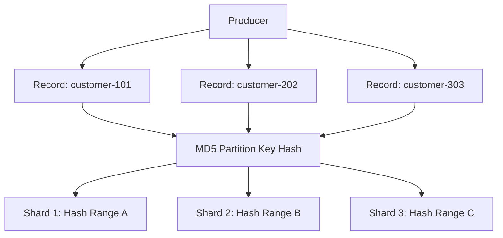
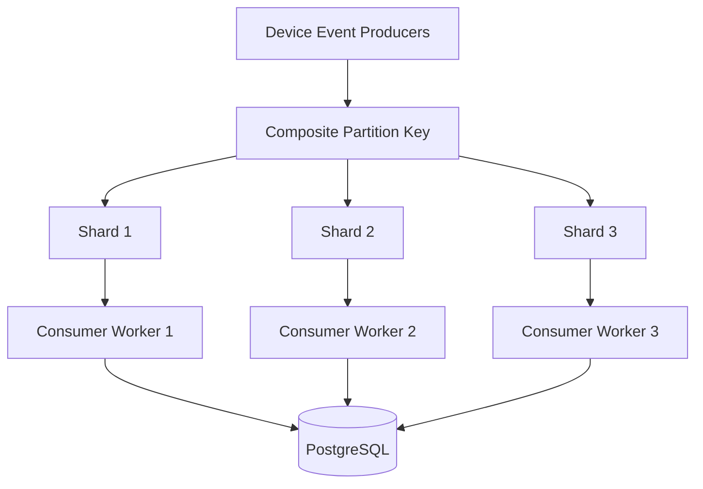
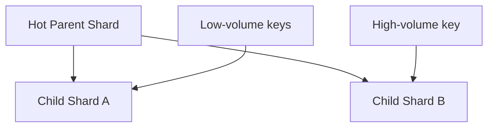

# 02- Hot Shards and Partition Key Distribution

## Overview

Amazon Kinesis Data Streams distributes records across shards using partition keys. Each partition key is hashed, and the resulting hash value determines the shard that receives the record.

This distribution model allows Kinesis to scale ingestion and consumption horizontally. However, uneven traffic distribution can cause individual shards to become overloaded even when the stream has sufficient aggregate capacity.

A **hot shard** is a shard receiving disproportionately high traffic compared with other shards. It can experience throughput throttling while other shards remain underutilized.

Hot shards commonly result from:

- Low-cardinality partition keys.
- A small number of high-volume tenants or customers.
- Uneven event-generation rates.
- Poorly designed composite partition keys.
- Traffic concentration around specific business entities.
- Partition-key strategies that preserve ordering at the expense of distribution.

Resolving hot shards requires understanding the relationship between partition keys, hash-key ranges, workload distribution, and ordering requirements.

## How Partition Key Distribution Works

Every Kinesis record contains a partition key. Kinesis uses the MD5 hash of that key to determine its position in the stream's hash-key space.

Each shard owns a range of hash values. A record is routed to the shard whose range contains the calculated hash.



The routing process is deterministic:

- The same partition key produces the same hash value.
- The same hash value maps to the same shard while the relevant hash-key range assignment remains unchanged.
- Different partition keys can map to the same shard.
- Different partition keys do not guarantee uniform traffic distribution.

A partition key is therefore both a routing mechanism and an important architectural decision.

### Partition Key and Explicit Hash Key

Kinesis supports two related routing values:

| Value | Purpose |
|---|---|
| `PartitionKey` | Application-provided key that Kinesis hashes using MD5 |
| `ExplicitHashKey` | Optional hash value supplied by the producer to control routing directly |

Normally, producers provide a partition key and allow Kinesis to calculate the hash.

An explicit hash key is useful for specialized routing requirements, such as deliberately distributing traffic across selected hash ranges. It requires knowledge of the stream's hash-key topology and should not be used as a substitute for a well-designed partition-key strategy.

## Understanding Hot Shards

A hot shard occurs when one shard receives more traffic than it can handle, even though the stream's aggregate capacity appears sufficient.

Consider a stream with four provisioned shards:

| Shard | Incoming records per second | Traffic distribution |
|---|---:|---:|
| Shard 1 | 8,000 | 80% |
| Shard 2 | 700 | 7% |
| Shard 3 | 800 | 8% |
| Shard 4 | 500 | 5% |
| **Total** | **10,000** | **100%** |

The stream's total traffic might appear manageable, but Shard 1 can exceed its individual write capacity.

This results in throttling even though the remaining shards have substantial unused capacity.

### Why Hot Shards Matter

Hot shards affect both producers and consumers.

**Producer impact:**
- `PutRecord` and `PutRecords` operations can be throttled.
- Producers may need to retry failed records.
- Ingestion latency can increase.
- Retry traffic can amplify the original overload.

**Consumer impact:**
- Read throughput can become constrained on the affected shard.
- Consumer processing lag can increase.
- Records may accumulate faster than workers can process them.
- Downstream systems can experience uneven workloads.

Adding more shards does not necessarily resolve the problem. If a dominant partition key continues mapping to one shard, the workload can remain concentrated.

## Common Causes of Hot Shards

### Low-Cardinality Partition Keys

A low-cardinality partition key contains only a small number of distinct values.

Example:

```python
partition_key = "orders"
```

If every record uses the same partition key, every record maps to the same hash value and therefore the same shard.

Even a stream with many shards cannot distribute records that all use one partition key.

Use partition keys that represent meaningful entities with sufficient cardinality, such as customer IDs, device IDs, or order IDs.

### High-Volume Customers or Tenants

A multi-tenant application may use tenant ID as its partition key.

```python
partition_key = tenant_id
```

This is useful when all events for a tenant must remain ordered within the same shard.

However, a large tenant can generate significantly more traffic than other tenants.

For example:

| Tenant | Events per second |
|---|---:|
| Tenant A | 15,000 |
| Tenant B | 500 |
| Tenant C | 300 |
| Tenant D | 200 |

Tenant A may overload its assigned shard while the remaining shards are underutilized.

This is a common problem in SaaS platforms where a small number of customers generate most of the traffic.

### Time-Based Partition Keys

A timestamp or date can be a poor partition key when many records share the same value.

Example:

```python
partition_key = "2026-11-19"
```

All records using this value map to the same shard for that date.

A better approach is to combine time-related information with an entity identifier when the ordering requirements allow it.

### Sequential Identifiers

Sequential IDs are not automatically problematic because Kinesis hashes partition keys before routing.

However, using a low-cardinality prefix or a shared identifier can still concentrate traffic.

The important factor is the actual partition-key distribution and the resulting traffic per shard, not whether identifiers appear sequential.

## Choosing an Effective Partition Key

A good partition key should balance three requirements:

1. Sufficient cardinality for traffic distribution.
2. Preservation of required ordering.
3. Predictable workload distribution.

The correct choice depends on the business entity whose events must be processed in order.

### Common Partition Key Strategies

| Strategy | Example | Distribution characteristics | Ordering implications |
|---|---|---|---|
| Customer ID | `customer-101` | Depends on customer traffic | Preserves per-customer shard routing |
| Order ID | `order-10025` | Often distributes well when order volume is diverse | Preserves per-order routing |
| Device ID | `device-501` | Suitable for device-oriented workloads | Preserves per-device routing |
| Tenant ID | `tenant-101` | Can create hot shards for large tenants | Preserves per-tenant routing |
| Timestamp | `2026-11-19` | Can concentrate records | Same timestamp routes to the same shard |
| Composite key | `tenant-101:device-501` | Can improve distribution | Ordering is preserved only for the composite entity |
| Salted key | `tenant-101:3` | Spreads one entity across multiple keys | Breaks ordering across salt values |

There is no universally correct partition key. The key must reflect the application's ordering and distribution requirements.

## Composite Partition Keys

A composite partition key combines multiple business attributes.

For example:

```python
partition_key = f"{tenant_id}:{device_id}"
```

This allows records from different devices belonging to the same tenant to map independently.

Consider a monitoring platform:

```text
tenant-101:device-001
tenant-101:device-002
tenant-101:device-003
tenant-202:device-001
```

This can distribute traffic more effectively than using only the tenant ID.

However, events for the same tenant are no longer guaranteed to be routed to one shard if different device IDs are used.

Use composite keys when ordering is required at a more granular level, such as per device rather than per tenant.

### Example Architecture



The consumer architecture can process independent device workloads concurrently while maintaining routing consistency for each composite key.

## Key Salting

Key salting adds a suffix or bucket identifier to a partition key to distribute a high-volume entity across multiple partition keys.

It is useful when one business entity generates more traffic than a single shard can handle.

Without salting:

```python
partition_key = "tenant-101"
```

All records for the tenant use the same partition key.

With salting:

```python
partition_key = "tenant-101:0"
partition_key = "tenant-101:1"
partition_key = "tenant-101:2"
partition_key = "tenant-101:3"
```

The different keys are hashed independently and can map to different shards.

### Deterministic Salting

A deterministic strategy uses an attribute of the event to select a bucket.

```python
def build_partition_key(
    tenant_id: str,
    device_id: str,
    bucket_count: int = 8,
) -> str:
    if bucket_count < 1:
        raise ValueError(
            "bucket_count must be positive"
        )

    bucket = hash(device_id) % bucket_count

    return f"{tenant_id}:{bucket}"
```

For distributed Python deployments, do not use Python's built-in `hash()` when bucket assignment must remain stable across processes or restarts. Python hash randomization can produce different values between processes.

Use a stable hash function instead:

```python
import hashlib


def stable_bucket(
    value: str,
    bucket_count: int,
) -> int:
    if bucket_count < 1:
        raise ValueError(
            "bucket_count must be positive"
        )

    digest = hashlib.sha256(
        value.encode("utf-8")
    ).digest()

    hash_value = int.from_bytes(
        digest[:8],
        byteorder="big",
    )

    return hash_value % bucket_count


def build_partition_key(
    tenant_id: str,
    device_id: str,
    bucket_count: int = 8,
) -> str:
    bucket = stable_bucket(
        device_id,
        bucket_count,
    )

    return f"{tenant_id}:{bucket}"
```

All producers must use the same bucket algorithm and bucket count.

### Random Salting

Random salting selects a bucket independently for each event.

```python
import random


def build_random_partition_key(
    tenant_id: str,
    bucket_count: int = 8,
) -> str:
    if bucket_count < 1:
        raise ValueError(
            "bucket_count must be positive"
        )

    bucket = random.randrange(bucket_count)

    return f"{tenant_id}:{bucket}"
```

Random salting can distribute traffic across buckets, but it does not preserve ordering across events for the same tenant.

It also makes per-entity aggregation and replay more complex.

### Salting Trade-offs

| Consideration | Without salting | With salting |
|---|---|---|
| Traffic distribution | One key maps to one shard | Multiple keys can map to different shards |
| Per-entity ordering | Preserved at shard routing level | Not preserved across buckets |
| Consumer parallelism | Limited by the entity's shard | Can increase |
| Aggregation | Simpler | Requires combining multiple buckets |
| Operational complexity | Lower | Higher |
| Suitable workload | Moderate entity traffic | High-volume entities |

Salting is not a free scaling mechanism. It trades ordering simplicity for greater distribution and parallelism.

If the business requires strict per-entity ordering, use another design rather than blindly adding random suffixes.

## Ordering Implications

Kinesis preserves ordering for records within a shard based on their sequence order.

Records with the same partition key are routed to the same shard while the relevant hash-key assignment remains unchanged.

This is useful for workflows such as:

- Order state transitions.
- Account balance updates.
- Device state changes.
- Customer activity streams.

However, salting or changing the partition key can distribute records from the same business entity across multiple shards.

That means consumers can process those records concurrently and observe them in a different order.

For example:

```text
order-10025:bucket-0 -> Shard 1
order-10025:bucket-1 -> Shard 3
```

If the application requires the following sequence:

```text
order.created
order.payment_confirmed
order.shipped
```

Splitting these events across buckets can violate the application's ordering assumptions.

Possible approaches include:

- Preserve one partition key for entities requiring strict order.
- Partition by a smaller ordering boundary, such as device or account.
- Include sequence numbers and enforce ordering in the consumer.
- Use a dedicated stream for exceptionally high-volume entities.
- Redesign processing so independent events can execute concurrently.

## Hot Shards and Resharding

Resharding changes the hash-key ranges assigned to shards.

Kinesis supports:

- Splitting a shard into two child shards.
- Merging two adjacent shards into one shard.

Resharding can help when a shard's hash-key range receives high traffic from multiple partition keys.

However, splitting a shard does not split a single partition key across the resulting child shards. The key's hash value belongs to one of the child ranges.

Consider a shard containing these partition keys:

```text
customer-101
customer-202
customer-303
customer-404
```

If the traffic is spread across the hash range, splitting the shard can distribute the keys across two child shards.

But if nearly all traffic comes from `customer-101`, splitting the shard may leave the dominant key on one child shard.



The high-volume key remains concentrated on one child shard.

### When to Reshard

Consider resharding when:

- Several partition keys collectively overload a shard.
- Traffic distribution across hash ranges is uneven.
- Additional shard-level capacity is required.
- The stream uses provisioned capacity and requires explicit capacity management.

Consider changing the partition-key strategy when:

- One key dominates shard traffic.
- A single tenant generates most of the records.
- A single device or account exceeds shard capacity.
- Splitting the affected shard does not distribute the dominant key.

For details on split, merge, and capacity management, refer to [Shard Scaling and Resharding](01-%20Shard%20Scaling%20and%20Resharding.md).

## Python Producer Example

The following example publishes device events using a composite partition key.

```python
import json
import logging

import boto3
from botocore.exceptions import BotoCoreError, ClientError

logger = logging.getLogger(__name__)

kinesis = boto3.client(
    "kinesis",
    region_name="us-east-1",
)

STREAM_NAME = "device-events"


def publish_device_event(
    tenant_id: str,
    device_id: str,
    event_type: str,
    event_data: dict,
) -> str:
    if not tenant_id or not device_id:
        raise ValueError(
            "tenant_id and device_id are required"
        )

    partition_key = f"{tenant_id}:{device_id}"

    payload = {
        "tenant_id": tenant_id,
        "device_id": device_id,
        "event_type": event_type,
        "data": event_data,
    }

    try:
        response = kinesis.put_record(
            StreamName=STREAM_NAME,
            Data=json.dumps(payload).encode("utf-8"),
            PartitionKey=partition_key,
        )

        logger.info(
            "Kinesis record published",
            extra={
                "shard_id": response["ShardId"],
                "sequence_number": response["SequenceNumber"],
            },
        )

        return response["SequenceNumber"]

    except (ClientError, BotoCoreError) as exc:
        logger.exception(
            "Failed to publish device event"
        )
        raise RuntimeError(
            "Kinesis publication failed"
        ) from exc
```

This design distributes events by tenant and device rather than routing every event from a tenant through one partition key.

The producer should also implement bounded retries and appropriate handling for throttling. For high-throughput workloads, consider `PutRecords` or the Kinesis Producer Library (KPL), while preserving the required partition-key semantics.

## Diagnosing Hot Shards

Hot-shard diagnosis requires shard-level metrics and partition-key analysis.

Stream-level metrics alone can hide uneven distribution.

### CloudWatch Metrics

Important Kinesis metrics include:

| Metric | Purpose |
|---|---|
| `IncomingBytes` | Measures incoming data volume |
| `IncomingRecords` | Measures incoming record count |
| `WriteProvisionedThroughputExceeded` | Identifies write throttling |
| `ReadProvisionedThroughputExceeded` | Identifies read throttling |
| `GetRecords.IteratorAgeMilliseconds` | Indicates consumer lag |
| `ReadBytes` | Measures read volume |
| `GetRecords.Records` | Measures records returned to consumers |

Enable enhanced shard-level monitoring to inspect traffic and throttling at individual shard granularity.

Useful shard-level observations include:

- Incoming bytes per shard.
- Incoming records per shard.
- Write throttling by shard.
- Read throttling by shard.
- Consumer lag by shard.

Compare these values across shards over the same time interval.

### Identifying Uneven Distribution

A practical investigation process is:

1. Identify whether throttling is occurring on writes, reads, or both.
2. Inspect shard-level CloudWatch metrics.
3. Identify shards with disproportionately high incoming traffic.
4. Examine producer partition-key selection.
5. Measure traffic distribution by key.
6. Identify dominant tenants, customers, devices, or entities.
7. Determine whether ordering requirements prevent repartitioning.
8. Select a corrective strategy and validate it under representative load.

### Producer-Side Instrumentation

Instrument producers to record partition-key distribution.

Avoid logging every complete partition key if keys contain sensitive identifiers or if cardinality is extremely high.

Instead, collect aggregated metrics such as:

- Events per tenant.
- Events per device.
- Bytes per tenant.
- Top traffic-producing entities.
- Number of distinct partition keys.
- Throttling rate by producer.

Use sampled logs or bounded-cardinality labels for detailed investigation.

Do not use raw customer IDs or device IDs as unrestricted CloudWatch metric dimensions. High-cardinality dimensions can create excessive metric costs and operational complexity.

## Performance and Scalability Considerations

Partition-key design affects how effectively Kinesis can use available shard capacity.

### Distribution Quality

A good partition-key strategy should avoid a small number of keys dominating traffic.

Evaluate both:

- Number of distinct partition keys.
- Traffic volume generated by each key.

A stream can have thousands of unique keys and still have a hot shard if one key generates most of the records.

### Producer Retries

Throttling can cause producers to retry failed requests.

Uncontrolled retries can increase pressure on an already overloaded shard.

Use:

- Exponential backoff.
- Jitter.
- Bounded retry attempts.
- Retry queues or durable buffering where appropriate.
- Monitoring for sustained throttling.

For `PutRecords`, inspect each record's result. A successful API response does not guarantee that every record in the batch was accepted.

### Consumer Parallelism

A consumer's processing capacity depends on shard assignment and the number of workers.

Increasing shard count can increase available parallelism, but only if consumers can process the additional shards and downstream systems can handle the resulting workload.

KCL can manage shard leases and worker coordination in distributed consumer applications.

For custom consumers, ensure that shard ownership, checkpoints, and parent-child relationships are handled correctly.

## Operational Recommendations

For production Kinesis workloads:

- Select partition keys based on business ordering requirements and traffic distribution.
- Measure traffic per key before selecting a partitioning strategy.
- Monitor shard-level metrics rather than relying exclusively on stream-level averages.
- Use composite keys when ordering is needed at a smaller entity boundary.
- Use salting only when the loss of cross-bucket ordering is acceptable.
- Avoid relying on resharding to solve a single dominant partition key.
- Use stable partitioning algorithms across all producer instances.
- Test partition-key changes with realistic traffic distributions.
- Make consumers idempotent and resilient to retries.
- Scale consumers and downstream dependencies along with ingestion capacity.
- Use on-demand capacity when appropriate, but continue monitoring for hot-key concentration.
- Document partition-key semantics as part of the event schema and producer contract.

## Common Mistakes and Production Pitfalls

| Mistake | Why it causes problems | Recommended approach |
|---|---|---|
| Using one constant partition key | All records map to the same shard | Use a meaningful, sufficiently distributed key |
| Assuming more shards solve every hot shard | One dominant key still maps to one hash range | Analyze key-level traffic and redesign partitioning |
| Using tenant ID for every workload | Large tenants can dominate individual shards | Consider tenant plus device or another ordering boundary |
| Adding random salt without evaluating ordering | Events for one entity can be processed out of order | Define ordering requirements before salting |
| Using Python's built-in `hash()` for stable buckets | Hash randomization can change assignments across processes | Use a stable hashing algorithm |
| Using timestamps as the only partition key | Many records can share the same hash input | Combine time with an entity identifier where appropriate |
| Monitoring only aggregate stream throughput | Hot shards remain hidden by unused capacity elsewhere | Enable shard-level monitoring |
| Increasing consumer count without checking shard distribution | Additional workers cannot eliminate a hot partition key | Fix producer distribution and consumer bottlenecks separately |
| Ignoring `PutRecords` partial failures | Failed records may be silently lost by the application | Inspect per-record results and retry failed records |
| Changing partition keys without migration planning | Ordering and consumer assumptions can change | Version and roll out partitioning changes deliberately |

## Key Takeaways

- Kinesis hashes partition keys to route records into shard hash-key ranges; identical partition keys map to the same shard while the relevant topology remains unchanged.
- A hot shard results from uneven traffic distribution and can cause throttling even when aggregate stream capacity is available.
- Composite partition keys and key salting can improve distribution, but they change the ordering boundary and require application-level design decisions.
- Resharding helps distribute traffic across hash ranges but cannot split one partition key across multiple shards.
- Reliable hot-shard prevention requires shard-level monitoring, stable partitioning strategies, bounded retries, and workload-aware capacity planning.