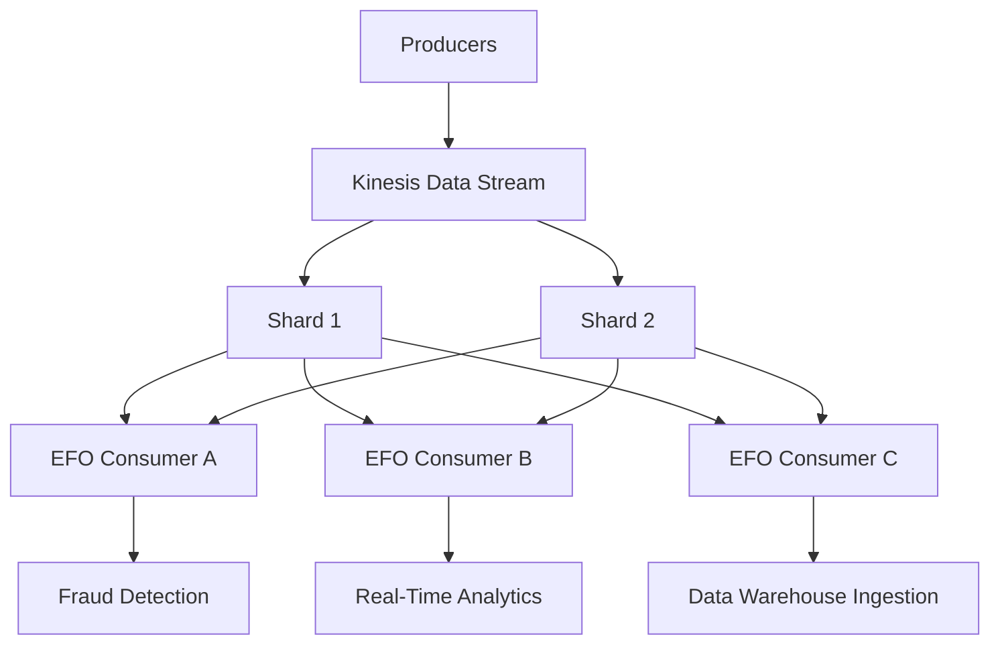
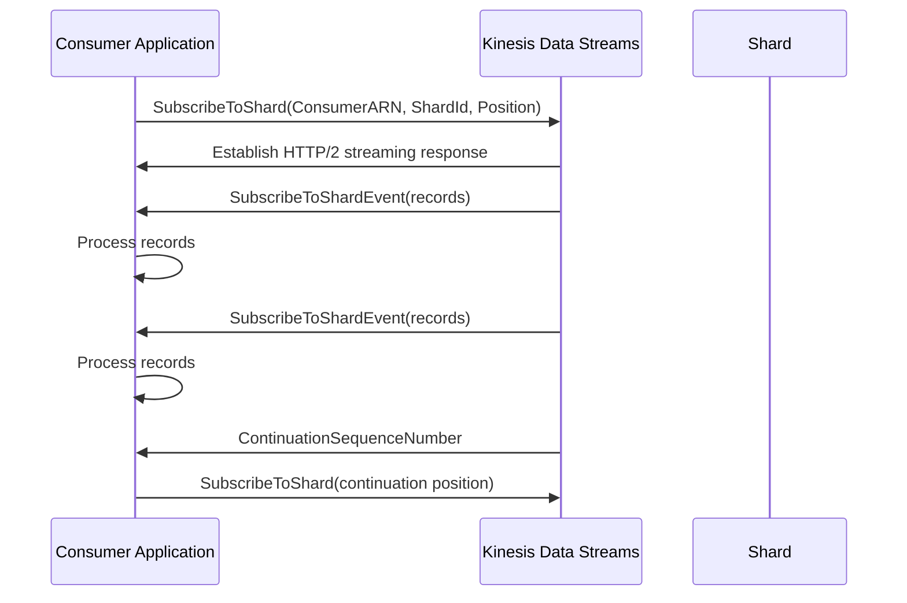
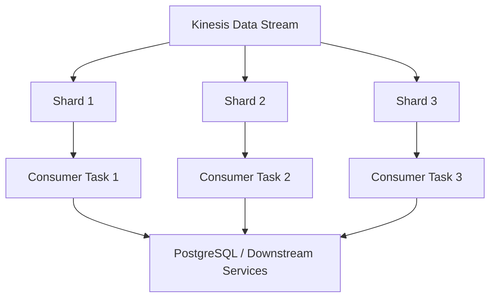
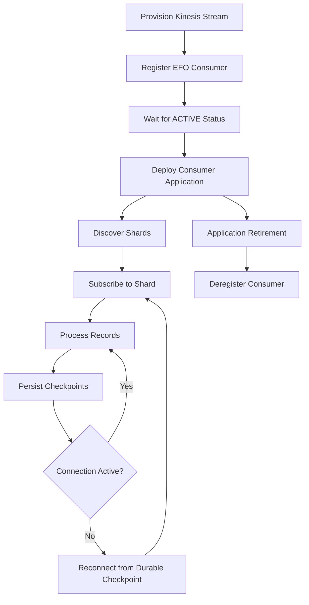

# 03- Enhanced Fan-Out

## Overview

Enhanced Fan-Out (EFO) is a Amazon Kinesis Data Streams capability that provides dedicated read throughput to registered consumers. It allows multiple consumers to independently read records from the same stream without competing for the stream's shared read throughput.

With standard shared-throughput consumption, consumers use `GetRecords` and share the read capacity available from each shard. As the number of consumers increases, they can experience throughput contention and higher processing latency.

Enhanced Fan-Out addresses this by assigning dedicated read throughput to each registered consumer and delivering records through HTTP/2-based streaming using `SubscribeToShard`.

EFO is particularly useful for event-driven architectures where multiple independent services need to process the same high-volume stream with predictable throughput and low latency.

## Why Enhanced Fan-Out Exists

Kinesis Data Streams supports multiple consumers reading from the same stream. However, standard consumers share shard-level read throughput.

For a provisioned shard, standard shared-throughput consumption provides up to:

- 2 MB/s of read throughput per shard.
- 5 `GetRecords` transactions per second per shard.

These limits are shared among consumers using the standard consumption model.

Consider an architecture with multiple downstream services:

- Fraud detection service.
- Real-time analytics service.
- Data warehouse ingestion service.
- Monitoring and alerting service.

If all consumers use `GetRecords`, they compete for the same shard read capacity. One consumer's polling activity can affect the performance of other consumers.

Enhanced Fan-Out gives each registered consumer dedicated throughput of up to 2 MB/s per shard.

This improves isolation and makes consumer performance more predictable.

## Standard Consumption vs Enhanced Fan-Out

| Characteristic | Standard Consumption | Enhanced Fan-Out |
|---|---|---|
| API | `GetRecords` | `SubscribeToShard` |
| Delivery model | Consumer polling | Server-pushed streaming |
| Read throughput | Shared per shard | Dedicated per consumer per shard |
| Per-shard throughput | Up to 2 MB/s shared | Up to 2 MB/s per registered consumer |
| Transaction limits | Shared `GetRecords` limit | Dedicated consumer streaming |
| Consumer isolation | Limited | Stronger throughput isolation |
| Connection model | Repeated API requests | Persistent HTTP/2 streaming |
| Latency | Depends on polling interval | Typically lower |
| Consumer registration | Not required | Required |
| Cost | No separate EFO consumer throughput charge | Additional consumer-hour and data retrieval charges |

Enhanced Fan-Out is not automatically better for every workload. For a small number of low-volume consumers, standard consumption may be simpler and more cost-effective.

## Enhanced Fan-Out Architecture

An EFO consumer must be registered with a Kinesis Data Stream before it can subscribe to shards.

Each registered consumer receives dedicated read throughput for every shard in the stream.



Each consumer independently reads records from the stream. A consumer does not consume records on behalf of another consumer.

For example, a fraud detection service can process records without reducing the dedicated read throughput available to an analytics service.

## Consumer Registration

Enhanced Fan-Out requires a registered stream consumer.

Registration creates a consumer resource associated with a specific Kinesis Data Stream.

A consumer has:
- A consumer name.
- A consumer ARN.
- A stream association.
- A consumer creation timestamp.
- A registration status.

Consumer names must be unique within a stream.

### Register a Consumer Using AWS CLI

```bash
aws kinesis register-stream-consumer \
    --stream-arn arn:aws:kinesis:ap-south-1:123456789012:stream/orders-stream \
    --consumer-name fraud-detection-consumer
```

The response includes the registered consumer ARN.

Example:

```json
{
  "Consumer": {
    "ConsumerName": "fraud-detection-consumer",
    "ConsumerARN": "arn:aws:kinesis:ap-south-1:123456789012:stream/orders-stream:consumer:fraud-detection-consumer:1730000000",
    "ConsumerStatus": "CREATING"
  }
}
```

Registration is asynchronous. The consumer must reach the `ACTIVE` state before it can be used for subscription operations.

### Describe a Registered Consumer

```bash
aws kinesis describe-stream-consumer \
    --consumer-arn arn:aws:kinesis:ap-south-1:123456789012:stream/orders-stream:consumer:fraud-detection-consumer:1730000000
```

Check the returned `ConsumerStatus` before starting consumption.

### List Registered Consumers

```bash
aws kinesis list-stream-consumers \
    --stream-arn arn:aws:kinesis:ap-south-1:123456789012:stream/orders-stream
```

This is useful for deployment automation and operational inspection.

## SubscribeToShard API

`SubscribeToShard` is the primary API used by Enhanced Fan-Out consumers.

Unlike `GetRecords`, which requires consumers to poll for available records, `SubscribeToShard` establishes a streaming connection using HTTP/2.

Kinesis pushes records to the consumer as they become available.

The subscription request includes:

| Parameter | Description |
|---|---|
| `ConsumerARN` | ARN of the registered EFO consumer. |
| `ShardId` | Shard from which records should be consumed. |
| `StartingPosition` | Position from which record delivery begins. |

Supported starting positions include:

- `TRIM_HORIZON`: Start at the oldest available record.
- `LATEST`: Start with records arriving after the subscription position is established.
- `AT_SEQUENCE_NUMBER`: Start at a specified sequence number.
- `AFTER_SEQUENCE_NUMBER`: Start immediately after a specified sequence number.
- `AT_TIMESTAMP`: Start at a specified timestamp.

Example request:

```json
{
  "ConsumerARN": "arn:aws:kinesis:ap-south-1:123456789012:stream/orders-stream:consumer:fraud-detection-consumer:1730000000",
  "ShardId": "shardId-000000000001",
  "StartingPosition": {
    "Type": "TRIM_HORIZON"
  }
}
```

The API returns a streaming response containing records and continuation information.

### Subscription Lifecycle



A subscription is not an unlimited permanent connection. The streaming response has a finite lifetime, so consumers must use continuation information to establish subsequent subscriptions.

The consumer should maintain its own processing checkpoint and use the appropriate sequence position when reconnecting.

## Starting Positions and Checkpointing

Starting position determines where a consumer begins reading records.

| Position | Behavior | Typical Use Case |
|---|---|---|
| `TRIM_HORIZON` | Starts from the oldest retained record | Initial processing or full replay |
| `LATEST` | Starts with new records arriving after subscription | Real-time processing |
| `AT_SEQUENCE_NUMBER` | Starts at a specific sequence number | Recovery from a known checkpoint |
| `AFTER_SEQUENCE_NUMBER` | Starts after a specific sequence number | Resume after a successfully processed record |
| `AT_TIMESTAMP` | Starts from a specified timestamp | Time-based replay |

Checkpointing is an application responsibility.

Kinesis does not automatically know whether the consumer has completed its business processing.

A reliable consumer should:

1. Receive a batch of records.
2. Process records successfully.
3. Persist the latest safely completed checkpoint.
4. Resume from that checkpoint after a restart or connection interruption.

For business-critical processing, checkpoint updates should occur only after durable processing.

### Example Checkpoint Model

A PostgreSQL table can store consumer progress.

```sql
CREATE TABLE kinesis_consumer_checkpoints (
    consumer_name VARCHAR(150) NOT NULL,
    stream_arn TEXT NOT NULL,
    shard_id VARCHAR(100) NOT NULL,
    sequence_number TEXT NOT NULL,
    updated_at TIMESTAMPTZ NOT NULL DEFAULT NOW(),
    PRIMARY KEY (consumer_name, stream_arn, shard_id)
);
```

Store sequence numbers as text to avoid numeric conversion assumptions. Kinesis sequence numbers can be large and should be handled as opaque identifiers.

For multiple records, persist the checkpoint only through the last record whose processing has completed successfully.

## Python Implementation with Boto3

The following example demonstrates registering a consumer, subscribing to a shard, processing records, and maintaining a durable checkpoint.

Install the AWS SDK:

```bash
pip install boto3
```

### Create a Kinesis Client

```python
import boto3

kinesis = boto3.client(
    "kinesis",
    region_name="ap-south-1",
)
```

### Register the EFO Consumer

```python
def register_consumer(
    stream_arn: str,
    consumer_name: str,
) -> str:
    response = kinesis.register_stream_consumer(
        StreamARN=stream_arn,
        ConsumerName=consumer_name,
    )

    return response["Consumer"]["ConsumerARN"]
```

Registration should normally be performed during infrastructure provisioning or deployment, not every time a worker starts.

### Process Records

```python
import base64
import json
import logging

logger = logging.getLogger(__name__)


def process_record(record: dict) -> None:
    payload = base64.b64decode(record["Data"])

    event = json.loads(payload)

    event_id = event["event_id"]
    event_type = event["event_type"]

    logger.info(
        "Processing Kinesis event",
        extra={
            "event_id": event_id,
            "event_type": event_type,
            "sequence_number": record["SequenceNumber"],
        },
    )

    # Perform durable, idempotent business processing.
```

The record data is Base64-encoded in the API response. Decode it before parsing the application payload.

### Subscribe to a Shard

```python
def subscribe_to_shard(
    consumer_arn: str,
    shard_id: str,
    starting_position: dict,
) -> None:
    response = kinesis.subscribe_to_shard(
        ConsumerARN=consumer_arn,
        ShardId=shard_id,
        StartingPosition=starting_position,
    )

    event_stream = response["EventStream"]

    for event in event_stream:
        if "SubscribeToShardEvent" not in event:
            continue

        shard_event = event["SubscribeToShardEvent"]

        records = shard_event.get("Records", [])

        for record in records:
            process_record(record)

        continuation_number = shard_event.get(
            "ContinuationSequenceNumber"
        )

        logger.info(
            "Received Kinesis records",
            extra={
                "record_count": len(records),
                "continuation_sequence_number": continuation_number,
            },
        )
```

This example illustrates event handling. A production consumer must additionally implement:

- Durable checkpoint persistence.
- Continuation subscriptions.
- Connection interruption handling.
- Retry with backoff and jitter.
- Idempotent record processing.
- Shard discovery and lifecycle management.
- Graceful shutdown.

Do not treat receipt of a record as successful processing. Advance the checkpoint only after the corresponding business operation is durable.

## Managing Subscription Continuation

An EFO subscription response has a finite lifetime. Consumers must establish subsequent subscriptions to continue receiving records.

The `ContinuationSequenceNumber` provides the position used to continue the subscription.

A production implementation should preserve the last successfully processed sequence number separately from the continuation token.

These values serve different purposes:

| Value | Purpose |
|---|---|
| Continuation sequence number | Supports continuation of the streaming subscription. |
| Application checkpoint | Represents the last record safely processed by the application. |

If a consumer crashes after receiving records but before processing them, it must resume from the durable application checkpoint rather than blindly advancing to the latest received position.

This distinction prevents data loss.

## Parallelism and Shard Processing

Enhanced Fan-Out provides dedicated throughput, but it does not automatically parallelize application processing.

The application must manage concurrency across shards and preserve the ordering requirements of its workload.

A common architecture uses one logical processing task per shard.



Consider the following guidelines:

- Process records from different shards concurrently.
- Preserve ordering within a shard when the application requires it.
- Avoid unbounded thread or task creation.
- Apply backpressure when downstream systems become saturated.
- Scale consumer workers according to shard count and processing capacity.

A single shard has a defined ordering boundary. Parallelizing records from the same shard without coordination can violate application-level ordering.

## Enhanced Fan-Out with Multiple Consumers

Multiple EFO consumers can independently subscribe to the same stream.

For example:

| Consumer | Responsibility |
|---|---|
| `fraud-detection` | Detect suspicious transactions |
| `analytics` | Aggregate transaction activity |
| `warehouse-ingestion` | Load events into a data warehouse |
| `audit-processing` | Persist compliance and audit events |

Each registered consumer receives dedicated read throughput per shard.

This is useful when consumers have different processing requirements, deployment schedules, and availability characteristics.

However, each registered EFO consumer introduces additional cost. Register only consumers that need dedicated throughput.

## Throughput and Performance

Enhanced Fan-Out provides up to 2 MB/s per shard per registered consumer.

For a stream with 10 shards and 3 registered EFO consumers:

```text
Per-consumer read capacity:
10 shards × 2 MB/s = 20 MB/s

Aggregate dedicated consumer capacity:
3 consumers × 20 MB/s = 60 MB/s
```

This represents theoretical provisioned read capacity, not a guarantee that applications will sustain that processing rate.

Actual throughput depends on:
- Record size and distribution.
- Number of active shards.
- Consumer processing speed.
- Network throughput.
- Downstream database or API capacity.
- Serialization and deserialization overhead.
- Consumer connection stability.

EFO improves read isolation but cannot compensate for a slow downstream database or inefficient application processing.

## EFO Consumer Limits and Quotas

Enhanced Fan-Out has service quotas that affect architecture and deployment.

Important considerations include:

- A stream supports a limited number of registered EFO consumers; the commonly documented default quota is 20 per stream.
- Each registered consumer receives dedicated throughput per shard.
- Consumer registration and subscription APIs are subject to service quotas and throttling.
- HTTP/2 connection and subscription lifecycle management must be implemented correctly.
- Regional service quotas may differ and can be increased through AWS Service Quotas where supported.

Verify current quotas for the target AWS Region before designing a high-consumer-count architecture.

Avoid creating a separate EFO consumer for every short-lived application instance. Prefer a stable consumer identity shared by the intended logical application, with coordinated shard ownership.

## Reliability and Failure Handling

EFO consumers must handle both streaming failures and application processing failures.

### Connection Interruption

A network interruption can terminate the streaming response.

The consumer should:
- Detect stream termination.
- Recover from the last durable checkpoint.
- Re-establish the subscription.
- Apply exponential backoff with jitter.
- Avoid tight retry loops.

### Processing Failure

A record may fail because of invalid data, a downstream service outage, or a database error.

Recommended handling:
- Retry transient failures with bounded backoff.
- Isolate malformed or permanently failing records.
- Persist failure details for investigation.
- Advance checkpoints only through successfully completed records.
- Use idempotency keys to prevent duplicate side effects.

Kinesis does not provide an SQS-style native dead-letter queue for individual EFO consumer records. Implement application-level failure handling or route failed events to a separate destination such as SQS or S3.

### Duplicate Processing

A consumer may process the same record again after a crash or checkpoint failure.

Use a stable event identifier and enforce idempotency in the destination system.

For example:

```sql
CREATE TABLE processed_events (
    event_id UUID PRIMARY KEY,
    processed_at TIMESTAMPTZ NOT NULL DEFAULT NOW()
);
```

Use a transaction to coordinate the idempotency record and business state update.

A checkpoint should not advance beyond work that has not been durably committed.

## Security Considerations

EFO consumers require permission to access the stream and subscribe to the registered consumer.

Use IAM policies with least-privilege permissions.

Typical permissions include:

| Permission | Purpose |
|---|---|
| `kinesis:DescribeStreamSummary` | Inspect stream metadata |
| `kinesis:ListShards` | Discover stream shards |
| `kinesis:DescribeStreamConsumer` | Inspect consumer registration |
| `kinesis:SubscribeToShard` | Subscribe to a shard |
| `kinesis:RegisterStreamConsumer` | Register a consumer |
| `kinesis:DeregisterStreamConsumer` | Remove a consumer |

Grant registration and deregistration permissions only to deployment or administrative roles when possible.

Additional recommendations:

- Use IAM roles for EC2, ECS, EKS, or Lambda workloads.
- Avoid embedding AWS credentials in application configuration.
- Encrypt streams using AWS-managed or customer-managed KMS keys.
- Review KMS permissions and key policies.
- Restrict access to sensitive records.
- Avoid logging full payloads containing personal or financial information.
- Use VPC endpoints where appropriate for private AWS service connectivity.

## Monitoring and Observability

Monitor both Kinesis stream health and application-level processing.

| Metric or Signal | What It Indicates |
|---|---|
| `IncomingBytes` | Volume of data written to the stream |
| `IncomingRecords` | Number of records published |
| `ReadProvisionedThroughputExceeded` | Read throttling associated with shared-throughput reads |
| `WriteProvisionedThroughputExceeded` | Write throttling |
| `SubscribeToShard.RateExceeded` | Subscription request rate limiting |
| `SubscribeToShardEvent.MillisBehindLatest` | Consumer lag relative to the latest records |
| `SubscribeToShardEvent.Success` | Successful streaming event delivery |
| `SubscribeToShardEvent.Records` | Records delivered through subscription events |

Metric availability and dimensions depend on the API and monitoring configuration. Use the CloudWatch metrics reference for the target service and Region when configuring alarms.

Application-level metrics should include:

- Last successfully processed sequence number per shard.
- Consumer processing latency.
- Records processed and failed.
- Checkpoint persistence latency.
- Reconnection count.
- Downstream API and database latency.
- Idempotency conflicts.
- Time since last successful record processing.

Use structured logs containing stream name, consumer name, shard ID, sequence number, and event ID.

## Cost Considerations

Enhanced Fan-Out introduces additional charges compared with standard shared-throughput consumption.

Costs generally depend on:
- Number of registered consumer-hours.
- Amount of data retrieved through enhanced fan-out.
- Number of streams and active consumers.
- Regional pricing.

Evaluate EFO based on consumer count, throughput requirements, and latency objectives.

| Workload | Consumption Model |
|---|---|
| One low-volume consumer | Standard consumption |
| A few consumers with moderate throughput | Benchmark standard consumption first |
| Multiple high-throughput consumers | Enhanced Fan-Out |
| Consumers requiring predictable read isolation | Enhanced Fan-Out |
| Consumers with strict low-latency requirements | Evaluate Enhanced Fan-Out |

Do not select EFO solely because it offers dedicated throughput. Measure the actual workload and compare the cost against the operational benefits.

## Deployment and Operational Best Practices

For production deployments:

- Provision streams and registered consumers through Terraform, CloudFormation, or CDK.
- Register consumers before deploying application instances that depend on them.
- Wait for consumer status to become `ACTIVE`.
- Keep consumer names stable across application restarts.
- Persist checkpoints outside the worker process.
- Coordinate shard ownership across replicas.
- Implement graceful shutdown and checkpoint flushing.
- Use bounded concurrency and downstream backpressure.
- Configure CloudWatch alarms for lag, throttling, and processing failures.
- Test shard splits, merges, and resharding behavior.
- Validate recovery from network interruptions and process crashes.
- Deregister unused consumers to avoid unnecessary charges and quota consumption.

### Consumer Lifecycle Management



## Common Mistakes and Pitfalls

| Mistake | Why It Causes Problems | Recommended Approach |
|---|---|---|
| Using EFO for every consumer | Increases cost and consumes consumer quotas | Use EFO only when dedicated throughput or latency isolation is needed |
| Subscribing before registration is active | Subscription requests can fail | Wait until consumer status is `ACTIVE` |
| Treating EFO as automatic parallel processing | Dedicated throughput does not parallelize application work | Manage shard-level concurrency explicitly |
| Advancing checkpoints before processing completes | Can cause data loss after a restart | Persist checkpoints only after durable processing |
| Using `LATEST` for recovery | Can skip records that arrived during downtime | Resume from a durable checkpoint |
| Ignoring duplicate processing | Retries and restarts can repeat side effects | Implement idempotent processing |
| Creating a consumer per application replica | Causes unnecessary registrations and quota usage | Coordinate replicas under a stable logical consumer |
| Ignoring downstream capacity | Records accumulate despite dedicated read throughput | Apply backpressure and scale downstream dependencies |
| Assuming EFO provides exactly-once business processing | Stream delivery and external side effects are separate concerns | Use transactional idempotency and durable checkpoints |
| Ignoring shard lifecycle changes | Consumer assignments can become stale after resharding | Discover and manage shard topology dynamically |

## Key Takeaways

- Enhanced Fan-Out provides dedicated read throughput of up to 2 MB/s per shard per registered consumer.
- EFO uses `SubscribeToShard` and HTTP/2 streaming instead of shared `GetRecords` polling.
- Consumer applications must manage checkpoints, continuation subscriptions, retries, and shard-level concurrency.
- Dedicated read throughput does not guarantee exactly-once business processing; idempotency and durable checkpoints remain essential.
- Evaluate EFO cost, consumer quotas, downstream capacity, and latency requirements before adopting it.