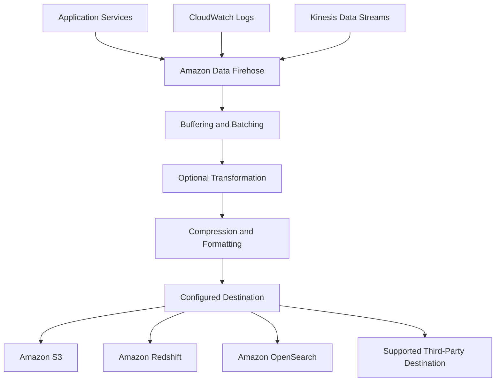
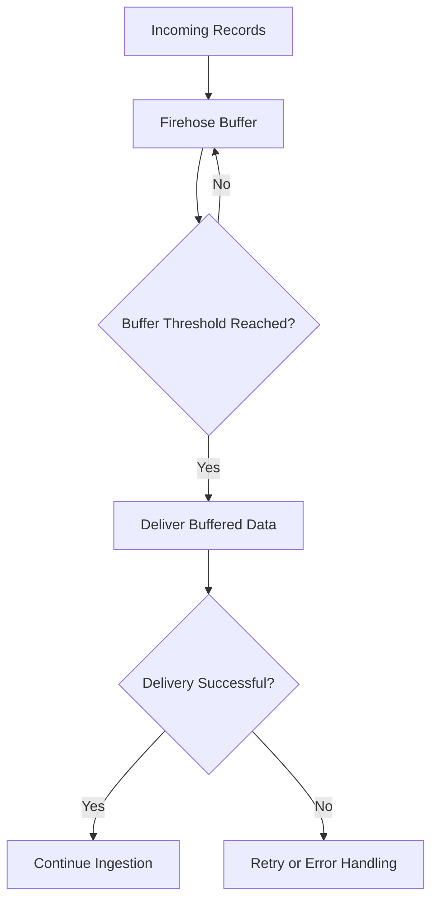
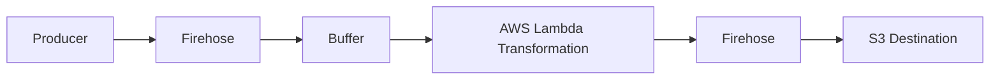
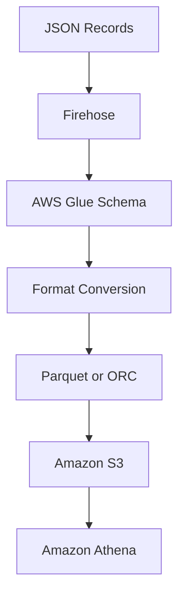
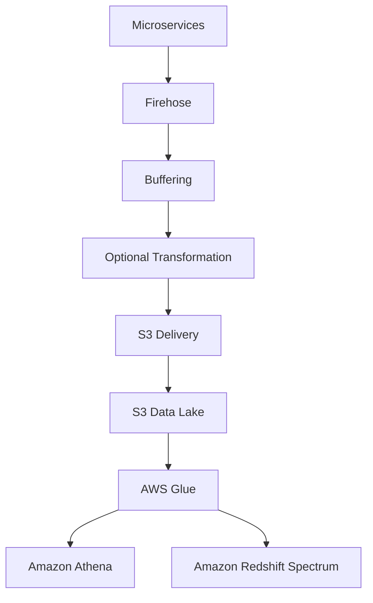
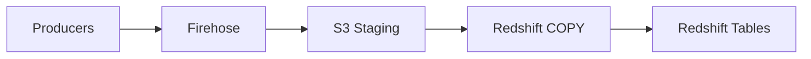
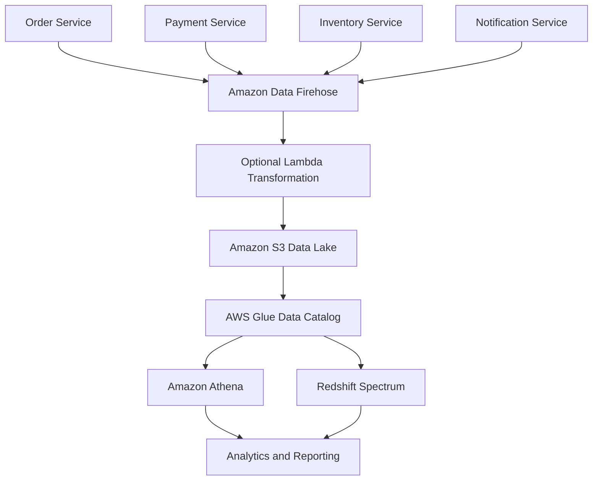

# 04- Kinesis Data Firehose

## Overview

Amazon Data Firehose, formerly known as Amazon Kinesis Data Firehose, is a fully managed service for reliably delivering streaming data to destinations such as Amazon S3, Amazon Redshift, Amazon OpenSearch Service, and supported third-party platforms.

Firehose simplifies streaming data ingestion by managing buffering, batching, optional transformation, compression, encryption, and destination delivery.

Unlike Kinesis Data Streams, which provides consumers with access to retained records for independent stream processing, Firehose focuses on delivering streaming data to configured destinations.

It is commonly used for:
- Centralized application and infrastructure logging.
- Streaming analytics and data lake ingestion.
- Security and audit event delivery.
- ETL pipelines that require lightweight transformations.
- Collecting events from microservices and delivering them to S3 or analytics platforms.

## Kinesis Data Streams vs Data Firehose

Both services support streaming data architectures, but they solve different problems.

| Characteristic | Kinesis Data Streams | Data Firehose |
|---|---|---|
| Primary purpose | Streaming data ingestion and consumption | Managed streaming data delivery |
| Data access | Consumers read records from streams | Records are delivered to configured destinations |
| Consumer model | Multiple independent consumers | Configured delivery destinations |
| Record retention | Configurable retention period | No general-purpose stream retention for consumer replay |
| Processing | Custom consumer applications | Optional managed transformations |
| Buffering | Consumer-controlled | Managed buffering |
| Replay | Supported within retention period | Not designed for arbitrary replay |
| Operational responsibility | Stream and consumer management | Mostly managed delivery infrastructure |
| Typical use case | Real-time event processing | Data lake and analytics ingestion |

A common architecture uses both services:

- Kinesis Data Streams handles real-time event ingestion and independent consumers.
- Firehose delivers a copy of the data to S3 for long-term storage and analytics.

## Firehose Architecture

Firehose receives streaming records from producers or supported AWS integrations, buffers them, and delivers them to a configured destination.



The delivery pipeline is managed by Firehose. Producers do not need to implement destination-specific buffering or retry logic.

## Delivery Stream

A delivery stream is the primary Firehose resource.

It defines how incoming records are processed and delivered.

A delivery stream typically contains:

- Source configuration.
- Destination configuration.
- Buffering hints.
- Optional data transformation.
- Optional record format conversion.
- Compression and encryption settings.
- Retry and error-handling configuration.
- Logging and monitoring configuration.

A delivery stream is configured for a destination. To deliver the same incoming data to multiple independent destinations, use an appropriate fan-out architecture with multiple delivery streams or another distribution mechanism.

## Data Sources

Firehose supports multiple ingestion paths.

| Source | Description | Typical Use Case |
|---|---|---|
| Direct PUT | Applications publish records through Firehose APIs | Backend application events |
| Kinesis Data Streams | Firehose reads records from an existing stream | Stream-to-data-lake delivery |
| Amazon MSK | Firehose consumes from supported Kafka clusters | Kafka-based ingestion |
| AWS service integrations | Supported AWS services deliver data to Firehose | Logs, metrics, and service events |

### Direct PUT

Applications can send records using `PutRecord` or `PutRecordBatch`.

Example:

```python
import json
import boto3

firehose = boto3.client(
    "firehose",
    region_name="ap-south-1",
)

response = firehose.put_record(
    DeliveryStreamName="application-events-stream",
    Record={
        "Data": (
            json.dumps({
                "event_id": "evt-1001",
                "event_type": "order.created",
                "order_id": "ord-5001",
                "amount": 1499.00,
            }) + "\n"
        ).encode("utf-8")
    },
)

print(response["RecordId"])
```

For production workloads:
- Reuse the SDK client.
- Implement bounded retries for transient failures.
- Handle throttling and service exceptions.
- Include stable event identifiers.
- Use batching when publishing multiple records.
- Monitor failed publications.

### PutRecordBatch

`PutRecordBatch` sends multiple records in one API request.

```python
import json
import boto3

firehose = boto3.client(
    "firehose",
    region_name="ap-south-1",
)

events = [
    {
        "event_id": "evt-1001",
        "event_type": "order.created",
    },
    {
        "event_id": "evt-1002",
        "event_type": "payment.completed",
    },
]

records = [
    {
        "Data": (json.dumps(event) + "\n").encode("utf-8")
    }
    for event in events
]

response = firehose.put_record_batch(
    DeliveryStreamName="application-events-stream",
    Records=records,
)

failed_count = response["FailedPutCount"]

if failed_count:
    for record, result in zip(records, response["RequestResponses"]):
        if "ErrorCode" in result:
            print({
                "record": record,
                "error_code": result["ErrorCode"],
                "error_message": result.get("ErrorMessage"),
            })
```

Important considerations:

- A batch can partially succeed.
- Retry only failed records.
- Preserve record-to-response ordering.
- Use bounded exponential backoff with jitter.
- Avoid retrying the entire batch when some records succeeded.

`PutRecordBatch` supports up to 500 records per request, subject to service size limits. Each record is subject to the Firehose record-size limit, and the total request payload must remain within the API limit.

## Buffering and Batching

Firehose buffers incoming records before delivering them to the destination.

Buffering reduces the number of destination writes and improves delivery efficiency.

Two primary buffering hints are available:

| Setting | Purpose |
|---|---|
| Buffer size | Maximum buffered data size before delivery |
| Buffer interval | Maximum buffering time before delivery |

A delivery attempt is triggered when the configured buffering condition is reached.

Actual delivery timing can exceed the configured interval because buffering hints are not strict end-to-end delivery deadlines.

### Buffering Flow



### Buffer Size

Larger buffers generally:
- Reduce destination request frequency.
- Improve throughput efficiency.
- Reduce the number of small files in S3.
- Increase the amount of data accumulated before delivery.

Smaller buffers generally:
- Reduce buffering delay.
- Produce smaller destination batches.
- Increase delivery request frequency.
- Potentially increase destination costs.

### Buffer Interval

The interval controls how long Firehose waits before attempting delivery when the size threshold has not been reached.

Choose buffering settings according to the destination and downstream processing requirements.

For example, an S3 analytics pipeline may prefer larger files to reduce query overhead, while a monitoring pipeline may prioritize lower delivery latency.

## Data Transformation with AWS Lambda

Firehose supports optional record transformation using AWS Lambda.

The Lambda function can:
- Validate incoming records.
- Enrich records with metadata.
- Remove sensitive fields.
- Normalize event formats.
- Convert records into a destination-compatible structure.
- Mark records as successfully processed or failed.

### Transformation Architecture



### Lambda Transformation Example

Firehose invokes Lambda with a batch of records.

```python
import base64
import json


def lambda_handler(event, context):
    output = []

    for record in event["records"]:
        try:
            raw_data = base64.b64decode(
                record["data"]
            )

            payload = json.loads(raw_data)

            payload["source"] = "application"
            payload["schema_version"] = 1

            transformed = (
                json.dumps(payload) + "\n"
            ).encode("utf-8")

            output.append({
                "recordId": record["recordId"],
                "result": "Ok",
                "data": base64.b64encode(
                    transformed
                ).decode("utf-8"),
            })

        except (ValueError, TypeError, json.JSONDecodeError):
            output.append({
                "recordId": record["recordId"],
                "result": "ProcessingFailed",
                "data": record["data"],
            })

    return {
        "records": output
    }
```

The transformation response must contain the corresponding `recordId`, a valid processing result, and Base64-encoded output data.

Supported result statuses include:

| Status | Meaning |
|---|---|
| `Ok` | Record transformation succeeded |
| `Dropped` | Record should be discarded intentionally |
| `ProcessingFailed` | Transformation failed |

A failed transformation should not be silently converted into a successful record. Define an explicit policy for malformed records and downstream recovery.

### Lambda Transformation Considerations

- Keep transformation functions stateless.
- Make processing deterministic where possible.
- Handle malformed payloads explicitly.
- Monitor invocation errors and throttling.
- Size Lambda concurrency for the expected ingestion rate.
- Keep execution time within the configured Lambda timeout.
- Avoid unnecessary external API calls during transformation.
- Configure error output handling for failed records.

Firehose may retry transformation failures according to its processing configuration. Transformation code should therefore be safe to execute more than once.

## Data Format Conversion

Firehose can convert supported input formats into columnar formats such as Apache Parquet and Apache ORC before delivering data to S3.

This is useful for analytical workloads using services such as Amazon Athena and AWS Glue.

Format conversion generally uses an AWS Glue Data Catalog schema.

### Common Formats

| Format | Characteristics | Typical Use |
|---|---|---|
| JSON | Flexible, readable, row-oriented | Application event ingestion |
| Apache Parquet | Columnar, compressed, analytics-oriented | Athena and data lake queries |
| Apache ORC | Columnar, optimized for analytical processing | Large-scale analytics |

### Format Conversion Flow



### Production Considerations

- Define a stable schema in AWS Glue.
- Use explicit schema versioning.
- Validate incoming records before conversion.
- Handle schema evolution carefully.
- Avoid incompatible changes to existing analytical datasets.
- Partition data according to query access patterns.
- Test conversion behavior with representative records.

Format conversion is not a replacement for a complete data governance or schema evolution strategy.

## Amazon S3 Destination

Amazon S3 is a common Firehose destination for data lake ingestion.

Firehose can deliver buffered records to S3 objects using configurable prefixes and time-based partitioning.

Typical applications include:
- Application logs.
- Audit events.
- Transaction events.
- Clickstream data.
- Security telemetry.
- Operational metrics.

### S3 Delivery Architecture



### S3 Prefix Configuration

A time-based S3 prefix can organize objects by delivery time.

Example:

```text
application-events/
    year=2026/
        month=11/
            day=20/
                hour=10/
                    object-001.parquet
```

Firehose supports dynamic partitioning, allowing partition keys to be extracted from record data or generated through a transformation process.

Dynamic partitioning is useful when partitioning by attributes such as:
- Tenant ID.
- Event type.
- Region.
- Business date.
- Application identifier.

Avoid excessive partition cardinality. Creating too many small partitions can increase metadata overhead and reduce query efficiency.

### Error Output Prefix

Configure an S3 error output prefix to store records that could not be delivered or processed through supported error paths.

Separate error output from normal analytical data.

This makes it easier to:
- Investigate malformed records.
- Identify transformation failures.
- Reprocess recoverable data.
- Monitor delivery issues.

## Other Delivery Destinations

Firehose supports multiple destinations depending on Region and service capabilities.

| Destination | Typical Use Case |
|---|---|
| Amazon S3 | Data lakes and archival storage |
| Amazon Redshift | Analytical data loading |
| Amazon OpenSearch Service | Search and log analytics |
| Amazon OpenSearch Serverless | Managed search and analytics |
| Splunk | Security and operational analytics |
| HTTP endpoint | External data platforms |
| Amazon Snowflake and other supported integrations | External analytics platforms |

Destination availability, configuration options, and delivery behavior vary. Verify supported destinations and features in the target Region.

### Amazon Redshift Delivery

Firehose typically uses S3 as an intermediate storage location before loading data into Redshift.



This architecture separates streaming ingestion from analytical database loading.

Ensure that:
- The target table schema matches the incoming records.
- The intermediate S3 bucket is secured.
- Redshift has the required S3 access.
- Failed delivery and loading paths are monitored.
- Data loading behavior is tested with realistic batch sizes.

## Compression

Firehose supports compression for supported destinations and configurations.

Compression reduces storage consumption and can reduce data transfer costs.

Common formats include:
- GZIP.
- Snappy.
- ZIP.
- Hadoop-compatible compression formats where supported.

For analytical S3 workloads, Parquet and ORC already provide columnar compression options.

Choose compression based on downstream compatibility and query performance.

Avoid compressing data into a format that the next processing stage cannot efficiently consume.

## Reliability and Delivery Semantics

Firehose manages delivery retries and buffering, but applications must still account for delivery delays and possible duplicate data.

Important considerations:

- A successful ingestion API response does not mean the destination object or record is already available.
- Delivery is asynchronous.
- Destination failures can delay delivery.
- Transformation functions may be invoked more than once.
- Downstream processing should tolerate duplicate events.
- Retain stable event identifiers for reconciliation.

Do not assume that Firehose provides exactly-once business processing.

For critical ingestion pipelines, preserve the original event or a recoverable copy and implement reconciliation for failed or delayed delivery.

## Error Handling and Recovery

Firehose can encounter failures at multiple stages.

| Failure Area | Example | Handling |
|---|---|---|
| Producer ingestion | Throttling or invalid request | Retry with bounded backoff |
| Transformation | Lambda exception or malformed output | Inspect transformation logs and failed-record output |
| Destination | S3 or OpenSearch access failure | Correct permissions and monitor delivery retries |
| Format conversion | Schema mismatch | Validate Glue schema and input records |
| Network or service interruption | Temporary destination unavailability | Allow managed retries and monitor delivery lag |

For critical workloads:
- Enable appropriate error logging.
- Configure S3 backup or error prefixes where supported.
- Retain source events when replay is required.
- Build a controlled reprocessing workflow.
- Alert on sustained delivery failures.
- Test recovery procedures before production deployment.

## Security Considerations

Firehose handles potentially sensitive application and business data. Secure the entire ingestion and delivery path.

### IAM

Use separate IAM roles for Firehose and producer applications.

Producer permissions should be limited to the required delivery stream actions.

Firehose needs permission to:
- Write to the configured destination.
- Invoke the transformation Lambda when configured.
- Access intermediate S3 locations when required.
- Use the configured KMS key.
- Access other destination resources.

Avoid wildcard permissions when resource-level permissions are available.

### Encryption

Use encryption at rest for delivery streams and destination storage.

For S3:
- Enable server-side encryption.
- Use SSE-S3 or SSE-KMS according to security requirements.
- Restrict bucket access.
- Enable versioning where recovery requirements justify it.
- Apply lifecycle policies for retention management.

For customer-managed KMS keys, ensure the Firehose delivery role has the required key permissions.

### Network Security

- Use private connectivity and VPC configurations where supported.
- Restrict destination access to trusted resources.
- Use TLS for supported external endpoints.
- Avoid exposing sensitive payloads in logs.
- Apply appropriate controls to intermediate storage.

## Monitoring and Observability

Firehose publishes CloudWatch metrics that help identify ingestion and delivery problems.

Important metrics include:

| Metric | Purpose |
|---|---|
| `IncomingBytes` | Volume of data received |
| `IncomingRecords` | Number of records ingested |
| `DeliveryToS3.Success` | Successful S3 delivery |
| `DeliveryToS3.DataFreshness` | Age of the oldest record not yet delivered to S3 |
| `DeliveryToS3.Records` | Records delivered to S3 |
| `DeliveryToS3.Bytes` | Bytes delivered to S3 |
| `DeliveryToS3.DataDeliveryFailures` | Failed S3 delivery attempts |
| `ExecuteProcessing.Success` | Successful transformation processing |
| `ExecuteProcessing.Errors` | Transformation failures |
| `ThrottledRecords` | Records affected by throttling |

Metric names and availability depend on the destination and enabled features.

### Operational Alarms

Configure alarms for:
- Sustained delivery failures.
- Increasing data freshness.
- Transformation errors.
- Ingestion throttling.
- Unusually low ingestion volume.
- Destination delivery interruptions.

Monitor application-level metrics as well:

- Producer publication failures.
- Records accepted by Firehose.
- Failed batch entries.
- Event age at ingestion.
- Reconciliation discrepancies.
- Downstream query or processing failures.

Use CloudWatch Logs for Firehose delivery diagnostics and Lambda transformation logs for application-level failures.

## Cost Optimization

Firehose pricing depends on the delivery configuration, Region, data volume, and enabled features.

Cost factors can include:
- Data ingestion volume.
- Data format conversion.
- Dynamic partitioning.
- VPC delivery.
- Destination-specific processing.
- Lambda transformation execution.
- Destination storage and query costs.

Optimization strategies:

- Batch producer records.
- Select appropriate buffering hints.
- Avoid unnecessary transformations.
- Use efficient formats such as Parquet for analytical workloads.
- Apply S3 lifecycle policies.
- Avoid excessive partition cardinality.
- Monitor data volume and destination request patterns.
- Remove unused delivery streams.

A smaller buffer may improve delivery latency but increase the number of destination objects and downstream processing overhead.

## Infrastructure as Code with Terraform

Provision Firehose delivery streams using infrastructure as code.

The following example creates a delivery stream with an S3 destination.

```hcl
resource "aws_kinesis_firehose_delivery_stream" "application_events" {
  name        = "application-events-stream"
  destination = "extended_s3"

  extended_s3_configuration {
    role_arn   = aws_iam_role.firehose_delivery.arn
    bucket_arn = aws_s3_bucket.application_events.arn

    prefix = "application-events/year=!{timestamp:yyyy}/month=!{timestamp:MM}/day=!{timestamp:dd}/"

    error_output_prefix = "errors/!{firehose:error-output-type}/"

    buffering_size     = 64
    buffering_interval = 300

    compression_format = "GZIP"

    s3_backup_mode = "Disabled"
  }

  tags = {
    Environment = "production"
    Application = "event-ingestion"
  }
}
```

The example assumes that the S3 bucket and IAM role are defined separately.

For production deployments:
- Configure encryption explicitly.
- Restrict the delivery role to the required bucket and KMS resources.
- Enable CloudWatch logging.
- Configure transformation and format conversion only when needed.
- Manage IAM policies and bucket policies independently.
- Avoid hardcoding account-specific identifiers.

Validate the Terraform provider version and destination-specific configuration before deployment.

## Production Architecture Example

Consider an order-processing platform with multiple backend services.

Each service publishes structured events to Firehose. Firehose delivers them to an S3 data lake, where AWS Glue catalogs the data and Athena supports analytical queries.



Recommended design decisions:

- Use a consistent event envelope across services.
- Include event ID, event type, schema version, and event timestamp.
- Publish records in batches where appropriate.
- Use S3 partitioning based on query patterns.
- Convert analytical datasets to Parquet.
- Keep raw or recoverable data separate from transformed datasets.
- Monitor delivery freshness and failed records.
- Apply lifecycle policies to control storage costs.

## Common Mistakes and Pitfalls

| Mistake | Why It Causes Problems | Recommended Approach |
|---|---|---|
| Treating Firehose as a replayable event stream | Firehose is a delivery service, not a general-purpose retained stream | Use Kinesis Data Streams when independent replay and consumer control are required |
| Assuming immediate destination delivery | Buffering introduces delivery delay | Design downstream processing for asynchronous delivery |
| Ignoring partial batch failures | Some records can fail while others succeed | Inspect `RequestResponses` and retry only failed records |
| Using very small S3 buffers | Creates many small objects | Tune buffering for destination and query requirements |
| Ignoring schema evolution | Format conversion can fail or produce inconsistent datasets | Version schemas and validate compatibility |
| Making Lambda transformations stateful | Retries and repeated invocation can produce inconsistent results | Use deterministic, stateless transformations |
| Assuming exactly-once delivery | Retries and downstream processing can produce duplicates | Use event IDs and idempotent processing |
| Over-partitioning S3 data | Creates excessive small partitions and metadata overhead | Choose partition keys based on query patterns |
| Granting broad IAM permissions | Increases the impact of compromised roles | Apply least-privilege resource permissions |
| Ignoring data freshness | Delivery delays can remain unnoticed | Monitor destination freshness and delivery failures |

## Key Takeaways

- Amazon Data Firehose is a managed streaming delivery service for moving records into S3, Redshift, OpenSearch, and supported external destinations.
- Firehose manages buffering, batching, retries, optional Lambda transformation, compression, and destination delivery.
- Kinesis Data Streams is designed for retained stream consumption and independent consumers, while Firehose focuses on managed delivery.
- Production pipelines must handle asynchronous delivery, partial failures, schema evolution, duplicate records, and destination outages.
- Buffering, partitioning, compression, IAM permissions, monitoring, and destination selection directly affect reliability and operating cost.