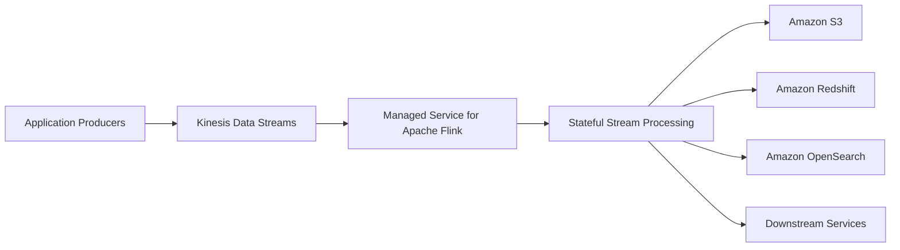
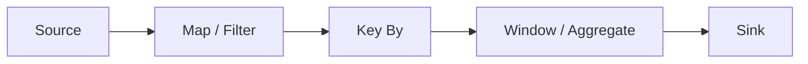
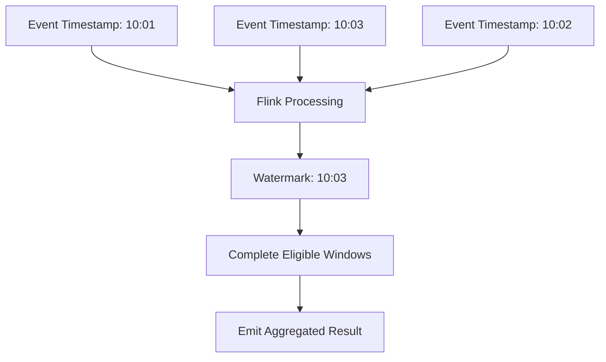
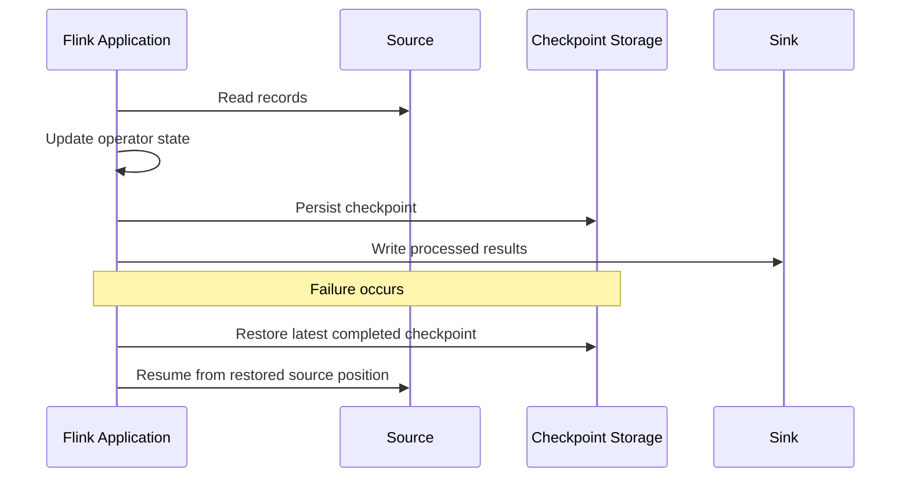

# 05- Kinesis Data Analytics

## Overview

Amazon Kinesis Data Analytics is the former name of AWS's managed real-time analytics capabilities for streaming data. The service evolved into **Amazon Managed Service for Apache Flink** for Apache Flink-based stream processing. The legacy Kinesis Data Analytics for SQL Applications offering was discontinued; new implementations should use supported alternatives rather than build on that retired offering.

Amazon Managed Service for Apache Flink allows applications to process continuously arriving data without managing the underlying Flink infrastructure. It supports stateful stream processing, event-time operations, windowed aggregations, joins, and complex event processing.

It is useful when backend and data engineering systems need to derive actionable information from events as they arrive.

Typical use cases include:

- Real-time fraud detection.
- Transaction and payment analytics.
- Clickstream aggregation.
- Monitoring and anomaly detection.
- Real-time operational dashboards.
- Event enrichment and stream-to-stream joins.
- Continuous transformation of events before storage.

## Streaming Analytics Architecture

Streaming analytics processes records continuously instead of waiting for a scheduled batch job.

A typical architecture combines Kinesis Data Streams, Managed Service for Apache Flink, and downstream destinations.



For example, an e-commerce platform can publish order and payment events to Kinesis Data Streams. A Flink application can continuously calculate transaction totals, detect unusual payment patterns, and publish derived events to downstream services.

## Managed Service for Apache Flink

Amazon Managed Service for Apache Flink is a managed environment for running Apache Flink applications on AWS.

Apache Flink is a distributed stream-processing framework designed for stateful computation over bounded and unbounded data.

Managed Service for Apache Flink handles much of the infrastructure management, including:
- Provisioning and operating Flink application resources.
- Integrating with supported AWS streaming sources and destinations.
- Application deployment and updates.
- Checkpoint and snapshot integration.
- Monitoring through CloudWatch.
- Scaling application capacity through configured processing resources.

The application developer remains responsible for processing logic, state design, serialization, error handling, and operational configuration.

### When to Use It

Use Managed Service for Apache Flink when workloads require:

- Stateful processing across multiple events.
- Event-time windows and late-event handling.
- Continuous aggregations.
- Stream joins and enrichment.
- Complex event detection.
- Low-latency processing over high-volume streams.

For simple record delivery to S3, use Amazon Data Firehose instead. For straightforward queue-based background jobs, SQS and Lambda may be sufficient.

## Apache Flink Processing Model

Flink applications process data through a distributed dataflow.

A typical application consists of:
- Sources that read records.
- Transformations that process records.
- Stateful operators that maintain intermediate state.
- Sinks that write results to downstream systems.



### Sources

A source connects a Flink application to an upstream data system.

Common sources include:
- Kinesis Data Streams.
- Apache Kafka.
- Amazon MSK.
- File-based sources.
- Custom connectors.

A source is responsible for reading records and exposing them to the Flink processing pipeline.

### Transformations

Transformations modify or select records.

| Transformation | Purpose |
|---|---|
| `map` | Transform each record |
| `filter` | Select records based on conditions |
| `flatMap` | Produce zero or more records from one input |
| `keyBy` | Partition records by key |
| `union` | Combine compatible streams |
| `connect` | Combine streams with different types |
| `process` | Implement custom stateful or event-time processing |

### Sinks

A sink writes processed records to an external system.

Examples include:
- Amazon S3.
- Amazon Kinesis Data Streams.
- Amazon MSK.
- Relational databases through supported connectors.
- Custom HTTP or application integrations.

Sink delivery guarantees depend on the connector and destination capabilities. An end-to-end exactly-once guarantee requires compatible source, checkpointing, and sink behavior.

## Event Time, Processing Time, and Ingestion Time

Time semantics are fundamental to stream processing.

| Time Type | Meaning | Example |
|---|---|---|
| Event time | Timestamp when the event actually occurred | Payment timestamp |
| Processing time | Time when Flink processes the record | Worker processing timestamp |
| Ingestion time | Time when the event enters the processing system | Stream ingestion timestamp |

Event time is generally preferred for business analytics because it reflects when an event occurred rather than when a processing system happened to receive it.

For example, a payment event may occur at 10:00 but arrive at Flink at 10:03 because of network delays. An event-time aggregation should place it in the 10:00 window.

## Windowing

Windowing groups records into finite time or count-based collections so that Flink can perform aggregations.

It is useful for:
- Transaction totals per minute.
- Average API latency per five minutes.
- Number of orders per region.
- Real-time fraud indicators.
- Traffic and error-rate monitoring.

### Tumbling Windows

Tumbling windows divide a stream into fixed, non-overlapping intervals.

```text
10:00 - 10:01
10:01 - 10:02
10:02 - 10:03
```

Each event belongs to one window.

### Sliding Windows

Sliding windows use a fixed duration and a smaller slide interval.

For example, a five-minute window that advances every minute:

```text
10:00 - 10:05
10:01 - 10:06
10:02 - 10:07
```

An event can belong to multiple windows.

### Session Windows

Session windows group events based on activity and inactivity gaps.

They are useful for:
- User sessions.
- Customer interaction analysis.
- Application activity tracking.

A session closes after the configured inactivity period.

### Window Comparison

| Window Type | Behavior | Typical Use Case |
|---|---|---|
| Tumbling | Fixed, non-overlapping intervals | Per-minute transaction totals |
| Sliding | Overlapping intervals | Rolling traffic averages |
| Session | Activity-based intervals | User behavior analysis |
| Count-based | Fixed number of records | Batch-like event aggregation |

## Watermarks and Late Events

A watermark is Flink's mechanism for tracking progress in event time.

It indicates that the system believes events with timestamps earlier than a particular time are unlikely to arrive in the future.

Watermarks allow event-time windows to close even when records arrive out of order.



A late event arrives after the watermark has passed the relevant event-time window.

Production applications should define how late events are handled:

- Allow a configured lateness interval.
- Use supported side-output mechanisms for late records.
- Reconcile late events through a correction pipeline.
- Monitor late-event volume.

Do not assume that arrival order and event-time order are identical.

## Stateful Stream Processing

State allows a Flink application to remember information across records.

Without state, each record is processed independently. With state, the application can calculate cumulative values, maintain user activity, or correlate related events.

Examples include:
- Total transaction value per customer.
- Number of failed login attempts per account.
- Current inventory quantity per product.
- Payment status across multiple events.
- Moving averages for application metrics.

### Keyed State

Keyed state is partitioned by a key.

For example, records can be grouped by `customer_id`, allowing each customer to maintain independent processing state.

```text
Customer A -> State A
Customer B -> State B
Customer C -> State C
```

This supports parallel processing while maintaining state isolation between keys.

### Operator State

Operator state belongs to a parallel operator instance rather than an individual key.

It is useful for state associated with source partitions, custom operators, or application-level processing metadata.

### State Backends

Flink uses state backends to manage application state.

State backend selection affects memory consumption, checkpoint performance, and recovery behavior. Managed Service for Apache Flink configures and operates supported Flink runtime capabilities, but application state design still determines scalability.

## Checkpointing and Fault Tolerance

Checkpointing periodically captures the state of a Flink application so it can recover after failures.

A checkpoint includes the state required to restore the application to a consistent processing point.



Important concepts:

| Concept | Description |
|---|---|
| Checkpoint | Consistent snapshot used for automatic recovery |
| Savepoint | Manually triggered snapshot used for controlled operations such as upgrades or migration |
| Recovery | Restoring application state and source progress |
| State consistency | Ensuring state and source positions represent a consistent processing point |

Checkpointing does not automatically make every external side effect exactly once. The sink must support compatible transactional or idempotent behavior.

### Production Recommendations

- Configure checkpoint intervals according to recovery objectives.
- Monitor checkpoint duration and failures.
- Avoid excessively frequent checkpoints for large state.
- Use savepoints for controlled application upgrades where supported.
- Test recovery under realistic failure conditions.
- Ensure downstream sinks can tolerate retries or provide transactional guarantees.

## Exactly-Once Processing

Exactly-once processing means that the application produces a logically consistent result despite retries and recovery.

Flink supports exactly-once state consistency through checkpointing and coordinated recovery. End-to-end exactly-once behavior additionally depends on the source and sink.

For example:

```text
Kinesis Source
      |
      v
Flink Processing
      |
      v
Checkpointing
      |
      v
Transactional or Idempotent Sink
```

A database sink that performs non-idempotent inserts without transaction coordination may still produce duplicates after recovery.

For external databases and APIs, use:
- Stable event IDs.
- Idempotent writes.
- Transactional sink implementations where supported.
- Deduplication constraints.
- Reconciliation processes.

Do not interpret exactly-once state processing as a universal guarantee for arbitrary external side effects.

## Python and Backend Integration

Apache Flink's primary APIs and runtime are JVM-based. Python developers can use supported PyFlink APIs for stream-processing applications.

PyFlink is useful when the processing logic benefits from Python libraries or when the team maintains Python-based data engineering workflows.

However, evaluate serialization overhead, Python execution performance, connector support, and runtime compatibility before selecting PyFlink for high-throughput workloads.

### Example PyFlink DataStream Application

The following illustrates a keyed aggregation using the PyFlink DataStream API. It assumes an appropriately configured source and execution environment.

```python
from pyflink.common import Types
from pyflink.datastream import StreamExecutionEnvironment
from pyflink.datastream.functions import MapFunction


class ParseTransaction(MapFunction):
    def map(self, value):
        customer_id, amount = value.split(",")

        return (
            customer_id,
            float(amount),
        )


class SumTransaction(MapFunction):
    def map(self, value):
        customer_id, amount = value

        return (
            customer_id,
            amount,
        )


env = StreamExecutionEnvironment.get_execution_environment()

transactions = env.from_collection(
    [
        "customer-1,120.50",
        "customer-2,80.00",
        "customer-1,45.50",
    ],
    type_info=Types.STRING(),
)

parsed = transactions.map(
    ParseTransaction(),
    output_type=Types.TUPLE([
        Types.STRING(),
        Types.DOUBLE(),
    ]),
)

aggregated = (
    parsed
    .key_by(lambda value: value[0])
    .reduce(
        lambda left, right: (
            left[0],
            left[1] + right[1],
        )
    )
)

aggregated.print()

env.execute("customer-transaction-aggregation")
```

This example demonstrates keyed aggregation over a bounded collection. A production streaming application must replace the collection source and print sink with appropriate connectors, configure checkpointing, and define event-time and failure-handling behavior.

## Scaling and Parallelism

Flink applications execute operators in parallel subtasks.

Parallelism determines how many concurrent instances of an operator process data.

For example:

```text
Source Parallelism: 4
       |
       v
Filter Parallelism: 4
       |
       v
Aggregation Parallelism: 8
       |
       v
Sink Parallelism: 4
```

Parallelism should be selected according to:
- Source partition count.
- Record volume.
- Key distribution.
- State size.
- CPU and memory requirements.
- Downstream destination capacity.

### Key Skew

Keyed processing can become unbalanced when some keys receive substantially more records than others.

For example, if most transactions belong to one high-volume customer, the subtask responsible for that customer can become a bottleneck.

Mitigation strategies include:
- Choosing suitable partition keys.
- Monitoring per-subtask load.
- Using controlled key salting for aggregations that can be combined safely.
- Separating exceptionally hot keys into dedicated processing paths.

Key salting is not appropriate when it breaks required ordering or state semantics.

## Deployment and Application Management

Managed Service for Apache Flink applications require a deployment process that accounts for application code, runtime configuration, state compatibility, and recovery.

Typical deployment stages:

1. Build the Flink application artifact.
2. Upload the artifact to the configured deployment location.
3. Configure the application runtime and permissions.
4. Start or update the application.
5. Monitor application health and checkpoint behavior.
6. Validate output correctness.

For production deployments:
- Store application artifacts in controlled S3 locations.
- Use CI/CD to build and publish versioned artifacts.
- Separate development, staging, and production configurations.
- Use IAM roles instead of embedded credentials.
- Test savepoint-based upgrades where appropriate.
- Validate state compatibility before changing application versions.
- Maintain a rollback procedure.

## Monitoring and Observability

Monitor application health, processing progress, resource usage, and downstream delivery.

| Area | Operational Signal |
|---|---|
| Throughput | Records and bytes processed per second |
| Latency | Event processing and end-to-end latency |
| Backpressure | Operators unable to process input at the required rate |
| Checkpointing | Duration, failures, and checkpoint size |
| State | State size and growth rate |
| Resources | CPU, memory, and worker utilization |
| Sources | Input rate and source lag |
| Sinks | Output rate, failures, and destination latency |

Use CloudWatch metrics and application logs to identify bottlenecks.

Application-level metrics should include:
- Records processed.
- Records rejected.
- Late-event count.
- Processing latency.
- Checkpoint failures.
- Sink write failures.
- Per-key processing imbalance where measurable.

A healthy application process does not necessarily mean that records are being processed within the required latency objective. Monitor processing lag and output freshness.

## Security Considerations

Streaming analytics applications often process financial, customer, and operational data.

Apply security controls across the source, processing runtime, state storage, and destination.

- Use least-privilege IAM execution roles.
- Restrict source stream read permissions.
- Restrict destination write permissions.
- Encrypt data at rest and in transit.
- Use customer-managed KMS keys when required.
- Protect application artifacts and configuration.
- Avoid logging sensitive record payloads.
- Store credentials in AWS Secrets Manager or another approved secret-management system.
- Review VPC and network configuration for private data paths.

For multi-account architectures, define explicit cross-account access and encryption-key permissions.

## Cost Considerations

Managed Service for Apache Flink costs depend on application resource usage and the selected deployment configuration.

Cost factors include:
- Configured application processing capacity.
- Runtime duration.
- Additional storage and checkpoint requirements.
- Source and destination service costs.
- Network data transfer.
- Supporting AWS services.

Cost optimization strategies:

- Right-size application parallelism.
- Avoid unnecessary always-on processing capacity.
- Monitor idle or underutilized resources.
- Optimize serialization and record processing.
- Control state growth.
- Review checkpoint frequency.
- Scale according to actual throughput and latency requirements.

Do not reduce resources without measuring backpressure and processing latency. Under-provisioning can increase lag and create downstream recovery costs.

## Common Mistakes and Pitfalls

| Mistake | Why It Causes Problems | Recommended Approach |
|---|---|---|
| Using processing time for business windows | Late events can be assigned to incorrect windows | Use event time and watermarks where appropriate |
| Ignoring checkpoint failures | Recovery points become unreliable | Monitor checkpoint health and investigate failures |
| Assuming exactly-once covers external APIs | External side effects may be repeated | Use idempotency and transactional sinks |
| Choosing poor partition keys | Creates hot keys and uneven processing | Analyze key distribution before deployment |
| Increasing parallelism without checking state | Can increase resource usage and complicate state redistribution | Benchmark and validate state scaling |
| Ignoring backpressure | Processing lag grows even when the application is running | Identify the slow operator or sink |
| Treating late events as impossible | Out-of-order delivery is normal in distributed systems | Configure lateness handling and reconciliation |
| Performing blocking network calls in operators | Reduces throughput and can cause backpressure | Use appropriate asynchronous I/O patterns |
| Upgrading without state compatibility testing | Application restoration can fail | Test savepoint-based upgrades |
| Using Flink for simple delivery workloads | Adds unnecessary processing complexity | Use Firehose or simpler managed integrations when sufficient |

## Key Takeaways

- Amazon Kinesis Data Analytics is the former service name; new Apache Flink-based implementations use Amazon Managed Service for Apache Flink.
- Flink supports stateful, event-time stream processing with windows, watermarks, joins, and continuous aggregations.
- Checkpointing enables state recovery, but end-to-end exactly-once behavior depends on source and sink guarantees.
- Parallelism, key distribution, state size, and backpressure determine application scalability.
- Production stream-processing systems require durable recovery, idempotent outputs, schema management, monitoring, and tested deployment procedures.