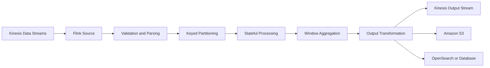
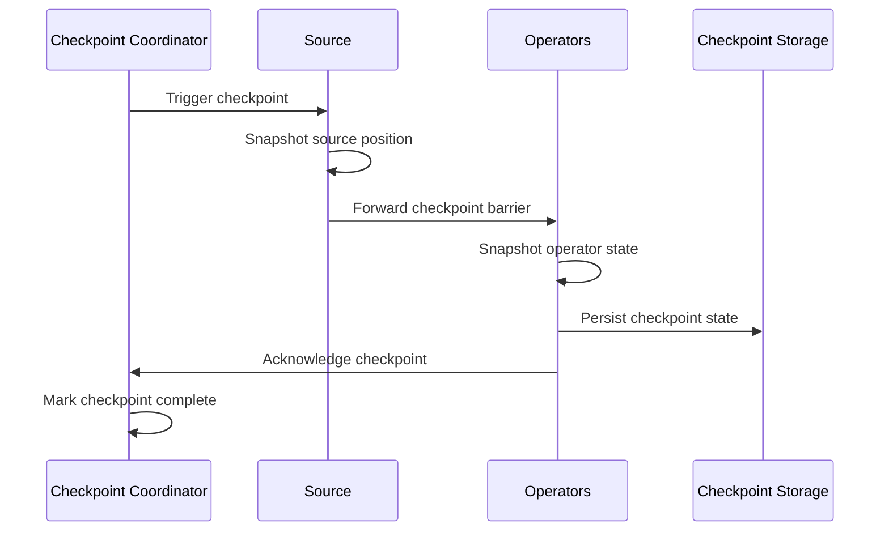
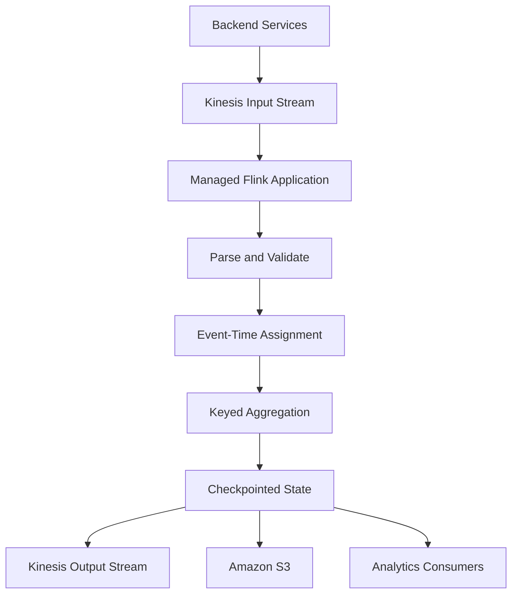
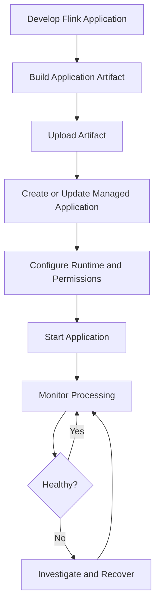
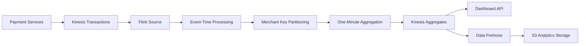
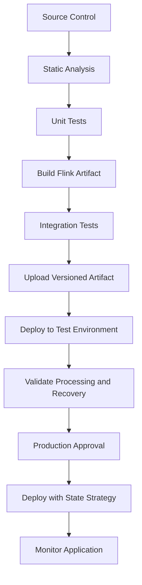

# 06- Stream Processing with Apache Flink

## Overview

Apache Flink is a distributed stream-processing framework designed to process unbounded and bounded datasets with low latency, high throughput, and stateful computation.

In an AWS-based streaming architecture, Flink commonly consumes events from Amazon Kinesis Data Streams, performs transformations and aggregations, enriches records, detects patterns, and writes results to downstream systems such as:

- Amazon Kinesis Data Streams
- Amazon Data Firehose
- Amazon S3
- Amazon OpenSearch Service
- Relational databases
- External APIs and data platforms

Unlike a traditional batch-processing job, a streaming application continuously processes events as they arrive. It can maintain state across events, handle out-of-order data, recover from failures, and calculate results over time-based or count-based windows.

AWS provides **Amazon Managed Service for Apache Flink**, which manages the infrastructure required to run Flink applications. It was previously known as Amazon Kinesis Data Analytics for Apache Flink.

Flink is particularly useful when a backend system needs more than simple message consumption and forwarding. It provides a processing engine for continuous aggregation, event correlation, stream enrichment, anomaly detection, and real-time analytics.

## Why Stream Processing with Flink Matters

A conventional backend service often processes events using a queue consumer:

1. Receive a message.
2. Validate the payload.
3. Execute business logic.
4. Persist the result.
5. Acknowledge the message.

This works well for independent messages and straightforward asynchronous workflows. However, requirements become more complicated when processing depends on multiple events, historical state, event timestamps, or continuous aggregations.

Examples include:

- Calculate transaction volume per merchant every minute.
- Detect multiple failed login attempts within a time window.
- Aggregate device telemetry into real-time operational metrics.
- Join incoming transactions with reference data.
- Identify unusual payment patterns.
- Calculate continuously updated business metrics.

Implementing these requirements with independent queue consumers often introduces custom state management, scheduling, aggregation, replay, and recovery logic.

Flink provides these capabilities as part of its distributed processing model.

## Flink Architecture

A Flink application is represented as a distributed dataflow graph.

The graph consists of sources, operators, and sinks.

| Component | Responsibility |
|---|---|
| Source | Reads records from an external system |
| Transformation | Filters, maps, parses, or enriches records |
| Keyed partitioning | Routes related records to the same logical processing partition |
| Stateful operator | Maintains information across multiple events |
| Window operator | Groups records according to time or count boundaries |
| Sink | Writes processed results to an external destination |

### High-Level Architecture



The processing pipeline is distributed across multiple parallel operator instances.

For example, a transaction stream can be partitioned by merchant ID. Each processing instance handles a subset of merchant keys and maintains the corresponding aggregation state.

This allows the application to scale without requiring every worker to maintain the complete state of the stream.

### Flink Application Components

A production application typically includes:

- A source connector configured to consume records.
- A deserialization layer that converts incoming records into application objects.
- A transformation pipeline.
- A partitioning strategy.
- Stateful operators and window definitions.
- A sink connector.
- Checkpoint and state configuration.
- Monitoring and operational controls.

The source and sink connectors determine how Flink interacts with external systems. Their delivery and recovery guarantees must be evaluated separately from Flink's internal processing guarantees.

## Core Processing Concepts

### Data Streams

A DataStream represents a sequence of records processed continuously by a Flink application.

Unlike a collection loaded entirely into memory, an unbounded stream has no predefined end.

For example, an application receiving payment events might process records continuously:

```json
{
  "event_id": "evt-10001",
  "merchant_id": "merchant-42",
  "transaction_id": "txn-90001",
  "amount": 1250.50,
  "currency": "INR",
  "event_time": "2026-11-19T10:15:30Z"
}
```

The application can process each event independently or combine it with other events using stateful operations.

A stream can be transformed multiple times before being written to a sink.

### Operators

Operators are the processing units in a Flink dataflow.

Common operators include:

| Operator | Purpose | Example |
|---|---|---|
| `map` | Transform one record into another | Convert JSON into a typed event |
| `flatMap` | Produce zero or more records | Split a compound event |
| `filter` | Remove records that do not satisfy a condition | Ignore invalid transactions |
| `keyBy` | Partition records by a key | Group transactions by merchant |
| `union` | Combine compatible streams | Merge multiple event sources |
| `window` | Group records into windows | Aggregate transactions per minute |
| `process` | Implement custom processing logic | Maintain complex event state |

Operators can execute in parallel across multiple task instances.

The parallelism of an operator determines how many parallel instances execute that stage of the pipeline.

### Parallelism and Data Partitioning

Parallelism is one of the most important performance and scalability controls in Flink.

Consider a stream containing events from thousands of merchants.

If the application groups transactions by merchant ID, it can use keyed partitioning:

```java
transactions
    .keyBy(Transaction::getMerchantId);
```

Flink routes records with the same key to the same logical keyed operator instance.

This is important because all events associated with a key must access consistent keyed state.

For example:

```text
merchant-1 -> Subtask 1
merchant-2 -> Subtask 2
merchant-3 -> Subtask 1
merchant-4 -> Subtask 3
merchant-5 -> Subtask 2
```

The actual assignment depends on the key-group and operator parallelism configuration.

**Important:** `keyBy()` introduces a network repartitioning operation. Records may need to move between machines, which adds serialization, network, and buffering overhead.

Production considerations:

- Choose keys that distribute traffic reasonably evenly.
- Avoid low-cardinality keys that create processing bottlenecks.
- Avoid assigning every event to a single global key unless global ordering or aggregation is required.
- Monitor individual operator subtasks, not just application-level throughput.
- Account for the cost of network shuffles when designing the processing graph.

## Time Semantics

Time is fundamental to stream processing.

Flink supports different notions of time because an event can be created, transmitted, received, and processed at different moments.

### Processing Time

Processing time is the system time when an operator processes a record.

For example:

```text
Event created:       10:00:00
Event received:      10:00:08
Event processed:     10:00:09
```

The processing-time timestamp is approximately `10:00:09`.

Advantages:

- Simple to implement.
- Low coordination overhead.
- Suitable for applications where processing speed matters more than the original event timestamp.

Limitations:

- Results depend on message arrival and processing delays.
- Delayed events can be assigned to a different window than expected.
- Replaying historical events can produce different window assignments.

Use processing time when the business requirement is based on when the system handles data rather than when the underlying event occurred.

### Event Time

Event time represents when the event actually happened.

The timestamp is usually included in the event payload or obtained from trusted source metadata.

Example:

```json
{
  "transaction_id": "txn-90001",
  "merchant_id": "merchant-42",
  "amount": 1250.50,
  "event_timestamp": 1795083330000
}
```

The event timestamp can be used to group records according to their actual occurrence time.

Advantages:

- Handles out-of-order events.
- Produces more consistent historical aggregations.
- Supports event-time windows and replay-based processing.
- Suitable for telemetry, financial events, and business analytics.

Limitations:

- Requires reliable event timestamps.
- Requires watermark configuration.
- Late-event handling adds complexity.
- A slow or idle input partition can delay event-time progress.

For most business analytics involving event occurrence time, event-time processing is preferable.

### Watermarks

A watermark indicates the progress of event time.

A watermark with timestamp `10:15:00` indicates that the system does not expect additional events with timestamps at or before that point, subject to the source's watermark strategy.

Watermarks allow Flink to determine when event-time windows can be finalized.

Consider these events:

| Event | Event time | Arrival order |
|---|---|---|
| A | 10:00:05 | 1 |
| B | 10:00:15 | 2 |
| C | 10:00:10 | 3 |
| D | 10:00:25 | 4 |

Event C arrives after event B even though its event timestamp is earlier.

A processing-time aggregation may place these events according to arrival time. An event-time aggregation can place them according to their original timestamps.

A watermark strategy defines how much out-of-order data the application expects.

For example, if events are typically delayed by up to 30 seconds, the application can use a bounded-out-of-orderness strategy with a 30-second delay.

Conceptually:

```text
Current maximum event timestamp: 10:15:30
Allowed out-of-orderness:         30 seconds
Watermark:                        10:15:00
```

A watermark is not a guarantee that no older event will ever arrive. It is a progress signal based on the configured strategy.

### Watermarks in Parallel Streams

Each parallel source task can generate watermarks independently.

When an operator receives data from multiple input channels, its event-time progress is constrained by the minimum watermark of its active inputs.

This prevents an operator from finalizing a window while another active input may still contain earlier events.

A slow input can therefore delay downstream window completion.

Flink supports marking inactive inputs as idle so that they do not indefinitely hold back watermark progress.

Production considerations:

- Choose an out-of-orderness bound based on observed event delays.
- Monitor watermark lag.
- Configure source idleness where appropriate.
- Define a policy for events arriving after the relevant watermark.
- Avoid excessively large watermark delays because they increase result latency and retained state.

## Windowing

Windowing groups streaming records into finite logical collections so that an application can perform aggregations over them.

Without windows, an unbounded stream would require an explicit condition to determine when an aggregation is complete.

### Tumbling Windows

A tumbling window divides a stream into fixed-size, non-overlapping intervals.

For example, a one-minute tumbling window produces separate aggregates:

```text
10:00:00 - 10:01:00
10:01:00 - 10:02:00
10:02:00 - 10:03:00
```

An event belongs to one window based on its timestamp.

Use cases:

- Transactions per minute.
- API requests per five minutes.
- Device readings per hour.
- Revenue per business interval.

### Sliding Windows

A sliding window uses a fixed window size and a separate slide interval.

For example:

```text
Window size: 5 minutes
Slide:       1 minute
```

The windows overlap:

```text
10:00 - 10:05
10:01 - 10:06
10:02 - 10:07
10:03 - 10:08
```

An event can contribute to multiple windows.

Use cases:

- Rolling transaction volume.
- Moving averages.
- Continuously updated operational metrics.
- Short-term anomaly detection.

Sliding windows can require more computation and state because records may participate in multiple overlapping windows.

### Session Windows

Session windows group events based on periods of activity separated by inactivity gaps.

For example, a user session may be considered complete after 30 minutes without activity.

```text
User activity:
10:00 -> 10:05 -> 10:12 -> 10:50 -> 10:55

Session 1:
10:00 -> 10:12

Session 2:
10:50 -> 10:55
```

Use cases:

- User activity sessions.
- Customer engagement analytics.
- Device activity tracking.
- Behavioral event analysis.

Session windows are dynamic. Additional events can extend or merge existing sessions depending on the configured gap and event-time semantics.

### Window Comparison

| Window type | Behavior | Typical use |
|---|---|---|
| Tumbling | Fixed, non-overlapping intervals | Periodic aggregation |
| Sliding | Fixed intervals with overlap | Rolling metrics |
| Session | Activity grouped by inactivity gaps | User or device sessions |

### Flink SQL Window Example

Flink SQL provides table-valued window functions for defining event-time aggregations.

The following query assumes an input table named `transactions` with an event-time column named `event_time`.

```sql
SELECT
    window_start,
    window_end,
    merchant_id,
    COUNT(*) AS transaction_count,
    SUM(amount) AS total_amount
FROM TABLE(
    TUMBLE(
        TABLE transactions,
        DESCRIPTOR(event_time),
        INTERVAL '1' MINUTE
    )
)
GROUP BY
    window_start,
    window_end,
    merchant_id;
```

This query:

1. Reads transaction events.
2. Groups them into one-minute event-time windows.
3. Groups each window by merchant.
4. Calculates the transaction count and total amount.
5. Emits aggregated results according to the window's completion semantics.

The source table must have an appropriate event-time attribute and connector configuration. The query alone does not configure the Kinesis source.

## Stateful Stream Processing

Stateful processing allows an operator to remember information across multiple records.

For example, calculating the total transaction amount for a merchant requires the application to retain an aggregate between incoming events.

Without state, the application would have to retrieve all historical transactions for every calculation.

Flink manages distributed operator state and integrates it with its fault-tolerance mechanisms.

### Types of State

Flink provides several state abstractions.

| State type | Purpose | Typical use |
|---|---|---|
| ValueState | Store one value per key | Running balance |
| ListState | Store a list of values per key | Pending events |
| MapState | Store key-value entries per key | Per-category counters |
| ReducingState | Maintain a reduced value | Running sum |
| AggregatingState | Maintain an aggregate using custom logic | Running average |

The exact state abstractions available depend on the API being used.

### Keyed State

Keyed state is associated with a key produced by `keyBy()`.

For example:

```java
transactions
    .keyBy(Transaction::getMerchantId);
```

Each merchant's state is managed by the corresponding keyed operator instance.

Conceptually:

```text
merchant-42:
    transaction_count = 125
    total_amount = 150000.00

merchant-73:
    transaction_count = 84
    total_amount = 92000.00
```

This state can be updated as new events arrive.

Keyed state is particularly useful for:

- Per-customer transaction totals.
- Per-device telemetry statistics.
- Failed-login counters.
- Fraud detection features.
- Business-rule evaluation.

### Operator State

Operator state belongs to a parallel operator instance rather than being associated with an individual business key.

It is useful for maintaining state such as:

- Source offsets.
- Per-instance buffers.
- Custom source or sink progress.
- State associated with a particular parallel task.

When the operator is rescaled, operator state can be redistributed according to the state assignment strategy.

### State Size and Management

State size directly affects checkpoint duration, recovery time, storage requirements, and operational cost.

Production recommendations:

- Keep state limited to information required for future computation.
- Use state TTL where expiration matches the business semantics.
- Avoid retaining entire event histories when aggregates are sufficient.
- Monitor checkpoint size and duration.
- Design state schemas and operator identities carefully before production deployment.
- Test state restoration when changing application versions.

State TTL is not a substitute for a correct retention policy. Expiration behavior and cleanup guarantees depend on the configured state backend and processing model.

## Checkpointing and Fault Tolerance

Checkpointing is Flink's primary mechanism for recovering application state after failures.

A checkpoint captures a consistent snapshot of the distributed dataflow, including operator state and source positions where supported by the connector.

When a failure occurs, Flink restores the latest successful checkpoint and resumes processing from the corresponding source positions.

### Checkpoint Lifecycle



The checkpoint coordinator coordinates checkpoint execution across the application.

Flink uses checkpoint barriers to establish a consistent point across the distributed dataflow.

Checkpointing is asynchronous in the sense that the application can continue processing while state is persisted, subject to the checkpoint mode and operator behavior.

### Exactly-Once Processing

Flink supports exactly-once state consistency through checkpointing and replay.

This means that after recovery, the restored application state represents the effects of processing records up to the checkpoint boundary without applying those records twice to the restored Flink-managed state.

However, exactly-once state consistency does not automatically mean that every external side effect occurs exactly once.

For example:

1. Flink processes a payment event.
2. The application writes a payment result to an external database.
3. The application fails before the corresponding checkpoint completes.
4. Flink restores an earlier checkpoint.
5. The event is processed again.

If the database write is not transactional or idempotent, the external side effect may be duplicated.

Exactly-once end-to-end behavior requires compatible source replay and sink commit mechanisms, or an application-level idempotency strategy.

### Checkpoints vs. Savepoints

Both checkpoints and savepoints capture application state, but they serve different operational purposes.

| Feature | Checkpoint | Savepoint |
|---|---|---|
| Primary purpose | Automatic fault recovery | Controlled operational snapshot |
| Trigger | Flink checkpoint coordinator | User or deployment workflow |
| Lifecycle | Managed by checkpoint retention configuration | Retained according to operational policy |
| Common use | Restart after failure | Upgrade, migration, or controlled restart |
| Recovery | Automatic or configured recovery | Explicit restore operation |

Savepoints are particularly important when deploying a new application version that must preserve existing processing state.

### Checkpoint Configuration Considerations

Important checkpoint settings include:

- Checkpoint interval.
- Checkpoint timeout.
- Minimum time between checkpoints.
- Maximum concurrent checkpoints.
- Checkpoint storage location.
- Restart strategy.
- State backend configuration.
- Externalized checkpoint retention behavior.

A shorter checkpoint interval can reduce the amount of work replayed after a failure, but it increases checkpoint overhead.

A longer interval reduces checkpoint frequency but can increase recovery time and replay volume.

The correct interval depends on state size, source throughput, latency requirements, and recovery objectives.

## Kinesis Data Streams Integration

Amazon Kinesis Data Streams is a common source and destination for Flink applications.

Kinesis provides a durable event stream, while Flink performs continuous processing over those records.

### Processing Architecture



A typical flow:

1. Backend services publish events to a Kinesis input stream.
2. Flink consumes records through a compatible source connector.
3. The application deserializes and validates each event.
4. Event timestamps and watermarks are assigned.
5. Events are partitioned by business keys.
6. Stateful operators calculate aggregates or detect patterns.
7. Results are written to configured sinks.
8. Checkpoints capture processing state and source progress.

### Source Considerations

When consuming Kinesis records, consider:

- Stream shard count and throughput.
- Source connector parallelism.
- Starting position and initial stream offsets.
- Consumer registration and consumption mode.
- Record deserialization and schema compatibility.
- Checkpoint and source-position integration.
- Shard discovery and resharding behavior.

A Flink application cannot process data faster than its source can deliver it.

For provisioned Kinesis streams, shard capacity and partition-key distribution can constrain throughput. Increasing Flink operator parallelism does not automatically increase source throughput.

A hot Kinesis shard can become a bottleneck even when the Flink application has unused processing capacity.

### Sink Considerations

A Flink sink writes processed results to a destination.

Common destinations include:

| Destination | Typical purpose |
|---|---|
| Kinesis Data Streams | Feed another streaming application |
| Amazon Data Firehose | Deliver processed records to supported destinations |
| Amazon S3 | Store analytical data and historical output |
| OpenSearch | Support search and operational dashboards |
| Relational database | Persist application-level results |

Evaluate each sink for:

- Supported delivery guarantees.
- Retry behavior.
- Transactional commit support.
- Batching and buffering.
- Backpressure behavior.
- Authentication and authorization.
- Failure recovery.

Do not assume that a checkpointed Flink application provides exactly-once writes to every sink.

## Amazon Managed Service for Apache Flink

Amazon Managed Service for Apache Flink provides managed infrastructure for running Apache Flink applications on AWS.

AWS manages much of the underlying application infrastructure, allowing engineers to focus on the processing logic and operational configuration.

The service supports application development using Java, Python, SQL, and Scala, subject to the selected application environment and supported runtime capabilities.

### Managed Service Responsibilities

The service provides capabilities such as:

- Managed application execution.
- Integration with supported streaming sources.
- Application scaling configuration.
- Checkpoint and snapshot management.
- CloudWatch integration.
- IAM-based access control.
- VPC connectivity.
- Application lifecycle management.

It does not remove the need to design the dataflow, configure state, select connectors, manage schema compatibility, or monitor processing behavior.

### Application Development Options

| Development option | Purpose |
|---|---|
| Managed Flink application | Deploy and operate a continuous production application |
| Flink Studio | Interactive development and exploration |
| Flink SQL | Declarative stream transformations and analytics |
| DataStream API | Programmatic control over streaming operators and state |

For production workloads, use a deployment process that builds and validates application artifacts before updating the managed application.

### Application Lifecycle



### Deployment Considerations

A production deployment should account for:

- Application artifact versioning.
- Runtime compatibility.
- Connector compatibility.
- State compatibility.
- Checkpoint and savepoint strategy.
- IAM execution role.
- VPC and network configuration.
- Logging and monitoring.
- Rollback procedures.

Do not treat a successful application upload as proof that the application can restore its existing state or process production traffic correctly.

## Practical Example: Real-Time Merchant Transaction Aggregation

Consider a payment platform that publishes transaction events to Kinesis Data Streams.

The business requirement is to calculate the number and total value of transactions per merchant every minute.

### Architecture



### Example Input Event

```json
{
  "event_id": "evt-10001",
  "merchant_id": "merchant-42",
  "transaction_id": "txn-90001",
  "amount": 1250.50,
  "currency": "INR",
  "event_time": "2026-11-19T10:15:30Z"
}
```

### Flink SQL Aggregation

The following query illustrates the aggregation logic.

It assumes that the `transactions` table has already been configured with a compatible source connector, a typed schema, and an event-time attribute.

```sql
SELECT
    window_start,
    window_end,
    merchant_id,
    currency,
    COUNT(*) AS transaction_count,
    SUM(amount) AS total_amount
FROM TABLE(
    TUMBLE(
        TABLE transactions,
        DESCRIPTOR(event_time),
        INTERVAL '1' MINUTE
    )
)
GROUP BY
    window_start,
    window_end,
    merchant_id,
    currency;
```

Example output:

```json
{
  "window_start": "2026-11-19T10:15:00Z",
  "window_end": "2026-11-19T10:16:00Z",
  "merchant_id": "merchant-42",
  "currency": "INR",
  "transaction_count": 125,
  "total_amount": 156250.75
}
```

The output can be written to a Kinesis output stream and consumed by a dashboard service.

### Production Design Considerations

The example demonstrates window aggregation, but a production payment analytics pipeline requires additional controls.

**Event identity and duplicate handling**

Each event should contain a stable event identifier. If the source can replay records or producers can publish duplicates, the application may need deduplication state or downstream idempotency.

**Currency handling**

Never aggregate monetary values across different currencies without an explicit conversion policy. Group by currency or convert using a defined exchange-rate source and effective timestamp.

**Late events**

Define how transactions arriving after the watermark should be handled. Depending on the business requirement, use allowed lateness, side outputs, correction events, or a reconciliation process.

**Output delivery**

The output sink must be configured with delivery semantics appropriate to the application. Downstream consumers should tolerate retries and duplicate results where exactly-once delivery cannot be guaranteed.

**Historical reconciliation**

Real-time aggregates should be reconcilable against durable transaction records. A streaming result should not become the only source of truth for financial records unless the complete consistency and recovery model has been explicitly designed.

## Python and PyFlink Considerations

PyFlink exposes Apache Flink capabilities through Python APIs.

It is useful when the processing logic benefits from Python libraries, data-processing workflows, or an existing Python engineering ecosystem.

Typical use cases include:

- Event transformation.
- Stream enrichment.
- Aggregation.
- Data validation.
- Feature generation for analytics.
- Integration with supported Flink Table and DataStream APIs.

However, PyFlink does not make arbitrary Python execution free or inexpensive.

Python operators may introduce additional serialization, process communication, dependency packaging, and memory overhead.

Production considerations:

- Pin the Flink runtime and PyFlink versions.
- Match Python and Java runtime compatibility requirements.
- Package dependencies reproducibly.
- Avoid expensive per-record operations in Python.
- Prefer vectorized or efficient processing where supported.
- Measure Python operator throughput independently.
- Test application recovery and state compatibility.
- Verify connector support for the selected runtime.

For high-throughput workloads, benchmark Java and Python implementations rather than assuming equivalent performance.

## Scaling and Performance

Flink performance depends on more than the number of application workers.

Important factors include:

- Source throughput.
- Operator parallelism.
- Key distribution.
- Network shuffling.
- State size.
- Checkpoint overhead.
- Sink throughput.
- Serialization cost.
- Backpressure.

### Parallelism

Increasing operator parallelism can improve throughput when the workload can be distributed effectively.

However, excessive parallelism can increase:

- Scheduling overhead.
- Network communication.
- State redistribution cost.
- Checkpoint coordination overhead.
- Resource consumption.

Scale the operators that are actually constrained rather than increasing every parallelism setting without measurement.

### Backpressure

Backpressure occurs when downstream operators cannot process records as quickly as upstream operators produce them.

For example:

```text
Kinesis Source:       20,000 records/sec
Transformation:      20,000 records/sec
Database Sink:        5,000 records/sec
```

The sink becomes the bottleneck. Buffers fill, and backpressure propagates upstream.

Possible causes include:

- Slow database writes.
- Insufficient sink parallelism.
- Large serialization overhead.
- Expensive transformations.
- Network latency.
- Hot keys.
- External service throttling.

Mitigation strategies:

- Optimize expensive operators.
- Batch sink writes where supported.
- Increase sink capacity.
- Review operator parallelism.
- Improve partition-key distribution.
- Reduce unnecessary network shuffles.
- Monitor external destination latency and throttling.

Increasing source parallelism does not solve a downstream bottleneck.

### State Backend and Memory

State management affects throughput and recovery performance.

Flink supports different state backend strategies depending on runtime and version.

For large state workloads, a disk-backed state implementation can reduce reliance on JVM heap memory, but it does not eliminate storage I/O, checkpoint, or memory-management costs.

Monitor:

- Managed memory usage.
- JVM heap and garbage collection.
- State size.
- Checkpoint duration.
- Checkpoint failures.
- Restore duration.
- RocksDB-related metrics when using a RocksDB-backed state configuration.

Select state backend settings based on the actual runtime and workload rather than copying configuration from another Flink deployment.

## Reliability and Recovery

A production Flink application should have a documented failure-recovery strategy.

### Failure Scenarios

| Failure | Expected behavior | Engineering consideration |
|---|---|---|
| Task failure | Restart affected execution graph according to recovery strategy | Verify restart policy |
| Worker failure | Restore from a successful checkpoint | Confirm checkpoint availability |
| Source interruption | Resume when source becomes available | Verify source retention and offsets |
| Sink failure | Retry or recover according to sink behavior | Prevent duplicate side effects |
| Checkpoint failure | Continue or fail according to configured policy | Alert on repeated failures |
| Application deployment | Restore state when compatible | Use savepoints and controlled upgrades |

### Checkpoint Storage

Checkpoint storage must be durable and accessible to the application during recovery.

For managed AWS deployments, configure checkpoint and snapshot behavior according to the service's supported mechanisms.

Do not assume that application-local storage is sufficient for recovery after infrastructure replacement.

### Restart Strategy

A restart strategy determines how Flink responds to execution failures.

Common approaches include:

- Fixed-delay restart.
- Failure-rate restart.
- No restart.

Use bounded restart policies and investigate repeated failures.

An aggressive restart loop can consume resources while hiding persistent application defects.

### Disaster Recovery

Disaster recovery planning should cover:

- Application artifacts and configuration.
- Source stream retention and replay capability.
- Checkpoint and snapshot availability.
- IAM roles and policies.
- VPC and network dependencies.
- Sink recovery behavior.
- State compatibility.
- Recovery time objectives and recovery point objectives.

A checkpoint is useful only if the application can access the required state and resume from a valid source position.

Test recovery procedures in a non-production environment before relying on them during an incident.

## Monitoring and Observability

Flink applications need monitoring at both the application and operator levels.

A healthy application status does not guarantee that records are being processed at the required rate.

### Important Metrics

| Metric or signal | What it indicates |
|---|---|
| Records in | Incoming record rate |
| Records out | Processed output rate |
| Busy time | Time spent processing |
| Backpressured time | Time waiting due to downstream pressure |
| Idle time | Time without processing activity |
| Checkpoint duration | Time required to complete checkpoints |
| Checkpoint failures | Fault-tolerance problems |
| Checkpoint size | Amount of persisted state |
| Watermark lag | Event-time processing delay |
| Source lag | Difference between source progress and consumption |
| Restart count | Application instability |
| Sink latency | Downstream write performance |

### CloudWatch Integration

Amazon Managed Service for Apache Flink integrates with Amazon CloudWatch for application metrics and logs.

Use CloudWatch dashboards and alarms to monitor:

- Application availability.
- Record processing rates.
- Source lag.
- Checkpoint failures.
- Application restarts.
- Processing latency.
- Resource utilization.
- Backpressure indicators where exposed by the runtime and monitoring configuration.

Use structured application logs containing:

- Application version.
- Operator or processing stage.
- Error category.
- Event identifier where appropriate.
- Correlation identifier.
- Relevant source and sink context.

Avoid logging sensitive payloads, credentials, or personal data.

### Operational Alerts

Useful alert conditions include:

- Application enters an unexpected state.
- Checkpoints repeatedly fail.
- Source lag exceeds the business threshold.
- Watermark progress stalls.
- Sink errors increase.
- Processing throughput falls below expected volume.
- Restart frequency increases.
- Backpressure remains elevated.

Set thresholds based on workload behavior and service objectives rather than arbitrary static values.

## Security Considerations

A Flink application often processes sensitive business events and communicates with multiple AWS services.

Apply security controls at the application, infrastructure, and data layers.

### IAM

Use a dedicated execution role with least-privilege permissions.

Grant only the actions required to:

- Read input streams.
- Write output streams.
- Access checkpoint and application storage.
- Publish logs and metrics.
- Access required encryption keys.
- Retrieve application configuration or secrets.

Avoid wildcard permissions when resource-level permissions are supported.

### Network Security

For applications requiring private access to databases or internal services:

- Configure VPC connectivity.
- Restrict security-group ingress and egress.
- Use private endpoints where supported.
- Avoid exposing internal services publicly.
- Validate DNS and routing requirements.

### Encryption

Use encryption in transit and at rest.

Review:

- Kinesis stream encryption.
- S3 encryption.
- KMS key policies.
- Database encryption.
- TLS configuration for external endpoints.
- Secret storage and rotation.

### Data Protection

Streaming pipelines can expose sensitive data through logs, intermediate streams, and output destinations.

Apply:

- Data minimization.
- Field-level filtering.
- Appropriate retention policies.
- Access controls on output streams.
- Sensitive-field masking.
- Auditable access to operational data.

## Deployment and CI/CD

Treat Flink applications as versioned software artifacts.

A production deployment pipeline should build, test, validate, and deploy an immutable artifact.

### Recommended Pipeline



### CI/CD Best Practices

- Pin Flink and connector versions.
- Build artifacts reproducibly.
- Run serialization and schema compatibility tests.
- Test checkpoint restoration.
- Use savepoints for controlled stateful upgrades where appropriate.
- Keep environment-specific configuration outside the application artifact.
- Store secrets in an appropriate secret-management service.
- Use separate IAM roles for deployment and runtime execution.
- Retain previous application artifacts for rollback.
- Validate source and sink behavior after deployment.

### Stateful Application Upgrades

Changing a Flink application can affect its ability to restore existing state.

Examples include:

- Renaming stateful operators.
- Changing operator UIDs.
- Changing state serializers.
- Changing keyed-state structure.
- Changing key types.
- Changing parallelism.
- Changing connector versions.

Use stable operator identifiers where supported by the API and test state migration before deploying changes to production.

A code deployment that starts successfully is not necessarily a successful stateful migration.

## Cost Considerations

Managed Flink costs depend on the resources and supporting AWS services used by the application.

Relevant cost drivers include:

- Application processing capacity.
- Application runtime duration.
- Additional parallelism and resource requirements.
- Checkpoint and snapshot storage.
- Kinesis Data Streams capacity.
- Kinesis enhanced fan-out consumers, where used.
- Data Firehose delivery.
- CloudWatch metrics and log ingestion.
- Data transfer.
- Downstream storage and database capacity.

Cost optimization should focus on actual processing requirements.

Recommendations:

- Avoid unnecessary operator parallelism.
- Reduce expensive network shuffles.
- Keep state compact.
- Tune checkpoint frequency based on recovery requirements.
- Avoid excessive logging.
- Monitor source and sink utilization.
- Review the cost of supporting AWS services as part of the complete pipeline.

Do not reduce checkpoint frequency or application capacity without understanding the impact on recovery objectives and processing latency.

## Common Mistakes and Production Pitfalls

| Mistake | Why it causes problems | Recommended approach |
|---|---|---|
| Using processing time for event-time analytics | Delayed events can enter unexpected windows | Use event time and appropriate watermarks |
| Assuming watermarks prevent all late events | Watermarks represent expected progress, not absolute completeness | Define late-event handling |
| Increasing parallelism without checking key distribution | Hot keys remain bottlenecks | Measure per-key and per-subtask load |
| Assuming exactly-once state means exactly-once external writes | External side effects may be repeated after recovery | Use transactional sinks or idempotency |
| Ignoring checkpoint failures | Recovery points may become stale or unavailable | Alert on checkpoint health |
| Retaining excessive state | Increases memory, storage, checkpoint, and recovery costs | Bound state and apply suitable TTL |
| Treating Kinesis shard count as the only scaling factor | Operators or sinks may be the actual bottleneck | Monitor the complete dataflow |
| Ignoring backpressure | Latency and source lag increase | Identify and fix the slowest stage |
| Deploying stateful changes without testing restoration | Existing state may become incompatible | Test savepoint-based upgrades |
| Using unbounded retries | Can create persistent retry loops and resource exhaustion | Use bounded recovery and operational alerts |
| Aggregating monetary values across currencies | Produces invalid business metrics | Group by currency or apply explicit conversion |
| Assuming a running application is healthy | It may be stalled or falling behind | Monitor throughput, lag, and watermark progress |

## When to Use Flink

Flink is appropriate when an application needs continuous processing with state, event-time semantics, or distributed computation.

| Requirement | Flink suitability |
|---|---|
| Continuous event aggregation | High |
| Event-time windowing | High |
| Stateful stream processing | High |
| Complex event processing | High |
| Real-time enrichment | High |
| Large-scale streaming analytics | High |
| Simple asynchronous task execution | Often unnecessary |
| Scheduled background jobs | Usually use a scheduler |
| Basic message forwarding | Often unnecessary |
| Long-term event storage | Use a durable storage system |

### Flink vs. Traditional Queue Consumers

| Capability | Queue consumer | Flink |
|---|---|---|
| Independent message processing | Straightforward | Supported |
| Stateful distributed computation | Requires custom implementation | Built-in abstractions |
| Event-time processing | Requires custom logic | Built-in |
| Window aggregation | Requires custom scheduling and state | Built-in |
| Checkpointed operator state | Usually application-managed | Built-in |
| Complex stream transformations | Application-specific | Dataflow operators |
| Operational complexity | Depends on consumer design | Higher initial platform complexity |

Use a conventional SQS or Kinesis consumer for straightforward event handling. Introduce Flink when the processing requirements justify a dedicated distributed stream-processing engine.

## References

- [Amazon Managed Service for Apache Flink Documentation](https://docs.aws.amazon.com/managed-flink/)
- [Amazon Managed Service for Apache Flink FAQs](https://aws.amazon.com/managed-service-apache-flink/faqs/)
- [Develop Consumers Using Amazon Managed Service for Apache Flink](https://docs.aws.amazon.com/streams/latest/dev/kda-consumer.html)
- [Apache Flink: Stateful Stream Processing](https://nightlies.apache.org/flink/flink-docs-stable/docs/concepts/stateful-stream-processing/)
- [Apache Flink: Timely Stream Processing](https://nightlies.apache.org/flink/flink-docs-stable/docs/concepts/time/)

## Key Takeaways

- Apache Flink provides distributed stream processing with stateful operators, event-time semantics, watermarks, and windowing.
- Kinesis Data Streams can provide the input and output streams for Flink applications, but source and sink throughput remain important scaling constraints.
- Checkpointing supports consistent state recovery; exactly-once external effects require compatible transactional connectors or application-level idempotency.
- Production performance depends on source capacity, key distribution, operator parallelism, state size, sink throughput, and backpressure.
- Amazon Managed Service for Apache Flink reduces infrastructure management, but application design, security, state compatibility, monitoring, and recovery remain engineering responsibilities.