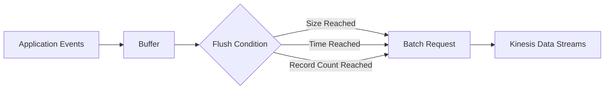
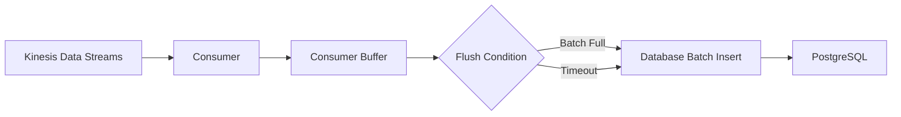
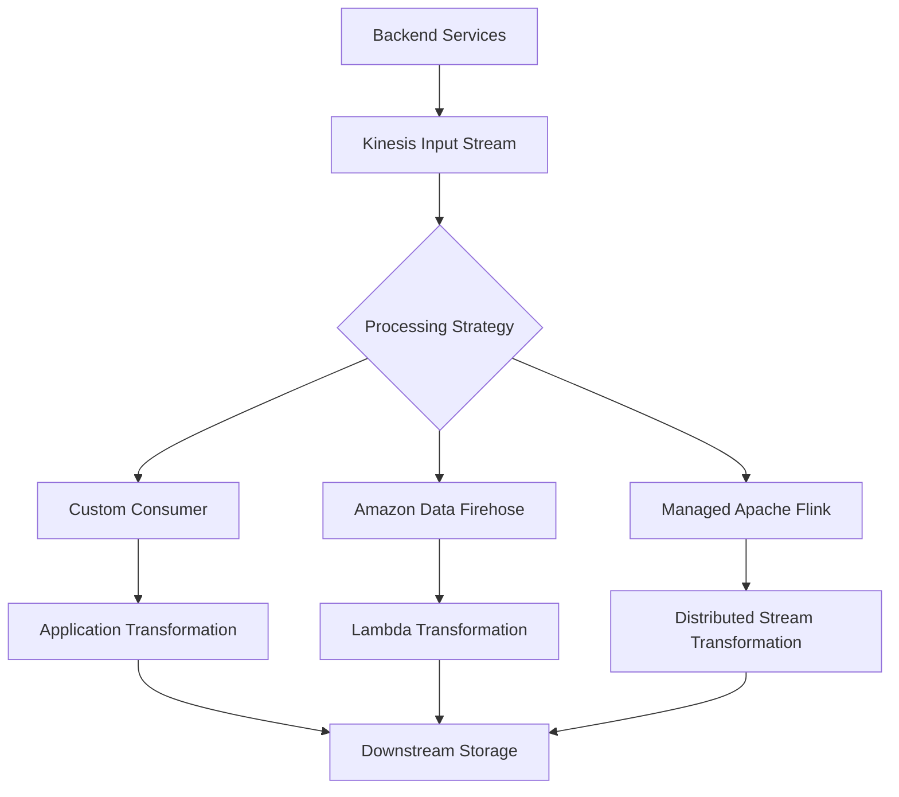
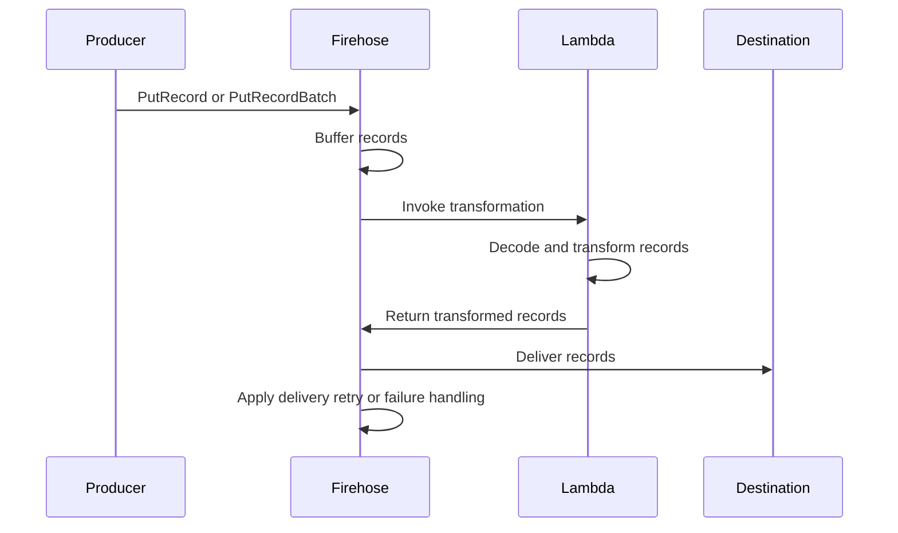

# 07- Buffering and Data Transformation

## Overview

Buffering and data transformation are essential parts of a production streaming architecture. Buffering controls when records are accumulated and delivered, while transformation converts incoming records into formats and structures required by downstream systems.

In Amazon Kinesis architectures, these responsibilities can exist at several layers:

- **Producer buffering:** Accumulate records before sending them to Kinesis.
- **Producer aggregation:** Combine multiple application records into fewer Kinesis records.
- **Consumer buffering:** Accumulate records before processing or writing them downstream.
- **Firehose buffering:** Accumulate incoming records before delivering them to destinations such as Amazon S3.
- **Transformation:** Validate, filter, enrich, normalize, or convert records before downstream consumption.

These mechanisms solve different problems. Producer batching reduces API request overhead, aggregation reduces the number of Kinesis records, and Firehose buffering controls destination delivery frequency and object size.

A reliable design must balance latency, throughput, memory consumption, request costs, downstream capacity, and failure recovery.

## Buffering Fundamentals

Buffering temporarily stores records before processing or delivery.

Instead of sending every event individually, a producer or processing component can accumulate records and flush them when a configured condition is met.

Common flush conditions include:

- Maximum number of records.
- Maximum accumulated payload size.
- Maximum time since the first buffered record.
- Explicit application shutdown or flush request.
- A downstream processing requirement.

### Why Buffering Matters

Consider a backend service publishing 10,000 events per second.

Sending every event through an individual API request can create unnecessary request overhead, connection pressure, and service throttling.

A batching strategy can accumulate records and submit them together.



Buffering can improve:

- Request efficiency.
- Network utilization.
- Throughput.
- Downstream write efficiency.
- Storage object sizes.
- Cost efficiency when request or object overhead is significant.

However, buffering introduces additional latency and memory requirements.

### Common Buffering Strategies

| Strategy | Flush condition | Typical use |
|---|---|---|
| Size-based | Buffer reaches a byte threshold | Control batch size |
| Count-based | Buffer reaches a record threshold | Limit records per request |
| Time-based | Maximum waiting interval expires | Bound delivery delay |
| Hybrid | Any configured threshold is reached | Production streaming pipelines |

A hybrid strategy is generally appropriate for production systems because it prevents buffers from growing indefinitely while also limiting how long low-volume records remain pending.

### Buffering Trade-offs

| Larger buffers | Smaller buffers |
|---|---|
| Fewer requests | More frequent requests |
| Better batching efficiency | Lower batching delay |
| Potentially higher throughput | Lower memory requirement |
| Larger retry units | Smaller retry units |
| Higher delivery latency | Lower delivery latency |
| Potentially larger failure impact | Smaller individual failure impact |

The correct buffer size depends on the destination, traffic profile, latency objective, and recovery strategy.

## Producer-Side Buffering

Producer-side buffering accumulates application events before publishing them to Kinesis Data Streams.

It is useful when an application generates events faster than it should or can efficiently submit individual API requests.

### Direct Publishing

A simple producer can publish individual records using `PutRecord`.

```python
import json

import boto3


kinesis = boto3.client("kinesis", region_name="ap-south-1")


def publish_event(
    stream_name: str,
    partition_key: str,
    event: dict,
) -> dict:
    response = kinesis.put_record(
        StreamName=stream_name,
        PartitionKey=partition_key,
        Data=json.dumps(event).encode("utf-8"),
    )

    return {
        "shard_id": response["ShardId"],
        "sequence_number": response["SequenceNumber"],
    }
```

This approach is straightforward, but one API request is made for every event.

For high-volume workloads, request overhead can become significant.

### Batch Publishing with PutRecords

Kinesis Data Streams provides `PutRecords` to publish multiple records in one API request.

Important limits include:

- Up to 500 records per request.
- Maximum request size of 10 MiB.
- Each individual Kinesis record can be up to 10 MiB.
- Each record must include a partition key.

The request-size limit applies to the complete request, not just the sum of application payloads. Account for partition-key and protocol overhead when constructing batches.

Example:

```python
import json

import boto3
from botocore.exceptions import BotoCoreError, ClientError


kinesis = boto3.client("kinesis", region_name="ap-south-1")


def publish_batch(
    stream_name: str,
    events: list[dict],
) -> dict:
    if not events:
        return {"successful": 0, "failed": 0}

    records = [
        {
            "Data": json.dumps(event).encode("utf-8"),
            "PartitionKey": str(event["merchant_id"]),
        }
        for event in events
    ]

    if len(records) > 500:
        raise ValueError("PutRecords supports at most 500 records")

    try:
        response = kinesis.put_records(
            StreamName=stream_name,
            Records=records,
        )
    except (ClientError, BotoCoreError):
        raise

    failed_records = [
        {
            "event": events[index],
            "error_code": result.get("ErrorCode"),
            "error_message": result.get("ErrorMessage"),
        }
        for index, result in enumerate(response["Records"])
        if "ErrorCode" in result
    ]

    return {
        "successful": response["Records"] and (
            len(events) - response["FailedRecordCount"]
        ) or 0,
        "failed": response["FailedRecordCount"],
        "failed_records": failed_records,
    }
```

`PutRecords` can return a successful HTTP response while individual records fail.

Always inspect `FailedRecordCount` and the corresponding entries in `Records`.

A successful API request does not mean every record was accepted.

### Partial Failure Handling

When a batch contains multiple records, some can succeed while others fail.

For example:

```text
Submitted records: 100

Successful:        96
Failed:             4
```

Retrying the entire batch can duplicate the 96 successful records.

A producer should retry only failed records.

A production retry strategy should include:

- Bounded retry attempts.
- Exponential backoff.
- Random jitter.
- Classification of retryable and non-retryable failures.
- A durable failure path when retries are exhausted.
- Stable event identifiers for downstream deduplication.

Example retry logic:

```python
import random
import time

import boto3
from botocore.exceptions import BotoCoreError, ClientError


kinesis = boto3.client("kinesis", region_name="ap-south-1")


def publish_with_retries(
    stream_name: str,
    events: list[dict],
    max_attempts: int = 5,
) -> None:
    pending = [
        {
            "Data": event["payload"],
            "PartitionKey": event["partition_key"],
        }
        for event in events
    ]

    for attempt in range(max_attempts):
        if not pending:
            return

        try:
            response = kinesis.put_records(
                StreamName=stream_name,
                Records=pending,
            )
        except (ClientError, BotoCoreError):
            if attempt == max_attempts - 1:
                raise

            delay = min(2 ** attempt, 30) + random.uniform(0, 1)
            time.sleep(delay)
            continue

        pending = [
            record
            for record, result in zip(
                pending,
                response["Records"],
            )
            if "ErrorCode" in result
        ]

        if pending and attempt < max_attempts - 1:
            delay = min(2 ** attempt, 30) + random.uniform(0, 1)
            time.sleep(delay)

    if pending:
        raise RuntimeError(
            f"{len(pending)} records were not published "
            f"after {max_attempts} attempts"
        )
```

This example demonstrates partial-failure handling, but a production implementation should also classify errors and persist exhausted records rather than losing them when the process terminates.

**Ordering consideration:** `PutRecords` does not guarantee ordering for records in a batch. Retrying failed records can also change their relative order. If strict per-key ordering is required, use an appropriate ordered publishing strategy such as sequential `PutRecord` calls or a producer implementation designed to preserve ordering.

## Producer Aggregation

Batching and aggregation are related but different operations.

### Batching

Batching combines multiple Kinesis records into one API request.

```text
Application records
        |
        v
PutRecords request
        |
        +---- Kinesis record 1
        +---- Kinesis record 2
        +---- Kinesis record 3
```

The request contains multiple independent Kinesis records.

### Aggregation

Aggregation combines multiple application-level user records into a single Kinesis record.

```text
Application records
        |
        v
Aggregation
        |
        v
Single Kinesis record
        |
        v
Kinesis Data Streams
```

The consumer must understand the aggregation format and extract the original user records.

### Kinesis Producer Library

The Kinesis Producer Library (KPL) provides advanced producer-side capabilities, including:

- Record aggregation.
- Request batching.
- Asynchronous publishing.
- Configurable buffering.
- Automatic retries.
- Metrics and monitoring.

KPL can aggregate multiple user records into a single Kinesis record and can collect multiple Kinesis records into a `PutRecords` request.

This improves efficiency when applications produce many relatively small events.

Important configuration concepts include:

| Configuration | Purpose |
|---|---|
| Record maximum buffer time | Maximum time records can wait before sending |
| Aggregation maximum count | Maximum user records in an aggregated record |
| Aggregation maximum size | Maximum aggregation payload size |
| Collection maximum count | Maximum Kinesis records in a request |
| Collection maximum size | Maximum request collection size |

Exact supported configuration names and defaults depend on the KPL version.

### Aggregation Considerations

Aggregation reduces the number of Kinesis records, which can improve throughput when record-count limits are the bottleneck.

However, it introduces additional considerations:

- Consumers must deaggregate records.
- Aggregated records can contain multiple application events.
- A single Kinesis record can contain multiple logical records.
- Record-level processing and error handling become more complex.
- Aggregation changes the relationship between Kinesis sequence numbers and application events.

KCL provides integration for KPL deaggregation in supported configurations. Custom consumers must explicitly handle the aggregation format.

Do not assume that a consumer reading Kinesis records automatically receives the original application-level records when the producer uses KPL aggregation.

## Consumer-Side Buffering

Consumers can buffer records after reading them from Kinesis.

This is useful when downstream processing or storage benefits from larger batches.

For example, a consumer may read events from Kinesis and accumulate them before writing to PostgreSQL or another destination.



### Why Consumer Buffering Matters

Suppose a consumer receives 1,000 events per second.

Writing each event individually to a database may create unnecessary transaction overhead.

Instead, the consumer can:

1. Read a batch of records.
2. Deserialize and validate the records.
3. Add valid records to a buffer.
4. Flush when a size or time threshold is reached.
5. Persist the results.
6. Advance the consumer checkpoint or processing position only after the required durability conditions are met.

### Consumer Buffering with Python

A simplified asynchronous buffering pattern can be implemented using `asyncio`.

```python
import asyncio
from collections.abc import Awaitable, Callable


class AsyncBatchBuffer:
    def __init__(
        self,
        flush_callback: Callable[[list[dict]], Awaitable[None]],
        max_records: int = 500,
        flush_interval: float = 2.0,
    ) -> None:
        if max_records < 1:
            raise ValueError("max_records must be positive")

        if flush_interval <= 0:
            raise ValueError("flush_interval must be positive")

        self.flush_callback = flush_callback
        self.max_records = max_records
        self.flush_interval = flush_interval
        self.records: list[dict] = []
        self.lock = asyncio.Lock()

    async def add(self, record: dict) -> None:
        async with self.lock:
            self.records.append(record)

            if len(self.records) >= self.max_records:
                await self._flush_locked()

    async def _flush_locked(self) -> None:
        if not self.records:
            return

        batch = self.records
        self.records = []

        try:
            await self.flush_callback(batch)
        except Exception:
            self.records = batch + self.records
            raise

    async def flush(self) -> None:
        async with self.lock:
            await self._flush_locked()
```

This example illustrates count-based buffering and explicit flushing. A production implementation also needs a background timer, byte-size limits, bounded memory, shutdown coordination, retry handling, and durable recovery.

Holding a lock while performing a slow downstream write can block producers. A more advanced implementation should use a dedicated batch worker and a bounded queue to separate event ingestion from downstream writes.

### Consumer Acknowledgment and Checkpointing

Consumer buffering introduces an important reliability concern: when is a record considered successfully processed?

Consider this sequence:

```text
1. Read records from Kinesis.
2. Add records to an in-memory buffer.
3. Advance the checkpoint.
4. Application crashes before the database write.
```

The application may lose records because its source position has advanced before the buffered data is durable.

The correct processing order depends on the consumer framework, but the underlying principle is consistent:

**Do not advance a durable processing checkpoint beyond work that the application cannot safely recover.**

For KCL-based consumers, checkpoint only after the corresponding records have been processed successfully.

For Flink applications, use the checkpoint and sink guarantees supported by the configured connectors.

For custom consumers, persist processing progress only after the required downstream durability conditions are satisfied.

## Amazon Data Firehose Buffering

Amazon Data Firehose, previously known as Kinesis Data Firehose, provides managed buffering and delivery to supported destinations.

It is particularly useful when records need to be delivered to S3, Amazon Redshift, OpenSearch, or supported third-party destinations without building and operating a custom delivery worker.

Firehose buffers incoming records before delivering them to the configured destination.

### Buffering Hints

Firehose supports two primary buffering hints:

- Buffer size.
- Buffer interval.

A delivery operation can be triggered when the configured buffering conditions are reached.

The actual delivery behavior depends on the destination and service implementation. Buffering hints are not strict latency guarantees.

For supported destinations, buffer-size configuration is commonly expressed in MiB and buffer-interval configuration in seconds. Exact supported ranges and defaults should be checked for the selected destination and current service configuration.

### Buffer Size

Buffer size controls how much data Firehose accumulates before delivery.

Larger buffers can produce:

- Fewer destination writes.
- Larger S3 objects.
- Lower per-object overhead.
- More efficient downstream analytical processing.

However, they can increase the time records remain buffered.

### Buffer Interval

Buffer interval controls the maximum configured waiting period before Firehose attempts delivery.

A shorter interval can reduce delivery latency but may produce smaller objects.

A longer interval can improve batching efficiency but increases the delay before records become available at the destination.

### Buffering Example

```text
Incoming records
       |
       v
Amazon Data Firehose
       |
       v
Buffering
       |
       +---- Size threshold reached
       |
       +---- Time threshold reached
       |
       v
Delivery attempt
       |
       v
Amazon S3
```

For example, an analytics pipeline may prefer larger S3 objects to reduce object-listing overhead and improve downstream processing efficiency.

A near-real-time operational pipeline may use a shorter buffer interval to reduce data availability delay.

### Firehose Configuration with AWS CLI

A Firehose delivery stream can be configured with buffering hints for an S3 destination.

The following is an illustrative portion of a delivery-stream configuration:

```json
{
  "ExtendedS3DestinationConfiguration": {
    "BucketARN": "arn:aws:s3:::company-analytics-data",
    "RoleARN": "arn:aws:iam::123456789012:role/FirehoseDeliveryRole",
    "Prefix": "events/year=!{timestamp:yyyy}/month=!{timestamp:MM}/day=!{timestamp:dd}/",
    "BufferingHints": {
      "SizeInMBs": 64,
      "IntervalInSeconds": 300
    },
    "CompressionFormat": "GZIP"
  }
}
```

This configuration illustrates a 64 MiB size hint and a 300-second interval hint.

It does not guarantee that every object will contain exactly 64 MiB or that delivery will occur precisely after 300 seconds. Low traffic, destination behavior, service limits, and delivery processing can affect actual results.

### Buffering and S3 Object Size

Firehose buffering directly affects the number and size of S3 objects.

Consider a pipeline receiving 1 MiB of data per second.

| Buffer interval | Approximate incoming data |
|---|---:|
| 60 seconds | 60 MiB |
| 300 seconds | 300 MiB |
| 600 seconds | 600 MiB |

Actual object sizes depend on the configured size threshold, destination behavior, and other service constraints.

Very small objects can create performance problems for downstream analytical systems.

For example, an S3 data lake containing millions of tiny Parquet or JSON objects can increase metadata overhead and reduce query efficiency.

Buffering should therefore be designed together with:

- File format.
- Compression.
- Partitioning strategy.
- Expected data volume.
- Downstream query engine.
- Data availability requirements.

## Data Transformation

Data transformation converts incoming events into a structure suitable for downstream processing.

Common transformation operations include:

| Transformation | Purpose | Example |
|---|---|---|
| Validation | Reject malformed records | Validate required event fields |
| Filtering | Remove unwanted records | Ignore debug events |
| Normalization | Standardize representation | Convert timestamps to UTC |
| Enrichment | Add external or reference data | Add merchant metadata |
| Projection | Select required fields | Remove unused attributes |
| Conversion | Change data representation | JSON to Parquet |
| Aggregation | Combine multiple events | Calculate transactions per minute |
| Masking | Protect sensitive fields | Remove personal identifiers |

Transformation can happen at different points in a Kinesis architecture.

### Transformation Placement

| Component | Transformation responsibility |
|---|---|
| Producer application | Validate and normalize events before publishing |
| Kinesis Data Streams consumer | Apply custom application processing |
| Amazon Data Firehose | Apply supported Lambda transformations and format conversion |
| Managed Service for Apache Flink | Perform distributed stateful and event-time transformations |

Kinesis Data Streams is a durable streaming service. It does not automatically transform records when they are written to a stream.

Transformation must be implemented by producers, consumers, Firehose, Flink, or another processing component.

### Transformation Architecture



Choose the transformation layer according to the complexity of the processing requirement.

For example:

- Basic schema normalization can happen in the producer.
- Destination-specific record formatting can happen in Firehose.
- Stateful aggregation and event-time processing belong in Flink.
- Application-specific database writes can be handled by a dedicated consumer.

Avoid implementing the same transformation independently in several services without a clear ownership model.

## Firehose Lambda Transformation

Firehose supports Lambda-based record transformation for supported delivery configurations.

The Lambda function receives a batch of records, transforms them, and returns the results to Firehose.

This is useful for:

- JSON normalization.
- Field projection.
- Sensitive-field masking.
- Lightweight enrichment.
- Record filtering.
- Format preparation.

### Transformation Lifecycle



### Lambda Event Structure

Firehose sends a batch containing records with identifiers and Base64-encoded data.

Example input:

```json
{
  "invocationId": "invocation-001",
  "deliveryStreamArn": "arn:aws:firehose:ap-south-1:123456789012:deliverystream/transactions",
  "region": "ap-south-1",
  "records": [
    {
      "recordId": "record-001",
      "approximateArrivalTimestamp": 1795083330000,
      "data": "eyJtZXJjaGFudF9pZCI6Im1lcmNoYW50LTQyIn0="
    }
  ]
}
```

The `data` field contains Base64-encoded record data.

### Lambda Response Structure

Each returned record must preserve its original `recordId`.

The transformation result must be one of:

| Result | Meaning |
|---|---|
| `Ok` | Transformation succeeded |
| `Dropped` | Record is intentionally discarded |
| `ProcessingFailed` | Transformation failed |

Example response:

```json
{
  "records": [
    {
      "recordId": "record-001",
      "result": "Ok",
      "data": "eyJtZXJjaGFudF9pZCI6Im1lcmNoYW50LTQyIiwiZW52aXJvbm1lbnQiOiJwcm9kdWN0aW9uIn0="
    }
  ]
}
```

Returning an invalid response or failing to preserve record identifiers can cause Firehose transformation failures.

### Python Lambda Transformation Example

The following function adds a normalized environment field to incoming JSON records.

```python
import base64
import json
from typing import Any


def lambda_handler(event: dict[str, Any], context: Any) -> dict:
    transformed_records = []

    for record in event["records"]:
        record_id = record["recordId"]

        try:
            raw_data = base64.b64decode(
                record["data"],
                validate=True,
            )

            payload = json.loads(raw_data)

            if not isinstance(payload, dict):
                raise ValueError("Expected a JSON object")

            payload["environment"] = "production"

            transformed_data = json.dumps(
                payload,
                separators=(",", ":"),
            ).encode("utf-8")

            transformed_records.append(
                {
                    "recordId": record_id,
                    "result": "Ok",
                    "data": base64.b64encode(
                        transformed_data
                    ).decode("ascii"),
                }
            )

        except (
            ValueError,
            UnicodeDecodeError,
            json.JSONDecodeError,
        ):
            transformed_records.append(
                {
                    "recordId": record_id,
                    "result": "ProcessingFailed",
                    "data": record["data"],
                }
            )

    return {"records": transformed_records}
```

This example performs basic validation and transformation. Production implementations should also consider:

- Lambda timeout and memory configuration.
- Batch size and processing duration.
- Dependency packaging.
- Schema validation.
- Transformation failure metrics.
- Sensitive-data handling.
- Dead-letter or backup delivery configuration.
- Maximum supported record and invocation payload sizes.

Do not silently classify malformed business events as successful transformations.

### Lambda Transformation Limitations

Lambda transformation is not a replacement for a full stream-processing engine.

It is appropriate for record-level transformations that can be executed independently.

It is not the right place for:

- Long-running stateful aggregation.
- Complex event-time windowing.
- Large-scale joins requiring persistent distributed state.
- Cross-record ordering guarantees.
- Workloads requiring arbitrary historical event correlation.

Use Managed Service for Apache Flink when these requirements exist.

## Data Format Conversion

Firehose can convert supported JSON records into columnar formats such as Apache Parquet and ORC for supported destinations and configurations.

This is useful for analytical workloads because columnar formats can reduce storage and query costs.

### JSON vs. Parquet

| Property | JSON | Parquet |
|---|---|---|
| Structure | Text-based | Columnar binary |
| Human readability | High | Low |
| Storage efficiency | Often lower | Often higher |
| Compression | Supported | Supported |
| Analytical query efficiency | Depends on engine | Often better for column pruning |
| Schema handling | Flexible but inconsistent | Requires compatible schema metadata |

### Schema Management

Firehose can use AWS Glue Data Catalog schemas for supported format-conversion configurations.

A production schema strategy should define:

- Field names and types.
- Required and optional fields.
- Schema versioning.
- Compatibility rules.
- Handling of missing fields.
- Handling of unexpected fields.
- Timestamp and decimal representation.

Do not assume that changing a JSON producer payload automatically produces a compatible Parquet schema.

Schema changes must be coordinated with the Glue schema and downstream consumers.

## Dynamic Partitioning and Buffering

Dynamic partitioning allows Firehose to route records into S3 prefixes based on values extracted from record content or configured expressions.

For example:

```text
s3://company-analytics-data/
    year=2026/
        month=11/
            day=19/
                merchant=merchant-42/
```

This can improve query efficiency when downstream systems filter data by the corresponding partition keys.

However, partitioning affects buffering behavior.

Firehose maintains buffers for active partitions. A large number of active partitions can increase buffering and resource requirements and may reach active-partition quotas.

### Partition Cardinality

Consider two partition strategies.

**Low-cardinality partitioning:**

```text
year/month/day
```

This produces a manageable number of active partitions.

**High-cardinality partitioning:**

```text
year/month/day/merchant_id/device_id/transaction_id
```

This can produce a very large number of active partitions and many small files.

Recommended practices:

- Partition by attributes frequently used in analytical queries.
- Avoid transaction IDs and other high-cardinality fields as partition keys.
- Estimate active partition counts using peak traffic.
- Monitor active-partition limits and delivery failures.
- Use a compaction strategy when small files are unavoidable.

Partition design should balance query efficiency against ingestion and storage overhead.

## Transformation Reliability

Transformation introduces failure modes that must be handled explicitly.

### Failure Categories

| Failure | Example | Recommended handling |
|---|---|---|
| Invalid input | Malformed JSON | Reject or route to a failure destination |
| Schema mismatch | Unexpected field type | Apply schema validation |
| Transformation timeout | Lambda execution exceeds timeout | Optimize or adjust capacity |
| Dependency failure | Enrichment API unavailable | Retry with bounded policy |
| Destination failure | S3 or downstream service unavailable | Use service retry and backup behavior |
| Partial batch failure | Some records fail transformation | Track individual record results |

### Idempotency

A transformation should ideally be deterministic.

For the same input event and transformation version, it should produce the same output unless the transformation intentionally depends on external state.

For example:

```text
Input event
    |
    v
Normalize timestamp
    |
    v
Mask sensitive fields
    |
    v
Produce normalized event
```

If the event is replayed, the transformation should not create an additional business side effect.

Avoid performing irreversible operations such as charging a payment or sending a notification inside a transformation function.

Keep transformations separate from business operations that require independent transaction and idempotency controls.

### Error Isolation

Do not allow one malformed event to unnecessarily fail an entire batch.

Where the processing framework supports per-record results, classify records independently.

Maintain a failure path containing enough metadata to investigate and replay rejected events.

A useful failure record includes:

- Original event identifier.
- Source stream or delivery stream.
- Processing timestamp.
- Transformation version.
- Failure category.
- Sanitized error details.
- Original payload or a secure reference to it.

Protect failure records with the same access controls and retention requirements as the source data.

## Backpressure and Buffer Management

Backpressure occurs when a downstream component cannot consume data as quickly as upstream components produce it.

Buffering can temporarily absorb bursts, but it cannot solve a sustained capacity mismatch.

Consider:

```text
Producer rate:       15,000 records/sec
Consumer capacity:   10,000 records/sec
```

The difference accumulates as consumer lag.

A larger in-memory buffer may delay failure, but it does not increase the consumer's processing capacity.

### Backpressure Mitigation

- Increase downstream processing capacity.
- Scale consumer parallelism where the workload allows it.
- Optimize expensive transformations.
- Batch database writes.
- Reduce unnecessary network requests.
- Use bounded queues and controlled concurrency.
- Apply backpressure to producers where possible.
- Monitor source lag and downstream latency.

### Bounded Buffers

Unbounded buffers can cause memory exhaustion during traffic spikes or downstream outages.

Use explicit limits for:

- Record count.
- Total buffered bytes.
- Maximum waiting time.
- Concurrent batch processing.
- Retry queue size.

Define what happens when a buffer is full.

Possible policies include:

- Apply producer backpressure.
- Reject new events.
- Persist pending data durably.
- Route records to a failure queue.
- Pause consumption when the consumer framework supports safe pausing.

Do not silently discard events to protect application memory unless data loss is an explicitly accepted business behavior.

## Monitoring and Observability

Buffering and transformation should be monitored independently from application availability.

A pipeline can remain operational while accumulating delivery delays or silently rejecting records.

### Producer Metrics

Monitor:

- Records submitted.
- Successful records.
- Failed records.
- Retry count.
- Request latency.
- Batch size.
- Aggregation ratio.
- Throttling errors.

### Consumer Metrics

Monitor:

- Records received.
- Records processed.
- Records rejected.
- Buffer size.
- Buffer age.
- Flush frequency.
- Downstream write latency.
- Consumer lag.
- Retry count.

### Firehose Metrics

Relevant Firehose metrics include:

| Metric | Purpose |
|---|---|
| `IncomingRecords` | Number of records received |
| `IncomingBytes` | Incoming data volume |
| `DeliveryToS3.Records` | Records delivered to S3 |
| `DeliveryToS3.Bytes` | Data delivered to S3 |
| `DeliveryToS3.DataFreshness` | Age of the oldest record in the delivery stream |
| `ExecuteProcessing.Success` | Successful transformation processing |
| `ExecuteProcessing.Errors` | Transformation errors |
| `ThrottledRecords` | Records affected by throttling |

Metric availability and dimensions depend on destination and configuration.

Use CloudWatch dashboards and alarms to detect:

- Increasing delivery freshness.
- Transformation errors.
- Unexpected record loss.
- Sustained consumer lag.
- Buffer growth.
- Destination throttling.
- Repeated producer retries.

### Structured Logging

For transformation failures, log enough context to identify the affected record without exposing sensitive payloads.

Example:

```json
{
  "level": "ERROR",
  "event": "record_transformation_failed",
  "event_id": "evt-10001",
  "transformation_version": "v3",
  "error_category": "schema_validation",
  "timestamp": "2026-11-19T10:15:30Z"
}
```

Use metrics for high-volume operational signals rather than generating one verbose log entry for every successful record.

## Security Considerations

Buffering and transformation components can temporarily hold sensitive event data.

Apply security controls throughout the pipeline.

### Access Control

Use least-privilege IAM permissions for:

- Writing to input streams.
- Reading from streams.
- Invoking transformation Lambdas.
- Accessing S3 destinations.
- Writing failure records.
- Accessing Glue schemas.
- Using KMS encryption keys.

Restrict resource access to the required streams, buckets, functions, and keys.

### Encryption

Use encryption in transit and at rest.

Review:

- Kinesis Data Streams encryption.
- S3 bucket encryption.
- KMS key policies.
- Lambda invocation permissions.
- TLS for external enrichment services.
- Encryption of failure and backup destinations.

### Sensitive Data Handling

Transformation functions are a suitable place to remove or mask fields that downstream systems do not require.

However:

- Do not rely on masking as the only access-control mechanism.
- Avoid logging raw event payloads.
- Restrict access to original records.
- Define retention for buffered and failed records.
- Ensure replay destinations are protected.
- Avoid placing credentials or secrets inside event payloads.

## Cost and Performance Optimization

Buffering and transformation affect several cost dimensions.

| Area | Cost or performance impact | Optimization |
|---|---|---|
| Producer API calls | Request overhead and throughput limits | Batch records |
| Record aggregation | Record-count efficiency | Use KPL where appropriate |
| Consumer writes | Database transaction overhead | Batch writes |
| Firehose delivery | Destination object and request overhead | Tune buffering |
| Lambda transformation | Invocation and compute cost | Optimize batch processing |
| S3 storage | Object count and storage volume | Use suitable formats and compression |
| Dynamic partitioning | Active partition overhead | Control cardinality |
| Logging | Ingestion and storage cost | Prefer metrics for high-volume signals |

### Buffer Tuning Approach

Use a measured tuning process:

1. Establish the required end-to-end latency.
2. Measure average and peak record sizes.
3. Estimate incoming throughput.
4. Select initial count, size, and time thresholds.
5. Measure actual batch sizes and flush frequency.
6. Monitor memory usage and downstream latency.
7. Test traffic bursts and destination outages.
8. Adjust thresholds based on observed behavior.

Do not optimize only for throughput. A configuration that produces excellent throughput but violates the business latency objective is not a successful design.

## Common Mistakes and Production Pitfalls

| Mistake | Why it causes problems | Recommended approach |
|---|---|---|
| Treating batching and aggregation as identical | They operate at different layers and change record handling differently | Understand API batching versus KPL aggregation |
| Retrying every record after a partial `PutRecords` failure | Successfully published records can be duplicated | Retry only failed entries |
| Assuming `PutRecords` preserves ordering | Batch publishing does not guarantee ordering | Use an ordering-aware publishing strategy |
| Using unbounded consumer buffers | Traffic spikes can exhaust application memory | Apply count and byte limits |
| Advancing checkpoints before downstream writes complete | A crash can cause data loss | Checkpoint only after safe processing |
| Setting Firehose buffers too large | Increases delivery delay | Tune against the latency objective |
| Setting Firehose buffers too small | Produces many small destination objects | Balance latency and object size |
| Assuming Firehose hints are exact delivery guarantees | Actual delivery depends on service and destination behavior | Monitor data freshness |
| Using high-cardinality S3 partitions | Creates excessive active partitions and small files | Partition by query-relevant dimensions |
| Treating Lambda transformation as a stream-processing engine | It lacks the same stateful event-time processing model | Use Flink for complex stream processing |
| Ignoring malformed records | Invalid data can repeatedly fail processing | Classify failures and provide a recovery path |
| Assuming successful transformation means successful delivery | Transformation and destination delivery are separate stages | Monitor both independently |

## Choosing the Right Buffering and Transformation Layer

Different AWS services and application components solve different parts of the problem.

| Requirement | Recommended component |
|---|---|
| Reduce individual producer API requests | `PutRecords` |
| Aggregate many small application records | Kinesis Producer Library |
| Accumulate records before database writes | Consumer-side bounded buffer |
| Deliver streaming records to S3 with managed buffering | Amazon Data Firehose |
| Normalize or filter Firehose records | Firehose Lambda transformation |
| Convert supported JSON records into Parquet or ORC | Firehose format conversion |
| Perform event-time aggregation | Managed Service for Apache Flink |
| Maintain distributed processing state | Apache Flink |
| Execute simple asynchronous business tasks | SQS consumer or application worker |

A production architecture can combine several of these mechanisms.

For example, backend services can batch-publish events to Kinesis, Flink can perform event-time aggregation, and Firehose can deliver processed records to S3 with destination-specific buffering.

Each component should have a clearly defined responsibility to avoid duplicated processing and inconsistent transformations.

## Key Takeaways

- Buffering improves request efficiency and downstream delivery, but introduces latency, memory requirements, and additional failure-handling responsibilities.
- `PutRecords` batches Kinesis records into API requests, while KPL aggregation combines multiple application records into a single Kinesis record.
- Firehose buffering hints control destination delivery behavior but do not guarantee exact delivery times or object sizes.
- Transformation can occur in producers, consumers, Firehose Lambda functions, or Flink; choose the layer according to processing complexity and state requirements.
- Production pipelines require bounded buffers, partial-failure handling, safe checkpointing, idempotency, monitoring, and a durable recovery path.