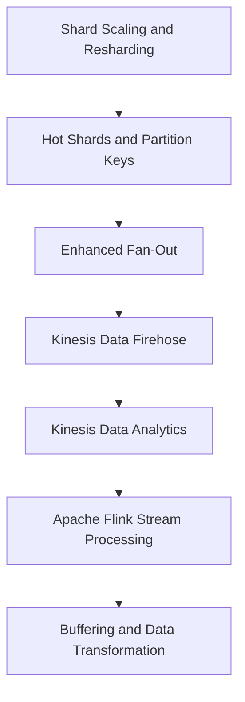
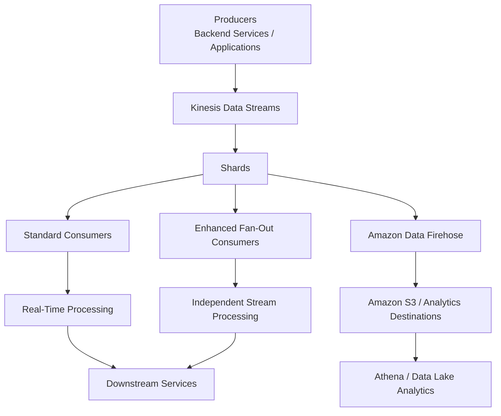
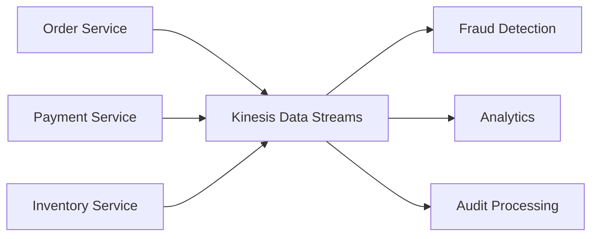
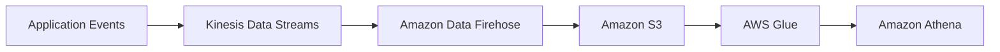
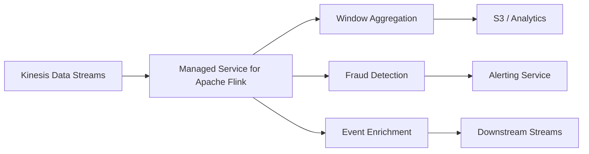

# README

## Overview

Amazon Kinesis is a collection of AWS services for collecting, processing, and delivering streaming data at scale.

This directory covers advanced Kinesis capabilities, including shard-level scaling, partition-key distribution, enhanced consumer throughput, managed data delivery, and real-time stream analytics.

These capabilities are important when building production data pipelines that process continuous event streams from backend services, applications, IoT devices, and infrastructure systems.

The documentation focuses on operational behavior, performance, reliability, and integration patterns used in modern backend and data engineering architectures.

## Documentation Structure

| File | Topic | Description |
|---|---|---|
| [01- Shard Scaling and Resharding.md](./01-%20Shard%20Scaling%20and%20Resharding.md) | Shard Scaling and Resharding | Explains shard capacity, scaling strategies, shard splits, merges, and operational considerations during resharding. |
| [02- Hot Shards and Partition Key Distribution.md](./02-%20Hot%20Shards%20and%20Partition%20Key%20Distribution.md) | Hot Shards and Partition Keys | Covers partition-key distribution, shard imbalance, hot partitions, key design, and throughput optimization. |
| [03- Enhanced Fan-Out.md](./03-%20Enhanced%20Fan-Out.md) | Enhanced Fan-Out | Explains dedicated consumer throughput, `SubscribeToShard`, HTTP/2 streaming, consumer registration, and independent consumption. |
| [04- Kinesis Data Firehose.md](./04-%20Kinesis%20Data%20Firehose.md) | Kinesis Data Firehose | Covers managed streaming delivery, buffering, transformation, compression, format conversion, and destination integration. |
| [05- Kinesis Data Analytics.md](./05-%20Kinesis%20Data%20Analytics.md) | Kinesis Data Analytics | Explains real-time stream processing with Apache Flink, event-time windows, watermarks, state management, checkpointing, and fault tolerance. |
| [06- Stream Processing with Apache Flink.md](./06-%20Stream%20Processing%20with%20Apache%20Flink.md) | Apache Flink Stream Processing | Covers Flink processing architecture, transformations, stateful operators, event-time processing, and production stream-processing patterns. |
| [07- Buffering and Data Transformation.md](./07-%20Buffering%20and%20Data%20Transformation.md) | Buffering and Data Transformation | Explains buffering strategies, batching, transformation pipelines, data serialization, throughput optimization, and delivery considerations. |

## Learning Path

Follow the documentation in sequence to understand how Kinesis workloads are scaled, consumed, processed, and delivered.

The sequence moves from stream capacity and partition design to consumer isolation, managed delivery, and advanced stream processing.

## Core Kinesis Architecture

Kinesis architectures commonly separate ingestion, processing, and delivery responsibilities.

### Core Components

| Component | Responsibility |
|---|---|
| Producer | Publishes records to a Kinesis stream. |
| Data Stream | Retains streaming records for consumption within its configured retention period. |
| Shard | Provides a unit of stream capacity and record distribution. |
| Partition Key | Determines how records are assigned to shards. |
| Consumer | Reads and processes records from the stream. |
| Enhanced Fan-Out Consumer | Receives dedicated read throughput through HTTP/2 streaming. |
| Data Firehose | Buffers and delivers streaming records to configured destinations. |
| Managed Service for Apache Flink | Runs stateful real-time stream-processing applications. |

## Key Engineering Concepts

### Shard Management

Shard count determines the capacity and parallelism available in a provisioned Kinesis Data Stream.

Shard scaling requires understanding:
- Read and write capacity.
- Partition-key distribution.
- Shard splits and merges.
- Consumer parallelism.
- Resharding impact on downstream applications.

### Partition-Key Distribution

Partition keys determine record placement across shards.

Poor key distribution can create hot shards even when the stream has sufficient aggregate capacity.

Production applications should select keys based on event distribution, ordering requirements, and expected throughput.

### Consumer Throughput

Standard consumers share shard-level read throughput. Enhanced Fan-Out provides dedicated read throughput to registered consumers.

Choose the consumption model based on:
- Number of consumers.
- Read throughput requirements.
- Latency objectives.
- Cost constraints.
- Consumer isolation requirements.

### Managed Data Delivery

Amazon Data Firehose simplifies delivery of streaming data to destinations such as S3, Redshift, and OpenSearch.

It manages buffering, batching, optional transformations, compression, and destination delivery.

### Real-Time Stream Processing

Managed Service for Apache Flink supports continuous processing of streaming data.

Important processing concepts include:
- Event time and processing time.
- Tumbling, sliding, and session windows.
- Watermarks and late events.
- Keyed and operator state.
- Checkpointing and recovery.
- Parallelism and backpressure.

## Common Backend Integration Patterns

### Microservices to Kinesis

Backend services publish domain events to Kinesis Data Streams.

Use this pattern when multiple independent consumers need access to a retained event stream.

### Kinesis to Data Lake

Firehose delivers streaming records to S3 for long-term storage and analytical workloads.

This separates real-time event ingestion from analytical storage and querying.

### Kinesis with Apache Flink

Flink continuously processes records and publishes derived results.

Use this pattern for stateful processing, event correlation, and low-latency analytics.

## Production Considerations

### Reliability

- Design consumers to tolerate duplicate processing.
- Persist consumer checkpoints where required.
- Handle shard splits and merges.
- Implement bounded retries with exponential backoff and jitter.
- Monitor consumer lag and processing failures.
- Define recovery and replay procedures.

### Scalability

- Distribute partition keys to avoid hot shards.
- Scale provisioned shard capacity according to measured workload requirements.
- Use Enhanced Fan-Out when consumers need dedicated throughput.
- Scale processing parallelism according to shard count and downstream capacity.
- Apply backpressure when downstream systems cannot sustain the incoming rate.

### Security

- Use least-privilege IAM policies.
- Encrypt streams and destination data.
- Apply KMS permissions carefully.
- Use IAM roles for applications running on AWS.
- Avoid logging sensitive event payloads.
- Restrict cross-account access through explicit resource policies.

### Monitoring

Monitor stream infrastructure and application-level processing.

| Area | Operational Focus |
|---|---|
| Ingestion | Incoming records, bytes, and write throttling |
| Shards | Capacity utilization and hot-shard behavior |
| Consumers | Read throughput, processing lag, and failures |
| Enhanced Fan-Out | Subscription health and consumer lag |
| Firehose | Delivery success, failures, and data freshness |
| Flink | Checkpoints, backpressure, state size, and processing latency |
| Destinations | Write failures, throughput, and storage growth |

Use CloudWatch metrics, structured logs, and application-level telemetry to identify bottlenecks across the pipeline.

### Cost Optimization

- Select shard capacity based on actual workload measurements.
- Avoid unnecessary registered Enhanced Fan-Out consumers.
- Tune Firehose buffering to reduce small-object overhead.
- Right-size Flink application capacity.
- Apply S3 lifecycle policies.
- Monitor data retention and storage costs.
- Review data transfer and downstream analytics costs.

## Repository Conventions

When adding or updating Kinesis documentation:

1. Place the document in this directory.
2. Preserve the existing numbered filename sequence.
3. Use descriptive filenames that identify the specific Kinesis capability.
4. Update this README with the new filename and a concise description.
5. Maintain relative links between related documents where useful.
6. Keep examples production-oriented and technically consistent with AWS service behavior.

## Key Takeaways

- Kinesis advanced capabilities address stream scaling, partition distribution, consumer isolation, managed delivery, and real-time processing.
- Partition-key design and shard capacity directly influence throughput and processing parallelism.
- Enhanced Fan-Out provides dedicated consumer throughput, while Firehose focuses on managed data delivery.
- Managed Service for Apache Flink supports stateful stream processing with event-time semantics and checkpoint-based recovery.
- Production Kinesis architectures require idempotent consumers, observability, security controls, capacity planning, and tested recovery procedures.