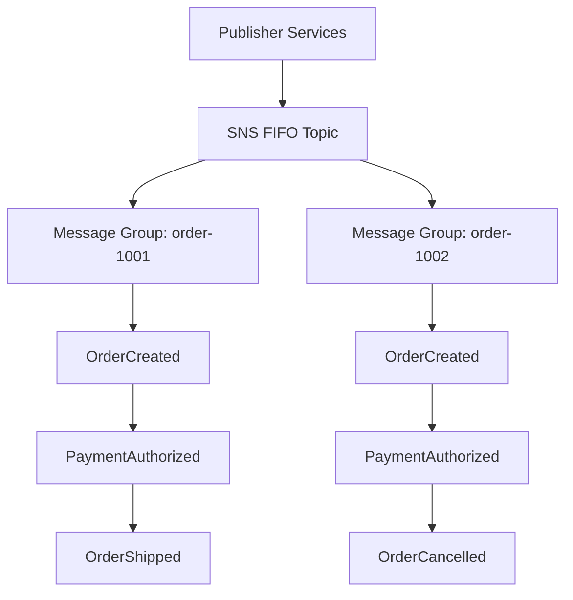
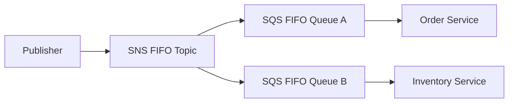
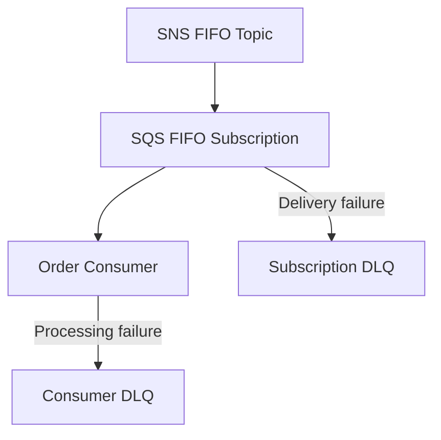

# 01- FIFO Topics and Message Ordering

## Overview

Amazon SNS FIFO (First-In-First-Out) topics provide ordered message delivery and deduplication for event-driven applications where the sequence of operations matters.

Unlike SNS Standard topics, which provide best-effort ordering and at-least-once delivery, FIFO topics preserve message order within a message group and suppress duplicate publications within a defined deduplication interval.

SNS FIFO topics are commonly used with Amazon SQS FIFO queues to build distributed workflows that require ordered event processing across multiple independent subscriber applications.

Typical use cases include:

- Bank transaction event distribution.
- Inventory updates.
- Product price changes.
- Order lifecycle events.
- Account balance processing.
- Flight status updates.
- Sequential business operations.

For example, an order-processing system may publish these events:

```text
OrderCreated
PaymentAuthorized
InventoryReserved
OrderShipped
OrderCompleted
```

Processing these events out of order can produce inconsistent application state. FIFO messaging helps preserve their intended sequence within a defined business entity.

SNS FIFO topics provide ordered fan-out, while SQS FIFO queues provide ordered message consumption. Both layers must be configured appropriately to preserve ordering through the complete messaging pipeline.

## SNS FIFO Topic Fundamentals

An SNS FIFO topic is a publish-subscribe messaging resource that supports:

- Message ordering within message groups.
- Message deduplication.
- Multiple subscribers.
- Message filtering.
- Integration with SQS FIFO and SQS Standard queues.
- Server-side encryption.
- High-throughput configuration.

FIFO topics have a `.fifo` suffix in their names.

Example:

```text
order-events.fifo
inventory-updates.fifo
payment-transactions.fifo
```

Unlike SNS Standard topics, FIFO topics cannot deliver directly to customer-managed endpoints such as HTTP/S endpoints, email addresses, SMS destinations, or mobile push endpoints.

They support SQS FIFO and SQS Standard subscriptions. If a Lambda function needs to consume FIFO topic messages, subscribe an SQS queue and configure the queue as the Lambda event source.

### SNS Standard vs. FIFO Topics

| Feature | Standard Topic | FIFO Topic |
|---|---|---|
| Ordering | Best effort | Strict within a message group |
| Deduplication | Best effort | Five-minute deduplication interval |
| Message groups | Not supported | Required |
| Message deduplication ID | Not required | Required unless content-based deduplication is enabled |
| SQS FIFO subscription | Supported | Supported |
| SQS Standard subscription | Supported | Supported |
| Direct Lambda subscription | Supported | Not supported |
| HTTP/S subscription | Supported | Not supported |
| Email and SMS | Supported | Not supported |
| High-throughput configuration | Standard topic throughput model | FIFO-specific throughput configuration |

A FIFO topic does not make every subscriber behave as a FIFO consumer. The subscription endpoint determines the delivery guarantees available to the receiving application.

## Message Ordering

Message ordering is the primary reason to use an SNS FIFO topic.

SNS preserves the order in which messages are published to the topic within each message group.

Consider an order-processing workflow:

```text
OrderCreated
PaymentAuthorized
InventoryReserved
OrderShipped
```

All four events should be published using the same message group ID when they belong to the same order.

SNS maintains their order within that group.

### Ordering Scope

Ordering is guaranteed within a message group, not globally across the entire topic.

Consider two orders:

```text
Order Group: order-1001
    OrderCreated
    PaymentAuthorized
    OrderShipped

Order Group: order-1002
    OrderCreated
    PaymentAuthorized
    OrderCancelled
```

SNS preserves the order of events for each order independently.

However, there is no guaranteed global ordering relationship between `order-1001` and `order-1002`.



This design allows independent business entities to be processed concurrently while preserving the sequence of events for each entity.

### Why Message-Level Ordering Is Not Global Ordering

A distributed messaging system must support parallel processing to scale.

If every message in a topic belonged to one global ordering sequence, all subscribers would be constrained by a single logical processing stream.

Message groups provide independent ordering boundaries.

For example:

| Message group | Messages | Ordering |
|---|---|---|
| `order-1001` | A, B, C | A → B → C |
| `order-1002` | D, E, F | D → E → F |
| `order-1003` | G, H | G → H |

The service can process different groups concurrently while maintaining ordering inside each group.

## Message Groups

A message group is a logical collection of messages that must be processed in order.

Every message published to an SNS FIFO topic must include a `MessageGroupId`.

The group ID determines the ordering boundary.

Common message group identifiers include:

- Order ID.
- Account ID.
- Customer ID.
- Product ID.
- Shipment ID.
- Device ID.

### Choosing a Message Group ID

The correct message group ID depends on the entity whose operations must remain ordered.

| Business requirement | Suggested group ID |
|---|---|
| Order lifecycle ordering | `order_id` |
| Account transaction ordering | `account_id` |
| Inventory update ordering | `product_id` |
| Device telemetry ordering | `device_id` |
| Customer activity ordering | `customer_id` |

For example, if payment events must be processed sequentially for each bank account, use the account identifier.

```python
message_group_id = "account-1001"
```

All events for that account belong to the same ordering group.

### Message Group Distribution

Message groups also influence throughput.

SNS FIFO topics can deliver messages from different groups in parallel. A topic with many distinct message groups can therefore achieve greater concurrency than a topic where all messages use one group ID.

Consider two designs.

**Single global message group:**

```text
MessageGroupId = "global"

All messages
    |
    v
Single ordered group
```

This preserves one global sequence but creates a throughput bottleneck.

**Entity-based message groups:**

```text
order-1001 -> Independent ordered sequence
order-1002 -> Independent ordered sequence
order-1003 -> Independent ordered sequence
order-1004 -> Independent ordered sequence
```

This supports parallel processing while preserving per-order ordering.

### Message Group Design Considerations

- Use a stable business identifier.
- Keep the group ID consistent across all events for the same entity.
- Avoid one global group unless global ordering is genuinely required.
- Avoid random group IDs when events for the same entity must remain ordered.
- Monitor traffic distribution across groups.
- Consider the ordering consequences before changing the grouping strategy.

Changing a message group ID changes the ordering boundary. Events for one business entity published under different group IDs no longer share the same FIFO sequence.

## Message Deduplication

SNS FIFO topics support message deduplication to prevent duplicate messages from being delivered to subscribed endpoints within a five-minute deduplication interval.

Deduplication is useful when a publisher retries a request because it did not receive a successful response.

For example:

1. A backend publishes an order event.
2. SNS accepts the message.
3. The network connection fails before the publisher receives the response.
4. The publisher retries the same logical event.
5. SNS identifies the duplicate using its deduplication ID.
6. The duplicate publication is accepted but not delivered again within the deduplication interval.

Deduplication helps prevent duplicate event publication caused by retry behavior.

It does not replace application-level idempotency.

### MessageDeduplicationId

A publisher can provide a `MessageDeduplicationId` with every message.

The identifier should represent the logical event rather than the publishing attempt.

Example:

```text
event_id = evt-order-1001-payment-authorized
```

If the publisher retries the same event, it should reuse the same deduplication ID.

If it generates a new ID for every retry, SNS treats the retry as a different message.

### Content-Based Deduplication

SNS FIFO topics support content-based deduplication.

When enabled, SNS generates a deduplication identifier by hashing the message body.

This removes the need to provide a deduplication ID for each publication.

Important behavior:

- The hash is calculated from the message body.
- Message attributes are not included in the hash.
- An explicitly supplied deduplication ID overrides the generated identifier.
- Two messages with identical bodies can be considered duplicates even if their message attributes differ.

For business events, explicit deduplication IDs are often preferable because they make event identity independent of payload formatting.

### Deduplication Example

Consider two publications:

```json
{
  "event_id": "evt-1001",
  "order_id": "order-1001",
  "status": "PAYMENT_AUTHORIZED"
}
```

Both publications use:

```text
MessageDeduplicationId = evt-1001
```

SNS recognizes the repeated deduplication ID within the configured deduplication scope and interval.

A different event should use a different identifier:

```text
MessageDeduplicationId = evt-1002
```

### Deduplication Scope

SNS FIFO topics support two deduplication scopes through the `FifoThroughputScope` topic attribute.

| Scope | Behavior |
|---|---|
| `Topic` | Deduplication applies across the entire topic |
| `MessageGroup` | Deduplication applies independently within each message group |

The scope affects how duplicate identifiers are evaluated.

For example, with `Topic` scope, publishing the same deduplication ID in two different message groups can result in the second publication being suppressed.

With `MessageGroup` scope, the same identifier can be used independently in different groups.

Choose the scope based on event identity and throughput requirements.

### Five-Minute Deduplication Window

SNS FIFO deduplication is time-bounded.

A repeated deduplication ID within the five-minute interval is suppressed according to the configured scope.

After that interval, the same identifier can be accepted as a new publication.

Therefore, deduplication does not provide permanent event uniqueness.

For critical business operations, maintain a durable event ID or idempotency key in the application database.

## FIFO Topic Throughput Modes

SNS FIFO topics support different throughput configurations.

The `FifoThroughputScope` topic attribute controls both throughput behavior and deduplication scope.

### Topic-Level Throughput

With:

```text
FifoThroughputScope = Topic
```

Deduplication is scoped to the entire topic.

This is the default configuration for FIFO topics and uses the topic-level throughput quota model.

It is appropriate when topic-wide deduplication is required and the workload fits within the applicable throughput quota.

### High-Throughput Mode

With:

```text
FifoThroughputScope = MessageGroup
```

Deduplication is scoped to individual message groups, enabling the high-throughput FIFO topic mode.

SNS distributes message groups across internal partitions and manages those partitions automatically.

The application should use many distinct message group IDs to distribute traffic effectively.

Important considerations:

- High-throughput mode changes deduplication scope.
- Throughput depends on regional service quotas and workload distribution.
- A single message group remains a constrained ordering boundary.
- Subscribed SQS FIFO queues should also be configured for high throughput when required.
- The setting cannot be reverted from `MessageGroup` to `Topic` after enabling high-throughput mode.

Configure the intended throughput scope during topic creation whenever possible.

### Throughput Comparison

| Configuration | Deduplication scope | Throughput characteristics |
|---|---|---|
| `Topic` | Entire topic | Topic-level quota model |
| `MessageGroup` | Individual message group | High-throughput mode with parallel message-group processing |

AWS service quotas can change and vary by Region. Check the current SNS service quotas before designing capacity around a specific messages-per-second target.

## Publishing Order with Multiple Producers

Multiple applications or threads can publish messages to the same SNS FIFO topic.

SNS establishes the sequence in which messages are accepted for each message group.

However, concurrent publishers introduce an important distinction:

**SNS preserves the order established by the service, not necessarily the business order intended by independent producers.**

Consider two application instances publishing events for the same order:

```text
Producer A:
    OrderCreated

Producer B:
    PaymentAuthorized
```

If both publish concurrently, the service determines the accepted sequence.

The application must coordinate publishing when the business workflow requires a specific sequence.

### Sequence Numbers

SNS assigns a sequence number to messages published to a FIFO topic.

The sequence number is a large, non-consecutive value associated with the message group.

It can help identify the order established by SNS.

Sequence numbers are useful for:

- Diagnosing ordering issues.
- Comparing accepted message sequences.
- Investigating concurrent publishers.
- Understanding message delivery behavior.

They are not application-generated business sequence numbers.

If a workflow requires a specific business sequence, include an explicit sequence or version field in the event payload.

Example:

```json
{
  "event_id": "evt-1002",
  "order_id": "order-1001",
  "event_sequence": 2,
  "event_type": "PAYMENT_AUTHORIZED"
}
```

The application can validate the expected business sequence independently of SNS ordering.

### Coordinating Publishers

If multiple services publish events for the same entity, consider:

- A single logical event producer for that entity.
- Database transaction sequencing.
- Transactional outbox patterns.
- Optimistic concurrency control.
- Explicit business sequence numbers.
- Durable event publication records.

SNS FIFO should not be treated as a substitute for coordinating concurrent business operations.

## Delivery to SQS Subscribers

SNS FIFO topics commonly fan out messages to multiple SQS queues.

Each subscription receives an independent copy of the published message, subject to its subscription configuration.

The queue type determines the guarantees available to the subscriber.

### SNS FIFO to SQS FIFO

When an SNS FIFO topic delivers to an SQS FIFO queue:

- Message order is preserved within each message group.
- The message group ID is passed to the queue.
- The deduplication ID is passed to the queue.
- The queue provides FIFO consumption semantics.
- Consumer processing must still handle failures and retries safely.



Each subscriber maintains its own queue and processing lifecycle.

The order of delivery to one subscriber does not establish an ordering relationship between different subscribers.

For example, the inventory queue may receive a message before the order-processing queue receives its copy. FIFO ordering is maintained independently within each subscriber queue.

### SNS FIFO to SQS Standard

SNS FIFO topics can also deliver to SQS Standard queues.

This is useful when a subscriber does not require FIFO ordering or deduplication and prefers Standard queue behavior.

However, the Standard queue provides:

- Best-effort ordering.
- At-least-once delivery.
- Possible duplicate messages.

The FIFO guarantees of the SNS topic do not carry through as strict end-to-end guarantees to an SQS Standard consumer.

### Subscription Comparison

| Subscription endpoint | Ordering | Duplicate behavior |
|---|---|---|
| SQS FIFO | Strict within message groups | FIFO deduplication behavior |
| SQS Standard | Best effort | At-least-once delivery |

For ordered business workflows, use SQS FIFO subscriptions.

## Message Filtering and Ordering

SNS FIFO topics support subscription filter policies.

Filtering allows each subscriber to receive only messages matching its requirements.

For example, a topic may publish order events while different subscribers receive only selected event categories.

Example message:

```json
{
  "event_id": "evt-1001",
  "order_id": "order-1001",
  "event_type": "PAYMENT_AUTHORIZED",
  "business": "retail"
}
```

A subscription can use a filter policy:

```json
{
  "business": ["retail"]
}
```

Another subscriber may use:

```json
{
  "business": ["wholesale"]
}
```

Filtering reduces unnecessary message processing in subscriber applications.

### Filtering and Delivery Guarantees

Filtering has an important implication for deduplication guarantees.

When subscription filtering is configured, SNS FIFO provides at-most-once delivery semantics for the filtered subscription behavior. Messages that do not match the filter are intentionally not delivered.

Therefore, do not assume that the end-to-end exactly-once delivery conditions associated with unfiltered SNS FIFO-to-SQS FIFO delivery still apply when subscription filtering is enabled.

Filtering also means subscribers can observe gaps in the original event sequence.

For example:

```text
Published:
    OrderCreated
    PaymentAuthorized
    InventoryReserved
    OrderShipped

Filtered subscriber receives:
    PaymentAuthorized
    OrderShipped
```

The subscriber receives the matching events in their relative order, but it does not receive every event in the original sequence.

If a subscriber requires the complete lifecycle, avoid filtering out events required for its state transitions.

## Practical Implementation with Python and Boto3

The following example publishes ordered order events to an SNS FIFO topic.

### Topic Creation

Create an SNS FIFO topic using the AWS CLI:

```bash
aws sns create-topic \
  --name order-events.fifo \
  --attributes \
    FifoTopic=true,\
ContentBasedDeduplication=false,\
FifoThroughputScope=MessageGroup \
  --region ap-south-1
```

The command creates a FIFO topic configured for message-group-level deduplication and high throughput.

For a workload requiring topic-wide deduplication, configure:

```text
FifoThroughputScope=Topic
```

### Publish an Ordered Message

```python
import json

import boto3
from botocore.exceptions import BotoCoreError, ClientError


sns = boto3.client("sns", region_name="ap-south-1")

TOPIC_ARN = (
    "arn:aws:sns:ap-south-1:123456789012:order-events.fifo"
)


def publish_order_event(event: dict) -> dict:
    required_fields = {
        "event_id",
        "order_id",
        "event_type",
        "event_sequence",
    }

    missing_fields = required_fields - event.keys()

    if missing_fields:
        raise ValueError(
            f"Missing required fields: {sorted(missing_fields)}"
        )

    message = json.dumps(
        event,
        separators=(",", ":"),
    )

    try:
        response = sns.publish(
            TopicArn=TOPIC_ARN,
            Message=message,
            MessageGroupId=event["order_id"],
            MessageDeduplicationId=event["event_id"],
            MessageAttributes={
                "event_type": {
                    "DataType": "String",
                    "StringValue": event["event_type"],
                }
            },
        )
    except (ClientError, BotoCoreError):
        raise

    return {
        "message_id": response["MessageId"],
        "sequence_number": response.get("SequenceNumber"),
    }
```

The important parameters are:

| Parameter | Purpose |
|---|---|
| `TopicArn` | Identifies the FIFO topic |
| `Message` | Event payload |
| `MessageGroupId` | Defines the ordering boundary |
| `MessageDeduplicationId` | Identifies duplicate logical publications |
| `MessageAttributes` | Provides additional message metadata |

The example uses `order_id` as the message group ID and `event_id` as the deduplication ID.

For retries of the same logical event, reuse the original `event_id`.

### Publishing a Sequence of Events

```python
events = [
    {
        "event_id": "evt-1001",
        "order_id": "order-1001",
        "event_type": "ORDER_CREATED",
        "event_sequence": 1,
    },
    {
        "event_id": "evt-1002",
        "order_id": "order-1001",
        "event_type": "PAYMENT_AUTHORIZED",
        "event_sequence": 2,
    },
    {
        "event_id": "evt-1003",
        "order_id": "order-1001",
        "event_type": "ORDER_SHIPPED",
        "event_sequence": 3,
    },
]

for event in events:
    result = publish_order_event(event)
    print(result)
```

Publishing sequentially from one producer helps preserve the intended order for that producer.

If multiple producers publish events for the same order, use application-level coordination to establish the correct business sequence.

## SQS FIFO Subscription Configuration

An SQS FIFO queue must also have a `.fifo` suffix.

Example:

```bash
aws sqs create-queue \
  --queue-name order-processing.fifo \
  --attributes \
    FifoQueue=true,\
ContentBasedDeduplication=false \
  --region ap-south-1
```

Subscribe the queue to the SNS FIFO topic:

```bash
aws sns subscribe \
  --topic-arn \
    arn:aws:sns:ap-south-1:123456789012:order-events.fifo \
  --protocol sqs \
  --notification-endpoint \
    arn:aws:sqs:ap-south-1:123456789012:order-processing.fifo \
  --region ap-south-1
```

The SQS queue policy must allow the SNS service principal to send messages.

Example policy:

```json
{
  "Version": "2012-10-17",
  "Statement": [
    {
      "Sid": "AllowSNSFIFO",
      "Effect": "Allow",
      "Principal": {
        "Service": "sns.amazonaws.com"
      },
      "Action": "sqs:SendMessage",
      "Resource": "arn:aws:sqs:ap-south-1:123456789012:order-processing.fifo",
      "Condition": {
        "ArnEquals": {
          "aws:SourceArn": "arn:aws:sns:ap-south-1:123456789012:order-events.fifo"
        }
      }
    }
  ]
}
```

Restricting `aws:SourceArn` prevents unrelated SNS topics from publishing to the queue.

For encrypted queues, configure the KMS key policy and required permissions for the delivery path.

## Consumer-Side Ordering

FIFO ordering at the queue does not automatically guarantee correct business processing.

The consumer must process messages according to the queue's ordering semantics.

For example, an order-processing consumer should not process `ORDER_SHIPPED` before `PAYMENT_AUTHORIZED`.

### SQS FIFO Consumer Behavior

SQS FIFO uses message groups to control concurrent processing.

Messages in the same group are processed sequentially, while different groups can be processed concurrently.

A consumer should:

1. Receive messages.
2. Process them successfully.
3. Persist the required business changes.
4. Delete the messages using their receipt handles.
5. Allow failed messages to become visible again after the visibility timeout.

Do not acknowledge a message before its business operation is durable.

### Visibility Timeout and Failures

If a consumer receives a message and fails before deleting it, the message can become visible again after the visibility timeout.

For FIFO queues, messages in the same group are affected by in-flight processing and blocking behavior.

A failed message can therefore delay later messages in the same group.

Configure:

- Appropriate visibility timeouts.
- Bounded processing retries.
- Dead-letter queues.
- Idempotent business operations.
- Monitoring for blocked message groups.

A poison message should not block an important business entity indefinitely.

### Lambda Consumers

An SQS FIFO queue can trigger a Lambda function through an event source mapping.

Lambda processes messages in a FIFO-aware manner and can process different message groups concurrently.

For reliable processing:

- Enable partial batch failure reporting where appropriate.
- Return failed message identifiers correctly.
- Avoid allowing later messages in a group to overtake a failed earlier message.
- Configure batch size and concurrency based on downstream capacity.
- Ensure business operations are idempotent.

For FIFO workloads, failure handling must preserve the required order within each message group.

## Exactly-Once Delivery vs. Exactly-Once Business Processing

SNS FIFO and SQS FIFO provide deduplication and ordered delivery capabilities, but these should not be confused with permanent exactly-once business execution.

The distinction is important.

### Messaging-Level Deduplication

SNS suppresses duplicate publications within its five-minute deduplication interval according to the configured scope.

SQS FIFO also supports message deduplication.

These mechanisms reduce duplicate message delivery.

### Consumer-Level Idempotency

Consider this workflow:

```text
1. Consumer receives payment event.
2. Consumer updates PostgreSQL.
3. Consumer crashes before deleting the SQS message.
4. SQS makes the message visible again.
5. Consumer receives the same event.
```

The database update may execute twice unless the operation is idempotent.

A durable event ID can prevent duplicate business processing.

Example PostgreSQL table:

```sql
CREATE TABLE processed_events (
    event_id VARCHAR(128) PRIMARY KEY,
    processed_at TIMESTAMPTZ NOT NULL DEFAULT NOW()
);
```

A transaction can insert the event ID and perform the business operation atomically.

```sql
BEGIN;

INSERT INTO processed_events (event_id)
VALUES ('evt-1001')
ON CONFLICT (event_id) DO NOTHING;

-- Execute the business operation only when the event ID
-- was newly inserted.

COMMIT;
```

In application code, check whether the insert actually created a row before applying the business operation. Keep both operations within the same database transaction.

For payment processing, inventory updates, and account balances, this application-level protection is essential.

## High Availability and Failure Handling

SNS FIFO topics are designed for durable, highly available messaging across Availability Zones.

However, end-to-end reliability depends on every part of the delivery path.

Important failure scenarios include:

| Failure | Potential impact | Recommended handling |
|---|---|---|
| Publisher timeout | Publisher may not know whether SNS accepted the message | Retry using the same deduplication ID |
| Invalid queue policy | SNS cannot deliver to the subscriber | Correct permissions and configure a subscription DLQ |
| SQS unavailable | Delivery may be delayed or fail temporarily | Monitor delivery failures and recovery |
| Consumer crash | Message may be received again | Use idempotent processing |
| Poison message | Blocks progress within a message group | Configure a DLQ and controlled recovery |
| Filter mismatch | Subscriber does not receive the event | Validate filter policies and event schemas |
| Incorrect group ID | Related events use different ordering boundaries | Use stable business identifiers |

### Subscription Dead-Letter Queues

SNS supports subscription-level dead-letter queues for messages that cannot be delivered to an endpoint after delivery attempts.

For an SNS FIFO topic subscribed to SQS FIFO, configure an appropriate FIFO dead-letter queue when preserving FIFO-compatible recovery behavior is required.

The subscription DLQ is different from the SQS source queue's own consumer dead-letter queue.



The two failure paths represent different stages:

- Subscription DLQ: SNS cannot deliver to the subscribed queue.
- Consumer DLQ: The queue consumer repeatedly fails to process a message.

Define a controlled redrive and replay process for both paths.

## Monitoring and Observability

Monitoring should cover publishing, topic delivery, queue consumption, and business processing.

### SNS Metrics

Important SNS metrics include:

| Metric | Purpose |
|---|---|
| `NumberOfMessagesPublished` | Messages successfully published |
| `NumberOfNotificationsDelivered` | Notifications delivered to subscribed endpoints |
| `NumberOfNotificationsFailed` | Failed delivery attempts |
| `PublishSize` | Published message size |
| `NumberOfNotificationsFilteredOut` | Messages not delivered because of filter policies |

Metric availability and dimensions can vary by topic type and configuration.

### SQS Metrics

Monitor subscriber queues using metrics such as:

- `ApproximateNumberOfMessagesVisible`
- `ApproximateNumberOfMessagesNotVisible`
- `ApproximateAgeOfOldestMessage`
- `NumberOfMessagesReceived`
- `NumberOfMessagesDeleted`

These metrics help identify queue growth, delayed processing, and consumer instability.

### Application Metrics

SNS and SQS metrics do not provide complete visibility into business processing.

Publish application-level metrics such as:

- Event processing latency.
- Duplicate event detection.
- Business sequence validation failures.
- Events processed per message group.
- Poison message count.
- Consumer retry count.
- Database transaction failures.

Include stable event IDs and business entity identifiers in structured logs.

Avoid high-cardinality metric dimensions such as raw order IDs or account IDs. Use logs and traces for entity-level investigation.

## Security Considerations

FIFO topics should follow the same security principles as other production messaging resources.

### IAM Permissions

Use separate IAM roles for publishers and consumers.

Publisher permissions should be limited to the required topic and publishing actions.

Consumer permissions should be limited to the required SQS queues.

The SNS delivery path must be authorized through the queue resource policy.

### Encryption

SNS FIFO topics support server-side encryption using AWS KMS keys.

SQS FIFO queues can also use server-side encryption.

Review:

- KMS key policies.
- Publisher permissions.
- SNS service access to the encryption key where required.
- SQS consumer decryption permissions.
- Key rotation and lifecycle policies.

### Private Connectivity

Use VPC endpoints with AWS PrivateLink where private access to SNS is required and supported by the workload.

Restrict access through endpoint policies and IAM policies.

### Message Protection

Do not place credentials, access tokens, or unnecessary sensitive information in message bodies.

Use encryption, access control, retention policies, and data minimization to protect business events.

## Performance and Scalability

FIFO ordering introduces a deliberate constraint: messages within one group must preserve their sequence.

Throughput therefore depends on how effectively the workload can be divided into independent groups.

### Scaling with Message Groups

Consider a system processing inventory updates for thousands of products.

Using the product ID as the message group ID allows independent product updates to be processed concurrently.

```text
product-1001 -> Ordered update stream
product-1002 -> Ordered update stream
product-1003 -> Ordered update stream
product-1004 -> Ordered update stream
```

This provides parallelism without sacrificing per-product ordering.

### Hot Message Groups

A hot message group receives a disproportionate volume of traffic.

For example:

```text
merchant-1001 -> 90% of all messages
merchant-1002 -> 5%
merchant-1003 -> 5%
```

The first group can become a throughput bottleneck even if the topic has sufficient overall capacity.

Mitigation strategies:

- Review the business ordering boundary.
- Distribute independent entities across separate groups.
- Avoid unnecessary global ordering.
- Monitor per-group traffic where application instrumentation permits.
- Increase subscriber processing capacity where possible.

Do not split one business entity across multiple message groups merely to increase throughput if doing so breaks required ordering.

### SNS FIFO vs. Kinesis Data Streams

Both services support ordered event processing, but their processing models differ.

| Capability | SNS FIFO | Kinesis Data Streams |
|---|---|---|
| Primary model | Pub/sub fan-out | Durable event streaming |
| Ordering boundary | Message group | Partition key and shard sequence |
| Multiple consumers | Independent subscriptions | Independent registered or shared-throughput consumers |
| Message retention | Delivery and subscription lifecycle | Configurable stream retention |
| Consumer replay | Not equivalent to stream retention and arbitrary offset replay | Supports reading from retained positions |
| Typical processing | Ordered business event distribution | Stateful stream processing and analytics |
| Consumer model | Queue-based subscribers | Stream consumers |

Use SNS FIFO when multiple subscriber applications need ordered copies of business events.

Use Kinesis Data Streams when consumers need retained records, stream replay, and sequential stateful processing over a partition key.

## Production Best Practices

- Use a stable business entity as the message group ID.
- Use explicit event IDs as deduplication IDs for important business events.
- Configure deduplication scope deliberately.
- Enable high-throughput mode only after understanding its message-group-level deduplication behavior.
- Use SQS FIFO subscriptions when strict end-to-end ordering is required.
- Keep SQS Standard subscriptions only for consumers that accept best-effort ordering and at-least-once delivery.
- Coordinate concurrent publishers when business ordering matters.
- Include business sequence numbers when consumers must validate event progression.
- Use durable consumer idempotency.
- Configure subscription and consumer dead-letter queues separately.
- Monitor delivery failures, queue age, retries, and business processing latency.
- Test publisher retries, consumer crashes, poison messages, and recovery procedures before production deployment.

## Common Mistakes and Production Pitfalls

| Mistake | Why it causes problems | Recommended approach |
|---|---|---|
| Assuming FIFO means global ordering | Ordering exists within each message group | Define the correct business ordering boundary |
| Using one global message group | Restricts parallelism and throughput | Use entity-based message groups where possible |
| Generating a new deduplication ID on every retry | SNS cannot recognize the retry as the same logical event | Reuse the original event ID |
| Assuming deduplication is permanent | The deduplication interval is five minutes | Maintain durable application idempotency |
| Using content-based deduplication without understanding its scope | Identical bodies can be treated as duplicates even when attributes differ | Use explicit deduplication IDs for business events |
| Assuming SQS Standard preserves FIFO ordering | Standard queues provide best-effort ordering | Use SQS FIFO for strict ordering |
| Assuming concurrent publishers preserve intended business order | SNS establishes the accepted sequence, not the application's intended sequence | Coordinate publishers and include business sequence numbers |
| Ignoring message filtering implications | Subscribers can miss events and filtering changes delivery guarantees | Design filter policies around consumer requirements |
| Assuming subscriber queues receive messages simultaneously | Delivery to each subscription is independent | Monitor and reconcile subscriber progress independently |
| Acknowledging messages before database commits | A crash can lose business updates | Commit durable work before deleting messages |
| Ignoring poison messages | A failed message can block later messages in its group | Configure DLQs and controlled recovery |
| Treating SNS deduplication as exactly-once business execution | Consumer retries can repeat external side effects | Use transactional idempotency |

## References

- [Amazon SNS FIFO Topics](https://docs.aws.amazon.com/sns/latest/dg/sns-fifo-topics.html)
- [SNS FIFO Message Delivery](https://docs.aws.amazon.com/sns/latest/dg/fifo-message-delivery.html)
- [SNS FIFO Message Grouping](https://docs.aws.amazon.com/sns/latest/dg/fifo-message-grouping.html)
- [SNS FIFO Message Ordering Details](https://docs.aws.amazon.com/sns/latest/dg/fifo-topic-message-ordering.html)
- [SNS FIFO Message Deduplication](https://docs.aws.amazon.com/sns/latest/dg/fifo-message-dedup.html)
- [High-Throughput SNS FIFO Topics](https://docs.aws.amazon.com/sns/latest/dg/fifo-high-throughput.html)
- [SNS FIFO Message Filtering](https://docs.aws.amazon.com/sns/latest/dg/fifo-message-filtering.html)
- [Amazon SQS FIFO Queues](https://docs.aws.amazon.com/AWSSimpleQueueService/latest/SQSDeveloperGuide/FIFO-queues.html)

## Key Takeaways

- SNS FIFO preserves message order within a `MessageGroupId`; it does not provide a global ordering guarantee across the topic.
- `MessageDeduplicationId` suppresses duplicate publications within a five-minute interval, but durable business idempotency must be implemented by consumers.
- Message group design controls both ordering boundaries and parallelism; high-throughput workloads benefit from many well-distributed groups.
- Strict end-to-end ordering requires SQS FIFO subscriptions and consumers that acknowledge messages only after successful processing.
- Concurrent publishers, subscription filtering, delivery failures, and poison messages must be handled explicitly to preserve business consistency.