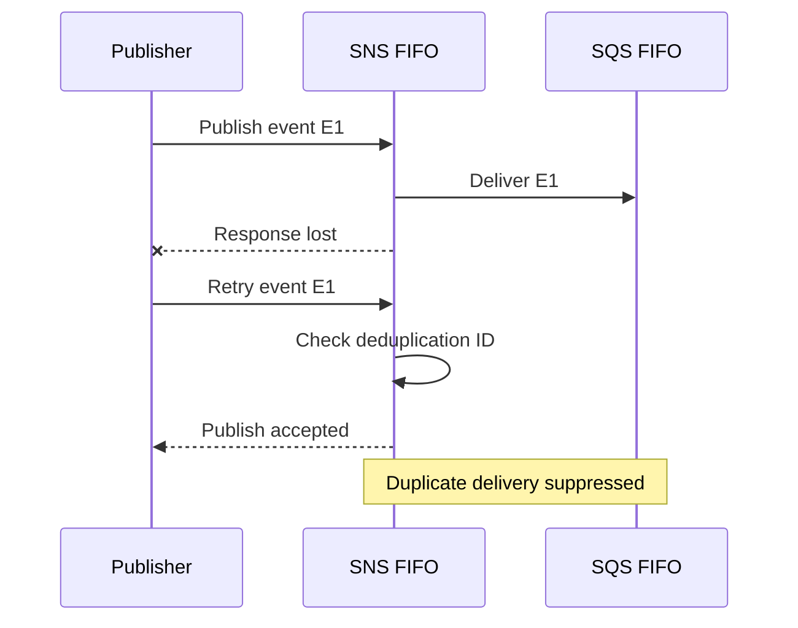
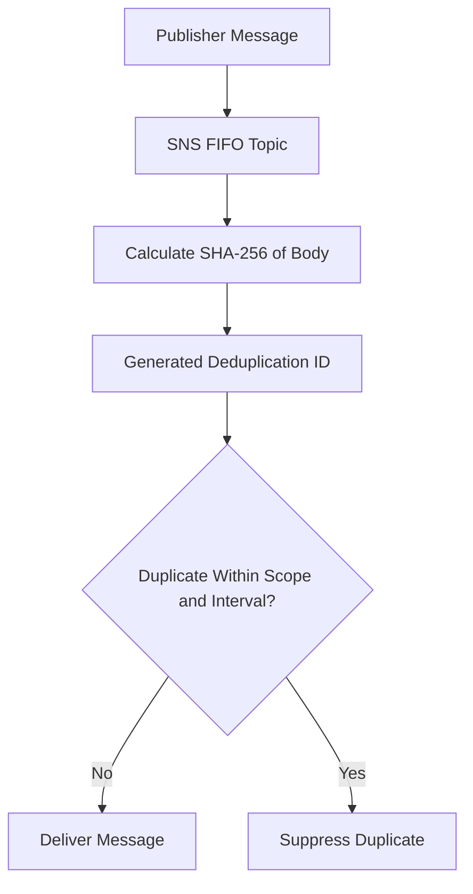
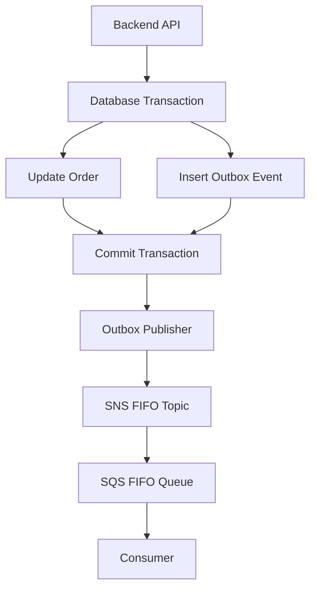
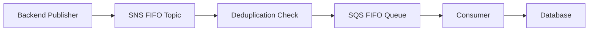

# 02- Message Deduplication

## Overview

Message deduplication prevents the same logical message from being delivered multiple times within a defined deduplication scope and interval.

In distributed systems, duplicate messages can occur even when applications use reliable messaging services. Network failures, request timeouts, publisher retries, consumer crashes, and uncertain acknowledgments can all cause the same event to be submitted or processed more than once.

Amazon SNS FIFO topics provide message deduplication to reduce duplicate publication and delivery. Publishers can identify messages explicitly using `MessageDeduplicationId`, or enable content-based deduplication so SNS generates an identifier from the message body.

SNS FIFO deduplication is particularly useful for:

- Financial transaction events.
- Inventory updates.
- Order lifecycle events.
- Account balance changes.
- Payment authorization events.
- Product price updates.
- Sequential business workflows.

However, SNS deduplication is not a replacement for application-level idempotency. Its deduplication interval is limited to five minutes, and it does not guarantee that external business side effects are executed exactly once under every failure scenario.

## Why Message Deduplication Is Necessary

A distributed application cannot always determine whether a remote service successfully processed a request when the response is lost.

Consider a backend service publishing an order event:

1. The application sends a message to SNS.
2. SNS accepts the message.
3. The network connection fails before the publisher receives the response.
4. The publisher cannot determine whether the message was accepted.
5. The application retries the publication.
6. SNS receives the same logical event again.

Without deduplication, subscribers may receive two copies of the event.



The publisher's retry is valid from a reliability perspective. It is attempting to ensure that the event is not lost.

The problem is that a retry can create a duplicate when the original request actually succeeded.

Deduplication allows the publisher to retry safely within the supported interval by reusing the same logical event identifier.

## SNS FIFO Deduplication Fundamentals

SNS FIFO topics support deduplication through two mechanisms:

- Explicit message deduplication IDs.
- Content-based deduplication.

Both mechanisms use a five-minute deduplication interval.

When SNS successfully accepts a message with a particular deduplication ID, subsequent messages using the same ID within the configured deduplication scope and interval are accepted but not delivered again.

SNS continues tracking the deduplication ID even after the original message has been delivered to subscribers.

### Deduplication Behavior

Consider the following publications:

| Time | Deduplication ID | Result |
|---|---|---|
| 10:00:00 | `event-1001` | Published and delivered |
| 10:01:00 | `event-1001` | Accepted, duplicate suppressed |
| 10:03:00 | `event-1001` | Accepted, duplicate suppressed |
| 10:06:00 | `event-1001` | May be delivered as a new message |

The deduplication interval is not permanent.

After the five-minute interval, SNS can accept another publication with the same identifier as a new message.

This is why application-level idempotency remains necessary for critical business operations.

### Scope of Deduplication

SNS FIFO topics support two deduplication scopes through the `FifoThroughputScope` topic attribute.

| Configuration | Deduplication scope | Throughput mode |
|---|---|---|
| `Topic` | Entire SNS FIFO topic | Topic-level throughput |
| `MessageGroup` | Individual message group | High-throughput mode |

With `Topic` scope, the same deduplication ID is considered a duplicate across the entire topic, even when messages belong to different message groups.

With `MessageGroup` scope, deduplication is evaluated independently within each message group.

Example:

```text
Topic scope:

MessageGroup A:
    event-1001 -> Delivered

MessageGroup B:
    event-1001 -> Duplicate suppressed
```

With message-group scope:

```text
MessageGroup scope:

MessageGroup A:
    event-1001 -> Delivered

MessageGroup B:
    event-1001 -> Delivered
```

Choose the scope according to the uniqueness requirements of the business events and the desired throughput configuration.

## Explicit Message Deduplication ID

An explicit `MessageDeduplicationId` is a publisher-supplied identifier used by SNS to recognize duplicate publications.

For production systems, this is generally the preferred approach when every business event already has a stable identifier.

Example:

```json
{
  "event_id": "evt-10001",
  "order_id": "order-5001",
  "event_type": "PAYMENT_AUTHORIZED",
  "amount": 2500.00,
  "currency": "INR"
}
```

The publisher uses:

```text
MessageDeduplicationId = evt-10001
```

If the publisher retries the same event, it must reuse `evt-10001`.

A new logical event must receive a different event ID.

### Choosing a Deduplication ID

A good deduplication ID should be:

- Stable across retries.
- Unique for each logical event.
- Independent of the publishing attempt.
- Available before publication.
- Persisted when reliable recovery is required.

Common identifiers include:

| Identifier | Suitability | Consideration |
|---|---|---|
| Event UUID | High | Unique per logical event |
| Database outbox event ID | High | Stable across publisher retries |
| Transaction ID | Conditional | One transaction may generate multiple events |
| Order ID | Conditional | One order can generate multiple legitimate events |
| Request ID | Conditional | Must remain stable across retries of the same logical operation |
| Random ID generated per retry | Poor | Prevents duplicate recognition |

A transaction ID should not automatically be used as the deduplication ID if the same transaction produces multiple distinct events.

For example:

```text
transaction-1001
    PAYMENT_INITIATED
    PAYMENT_AUTHORIZED
    PAYMENT_SETTLED
```

These are three different logical events. Each should have its own event identifier.

### Identifier Constraints

SNS FIFO message deduplication IDs support:

- A maximum length of 128 characters.
- Alphanumeric characters.
- Supported punctuation characters.

Use a predictable identifier format rather than embedding large payloads or sensitive business information.

## Content-Based Deduplication

Content-based deduplication allows SNS to generate a deduplication ID automatically.

When enabled, SNS calculates a SHA-256 hash of the message body and uses that hash as the deduplication identifier.

This is useful when the application cannot conveniently provide an explicit deduplication ID and identical message bodies represent identical logical events.

### How It Works



Example:

First publication:

```json
{
  "order_id": "order-5001",
  "status": "PAYMENT_AUTHORIZED"
}
```

Second publication:

```json
{
  "order_id": "order-5001",
  "status": "PAYMENT_AUTHORIZED"
}
```

If the message bodies are identical and both publications occur within the deduplication interval and scope, SNS treats the second publication as a duplicate.

### Enabling Content-Based Deduplication

Create a FIFO topic with content-based deduplication enabled:

```bash
aws sns create-topic \
  --name order-events.fifo \
  --attributes \
    FifoTopic=true,\
ContentBasedDeduplication=true \
  --region ap-south-1
```

When content-based deduplication is enabled, publishers do not need to provide `MessageDeduplicationId` unless they want to override the generated identifier.

### Important Limitations

Content-based deduplication hashes only the message body.

Message attributes are not included in the hash calculation.

Consider these messages:

```text
Message body:
    {"product_id":"P100","price":500}
```

Publication A:

```text
Message attribute:
    customer_type = retail
```

Publication B:

```text
Message attribute:
    customer_type = wholesale
```

The message bodies are identical, so SNS can treat the publications as duplicates even though their attributes differ.

If the attribute changes the business meaning of the event, either:

- Include that information in the message body.
- Use an explicit `MessageDeduplicationId` that identifies the logical event.

### When to Use Content-Based Deduplication

Use content-based deduplication when:

- Identical message bodies represent the same logical event.
- The body contains all fields relevant to event identity.
- Message attributes do not introduce distinct business meaning.
- The application does not need explicit control over deduplication identity.

Avoid it when:

- Identical payloads can represent separate legitimate events.
- Message attributes distinguish different business operations.
- Event identity must remain stable despite payload changes.
- The application needs explicit control over retry behavior.

## Explicit ID vs. Content-Based Deduplication

| Characteristic | Explicit ID | Content-based |
|---|---|---|
| Identifier source | Publisher | SNS |
| Hash calculation | Not required by publisher | SHA-256 of message body |
| Includes message attributes | Identifier is independently defined | No |
| Stable across payload changes | Yes, if the publisher reuses the ID | No |
| Business event identity | Explicitly controlled | Inferred from body content |
| Retry handling | Reuse the original ID | Reuse the same message body |
| Best use case | Business-critical events | Events with naturally unique bodies |

For financial and transactional workflows, explicit event IDs provide more predictable behavior.

## Deduplication and Message Group IDs

`MessageDeduplicationId` and `MessageGroupId` serve different purposes.

| Parameter | Responsibility |
|---|---|
| `MessageGroupId` | Defines the ordering boundary |
| `MessageDeduplicationId` | Identifies duplicate publications |

Example:

```text
MessageGroupId:
    order-5001

MessageDeduplicationId:
    evt-10001
```

All events belonging to the same order can use the same message group ID, while each distinct event receives a different deduplication ID.

```text
MessageGroupId = order-5001

Event 1:
    MessageDeduplicationId = evt-10001

Event 2:
    MessageDeduplicationId = evt-10002

Event 3:
    MessageDeduplicationId = evt-10003
```

Do not use the order ID as the deduplication ID for every event in the order. That could suppress legitimate events published within the deduplication interval.

## Deduplication with Multiple Publishers

Multiple application instances can publish events to the same SNS FIFO topic.

Deduplication works only when publishers use consistent event identity.

Consider two backend instances:

```text
API Instance A:
    Publishes event evt-10001

API Instance B:
    Retries event evt-10001
```

If both use the same deduplication ID and the publications fall within the configured scope and interval, SNS suppresses the duplicate.

However, if each instance generates a new UUID for the same logical operation, SNS cannot recognize that the messages represent the same event.

### Distributed Event Identity

A reliable event ID should be created before publication and persisted with the business operation.

For example:

```text
Order transaction
      |
      v
Generate event ID
      |
      v
Persist business change and outbox event
      |
      v
Outbox publisher
      |
      v
SNS FIFO
```

This ensures that publisher retries use the same event identity.

## Transactional Outbox Pattern

The transactional outbox pattern addresses the reliability gap between a database transaction and message publication.

Consider a Django or FastAPI backend that updates an order in PostgreSQL and publishes an SNS event.

A naive implementation might perform:

```text
1. Update PostgreSQL.
2. Publish to SNS.
```

If the database commit succeeds but SNS publication fails, the business state changes without the corresponding event being published.

The reverse ordering can also create inconsistencies if the message is published but the database transaction rolls back.

The transactional outbox pattern stores the event in the same database transaction as the business change.

### Architecture



### Outbox Table

```sql
CREATE TABLE outbox_events (
    event_id UUID PRIMARY KEY,
    aggregate_id VARCHAR(128) NOT NULL,
    event_type VARCHAR(100) NOT NULL,
    payload JSONB NOT NULL,
    created_at TIMESTAMPTZ NOT NULL DEFAULT NOW(),
    published_at TIMESTAMPTZ,
    attempts INTEGER NOT NULL DEFAULT 0
);

CREATE INDEX idx_outbox_unpublished
ON outbox_events (created_at)
WHERE published_at IS NULL;
```

The `event_id` becomes the SNS `MessageDeduplicationId`.

The `aggregate_id` can become the `MessageGroupId` when events for the same business entity must remain ordered.

### Publisher Responsibilities

The outbox publisher should:

1. Read unpublished events.
2. Publish each event using its persisted event ID.
3. Use the aggregate ID as the message group ID.
4. Mark the event as published after successful SNS publication.
5. Retry failures using the same event ID.
6. Monitor events that remain unpublished beyond the expected processing interval.

A publisher can crash after SNS accepts a message but before updating `published_at`.

When it restarts, it may publish the same event again.

Using the same `MessageDeduplicationId` allows SNS to suppress that retry within the five-minute interval.

The outbox pattern prevents loss of the publication intent, but it does not eliminate the need for consumer idempotency.

### Concurrent Outbox Publishers

If multiple publisher workers process the same outbox table, use database coordination to prevent unnecessary duplicate work.

PostgreSQL supports `FOR UPDATE SKIP LOCKED` for distributing pending rows among workers.

Example:

```sql
BEGIN;

SELECT
    event_id,
    aggregate_id,
    event_type,
    payload
FROM outbox_events
WHERE published_at IS NULL
ORDER BY created_at
FOR UPDATE SKIP LOCKED
LIMIT 100;

COMMIT;
```

In a production implementation, maintain the row locks or a lease while publishing, and update the publication status in a controlled transaction.

For strict per-aggregate ordering, do not allow independent workers to publish later events for an aggregate before earlier unpublished events. Use aggregate-level coordination or a partitioned outbox processing strategy.

## SNS Deduplication with SQS FIFO

SNS FIFO topics commonly deliver messages to SQS FIFO queues.

The SNS deduplication ID is passed to the subscribed SQS FIFO queue.

The queue also has its own deduplication behavior.

For an SNS FIFO to SQS FIFO pipeline, configure both resources with compatible FIFO settings.



### Delivery Conditions

AWS documents exactly-once message delivery and processing for SNS FIFO with SQS FIFO when the required conditions are satisfied, including:

- The subscribed SQS FIFO queue exists.
- The queue policy permits SNS delivery.
- The consumer processes and deletes the message before its visibility timeout expires.
- Subscription message filtering is not configured.
- Network disruptions do not prevent delivery acknowledgment.

These guarantees apply to the documented messaging workflow. They should not be interpreted as a guarantee that arbitrary external business side effects, such as database writes or payment-provider calls, can never be repeated.

For business-critical consumers, use durable idempotency even when both messaging resources are FIFO.

### Subscription Filtering

SNS FIFO supports subscription filter policies, but filtering changes the delivery guarantee.

When message filtering is enabled, SNS FIFO provides at-most-once delivery behavior for the filtered subscription. Messages that do not match the policy are intentionally not delivered.

This matters when a subscriber expects to receive every event in a business sequence.

For example:

```text
Published:
    OrderCreated
    PaymentAuthorized
    InventoryReserved
    OrderShipped

Filtered subscriber:
    PaymentAuthorized
    OrderShipped
```

The subscriber receives only matching events.

Do not use filtering when a consumer requires the complete event history to maintain consistent state.

## Consumer-Level Idempotency

SNS deduplication prevents duplicate publication within a limited interval. SQS consumers can still encounter retries and uncertain processing outcomes.

Consider this scenario:

1. A consumer receives an event.
2. The consumer updates PostgreSQL.
3. The database transaction commits.
4. The consumer crashes before deleting the SQS message.
5. The message becomes visible again.
6. The consumer receives the event again.

Without application-level idempotency, the database operation can execute twice.

### Processed Events Table

A common approach is to store processed event IDs in the same database as the business operation.

```sql
CREATE TABLE processed_events (
    event_id UUID PRIMARY KEY,
    processed_at TIMESTAMPTZ NOT NULL DEFAULT NOW()
);
```

The consumer inserts the event ID and performs the business update within one database transaction.

Conceptual transaction:

```sql
BEGIN;

INSERT INTO processed_events (event_id)
VALUES ('00000000-0000-0000-0000-000000000001')
ON CONFLICT DO NOTHING
RETURNING event_id;

-- Apply the business update only if the INSERT returned a row.

COMMIT;
```

The application must check whether the insert returned a row before applying the business operation.

If the event ID already exists, the event has already been processed and the consumer can safely acknowledge it.

### Idempotency Strategy

| Strategy | Purpose |
|---|---|
| Unique event ID | Identifies a logical event |
| Database unique constraint | Prevents duplicate event registration |
| Transactional processing | Keeps event registration and business updates atomic |
| Idempotency key | Prevents repeated execution of a logical operation |
| Durable processing record | Supports investigation and reconciliation |

The idempotency record and business update should be committed in the same database transaction whenever possible.

If the consumer performs external side effects, use the external system's idempotency mechanism or another durable coordination pattern.

## Practical Implementation with Python and Boto3

The following example publishes an order event using an explicit deduplication ID.

### SNS Topic Configuration

Create a FIFO topic with explicit deduplication:

```bash
aws sns create-topic \
  --name payment-events.fifo \
  --attributes \
    FifoTopic=true,\
ContentBasedDeduplication=false,\
FifoThroughputScope=MessageGroup \
  --region ap-south-1
```

This configuration enables message-group-level deduplication and high-throughput mode.

The `MessageGroup` setting cannot subsequently be reverted to `Topic` through the supported configuration update path. Select the intended scope during topic design.

### Python Publisher

```python
import json
from typing import Any

import boto3
from botocore.exceptions import BotoCoreError, ClientError


sns = boto3.client("sns", region_name="ap-south-1")

TOPIC_ARN = (
    "arn:aws:sns:ap-south-1:123456789012:payment-events.fifo"
)


def publish_payment_event(event: dict[str, Any]) -> dict[str, Any]:
    required_fields = {
        "event_id",
        "account_id",
        "event_type",
        "amount",
    }

    missing_fields = required_fields - event.keys()

    if missing_fields:
        raise ValueError(
            f"Missing required fields: {sorted(missing_fields)}"
        )

    message = json.dumps(
        event,
        separators=(",", ":"),
    )

    try:
        response = sns.publish(
            TopicArn=TOPIC_ARN,
            Message=message,
            MessageGroupId=event["account_id"],
            MessageDeduplicationId=event["event_id"],
        )
    except (ClientError, BotoCoreError):
        raise

    return {
        "message_id": response["MessageId"],
        "sequence_number": response.get("SequenceNumber"),
    }
```

Example event:

```python
payment_event = {
    "event_id": "payment-event-10001",
    "account_id": "account-5001",
    "event_type": "PAYMENT_AUTHORIZED",
    "amount": 2500.00,
}

result = publish_payment_event(payment_event)
```

### Retry Using the Same Deduplication ID

If a publication fails with an ambiguous network outcome, retry the same event.

```python
def retry_payment_event(event: dict[str, Any]) -> dict[str, Any]:
    return publish_payment_event(event)
```

The function reuses the original `event_id`.

Do not regenerate the event ID inside the retry function.

A production retry implementation should use bounded retries, exponential backoff with jitter, and error classification. Persist the event before publication so that a process restart does not generate a different identifier.

### Content-Based Deduplication Example

If the topic has content-based deduplication enabled, the publisher can omit `MessageDeduplicationId`.

```python
response = sns.publish(
    TopicArn=TOPIC_ARN,
    Message=json.dumps(
        {
            "order_id": "order-5001",
            "status": "PAYMENT_AUTHORIZED",
        }
    ),
    MessageGroupId="order-5001",
)
```

SNS generates the deduplication identifier from the message body.

If the same body is published again within the deduplication interval and scope, the duplicate is suppressed.

## Deduplication and Event Schema Design

Deduplication depends on stable event identity.

A well-designed event schema should separate:

- Event identity.
- Business entity identity.
- Event type.
- Event sequence.
- Event timestamp.
- Business payload.

Example:

```json
{
  "event_id": "evt-10001",
  "event_type": "ORDER_PAYMENT_AUTHORIZED",
  "aggregate_id": "order-5001",
  "event_sequence": 2,
  "occurred_at": "2026-11-19T10:15:30Z",
  "payload": {
    "payment_id": "payment-9001",
    "amount": 2500.00,
    "currency": "INR"
  }
}
```

These fields have distinct responsibilities:

| Field | Responsibility |
|---|---|
| `event_id` | Identifies the logical event |
| `event_type` | Identifies the event category |
| `aggregate_id` | Identifies the ordering entity |
| `event_sequence` | Represents business event progression |
| `occurred_at` | Records when the event occurred |
| `payload` | Contains business data |

Use `event_id` as the explicit deduplication ID and `aggregate_id` as the message group ID when the aggregate defines the required ordering boundary.

Do not derive event identity solely from a mutable business payload.

## Monitoring and Observability

Deduplication failures are not always visible through a simple application success or failure status.

A publisher may receive a successful response even when SNS suppresses a duplicate publication.

Monitor the publication and processing lifecycle separately.

### Publisher Metrics

Track:

- Publication attempts.
- Successful publication responses.
- Retry count.
- Ambiguous network failures.
- Reused event IDs.
- Publication latency.
- Outbox backlog.
- Oldest unpublished event age.

### Consumer Metrics

Track:

- Events received.
- Events processed.
- Duplicate event IDs detected.
- Idempotency conflicts.
- Business sequence validation failures.
- Consumer retry count.
- Database transaction failures.
- Dead-letter queue depth.

### Structured Logging

Use stable event identifiers for troubleshooting.

Example:

```json
{
  "level": "INFO",
  "event": "sns_message_published",
  "event_id": "evt-10001",
  "message_group_id": "order-5001",
  "topic": "order-events.fifo",
  "message_id": "sns-message-123",
  "timestamp": "2026-11-19T10:15:30Z"
}
```

Avoid logging sensitive message payloads or using raw business identifiers as high-cardinality CloudWatch metric dimensions.

### Operational Alerts

Useful alert conditions include:

- Outbox backlog exceeds the expected threshold.
- Publication retries increase unexpectedly.
- Consumer duplicate detection increases.
- Idempotency conflicts exceed normal levels.
- Dead-letter queue depth increases.
- Business sequence validation failures occur.
- Consumer processing latency exceeds the service objective.

## Security Considerations

Deduplication identifiers should not expose sensitive business information.

Use opaque event IDs rather than embedding account numbers, payment details, or personal information.

Apply the following controls:

- Restrict `sns:Publish` permissions to authorized publisher roles.
- Restrict queue access through SQS resource policies.
- Use KMS encryption where required.
- Protect outbox and idempotency tables.
- Avoid logging sensitive message content.
- Define retention policies for processed-event records.
- Validate event identity and schema at the consumer boundary.

A deduplication ID is an identifier, not an authorization mechanism.

Never use possession of an event ID as proof that a caller is authorized to perform a business operation.

## Performance and Scalability

Deduplication introduces service-side tracking, but its performance characteristics also depend on message group distribution and throughput configuration.

### Message Group Distribution

With `FifoThroughputScope=MessageGroup`, SNS uses message group IDs to distribute traffic across internal partitions.

A workload with many distinct message groups can distribute traffic more effectively than one using a single global group.

For example:

```text
account-1001 -> Independent deduplication scope
account-1002 -> Independent deduplication scope
account-1003 -> Independent deduplication scope
account-1004 -> Independent deduplication scope
```

However, a hot message group can still become a throughput bottleneck.

Do not change the business ordering boundary solely to increase throughput.

### Deduplication Scope and Throughput

The `FifoThroughputScope` setting controls both deduplication scope and throughput mode.

| Setting | Deduplication | Operational implication |
|---|---|---|
| `Topic` | Topic-wide | Identical IDs across groups can suppress one another |
| `MessageGroup` | Per group | Independent groups can use the same deduplication ID |

High-throughput mode should be selected based on the workload's distribution and deduplication requirements.

When using high-throughput SNS FIFO topics with SQS FIFO subscribers, configure the subscribed queues for compatible high-throughput behavior where required.

### Cost Considerations

Deduplication can reduce unnecessary downstream processing by suppressing duplicate publications.

However, it does not remove the need to account for:

- SNS publication requests.
- SQS delivery and receive requests.
- Consumer execution.
- Database idempotency checks.
- Outbox storage.
- Monitoring and logging.
- Dead-letter queue processing.

The cost of durable application-level idempotency is usually justified for critical business operations.

## Common Mistakes and Production Pitfalls

| Mistake | Why it causes problems | Recommended approach |
|---|---|---|
| Generating a new ID for every retry | SNS sees each retry as a different message | Persist and reuse the original event ID |
| Using a business entity ID for every event | Distinct legitimate events can be suppressed | Use a unique ID per logical event |
| Assuming deduplication is permanent | SNS deduplication is limited to five minutes | Implement durable consumer idempotency |
| Using content-based deduplication with important message attributes | Attributes are excluded from the hash | Include relevant fields in the body or use explicit IDs |
| Assuming identical payloads always represent duplicate business events | Two legitimate events can have identical bodies | Use explicit event identity |
| Ignoring `FifoThroughputScope` | Deduplication can occur across unexpected message groups | Select topic-wide or message-group scope deliberately |
| Treating a successful publish response as proof of unique business execution | Consumer retries can repeat side effects | Protect business operations transactionally |
| Retrying an event after the deduplication interval without durable idempotency | SNS can accept it as a new message | Retain event identity and consumer processing records |
| Generating event IDs only in the publisher process | Process restarts can create different IDs | Persist event IDs in an outbox |
| Ignoring concurrent outbox publishers | Later events can be published before earlier events for the same aggregate | Coordinate publication per aggregate |
| Treating SNS and SQS deduplication as a replacement for database constraints | External side effects can still be repeated | Use unique constraints and transactional processing |
| Enabling filtering without reviewing delivery semantics | Filtered FIFO subscriptions have at-most-once delivery behavior | Evaluate filtering against consumer requirements |

## Production Best Practices

- Generate one stable event ID for every logical business event.
- Persist event IDs before publishing whenever reliable recovery is required.
- Use explicit `MessageDeduplicationId` values for critical transactional events.
- Reuse the same deduplication ID for every retry of the same event.
- Select `FifoThroughputScope` according to business uniqueness and throughput requirements.
- Use content-based deduplication only when the complete message body represents event identity.
- Keep `MessageGroupId` and `MessageDeduplicationId` responsibilities separate.
- Use the transactional outbox pattern to coordinate database changes and event publication.
- Implement durable consumer idempotency with database constraints and transactions.
- Configure SNS FIFO and SQS FIFO delivery paths deliberately.
- Test ambiguous publisher outcomes, retries beyond five minutes, consumer crashes, and duplicate event processing.
- Monitor outbox backlog, publication retries, duplicate detection, and consumer failures.

## References

- [Amazon SNS Message Deduplication for FIFO Topics](https://docs.aws.amazon.com/sns/latest/dg/fifo-message-dedup.html)
- [Amazon SNS FIFO Topics](https://docs.aws.amazon.com/sns/latest/dg/sns-fifo-topics.html)
- [High-Throughput FIFO Topics](https://docs.aws.amazon.com/sns/latest/dg/fifo-high-throughput.html)
- [SNS Publish API](https://docs.aws.amazon.com/sns/latest/api/API_Publish.html)
- [Boto3 SNS Publish Reference](https://docs.aws.amazon.com/boto3/latest/reference/services/sns/client/publish.html)
- [Amazon SQS FIFO Queues](https://docs.aws.amazon.com/AWSSimpleQueueService/latest/SQSDeveloperGuide/FIFO-queues.html)

## Key Takeaways

- SNS FIFO deduplication suppresses repeated publications with the same deduplication ID within a five-minute interval and the configured deduplication scope.
- Explicit deduplication IDs provide control over business event identity, while content-based deduplication hashes only the message body and excludes message attributes.
- `FifoThroughputScope` controls whether deduplication is topic-wide or isolated to individual message groups, and also determines the FIFO throughput mode.
- The transactional outbox pattern provides reliable publication intent, while durable consumer idempotency protects business operations against repeated processing.
- SNS and SQS FIFO deduplication reduce duplicate delivery but do not replace database transactions, unique constraints, or application-level recovery mechanisms.