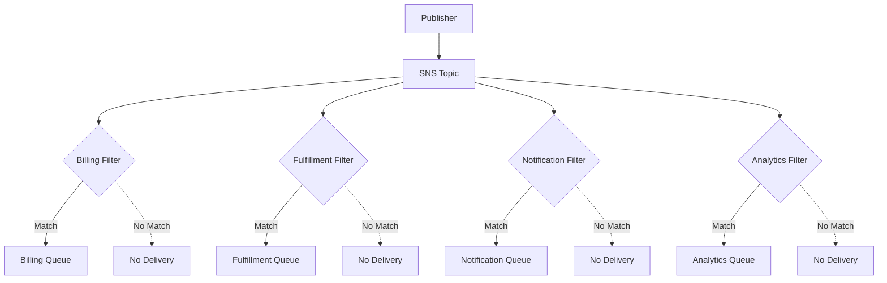
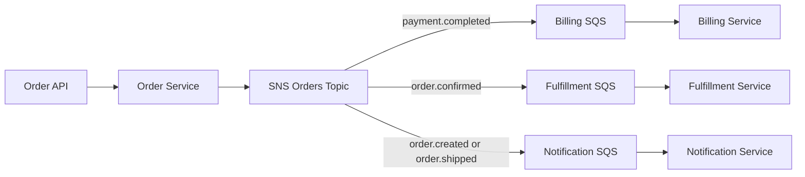

# 03- Message Filtering and Filter Policies

## Overview

Amazon SNS message filtering allows subscribers to receive only the messages relevant to their application logic. Instead of delivering every published message to every subscription, SNS evaluates a subscription's filter policy and forwards messages that satisfy its conditions.

Filtering is performed independently for each subscription. A single SNS topic can therefore distribute different subsets of the same event stream to multiple services without requiring publishers to know which consumers need each event.

For example, an e-commerce platform may publish order events to one SNS topic:

- The billing service receives payment-related events.
- The fulfillment service receives orders that have been paid.
- The notification service receives order confirmations and shipping updates.
- The analytics service receives all events.

Without filtering, every subscriber would receive every event and would need to discard irrelevant messages itself. SNS filtering moves this routing decision into the messaging layer.

## Why Message Filtering Matters

Without filtering, a fan-out architecture can create unnecessary processing and operational overhead.

Consider a topic receiving 100,000 events per hour with five subscribers. If every subscriber receives every event, the system produces 500,000 subscription deliveries, even if each subscriber only needs a small subset.

Filter policies reduce unnecessary deliveries and allow independent services to subscribe to a shared event source.

### Benefits

| Benefit | Engineering impact |
|---|---|
| Reduced message delivery | Subscribers receive fewer irrelevant messages |
| Lower consumer workload | Less unnecessary deserialization and processing |
| Reduced downstream cost | Fewer queue operations, Lambda invocations, and other delivery-related costs |
| Loose coupling | Publishers do not need subscriber-specific routing logic |
| Independent service evolution | New consumers can define their own filtering requirements |
| Centralized routing | Subscription-level routing rules are managed in SNS |

Filtering does not eliminate the need for consumer-side validation. Consumers must still validate message schemas, authorization context, and business invariants.

## How SNS Message Filtering Works

SNS evaluates filter policies against each subscription independently.

The publisher sends a message to a topic. SNS evaluates the filter policy associated with each subscription and delivers the message only when that subscription's policy matches.



The important architectural distinction is that filtering happens at the SNS subscription level, not in the publisher or the consumer.

### Message Delivery Lifecycle

1. A publisher publishes a message to an SNS topic.
2. SNS receives and accepts the publication.
3. SNS evaluates the filter policy configured for each eligible subscription.
4. SNS determines whether the message matches each subscription's policy.
5. Matching subscriptions receive the message.
6. Non-matching subscriptions do not receive the message.

A filter policy does not modify the original published message. It determines whether SNS delivers that message to a particular subscription.

## Message Filtering Policies

SNS supports two filter policy scopes:

- Message attributes
- Message body

The filter policy scope determines where SNS looks for values when evaluating a message.

| Filter policy scope | Evaluated data | Typical use |
|---|---|---|
| `MessageAttributes` | Message attributes supplied by the publisher | Explicit routing metadata |
| `MessageBody` | JSON message body | Routing based on event payload fields |

The default filtering scope is `MessageAttributes`.

The `FilterPolicyScope` subscription attribute controls which part of the message SNS evaluates.

### Message Attribute-Based Filtering

Message attribute filtering evaluates metadata attached to the SNS message.

Message attributes are separate from the message body and are explicitly supplied by the publisher.

For example, an order event may contain:

```json
{
  "Type": "String",
  "Value": "order.created"
}
```

Additional attributes could identify the region, tenant, or event priority.

A subscription can filter using these attributes without inspecting the JSON payload.

#### Example Filter Policy

```json
{
  "event_type": ["order.created", "order.confirmed"],
  "region": ["ap-south-1"]
}
```

This policy matches messages where:

- `event_type` is either `order.created` or `order.confirmed`.
- `region` is `ap-south-1`.

Both fields must match because different fields in a filter policy are combined using logical AND.

Values within the same field array are combined using logical OR.

The policy is logically equivalent to:

```text
(event_type = "order.created" OR event_type = "order.confirmed")
AND
(region = "ap-south-1")
```

#### Publishing Messages with Attributes Using Boto3

```python
import json
import boto3
from botocore.exceptions import BotoCoreError, ClientError

sns = boto3.client("sns", region_name="ap-south-1")

TOPIC_ARN = "arn:aws:sns:ap-south-1:123456789012:orders"

def publish_order_event(order_id: str, region: str) -> str:
    message = {
        "event_id": "evt-2026-000123",
        "order_id": order_id,
        "status": "created"
    }

    try:
        response = sns.publish(
            TopicArn=TOPIC_ARN,
            Message=json.dumps(message),
            MessageAttributes={
                "event_type": {
                    "DataType": "String",
                    "StringValue": "order.created"
                },
                "region": {
                    "DataType": "String",
                    "StringValue": region
                }
            }
        )

        return response["MessageId"]

    except (ClientError, BotoCoreError):
        raise
```

The message body contains the business event, while message attributes contain routing metadata.

This separation is useful when multiple consumers need different subsets of the same event stream.

### Message Body-Based Filtering

Message body filtering evaluates JSON fields inside the message payload.

This is useful when routing metadata is already part of the event schema and adding separate message attributes would create unnecessary duplication.

Example event:

```json
{
  "event_id": "evt-2026-000123",
  "event_type": "order.created",
  "order": {
    "id": "ORD-1001",
    "status": "created",
    "amount": 2500
  },
  "region": "ap-south-1"
}
```

A body-based filter policy could be:

```json
{
  "event_type": ["order.created"],
  "region": ["ap-south-1"],
  "order": {
    "amount": [
      {
        "numeric": [">=", 1000]
      }
    ]
  }
}
```

This policy matches events where:

- `event_type` equals `order.created`.
- `region` equals `ap-south-1`.
- `order.amount` is greater than or equal to 1000.

The nested `order.amount` expression demonstrates how filter policies can evaluate nested JSON fields.

#### Configuring Message Body Filtering

Set the subscription's `FilterPolicyScope` to `MessageBody`.

```bash
aws sns set-subscription-attributes \
  --subscription-arn arn:aws:sns:ap-south-1:123456789012:orders:example-subscription-id \
  --attribute-name FilterPolicyScope \
  --attribute-value MessageBody
```

Then configure the filter policy:

```bash
aws sns set-subscription-attributes \
  --subscription-arn arn:aws:sns:ap-south-1:123456789012:orders:example-subscription-id \
  --attribute-name FilterPolicy \
  --attribute-value '{"event_type":["order.created"],"region":["ap-south-1"]}'
```

When using body-based filtering, the published message must contain valid JSON suitable for the filter policy evaluation.

## Filter Policy Matching Semantics

Understanding the matching rules is important because an incorrect policy can silently exclude messages that a consumer expects to receive.

### Logical AND and OR

SNS combines different fields using AND and multiple values within a field using OR.

Example:

```json
{
  "event_type": ["order.created", "order.confirmed"],
  "region": ["ap-south-1", "ap-southeast-1"]
}
```

The message must satisfy both conditions:

```text
(event_type = "order.created" OR event_type = "order.confirmed")
AND
(region = "ap-south-1" OR region = "ap-southeast-1")
```

This distinction is particularly important when policies contain multiple fields and multiple accepted values.

### Exact Value Matching

A simple array of values matches messages containing one of those values.

```json
{
  "event_type": ["payment.completed"]
}
```

This matches the exact string `payment.completed`.

It does not automatically perform substring matching or case-insensitive matching.

### Prefix Matching

Prefix matching allows a subscription to receive messages whose string values begin with a specified prefix.

```json
{
  "event_type": [
    {
      "prefix": "order."
    }
  ]
}
```

This can match values such as:

- `order.created`
- `order.updated`
- `order.cancelled`

It does not match `payment.completed`.

Prefix matching is useful for event families, but broad prefixes can unintentionally route more events than intended.

### Anything-But Matching

The `anything-but` operator excludes specified values.

```json
{
  "event_type": [
    {
      "anything-but": ["order.deleted", "order.archived"]
    }
  ]
}
```

This matches values other than the listed exclusions.

Use exclusion-based policies carefully. A newly introduced event type may match automatically even when the consumer was never designed to process it.

### Numeric Matching

Numeric matching supports comparisons and ranges for numeric values.

```json
{
  "amount": [
    {
      "numeric": [">=", 1000, "<", 10000]
    }
  ]
}
```

This matches numeric values greater than or equal to 1000 and less than 10000.

Supported comparison operators include:

| Operator | Meaning |
|---|---|
| `=` | Equal |
| `>` | Greater than |
| `>=` | Greater than or equal |
| `<` | Less than |
| `<=` | Less than or equal |

Numeric conditions can be combined to define ranges.

For example:

```json
{
  "priority": [
    {
      "numeric": [">=", 1, "<=", 5]
    }
  ]
}
```

Use numeric filtering for actual numeric fields. A string containing digits is not automatically equivalent to a JSON number for body-based numeric matching.

### Exists Matching

The `exists` operator checks whether a field is present.

```json
{
  "customer_id": [
    {
      "exists": true
    }
  ]
}
```

This matches messages where `customer_id` exists.

The negative form can be used to match messages where the field is absent:

```json
{
  "customer_id": [
    {
      "exists": false
    }
  ]
}
```

This is useful for optional event attributes, but it should not replace schema validation.

### Wildcard Matching

Wildcard matching supports pattern-based string matching.

```json
{
  "event_type": [
    {
      "wildcard": "order.*"
    }
  ]
}
```

This matches strings that satisfy the wildcard pattern.

Wildcard patterns can be useful when event naming conventions are stable. Avoid overly broad patterns that make routing difficult to reason about.

### Case-Sensitive Matching

String matching is case-sensitive.

For example:

```json
{
  "region": ["ap-south-1"]
}
```

does not match:

```json
{
  "region": "AP-SOUTH-1"
}
```

Publishers should use consistent canonical values for routing fields.

## Nested JSON Filtering

Message body filtering supports nested JSON properties.

Consider this event:

```json
{
  "event_type": "payment.completed",
  "payment": {
    "status": "success",
    "method": "card",
    "amount": 4500
  },
  "customer": {
    "tier": "premium"
  }
}
```

A filter policy can target nested values:

```json
{
  "payment": {
    "status": ["success"],
    "method": ["card"]
  },
  "customer": {
    "tier": ["premium"]
  }
}
```

SNS evaluates the nested fields according to the policy's logical matching rules.

Nested filtering is useful when event schemas organize related fields into objects.

However, deeply nested routing policies can become difficult to maintain. Keep routing metadata relatively shallow when possible.

## Filter Policy Scope

The `FilterPolicyScope` subscription attribute determines whether SNS evaluates message attributes or the message body.

| Scope | Behavior | Suitable when |
|---|---|---|
| `MessageAttributes` | Evaluates publisher-supplied message attributes | Routing metadata is separate from the event payload |
| `MessageBody` | Evaluates JSON message body fields | Routing information is already part of the event schema |

Example:

```bash
aws sns get-subscription-attributes \
  --subscription-arn arn:aws:sns:ap-south-1:123456789012:orders:example-subscription-id
```

The response includes subscription attributes such as `FilterPolicy` and `FilterPolicyScope` when configured.

A subscription has one filtering scope at a time. A filter policy is evaluated against the selected scope; it does not automatically combine message attributes and body fields.

### Choosing the Right Scope

Use message attributes when:

- Routing metadata is independent of the business payload.
- Publishers need to attach explicit routing information.
- Consumers should not depend on the complete event structure.

Use message body filtering when:

- The event schema already contains routing fields.
- Routing depends on nested business data.
- Maintaining duplicate metadata in message attributes would be undesirable.

For long-lived event systems, define a consistent convention across publishers and subscriptions.

## Filter Policy Complexity and Limits

SNS imposes limits on filter policies. These limits matter when designing large event-routing systems.

Important constraints include:

- A filter policy can contain up to five keys at the same nesting level.
- Nested policies support up to five levels of nesting.
- A policy can contain up to 150 combinations of values, depending on its structure.
- A filter policy is limited to 256 KB.
- Wildcard complexity is limited; policies with excessive wildcard combinations are rejected.
- A subscription can have only one filter policy.

AWS can update service quotas and policy constraints. Verify the current SNS quotas before deploying policies with complex expressions.

Do not design a single topic with an enormous filter policy as a substitute for a well-defined event taxonomy.

## Practical Architecture: Routing Order Events

Consider a backend architecture with separate services for billing, fulfillment, and notifications.

The order service publishes events to an SNS topic. Each service subscribes through an SQS queue and defines its own filter policy.



This architecture provides:

- Independent consumer scaling.
- Queue-based buffering.
- Consumer-specific retry behavior.
- Dead-letter queues for failed processing.
- Subscription-level routing without publisher-specific dependencies.

### Example Subscription Policies

Billing:

```json
{
  "event_type": ["payment.completed", "payment.refunded"]
}
```

Fulfillment:

```json
{
  "event_type": ["order.confirmed"]
}
```

Notifications:

```json
{
  "event_type": ["order.created", "order.shipped"]
}
```

The publisher remains unaware of the downstream services.

## Configuring Filter Policies with AWS CLI

### Create a Subscription

```bash
aws sns subscribe \
  --topic-arn arn:aws:sns:ap-south-1:123456789012:orders \
  --protocol sqs \
  --notification-endpoint arn:aws:sqs:ap-south-1:123456789012:billing-queue
```

Capture the returned subscription ARN.

### Configure the Filter Policy

```bash
aws sns set-subscription-attributes \
  --subscription-arn arn:aws:sns:ap-south-1:123456789012:orders:example-subscription-id \
  --attribute-name FilterPolicy \
  --attribute-value '{"event_type":["payment.completed","payment.refunded"]}'
```

### Configure the Filtering Scope

For message attribute filtering:

```bash
aws sns set-subscription-attributes \
  --subscription-arn arn:aws:sns:ap-south-1:123456789012:orders:example-subscription-id \
  --attribute-name FilterPolicyScope \
  --attribute-value MessageAttributes
```

For message body filtering:

```bash
aws sns set-subscription-attributes \
  --subscription-arn arn:aws:sns:ap-south-1:123456789012:orders:example-subscription-id \
  --attribute-name FilterPolicyScope \
  --attribute-value MessageBody
```

### Verify the Configuration

```bash
aws sns get-subscription-attributes \
  --subscription-arn arn:aws:sns:ap-south-1:123456789012:orders:example-subscription-id
```

Always verify the effective policy and scope after deployment.

## Implementing Filter Policies with Terraform

Infrastructure as Code makes subscription routing repeatable and reviewable.

Example:

```hcl
resource "aws_sns_topic" "orders" {
  name = "orders"
}

resource "aws_sqs_queue" "billing" {
  name = "billing-queue"
}

resource "aws_sns_topic_subscription" "billing" {
  topic_arn = aws_sns_topic.orders.arn
  protocol  = "sqs"
  endpoint  = aws_sqs_queue.billing.arn

  filter_policy_scope = "MessageAttributes"

  filter_policy = jsonencode({
    event_type = [
      "payment.completed",
      "payment.refunded"
    ]
  })

  depends_on = [
    aws_sqs_queue_policy.billing
  ]
}

data "aws_iam_policy_document" "billing_queue" {
  statement {
    sid    = "AllowSNSOrdersTopic"
    effect = "Allow"

    principals {
      type        = "Service"
      identifiers = ["sns.amazonaws.com"]
    }

    actions = [
      "sqs:SendMessage"
    ]

    resources = [
      aws_sqs_queue.billing.arn
    ]

    condition {
      test     = "ArnEquals"
      variable = "aws:SourceArn"
      values   = [aws_sns_topic.orders.arn]
    }
  }
}

resource "aws_sqs_queue_policy" "billing" {
  queue_url = aws_sqs_queue.billing.id
  policy    = data.aws_iam_policy_document.billing_queue.json
}
```

The queue policy allows SNS to send messages to the SQS queue and restricts that permission to the expected topic ARN.

The explicit dependency ensures the queue policy is created before Terraform creates the subscription.

For production systems, also configure:

- Queue encryption.
- Dead-letter queues.
- Appropriate retention and visibility timeout.
- Queue monitoring and alarms.
- Least-privilege IAM permissions.
- Subscription redrive policies where supported and required.

## Filter Policies and SNS FIFO Topics

SNS FIFO topics support subscription filtering, but filtering changes the delivery semantics.

A filtered FIFO subscription can receive messages that match its policy while skipping messages that do not match. Consequently, the subscriber may observe gaps in the original message sequence.

For example, a topic may publish:

```text
order.created
order.confirmed
order.shipped
order.delivered
```

A subscription filtering only `order.shipped` receives that event without receiving the preceding events.

This means the subscriber cannot assume that it has observed every message in the topic's message group.

Important considerations:

- Filtering does not change the publisher's message group assignment.
- A subscriber receives only matching messages.
- Sequence gaps are expected when messages are filtered out.
- SNS FIFO filtering has at-most-once delivery semantics for filtered subscriptions, so the exactly-once delivery conditions associated with unfiltered SNS FIFO to SQS FIFO subscriptions do not apply.
- Consumers must not infer missing business events solely from gaps in the received sequence.

If a consumer requires a complete ordered event history, do not filter out events it needs to reconstruct state.

## Filter Policy Changes and Deployment

Filter policies are subscription configuration, not immutable topic definitions.

They can be updated while a system is running. However, changes can affect which messages are delivered.

For example, changing a policy from:

```json
{
  "event_type": ["payment.completed"]
}
```

to:

```json
{
  "event_type": ["payment.completed", "payment.refunded"]
}
```

allows additional events to reach the subscription.

Changing a policy in the opposite direction can exclude events that the consumer previously received.

### Deployment Considerations

- Review policy changes as application behavior changes.
- Version routing rules alongside event schemas.
- Test new policies against representative event payloads.
- Deploy consumer code capable of handling newly routed event types before enabling them.
- Avoid assuming that changing a filter policy replays previously published messages.
- Use a separate subscription when a new consumer needs a different routing contract.

Filter policy updates do not provide a historical replay mechanism. Messages published before a subscription becomes eligible to receive them are not automatically delivered because the policy later changes.

### Event Schema Compatibility

Filter policies are tightly coupled to event field names and value conventions.

For example, changing:

```json
{
  "event_type": "payment.completed"
}
```

to:

```json
{
  "type": "payment.completed"
}
```

breaks a body-based policy that still references `event_type`.

Treat routing fields as part of the event contract.

For production event schemas:

- Keep routing fields stable.
- Use explicit event type names.
- Define canonical casing and value formats.
- Introduce versioning for incompatible schema changes.
- Test publisher and subscription compatibility before deployment.

## Monitoring and Troubleshooting

SNS filtering can cause a consumer to receive fewer messages than expected. This may be correct behavior or an indication of a policy mismatch.

Monitoring should distinguish between messages that were published, messages delivered to subscriptions, and messages that were filtered out.

### Relevant CloudWatch Metrics

| Metric | Purpose |
|---|---|
| `NumberOfMessagesPublished` | Tracks messages published to the topic |
| `NumberOfNotificationsDelivered` | Tracks successful notification deliveries |
| `NumberOfNotificationsFailed` | Tracks failed notification deliveries |
| `NumberOfNotificationsFilteredOut` | Tracks messages filtered out by subscription policies |
| `NumberOfNotificationsFilteredOut-MessageAttributes` | Tracks filtering based on message attributes |
| `NumberOfNotificationsFilteredOut-MessageBody` | Tracks filtering based on message body |

Metric availability and dimensions depend on the subscription protocol and SNS monitoring configuration.

Use subscription-level dimensions where available to identify which consumer is filtering messages.

### Troubleshooting Checklist

| Symptom | Possible cause | Investigation |
|---|---|---|
| Consumer receives no messages | Filter policy excludes all published events | Inspect the policy and test representative messages |
| Attribute filter does not match | Attribute name or value differs | Compare exact attribute names, data types, and values |
| Body filter does not match | Invalid JSON or incorrect nested path | Validate the payload and policy structure |
| Numeric filter does not match | Payload value has the wrong JSON type | Verify the field is a JSON number |
| Some event types are missing | Policy values are incomplete | Compare event taxonomy with accepted values |
| Messages stop after a deployment | Policy scope or policy changed | Inspect subscription attributes and deployment history |
| FIFO consumer sees sequence gaps | Subscription filtering excludes events | Review the filter policy and consumer assumptions |

### Testing Filter Policies

Do not validate a filter policy only by checking that AWS accepted the JSON configuration.

Test both matching and non-matching messages.

A practical test matrix:

| Test case | Expected result |
|---|---|
| Matching event type and region | Delivered |
| Matching event type, different region | Filtered out |
| Different event type, matching region | Filtered out |
| Missing required routing field | Does not match the required condition |
| Numeric value inside configured range | Delivered |
| Numeric value outside configured range | Filtered out |
| Incorrect field casing | Does not match a case-sensitive condition |

For complex policies, maintain automated integration tests that publish representative messages and verify the resulting queue deliveries.

## Security Considerations

Filter policies are routing rules, not access-control mechanisms.

A filter policy determines whether a subscription receives a message. It does not establish whether the publisher is authorized to publish sensitive information or whether a consumer is authorized to access the underlying business data.

Apply security controls independently:

- Use IAM policies to restrict who can publish to SNS topics.
- Use topic policies to control cross-account access.
- Restrict SQS queue policies to the expected SNS topic ARN.
- Encrypt SNS topics and SQS queues where required.
- Avoid publishing secrets or unnecessary personal data in message attributes.
- Validate event payloads inside consumers.
- Use least-privilege permissions for deployment identities that can modify subscription policies.

A particularly important risk is overly broad filtering. A policy that accepts every event type may unintentionally expose messages to a consumer that should receive only a restricted subset.

Filtering should complement, not replace, data classification and authorization controls.

## Performance, Scalability, and Cost

SNS evaluates subscription policies as part of message delivery. Filtering reduces unnecessary downstream deliveries, but it does not eliminate the cost of publishing messages or all SNS processing overhead.

### Performance Considerations

- Keep policies understandable and reasonably small.
- Avoid unnecessarily deep nesting.
- Use stable, explicit routing fields.
- Avoid excessive wildcard combinations.
- Prefer a clear event taxonomy over complex matching expressions.
- Monitor delivery failures separately from intentional filtering.

### Cost Considerations

Filtering can reduce costs associated with downstream processing, including:

- SQS requests.
- Lambda invocations.
- Consumer compute.
- Downstream API calls.
- Data processing and logging.

However, SNS publication and applicable message delivery charges still depend on the service's pricing model.

Review current AWS pricing for the topic type, delivery protocol, message volume, and region before estimating savings.

### When to Use Filtering vs. Separate Topics

| Design | Advantages | Limitations |
|---|---|---|
| One topic with multiple filtered subscriptions | Centralized event distribution and independent subscriber routing | Policies become more complex as event types and consumers grow |
| Separate topic per domain | Clear ownership and simpler routing boundaries | More infrastructure and publisher configuration |
| Separate topic per event type | Explicit routing and narrow subscription contracts | Can create excessive topic proliferation |
| Application-level routing | Supports complex business decisions | Couples publishers or routing services to consumer requirements |

Use subscription filtering when consumers need different subsets of a shared event stream.

Use separate topics when event domains have different security boundaries, ownership, retention requirements, or operational characteristics.

Do not turn SNS filter policies into a general-purpose business rules engine. Complex authorization and workflow decisions belong in application services.

## Common Mistakes and Production Pitfalls

### Confusing Message Attributes with Message Body Fields

A filter policy using `MessageAttributes` does not inspect the JSON body.

Likewise, a `MessageBody` policy does not inspect separately supplied message attributes.

**Avoidance:** Set `FilterPolicyScope` explicitly and ensure the publisher sends routing data in the expected location.

### Assuming Filtering Is Consumer-Side

SNS filters messages before delivery. A non-matching message is not placed in the subscription's SQS queue for the consumer to discard.

**Avoidance:** Monitor SNS filtering metrics rather than relying only on consumer queue metrics.

### Using Unstable Routing Values

Inconsistent casing, naming, or data types can cause messages to be silently excluded.

**Avoidance:** Define canonical event names and routing-field conventions in the event schema.

### Treating Filtering as Authorization

A filter policy does not prevent unauthorized publishers from sending messages or replace IAM permissions.

**Avoidance:** Enforce publisher and subscriber permissions independently.

### Deploying Filter Changes Without Consumer Compatibility

A broader policy can suddenly deliver event types that the consumer does not understand.

**Avoidance:** Deploy compatible consumer code first, then update the filter policy.

### Assuming Filter Changes Replay Messages

Updating a policy does not retrieve messages previously filtered out.

**Avoidance:** Use an explicit replay or backfill architecture when historical processing is required.

### Ignoring FIFO Filtering Semantics

A filtered FIFO subscription can observe gaps in the source message sequence and does not retain the unfiltered subscription's exactly-once delivery semantics.

**Avoidance:** Use filtering only when the consumer can operate correctly without excluded events.

### Building Overly Complex Policies

Large policies with deep nesting, wildcard combinations, and many conditions are difficult to review and troubleshoot.

**Avoidance:** Simplify event schemas, split unrelated event domains, and use separate subscriptions where routing requirements differ significantly.

## Production Best Practices

1. **Define a routing contract:** Treat event names and routing fields as part of the published event schema.
2. **Choose the filtering scope deliberately:** Use message attributes or message body filtering consistently.
3. **Keep policies focused:** Prefer simple, explicit conditions over complex wildcard expressions.
4. **Test both matching and non-matching events:** Validate real publisher payloads against subscription policies.
5. **Manage policies through IaC:** Keep subscription configuration version-controlled and reviewable.
6. **Monitor filtered messages:** Distinguish intentional filtering from delivery failures.
7. **Preserve consumer compatibility:** Deploy consumer changes before broadening subscription policies.
8. **Keep authorization separate:** Use IAM, topic policies, and queue policies for access control.
9. **Design FIFO consumers for filtered sequences:** Never assume a filtered subscription receives the complete source event history.
10. **Plan replay independently:** Use durable event storage or an event archive when historical reprocessing is required.

## Key Takeaways

- SNS filter policies route messages independently for each subscription, reducing unnecessary downstream processing.
- Filtering can evaluate either message attributes or JSON message body fields through `FilterPolicyScope`.
- Different policy fields use AND semantics, while multiple accepted values within a field use OR semantics.
- Filter policies are routing mechanisms, not authorization controls or historical replay mechanisms.
- FIFO filtering changes delivery semantics and can create gaps in the sequence observed by a subscriber.