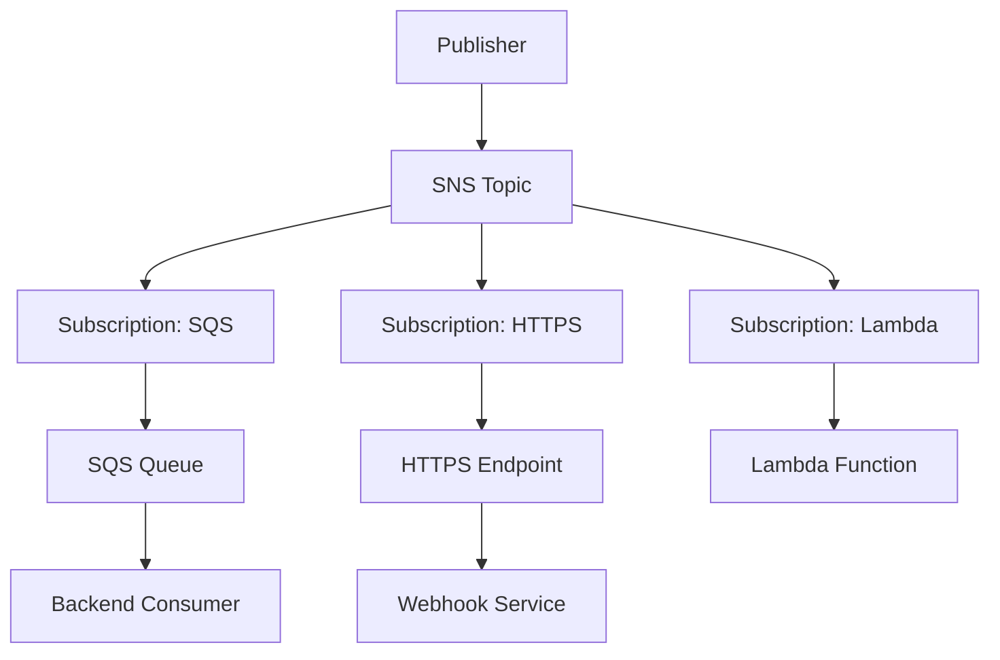
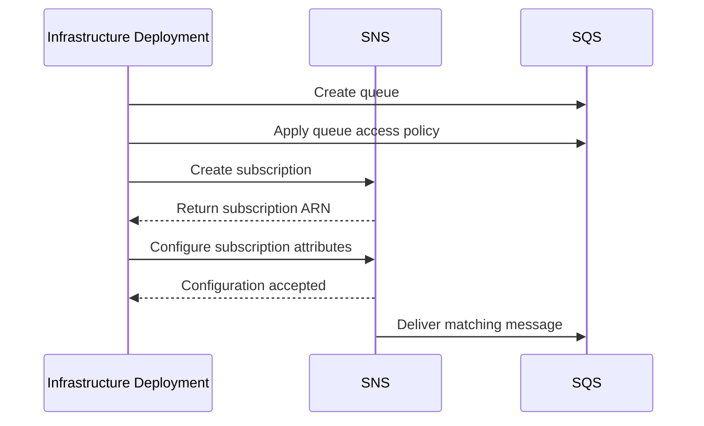
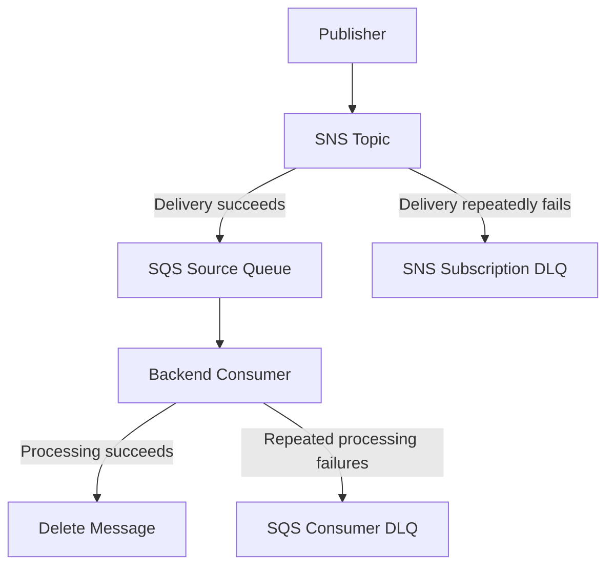

# 04- Advanced Subscription Configuration

## Overview

Amazon SNS subscriptions define how messages published to a topic are delivered to individual consumers. Beyond selecting a protocol and endpoint, SNS provides configuration options that control delivery behavior, message formatting, retry handling, filtering, security, and operational reliability.

Advanced subscription configuration is important in production systems because different consumers have different delivery requirements. An SQS-backed service may need durable buffering and controlled retries, while an HTTP endpoint may require authenticated delivery, timeout handling, and failure recovery.

This document covers subscription-level configuration used to build reliable, secure, and scalable SNS integrations.

## Subscription Architecture

An SNS subscription connects a topic to an endpoint through a selected delivery protocol.



Each subscription has independent configuration. A topic can therefore deliver messages to multiple endpoints with different delivery and processing requirements.

Important subscription attributes include:

- `Protocol`
- `Endpoint`
- `FilterPolicy`
- `FilterPolicyScope`
- `RawMessageDelivery`
- `DeliveryPolicy`
- `RedrivePolicy`
- `SubscriptionRoleArn`
- `ReplayPolicy`, where supported for the subscription type and feature

Not every attribute applies to every protocol. Always verify protocol-specific support before applying a configuration.

## Subscription Lifecycle and Configuration

A subscription is created by associating an endpoint with a topic.

For example, an SQS subscription requires:

1. An SNS topic.
2. An SQS queue.
3. An SQS queue policy allowing the SNS topic to send messages.
4. An SNS subscription connecting the topic to the queue.



For HTTP/S and email endpoints, subscription confirmation may be required before the endpoint receives notifications. SQS and Lambda subscriptions use service-specific authorization and configuration rather than the HTTP subscription confirmation workflow.

### Create a Subscription with AWS CLI

```bash
aws sns subscribe \
  --topic-arn arn:aws:sns:ap-south-1:123456789012:orders \
  --protocol sqs \
  --notification-endpoint arn:aws:sqs:ap-south-1:123456789012:orders-queue
```

The response includes a subscription ARN when SNS creates the subscription.

### Inspect Subscription Attributes

```bash
aws sns get-subscription-attributes \
  --subscription-arn arn:aws:sns:ap-south-1:123456789012:orders:example-subscription-id
```

This command is useful for verifying the effective configuration during deployment and troubleshooting.

## Raw Message Delivery

Raw message delivery controls whether SNS wraps a published message in its standard notification envelope before delivering it to a subscriber.

By default, SNS sends a notification envelope containing metadata such as:

- Message ID
- Topic ARN
- Timestamp
- Subject, when supplied
- Message body
- Signature and signing metadata for supported notification formats

For an SQS subscription, the SQS message body normally contains this SNS notification envelope.

With raw message delivery enabled, SNS sends the original published message body directly to SQS.

### Default Delivery Format

Suppose the publisher sends:

```json
{
  "event_id": "evt-1001",
  "event_type": "order.created",
  "order_id": "ORD-1001"
}
```

Without raw message delivery, the SQS message body resembles:

```json
{
  "Type": "Notification",
  "MessageId": "example-message-id",
  "TopicArn": "arn:aws:sns:ap-south-1:123456789012:orders",
  "Message": "{\"event_id\":\"evt-1001\",\"event_type\":\"order.created\",\"order_id\":\"ORD-1001\"}",
  "Timestamp": "2026-11-19T10:00:00.000Z"
}
```

The `Message` field contains the original message as a string.

The consumer must parse the outer SNS envelope and then deserialize the embedded message.

### Raw Message Delivery Format

With raw message delivery enabled, the SQS message body contains:

```json
{
  "event_id": "evt-1001",
  "event_type": "order.created",
  "order_id": "ORD-1001"
}
```

The consumer can deserialize the event directly without parsing an additional SNS envelope.

### Enable Raw Message Delivery

Using AWS CLI:

```bash
aws sns set-subscription-attributes \
  --subscription-arn arn:aws:sns:ap-south-1:123456789012:orders:example-subscription-id \
  --attribute-name RawMessageDelivery \
  --attribute-value true
```

Disable it:

```bash
aws sns set-subscription-attributes \
  --subscription-arn arn:aws:sns:ap-south-1:123456789012:orders:example-subscription-id \
  --attribute-name RawMessageDelivery \
  --attribute-value false
```

### Raw Message Delivery with Boto3

```python
import boto3
from botocore.exceptions import BotoCoreError, ClientError

sns = boto3.client("sns", region_name="ap-south-1")


def configure_raw_delivery(subscription_arn: str, enabled: bool) -> None:
    try:
        sns.set_subscription_attributes(
            SubscriptionArn=subscription_arn,
            AttributeName="RawMessageDelivery",
            AttributeValue=str(enabled).lower(),
        )
    except (ClientError, BotoCoreError):
        raise
```

### When to Use Raw Message Delivery

| Scenario | Recommendation |
|---|---|
| SQS consumer expects the original event JSON | Enable raw delivery |
| Consumer requires SNS envelope metadata | Keep raw delivery disabled |
| Existing consumer parses SNS notification envelopes | Preserve current configuration unless consumer code is updated |
| Event processing requires topic-level metadata | Include required metadata in the event or retain the envelope |

### Important Limitations

Raw message delivery changes the message format expected by the consumer.

For SQS subscriptions, SNS raw message delivery supports up to 10 message attributes. Messages containing more than 10 message attributes are discarded as client-side errors when raw delivery is enabled.

Do not assume that raw delivery is supported identically across all protocols. Verify the behavior for the selected endpoint type.

Raw delivery also removes the SNS notification envelope from the delivered message. If the consumer needs the topic ARN, SNS message ID, or other envelope metadata, preserve that information through an explicit event contract or use the default delivery format.

## Delivery Retry Policies

SNS uses delivery retry policies to handle temporary failures when delivering messages to supported endpoints.

A delivery failure can occur because of:

- Endpoint unavailability.
- Network timeouts.
- HTTP 5xx responses.
- Throttling.
- Temporary service failures.
- Endpoint-side capacity constraints.

SNS retries supported delivery failures according to the delivery policy configured for the subscription and the protocol-specific retry behavior.

A retry policy controls how SNS attempts delivery. It does not control how an application processes a message after a durable endpoint, such as SQS, has accepted it.

### Delivery Policy Components

A delivery policy can contain:

| Attribute | Purpose |
|---|---|
| `minDelayTarget` | Minimum retry delay |
| `maxDelayTarget` | Maximum retry delay |
| `numRetries` | Number of retries during the corresponding phase |
| `numMaxDelayRetries` | Retry count using maximum delay |
| `numNoDelayRetries` | Retry count without delay |
| `numMinDelayRetries` | Retry count using minimum delay |
| `backoffFunction` | Backoff strategy |

The exact supported values and retry phases depend on the delivery protocol.

### Example HTTP/S Delivery Policy

```json
{
  "healthyRetryPolicy": {
    "minDelayTarget": 5,
    "maxDelayTarget": 60,
    "numRetries": 10,
    "numMaxDelayRetries": 3,
    "numNoDelayRetries": 0,
    "numMinDelayRetries": 2,
    "backoffFunction": "exponential"
  }
}
```

This policy configures retry behavior for a supported HTTP/S subscription.

The policy should reflect the endpoint's recovery characteristics and the business importance of the notification.

### Configure a Delivery Policy

```bash
aws sns set-subscription-attributes \
  --subscription-arn arn:aws:sns:ap-south-1:123456789012:orders:example-subscription-id \
  --attribute-name DeliveryPolicy \
  --attribute-value file://delivery-policy.json
```

### Delivery Policy vs. SQS Visibility Timeout

These mechanisms solve different problems.

| Mechanism | Responsibility |
|---|---|
| SNS delivery retry policy | Retries delivery to a supported endpoint |
| SQS visibility timeout | Temporarily hides a received message while a consumer processes it |
| SQS redrive policy | Moves repeatedly unsuccessfully received messages to a DLQ |
| Application retry logic | Controls retries within application processing |

For an SNS-to-SQS integration, SNS considers delivery successful when SQS accepts the message. If the backend consumer later fails, SQS visibility timeout and redrive behavior govern that processing lifecycle.

Do not configure SNS delivery retries as a substitute for SQS consumer retry handling.

## Subscription Dead-Letter Queues

A subscription dead-letter queue captures messages that SNS cannot successfully deliver to a supported endpoint after exhausting its delivery retry policy.

This is different from an SQS consumer dead-letter queue.

### SNS Subscription DLQ vs. SQS Consumer DLQ

| Feature | SNS Subscription DLQ | SQS Consumer DLQ |
|---|---|---|
| Failure boundary | SNS cannot deliver to the endpoint | Consumer repeatedly fails to process a message |
| Managed by | SNS subscription redrive configuration | SQS source queue redrive policy |
| Typical use | Failed HTTP/S or other supported endpoint delivery | Failed backend message processing |
| Message reaches endpoint | No successful delivery | Message was received by the consumer |
| Recovery | Redrive or controlled replay | Redrive or controlled replay |

An SNS subscription DLQ should not be confused with the DLQ configured on an SQS queue subscribed to an SNS topic.

### Architecture with Both DLQ Types



The SNS subscription DLQ captures delivery failures before the endpoint successfully accepts the message.

The SQS consumer DLQ captures processing failures after the message has entered the queue.

### Configure an SNS Subscription DLQ

First create an SQS queue to act as the subscription DLQ.

```bash
aws sqs create-queue \
  --queue-name orders-subscription-dlq
```

Retrieve its ARN:

```bash
aws sqs get-queue-attributes \
  --queue-url https://sqs.ap-south-1.amazonaws.com/123456789012/orders-subscription-dlq \
  --attribute-names QueueArn
```

Configure the queue policy to allow SNS to send messages. Restrict access to the expected topic ARN.

Then configure the subscription redrive policy:

```json
{
  "deadLetterTargetArn": "arn:aws:sqs:ap-south-1:123456789012:orders-subscription-dlq"
}
```

Apply it:

```bash
aws sns set-subscription-attributes \
  --subscription-arn arn:aws:sns:ap-south-1:123456789012:orders:example-subscription-id \
  --attribute-name RedrivePolicy \
  --attribute-value file://subscription-redrive-policy.json
```

Verify the configuration:

```bash
aws sns get-subscription-attributes \
  --subscription-arn arn:aws:sns:ap-south-1:123456789012:orders:example-subscription-id
```

### Operational Considerations

- Use a dedicated DLQ for each failure boundary where independent recovery is required.
- Restrict the DLQ queue policy to the expected SNS topic.
- Configure encryption and retention according to data requirements.
- Monitor DLQ message count and oldest-message age.
- Establish a controlled replay procedure.
- Investigate endpoint failures before replaying messages.
- Preserve event IDs so consumers can safely handle duplicate processing.

An SNS subscription DLQ is not automatically a historical event archive. Retention and replay procedures must be designed explicitly.

## Subscription Filtering Configuration

Filter policies allow SNS to route only matching messages to a subscription.

Two filtering scopes are available:

| Scope | Evaluated content |
|---|---|
| `MessageAttributes` | Message attributes supplied by the publisher |
| `MessageBody` | JSON message body |

Example attribute-based filter:

```json
{
  "event_type": ["payment.completed"],
  "region": ["ap-south-1"]
}
```

Configure the policy:

```bash
aws sns set-subscription-attributes \
  --subscription-arn arn:aws:sns:ap-south-1:123456789012:orders:example-subscription-id \
  --attribute-name FilterPolicy \
  --attribute-value '{"event_type":["payment.completed"],"region":["ap-south-1"]}'
```

Set the scope:

```bash
aws sns set-subscription-attributes \
  --subscription-arn arn:aws:sns:ap-south-1:123456789012:orders:example-subscription-id \
  --attribute-name FilterPolicyScope \
  --attribute-value MessageAttributes
```

Filtering is evaluated independently for each subscription. It is useful for separating consumer responsibilities without introducing publisher-side routing dependencies.

For detailed filter operators, matching semantics, and policy limits, refer to `03- Message Filtering and Filter Policies.md`.

## Subscription Message Format and Protocol Configuration

Different protocols have different delivery formats and operational behavior.

| Protocol | Endpoint | Important considerations |
|---|---|---|
| `sqs` | SQS queue ARN | Queue policy, raw delivery, buffering, DLQ |
| `lambda` | Lambda function ARN | Lambda resource permission, asynchronous invocation behavior |
| `https` | HTTPS endpoint | Confirmation, authentication, delivery retries, endpoint availability |
| `http` | HTTP endpoint | Confirmation and endpoint security considerations |
| `email` | Email address | Human-oriented notifications and subscription confirmation |
| `email-json` | Email address | JSON-formatted notification delivery |
| `sms` | Phone number | Message size, regional availability, delivery cost |
| `application` | Mobile push application endpoint | Platform credentials and endpoint lifecycle |

Protocol support and available subscription attributes vary. Do not assume that an attribute supported for SQS is also supported for HTTP/S, Lambda, or mobile push.

### SQS Subscription

SQS is commonly used when consumers need durable buffering and independent processing capacity.

Important configuration considerations:

- Queue access policy.
- Queue encryption.
- Raw message delivery.
- Queue retention.
- Visibility timeout.
- Consumer DLQ.
- SNS subscription DLQ, if applicable to the delivery path and failure requirements.

### Lambda Subscription

SNS can invoke Lambda functions through a Lambda subscription.

The Lambda function must have a resource-based permission allowing SNS to invoke it.

Example:

```bash
aws lambda add-permission \
  --function-name order-event-handler \
  --statement-id AllowOrdersTopic \
  --action lambda:InvokeFunction \
  --principal sns.amazonaws.com \
  --source-arn arn:aws:sns:ap-south-1:123456789012:orders
```

Create the subscription:

```bash
aws sns subscribe \
  --topic-arn arn:aws:sns:ap-south-1:123456789012:orders \
  --protocol lambda \
  --notification-endpoint arn:aws:lambda:ap-south-1:123456789012:function:order-event-handler
```

SNS invokes Lambda asynchronously. Lambda's asynchronous invocation retry and failure-destination configuration are separate from SNS delivery retry policies.

For high-volume or independently controlled processing, SNS-to-SQS-to-Lambda can provide an additional buffering boundary.

### HTTP/S Subscription

HTTP/S endpoints are useful for integrating external services and webhook receivers.

The endpoint must be reachable by SNS and must complete the subscription confirmation process.

Production considerations include:

- HTTPS with valid TLS certificates.
- Endpoint authentication and request validation.
- Fast acknowledgement.
- Idempotent processing.
- Rate limiting and capacity management.
- Delivery retry handling.
- Monitoring for failed deliveries.

Avoid performing long-running business operations synchronously inside the webhook request. Persist or enqueue the event and return a successful response after durable acceptance.

## Subscription Replay and Message Archiving

Subscription replay and event archiving address historical event delivery requirements, but they are not interchangeable with ordinary filter policy changes.

SNS supports message archiving and replay for supported FIFO topic configurations. Replay configuration and availability depend on the topic and subscription capabilities.

A replay workflow can be useful when:

- A new consumer needs historical events.
- A consumer must rebuild its state.
- A processing defect has been corrected.
- Events need to be reprocessed after a deployment.

Before enabling replay, define:

- The required archive retention period.
- The target subscription.
- The replay time range.
- Consumer idempotency behavior.
- Whether replayed events can overlap with live traffic.
- The expected processing throughput.

Do not assume that changing a subscription's filter policy causes previously published messages to be delivered. Use supported replay capabilities or a separate event archive and replay pipeline.

## Security and Access Control

Subscription configuration affects where messages are delivered and which services can receive them.

Apply security controls at multiple layers.

### IAM Permissions

Restrict which identities can:

- Create subscriptions.
- Delete subscriptions.
- Modify subscription attributes.
- Publish messages.
- Modify topic policies.
- Configure subscription redrive policies.

Avoid granting unrestricted `sns:*` permissions to application roles.

### SQS Queue Policies

An SQS queue subscribed to an SNS topic needs a queue policy permitting the SNS service to send messages.

Example policy:

```json
{
  "Version": "2012-10-17",
  "Statement": [
    {
      "Sid": "AllowOrdersTopic",
      "Effect": "Allow",
      "Principal": {
        "Service": "sns.amazonaws.com"
      },
      "Action": "sqs:SendMessage",
      "Resource": "arn:aws:sqs:ap-south-1:123456789012:orders-queue",
      "Condition": {
        "ArnEquals": {
          "aws:SourceArn": "arn:aws:sns:ap-south-1:123456789012:orders"
        }
      }
    }
  ]
}
```

The `aws:SourceArn` condition restricts delivery permission to the expected topic.

### Encryption

For sensitive workloads:

- Enable SNS topic encryption where required.
- Enable SQS server-side encryption.
- Use customer-managed KMS keys when key ownership and audit requirements justify them.
- Configure key policies and service permissions correctly.
- Review cross-account KMS access requirements.

Encryption does not replace authorization or payload-level data protection.

## Monitoring and Observability

Subscription-level monitoring helps identify delivery problems that may not be visible from topic-level metrics alone.

Important SNS CloudWatch metrics include:

| Metric | Purpose |
|---|---|
| `NumberOfMessagesPublished` | Tracks published messages |
| `NumberOfNotificationsDelivered` | Tracks successful notification deliveries |
| `NumberOfNotificationsFailed` | Tracks failed notification deliveries |
| `NumberOfNotificationsFilteredOut` | Tracks messages excluded by filter policies |
| `NumberOfNotificationsRedrivenToDlq` | Tracks notifications moved to a subscription DLQ |
| `NumberOfNotificationsFailedToRedriveToDlq` | Tracks failures while sending notifications to a subscription DLQ |

Metric availability and dimensions vary by protocol and configuration.

For SQS-backed consumers, also monitor:

- `ApproximateNumberOfMessagesVisible`
- `ApproximateNumberOfMessagesNotVisible`
- `ApproximateAgeOfOldestMessage`
- `NumberOfMessagesSent`
- `NumberOfMessagesReceived`
- `NumberOfMessagesDeleted`

Use application-level metrics to measure:

- Event processing success and failure.
- Processing latency.
- Duplicate event detection.
- Retry counts.
- Dead-letter queue growth.
- Business-level processing outcomes.

### Correlation and Tracing

Include stable event identifiers in published messages.

Example:

```json
{
  "event_id": "evt-2026-000123",
  "correlation_id": "req-8f1c7b",
  "event_type": "order.created",
  "occurred_at": "2026-11-19T10:00:00Z",
  "order_id": "ORD-1001"
}
```

Use these identifiers across publisher logs, SNS publication records, SQS consumer logs, and downstream service traces.

SNS message IDs are useful for transport-level diagnostics, but a stable application-level event ID is more appropriate for business idempotency.

## Infrastructure as Code: Complete Subscription Example

The following Terraform example creates an SNS-to-SQS subscription with raw message delivery and an attribute-based filter policy.

```hcl
resource "aws_sns_topic" "orders" {
  name = "orders"
}

resource "aws_sqs_queue" "orders" {
  name                       = "orders-queue"
  message_retention_seconds  = 345600
  visibility_timeout_seconds = 60
  sqs_managed_sse_enabled    = true
}

data "aws_iam_policy_document" "orders_queue" {
  statement {
    sid    = "AllowOrdersTopic"
    effect = "Allow"

    principals {
      type        = "Service"
      identifiers = ["sns.amazonaws.com"]
    }

    actions = [
      "sqs:SendMessage"
    ]

    resources = [
      aws_sqs_queue.orders.arn
    ]

    condition {
      test     = "ArnEquals"
      variable = "aws:SourceArn"
      values   = [aws_sns_topic.orders.arn]
    }
  }
}

resource "aws_sqs_queue_policy" "orders" {
  queue_url = aws_sqs_queue.orders.id
  policy    = data.aws_iam_policy_document.orders_queue.json
}

resource "aws_sns_topic_subscription" "orders" {
  topic_arn = aws_sns_topic.orders.arn
  protocol  = "sqs"
  endpoint  = aws_sqs_queue.orders.arn

  raw_message_delivery = true

  filter_policy_scope = "MessageAttributes"

  filter_policy = jsonencode({
    event_type = [
      "order.created",
      "order.confirmed"
    ]
  })

  depends_on = [
    aws_sqs_queue_policy.orders
  ]
}
```

This configuration establishes:

- An SNS topic.
- An SQS queue.
- A queue policy restricted to the SNS topic.
- An SNS subscription.
- Raw message delivery.
- Attribute-based filtering.

For a production deployment, extend this configuration with a consumer DLQ, queue alarms, topic encryption, KMS policies where required, and application-specific retention and visibility settings.

Keep subscription configuration in the same infrastructure lifecycle as the topic and endpoint whenever possible. This reduces configuration drift and makes changes auditable.

## Common Mistakes and Production Pitfalls

### Treating SNS and SQS DLQs as the Same Thing

An SNS subscription DLQ captures delivery failures before the endpoint accepts the message. An SQS consumer DLQ captures processing failures after the message enters the queue.

**Avoidance:** Model and monitor both failure boundaries independently.

### Enabling Raw Delivery Without Updating Consumers

A consumer expecting an SNS notification envelope may fail when it receives the original event body.

**Avoidance:** Treat raw delivery changes as message-contract changes. Deploy compatible consumer code before changing the subscription.

### Assuming SNS Delivery Retries Control Consumer Retries

Once SQS accepts a message, SNS delivery has succeeded. Subsequent consumer failures are handled by SQS and the application.

**Avoidance:** Configure retry behavior at the correct failure boundary.

### Creating Subscriptions Before Queue Permissions

SNS may be unable to deliver to an SQS queue when the queue policy does not authorize the topic.

**Avoidance:** Deploy the queue policy before creating the subscription.

### Ignoring Lambda Asynchronous Invocation Behavior

SNS-to-Lambda delivery and Lambda's asynchronous execution retries are separate stages.

**Avoidance:** Configure Lambda failure handling and monitor both SNS delivery and Lambda execution outcomes.

### Using Broad IAM Permissions

Overly broad permissions allow identities to modify subscriptions or redirect messages to unintended endpoints.

**Avoidance:** Apply least-privilege permissions to subscription management and endpoint access.

### Assuming Subscription Changes Replay Historical Messages

Changing raw delivery, filtering, or retry configuration does not automatically replay old events.

**Avoidance:** Design replay and archival capabilities independently.

### Ignoring Idempotency

Retries, replay, and distributed delivery can result in duplicate business events.

**Avoidance:** Use stable event IDs and durable consumer-side idempotency controls.

## Production Best Practices

- Manage subscription configuration through Terraform or another version-controlled deployment mechanism.
- Select raw message delivery based on the consumer's message contract.
- Configure subscription delivery retries for supported endpoints according to their availability and recovery characteristics.
- Use subscription DLQs for delivery failures and SQS DLQs for consumer processing failures.
- Restrict SQS queue policies to the expected SNS topic ARN.
- Configure encryption and least-privilege IAM permissions.
- Make consumers idempotent and preserve stable event identifiers.
- Monitor delivery failures, filtered messages, redriven notifications, and downstream queue age.
- Test subscription changes against representative production event payloads.
- Document replay, recovery, and DLQ redrive procedures before incidents occur.

## Key Takeaways

- SNS subscriptions have independent configuration for message format, filtering, delivery behavior, and failure handling.
- Raw message delivery removes the SNS notification envelope and changes the consumer's expected message contract.
- SNS subscription DLQs capture endpoint delivery failures, while SQS consumer DLQs capture downstream processing failures.
- SNS delivery retries, SQS visibility timeouts, and application retries operate at different failure boundaries.
- Secure, observable, and idempotent consumers are essential for reliable SNS-based event-driven architectures.