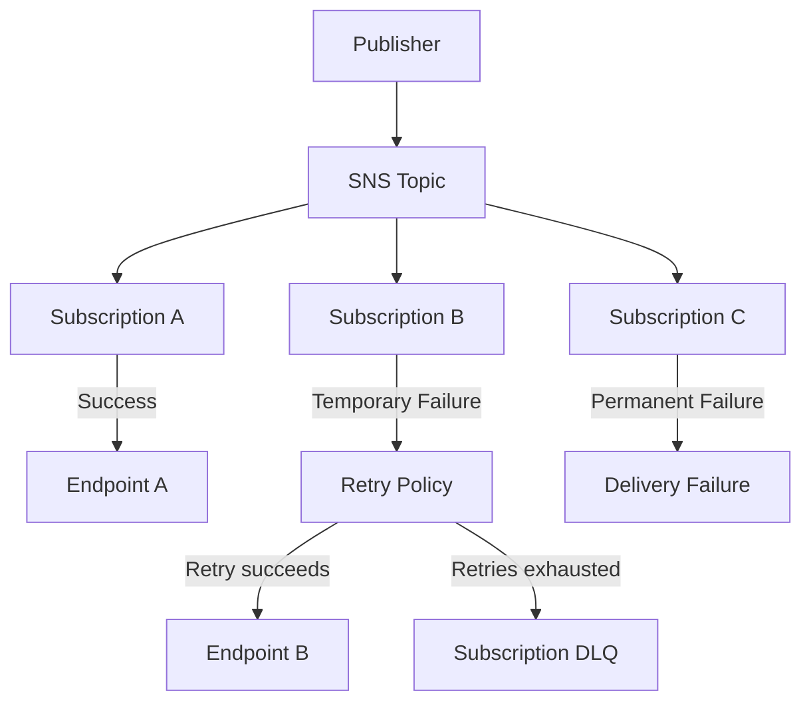
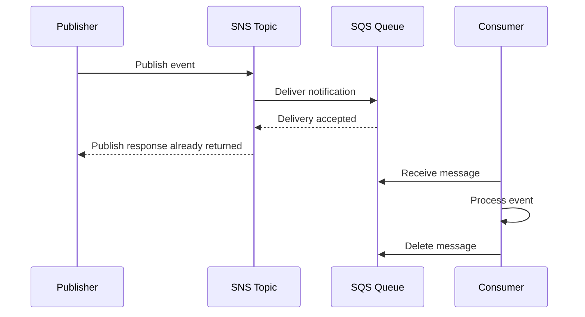
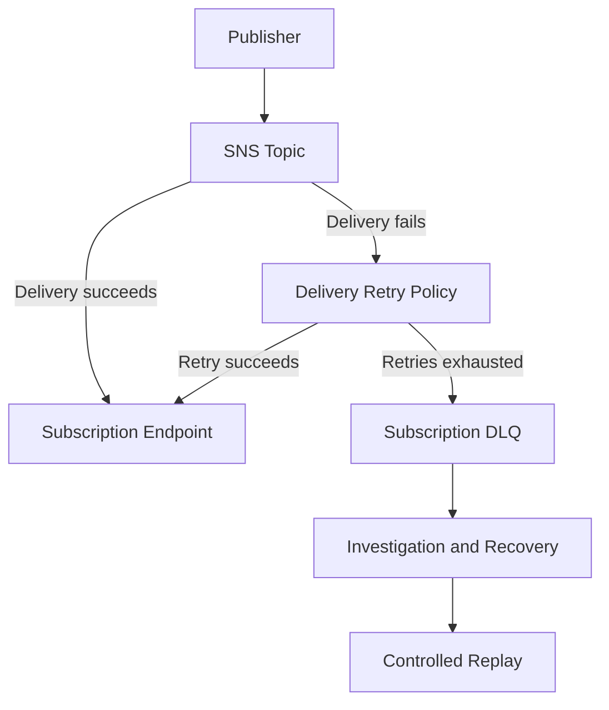

# 05- Delivery Retries and Delivery Status

## Overview

Amazon SNS provides delivery retry mechanisms and delivery status logging to help applications handle endpoint failures and monitor message delivery.

When a publisher sends a message to an SNS topic, SNS attempts to deliver that message independently to each subscription. Delivery behavior depends on the subscription protocol, endpoint availability, and configured retry policies.

A successful publication does not guarantee successful delivery to every subscriber. For example, SNS may accept a message while an HTTP endpoint is temporarily unavailable or an SQS delivery fails because of an authorization problem.

Production systems must distinguish between:

- **Publication success:** SNS accepted the message from the publisher.
- **Delivery success:** SNS successfully delivered the notification to the subscription endpoint.
- **Processing success:** The downstream application successfully processed the delivered message.

These are separate stages with different failure handling and observability requirements.

## SNS Message Delivery Lifecycle

SNS uses a fan-out delivery model. Each subscription has its own delivery attempt and outcome.



The delivery lifecycle is:

1. The publisher submits a message using an SNS publishing API.
2. SNS accepts the publication and returns a message ID.
3. SNS attempts delivery to eligible subscriptions.
4. Each subscription is handled independently.
5. Failed deliveries are retried according to the applicable delivery policy.
6. If delivery cannot be completed within the supported retry behavior, SNS reports the failure and can move the notification to a configured subscription DLQ.

The publisher's successful `Publish` response should not be interpreted as confirmation that all subscribers processed the event.

## Delivery Retry Fundamentals

SNS retries failed deliveries to supported endpoints to handle temporary failures.

Typical causes include:

- Endpoint service outages.
- Network connectivity problems.
- HTTP timeouts.
- HTTP 5xx responses.
- Endpoint throttling.
- Temporary service-side failures.

Retry behavior depends on the delivery protocol.

For example, HTTP/S subscriptions use configurable delivery retry policies. AWS-managed endpoints such as SQS and Lambda have protocol-specific delivery behavior and should not be assumed to follow the same configurable HTTP retry policy.

### Temporary vs. Permanent Failures

| Failure category | Example | Engineering response |
|---|---|---|
| Temporary | HTTP 503 | Retry after a delay |
| Temporary | Network timeout | Retry according to delivery policy |
| Temporary | HTTP 429 | Apply appropriate throttling and retry behavior |
| Configuration-related | HTTP 401 or 403 | Fix endpoint authentication or authorization |
| Configuration-related | Invalid endpoint URL | Correct the subscription endpoint |
| Endpoint unavailable | DNS resolution failure | Investigate DNS and endpoint availability |

A retry policy cannot fix a persistent configuration error. Repeatedly retrying an unauthorized endpoint only delays detection and increases operational noise.

## Delivery Retry Policies

A delivery retry policy defines how SNS retries delivery to supported endpoints after a failure.

For HTTP/S subscriptions, SNS supports configurable retry behavior through the subscription's `DeliveryPolicy` attribute.

The policy controls retry timing and backoff behavior.

### Retry Policy Components

| Attribute | Description |
|---|---|
| `minDelayTarget` | Minimum retry delay |
| `maxDelayTarget` | Maximum retry delay |
| `numRetries` | Number of retries in the corresponding retry phase |
| `numNoDelayRetries` | Retries performed without an additional delay |
| `numMinDelayRetries` | Retries performed using the minimum delay |
| `numMaxDelayRetries` | Retries performed using the maximum delay |
| `backoffFunction` | Backoff strategy used between attempts |

Supported backoff functions include:

- `linear`
- `arithmetic`
- `geometric`
- `exponential`

The selected policy should reflect endpoint recovery characteristics, expected traffic, and the operational impact of delayed delivery.

### Exponential Backoff

Exponential backoff increases the delay between retry attempts.

A simplified model is:

\[
delay_n = \min(maxDelay,\ baseDelay \times 2^n)
\]

For example, with a base delay of 5 seconds and a maximum delay of 60 seconds:

| Retry attempt | Calculated delay |
|---|---:|
| 1 | 5 seconds |
| 2 | 10 seconds |
| 3 | 20 seconds |
| 4 | 40 seconds |
| 5 | 60 seconds |

This is an illustrative model, not a guarantee of SNS's exact scheduling for every delivery attempt. SNS applies its documented retry policy and protocol-specific behavior.

Exponential backoff reduces pressure on an endpoint during an outage. However, it also increases the time before a notification is successfully delivered.

### Example HTTP/S Delivery Policy

```json
{
  "healthyRetryPolicy": {
    "minDelayTarget": 5,
    "maxDelayTarget": 60,
    "numRetries": 10,
    "numMaxDelayRetries": 3,
    "numNoDelayRetries": 0,
    "numMinDelayRetries": 2,
    "backoffFunction": "exponential"
  }
}
```

The values should be selected according to the endpoint's expected recovery time and the service's delivery requirements.

### Configure a Delivery Policy Using AWS CLI

Save the policy as `delivery-policy.json`.

```bash
aws sns set-subscription-attributes \
  --subscription-arn arn:aws:sns:ap-south-1:123456789012:orders:example-subscription-id \
  --attribute-name DeliveryPolicy \
  --attribute-value file://delivery-policy.json
```

Verify the configuration:

```bash
aws sns get-subscription-attributes \
  --subscription-arn arn:aws:sns:ap-south-1:123456789012:orders:example-subscription-id
```

### Configure a Delivery Policy Using Boto3

```python
import json

import boto3
from botocore.exceptions import BotoCoreError, ClientError

sns = boto3.client("sns", region_name="ap-south-1")

delivery_policy = {
    "healthyRetryPolicy": {
        "minDelayTarget": 5,
        "maxDelayTarget": 60,
        "numRetries": 10,
        "numMaxDelayRetries": 3,
        "numNoDelayRetries": 0,
        "numMinDelayRetries": 2,
        "backoffFunction": "exponential",
    }
}


def configure_delivery_policy(subscription_arn: str) -> None:
    try:
        sns.set_subscription_attributes(
            SubscriptionArn=subscription_arn,
            AttributeName="DeliveryPolicy",
            AttributeValue=json.dumps(delivery_policy),
        )
    except (ClientError, BotoCoreError):
        raise
```

Use an infrastructure deployment process rather than ad hoc application startup code to manage production subscription configuration.

## Delivery Retry Behavior by Protocol

SNS delivery behavior varies by endpoint protocol. A single retry policy should not be assumed to apply to every subscription type.

| Protocol | Delivery behavior | Important considerations |
|---|---|---|
| HTTP/S | Configurable delivery retry policy | Endpoint availability, response codes, timeout behavior |
| SQS | Service-managed delivery behavior | Queue policy, queue availability, encryption permissions |
| Lambda | Service-managed invocation delivery | Lambda resource permission and asynchronous execution behavior |
| Email | Service-managed delivery behavior | Recipient validity and provider delivery limitations |
| SMS | Service-managed delivery behavior | Regional availability, carrier restrictions, delivery reporting |
| Mobile push | Platform-dependent delivery behavior | Platform credentials, endpoint state, provider responses |

For SQS and Lambda integrations, distinguish SNS-to-endpoint delivery from downstream message processing.

### SNS to SQS



Once SQS accepts the message, SNS delivery has succeeded.

If the consumer later fails:

- The message becomes visible again after the visibility timeout.
- SQS can redeliver it.
- Repeated unsuccessful receives can move it to the SQS consumer DLQ.

This is not an SNS delivery retry.

### SNS to Lambda

SNS can invoke Lambda functions directly.

The integration has two separate stages:

1. SNS delivers the notification to Lambda.
2. Lambda processes the event asynchronously.

Lambda asynchronous invocation retries and failure handling are separate from SNS delivery retry configuration.

For reliable processing, configure Lambda's asynchronous invocation behavior, such as maximum event age and retry attempts, where applicable. Consider a Lambda failure destination or dead-letter queue for events that cannot be processed.

For workloads requiring durable buffering and independent consumer scaling, SNS-to-SQS-to-Lambda can provide a separate queue-based processing boundary.

## Delivery Status Logging

SNS supports delivery status logging for supported endpoint protocols.

Delivery status logging records information about notification delivery attempts and outcomes. It helps operators determine whether messages were successfully delivered, failed, or retried.

SNS can publish delivery status information to Amazon CloudWatch Logs through configured IAM roles.

The relevant delivery status logging attributes are configured on the SNS topic.

### Delivery Status Logging Attributes

| Attribute | Purpose |
|---|---|
| `applicationSuccessFeedbackRoleArn` | IAM role used for successful delivery status logging for application endpoints |
| `applicationFailureFeedbackRoleArn` | IAM role used for failed delivery status logging for application endpoints |
| `applicationSuccessFeedbackSampleRate` | Percentage of successful application endpoint deliveries to log |
| `httpSuccessFeedbackRoleArn` | IAM role used for successful HTTP/S delivery status logging |
| `httpFailureFeedbackRoleArn` | IAM role used for failed HTTP/S delivery status logging |
| `httpSuccessFeedbackSampleRate` | Percentage of successful HTTP/S deliveries to log |
| `lambdaSuccessFeedbackRoleArn` | IAM role used for successful Lambda delivery status logging |
| `lambdaFailureFeedbackRoleArn` | IAM role used for failed Lambda delivery status logging |
| `sqsSuccessFeedbackRoleArn` | IAM role used for successful SQS delivery status logging |
| `sqsFailureFeedbackRoleArn` | IAM role used for failed SQS delivery status logging |
| `firehoseSuccessFeedbackRoleArn` | IAM role used for successful Firehose delivery status logging |
| `firehoseFailureFeedbackRoleArn` | IAM role used for failed Firehose delivery status logging |

Success sampling attributes control the percentage of successful deliveries that are logged. Failure feedback roles are used to capture failed delivery information for the applicable protocol.

The supported attributes depend on the endpoint protocol and SNS feature configuration. Do not assume every protocol supports every feedback attribute.

## Configuring Delivery Status Logging

Delivery status logging requires an IAM role that SNS can assume to publish delivery status information to CloudWatch Logs.

The role must trust the SNS service principal and grant the required CloudWatch Logs permissions.

### IAM Trust Policy

Example trust policy:

```json
{
  "Version": "2012-10-17",
  "Statement": [
    {
      "Effect": "Allow",
      "Principal": {
        "Service": "sns.amazonaws.com"
      },
      "Action": "sts:AssumeRole"
    }
  ]
}
```

### CloudWatch Logs Permissions

The role needs permissions to create log groups and streams and publish log events.

Example policy:

```json
{
  "Version": "2012-10-17",
  "Statement": [
    {
      "Effect": "Allow",
      "Action": [
        "logs:CreateLogGroup",
        "logs:CreateLogStream",
        "logs:PutLogEvents"
      ],
      "Resource": "*"
    }
  ]
}
```

In production, scope permissions to the appropriate CloudWatch Logs resources where the required resource-level permissions are supported.

### Configure HTTP/S Delivery Status Logging

Assume the IAM role ARN is:

```text
arn:aws:iam::123456789012:role/SNSDeliveryStatusRole
```

Configure the topic:

```bash
aws sns set-topic-attributes \
  --topic-arn arn:aws:sns:ap-south-1:123456789012:orders \
  --attribute-name HTTPSuccessFeedbackRoleArn \
  --attribute-value arn:aws:iam::123456789012:role/SNSDeliveryStatusRole
```

Configure failure logging:

```bash
aws sns set-topic-attributes \
  --topic-arn arn:aws:sns:ap-south-1:123456789012:orders \
  --attribute-name HTTPFailureFeedbackRoleArn \
  --attribute-value arn:aws:iam::123456789012:role/SNSDeliveryStatusRole
```

Configure successful delivery sampling:

```bash
aws sns set-topic-attributes \
  --topic-arn arn:aws:sns:ap-south-1:123456789012:orders \
  --attribute-name HTTPSuccessFeedbackSampleRate \
  --attribute-value 100
```

A sample rate of `100` requests logging for all successful deliveries for the configured endpoint protocol.

For production workloads, select a sampling rate based on message volume, diagnostic requirements, and CloudWatch Logs cost.

### Configure SQS Delivery Status Logging

For SQS subscriptions, configure the corresponding topic attributes:

```bash
aws sns set-topic-attributes \
  --topic-arn arn:aws:sns:ap-south-1:123456789012:orders \
  --attribute-name SQSSuccessFeedbackRoleArn \
  --attribute-value arn:aws:iam::123456789012:role/SNSDeliveryStatusRole
```

Configure failure feedback:

```bash
aws sns set-topic-attributes \
  --topic-arn arn:aws:sns:ap-south-1:123456789012:orders \
  --attribute-name SQSFailureFeedbackRoleArn \
  --attribute-value arn:aws:iam::123456789012:role/SNSDeliveryStatusRole
```

Configure the successful delivery sampling rate:

```bash
aws sns set-topic-attributes \
  --topic-arn arn:aws:sns:ap-south-1:123456789012:orders \
  --attribute-name SQSSuccessFeedbackSampleRate \
  --attribute-value 100
```

Verify topic attributes:

```bash
aws sns get-topic-attributes \
  --topic-arn arn:aws:sns:ap-south-1:123456789012:orders
```

## Understanding Delivery Status Logs

Delivery status logs provide transport-level information about notification attempts.

Depending on the protocol, log entries can include:

- Notification message ID.
- Endpoint information.
- Delivery attempt timestamp.
- Delivery outcome.
- Response or failure information.
- Retry-related information.
- Provider-specific diagnostic details.

A simplified HTTP/S delivery status record may resemble:

```json
{
  "notification": {
    "messageId": "example-message-id",
    "topicArn": "arn:aws:sns:ap-south-1:123456789012:orders"
  },
  "delivery": {
    "destination": "https://api.example.com/events",
    "statusCode": 200,
    "attempts": 1,
    "timestamp": "2026-11-19T10:00:00.000Z"
  },
  "status": "SUCCESS"
}
```

This is an illustrative representation, not a guaranteed exact SNS log schema. Actual fields and formats depend on the delivery protocol.

Use the actual CloudWatch log structure when building queries and dashboards.

### Delivery Status vs. Application Logs

| Information | SNS delivery logs | Application logs |
|---|---|---|
| SNS delivery attempt | Yes | Not necessarily |
| Endpoint response | Available for supported protocols | Available if application records it |
| Business validation result | No | Yes |
| Database transaction result | No | Yes |
| Downstream API result | No | Yes |
| Event processing completion | No | Yes |
| Business-level failure reason | Usually no | Yes |

SNS delivery status confirms transport-level behavior. It does not prove that the consumer completed its business operation.

## CloudWatch Metrics for Delivery Monitoring

SNS publishes CloudWatch metrics that help monitor message publication and notification delivery.

Important metrics include:

| Metric | Description |
|---|---|
| `NumberOfMessagesPublished` | Number of messages published to the topic |
| `NumberOfNotificationsDelivered` | Number of successful notification deliveries |
| `NumberOfNotificationsFailed` | Number of failed notification deliveries |
| `NumberOfNotificationsRedrivenToDlq` | Number of notifications moved to subscription DLQs |
| `NumberOfNotificationsFailedToRedriveToDlq` | Number of failures while moving notifications to subscription DLQs |
| `NumberOfNotificationsFilteredOut` | Number of notifications excluded by filter policies |

Metric availability and dimensions vary by protocol and configuration.

### Recommended Monitoring Signals

Monitor:

- Published message volume.
- Successful delivery volume.
- Failed delivery volume.
- Delivery failure rate.
- Subscription DLQ message count.
- Failed DLQ redrive attempts.
- Endpoint response latency where available.
- Consumer queue age and processing failures.

A basic delivery failure ratio can be calculated as:

\[
FailureRate =
\frac{FailedDeliveries}
{SuccessfulDeliveries + FailedDeliveries}
\times 100
\]

This ratio should be interpreted carefully because metrics are aggregated, can be emitted at different stages, and may have protocol-specific behavior.

For low-volume systems, a single failed delivery may be operationally significant even if the percentage remains low.

## CloudWatch Alarms

Create alarms for sustained delivery failures and DLQ growth.

Example AWS CLI command for monitoring failed notifications:

```bash
aws cloudwatch put-metric-alarm \
  --alarm-name sns-orders-delivery-failures \
  --namespace AWS/SNS \
  --metric-name NumberOfNotificationsFailed \
  --dimensions Name=TopicName,Value=orders \
  --statistic Sum \
  --period 300 \
  --evaluation-periods 2 \
  --threshold 10 \
  --comparison-operator GreaterThanOrEqualToThreshold \
  --alarm-actions arn:aws:sns:ap-south-1:123456789012:operations-alerts
```

The alarm threshold is illustrative. Choose thresholds based on normal traffic volume and business impact.

For a production monitoring strategy:

- Alert on sustained delivery failures.
- Alert when subscription DLQs contain messages.
- Alert on failed DLQ redrive operations.
- Monitor consumer queue age separately.
- Avoid treating expected filtering as a delivery failure.
- Use dashboards to correlate delivery failures with endpoint deployments and outages.

## SNS Subscription Dead-Letter Queues

An SNS subscription DLQ stores notifications that SNS could not successfully deliver after exhausting the applicable delivery retry behavior.

It provides a recovery boundary between SNS and the endpoint.



### Configure a Redrive Policy

Example redrive policy:

```json
{
  "deadLetterTargetArn": "arn:aws:sqs:ap-south-1:123456789012:orders-subscription-dlq"
}
```

Apply it to the subscription:

```bash
aws sns set-subscription-attributes \
  --subscription-arn arn:aws:sns:ap-south-1:123456789012:orders:example-subscription-id \
  --attribute-name RedrivePolicy \
  --attribute-value file://subscription-redrive-policy.json
```

The DLQ must have a queue policy allowing the SNS service to send messages. Restrict that permission to the intended source topic using `aws:SourceArn`.

### Recovery Process

A production recovery workflow should:

1. Identify the endpoint failure.
2. Determine whether the failure is temporary or configuration-related.
3. Restore endpoint availability or correct permissions.
4. Inspect messages in the subscription DLQ.
5. Validate the event schema and target endpoint.
6. Replay messages using a controlled process.
7. Verify successful delivery and downstream processing.

Do not blindly replay all DLQ messages during an incident. A large replay can overload a recovering endpoint.

## Retry and Idempotency

Delivery retries can cause the same logical event to be observed more than once across a distributed workflow.

Consumers must be designed to handle duplicate events safely.

For example, a payment service should not charge a customer twice because a notification was delivered again after a timeout or replay.

Use a stable event identifier and persist processing state.

### PostgreSQL Idempotency Example

A table can record successfully processed event IDs:

```sql
CREATE TABLE processed_events (
    event_id VARCHAR(128) PRIMARY KEY,
    processed_at TIMESTAMPTZ NOT NULL DEFAULT NOW()
);
```

A consumer should claim the event and perform its business update in the same database transaction.

```python
from sqlalchemy import text
from sqlalchemy.ext.asyncio import AsyncSession


async def process_payment_event(
    session: AsyncSession,
    event: dict,
) -> bool:
    event_id = event["event_id"]

    async with session.begin():
        result = await session.execute(
            text("""
                INSERT INTO processed_events (event_id)
                VALUES (:event_id)
                ON CONFLICT (event_id) DO NOTHING
                RETURNING event_id
            """),
            {"event_id": event_id},
        )

        if result.scalar_one_or_none() is None:
            return False

        await session.execute(
            text("""
                UPDATE payments
                SET status = 'completed'
                WHERE payment_id = :payment_id
            """),
            {"payment_id": event["payment_id"]},
        )

    return True
```

The unique constraint prevents concurrent workers from claiming the same event ID more than once.

The event record and business update are committed atomically. If the transaction fails, both changes roll back.

The consumer should acknowledge or delete the SQS message only after the transaction commits.

For external side effects, such as charging a payment provider or sending an email, database idempotency alone may not be sufficient. Use the downstream provider's idempotency mechanism or a durable outbox/workflow pattern.

## Retry Storms and Endpoint Protection

Retries can increase pressure on an already unhealthy endpoint.

Suppose an HTTP endpoint normally handles 500 requests per second but becomes capable of handling only 50 requests per second during an incident. If SNS continues retrying failed notifications while new messages arrive, the endpoint can experience sustained overload.

Mitigation strategies include:

- Use exponential backoff where appropriate.
- Set realistic endpoint timeouts.
- Apply rate limits and admission control.
- Scale endpoint capacity independently.
- Return appropriate HTTP status codes.
- Persist accepted events before acknowledging delivery.
- Monitor retry volume and endpoint health.
- Use SQS buffering when the consumer needs independent throughput control.

For webhook receivers, avoid returning success before the event has been durably accepted.

A common design is to validate the request, persist the event or enqueue it, and return a successful response quickly. Business processing can then happen asynchronously.

## Delivery Status Logging and Cost

Delivery status logging creates CloudWatch Logs ingestion and storage activity.

High-volume topics can produce substantial log volume, especially when successful delivery sampling is set to 100%.

Cost considerations:

- Use success sampling appropriate to the traffic volume.
- Enable comprehensive failure logging.
- Set CloudWatch Logs retention periods.
- Avoid logging sensitive message payloads unnecessarily.
- Use metrics for long-term aggregate monitoring.
- Use detailed logs for targeted diagnosis.

A practical approach is to capture all relevant failures while sampling successful deliveries according to operational requirements.

Do not assume that delivery status logs are a permanent event archive.

## Security Considerations

Delivery logs and retry infrastructure can expose operational and endpoint information.

Apply the following controls:

- Restrict IAM permissions for modifying SNS delivery policies.
- Use dedicated IAM roles for delivery status logging.
- Scope CloudWatch Logs permissions where supported.
- Encrypt SNS topics and SQS DLQs where required.
- Restrict DLQ queue policies to the expected SNS topic.
- Avoid including secrets or unnecessary personal information in messages.
- Protect endpoint authentication credentials.
- Restrict access to CloudWatch Logs containing endpoint details.
- Define retention policies for operational logs.

For cross-account delivery, validate the topic policy, endpoint resource policy, and any required KMS key permissions.

## Common Mistakes and Production Pitfalls

### Treating Publish Success as Delivery Success

A successful SNS `Publish` call means SNS accepted the message. It does not mean every subscriber received or processed it.

**Avoidance:** Monitor publication, delivery, and consumer processing as separate stages.

### Applying HTTP Retry Policies to Every Protocol

Delivery policy configuration is protocol-dependent. HTTP/S retry behavior should not be assumed to control SQS or Lambda processing.

**Avoidance:** Verify protocol-specific behavior and configure each failure boundary independently.

### Confusing SNS Delivery Retries with SQS Consumer Retries

SNS retries delivery until the endpoint accepts the message. SQS controls redelivery after a consumer receives the message.

**Avoidance:** Monitor SNS delivery failures and SQS processing failures independently.

### Assuming Delivery Logs Confirm Business Processing

SNS logs confirm transport-level delivery, not successful database commits or downstream business operations.

**Avoidance:** Add application-level processing logs, metrics, and traces.

### Ignoring DLQ Recovery

A DLQ without monitoring or a replay procedure becomes an accumulation point for lost business work.

**Avoidance:** Define ownership, alarms, investigation steps, and controlled replay procedures.

### Using Excessive Successful Delivery Logging

Logging every successful delivery in a high-volume system can create unnecessary ingestion and storage costs.

**Avoidance:** Use success sampling and appropriate retention.

### Retrying Permanent Configuration Failures

Repeatedly retrying an unauthorized or invalid endpoint does not repair the underlying problem.

**Avoidance:** Alert on persistent failures and correct endpoint configuration, authentication, or permissions.

### Acknowledging HTTP Delivery Before Durable Acceptance

Returning HTTP success before persisting or enqueueing the event can result in data loss if the service crashes immediately afterward.

**Avoidance:** Acknowledge only after durable acceptance.

### Ignoring Duplicate Processing

Retries and recovery workflows can result in repeated business events.

**Avoidance:** Implement durable idempotency using stable event IDs.

## Production Best Practices

- Treat publication, delivery, and business processing as separate reliability stages.
- Configure protocol-appropriate delivery behavior rather than assuming one retry policy applies everywhere.
- Use exponential backoff for supported HTTP/S retry configurations where appropriate.
- Configure subscription DLQs for supported delivery failure scenarios.
- Use separate SQS consumer DLQs for downstream processing failures.
- Enable delivery failure logging and sample successful delivery logs according to traffic volume.
- Monitor SNS metrics, CloudWatch Logs, and consumer-level processing metrics together.
- Make webhook endpoints acknowledge only after durable event acceptance.
- Implement consumer-side idempotency for retries and replay.
- Define controlled DLQ recovery and replay procedures.
- Review CloudWatch Logs retention and delivery status logging costs.
- Use stable event IDs and correlation IDs across distributed services.

## Key Takeaways

- SNS publication success, endpoint delivery success, and application processing success are distinct stages.
- Delivery retry policies are protocol-dependent; HTTP/S retry configuration does not replace SQS or Lambda processing controls.
- Delivery status logging and CloudWatch metrics provide transport-level observability, not proof of business completion.
- Subscription DLQs capture endpoint delivery failures, while consumer DLQs handle downstream processing failures.
- Idempotency, durable event acceptance, and controlled replay are essential for reliable event-driven systems.