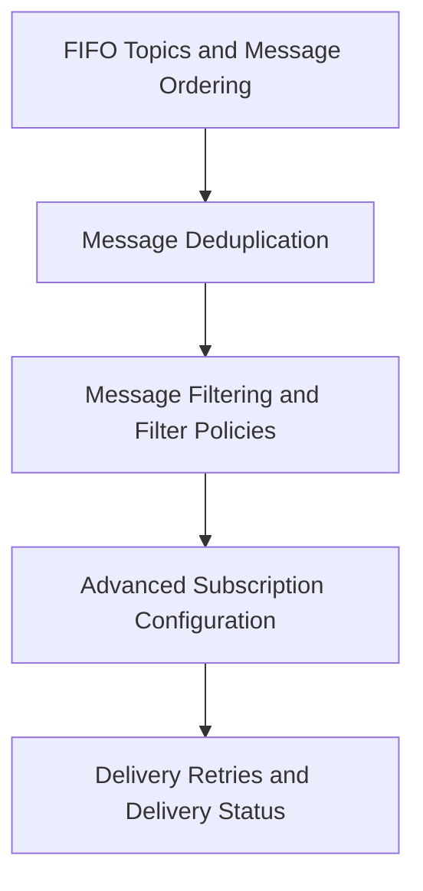
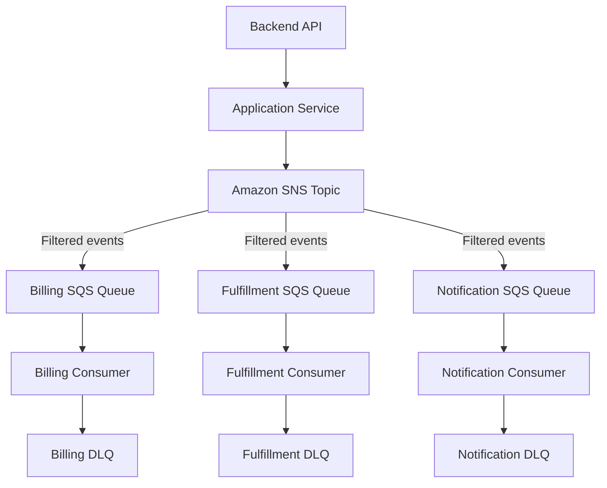

# README

## Overview

This directory documents advanced Amazon SNS capabilities used to build reliable, scalable, and loosely coupled event-driven architectures.

The focus is on production-level subscription behavior, FIFO messaging guarantees, message deduplication, filtering, delivery configuration, retry handling, and operational observability.

These topics build on the foundational SNS concepts covered in the Amazon SNS documentation directory. They explain how to configure and operate SNS subscriptions beyond basic topic creation and message publishing.

## Documentation Index

| No. | Document | Description |
|---|---|---|
| 01 | [FIFO Topics and Message Ordering](01-%20FIFO%20Topics%20and%20Message%20Ordering.md) | FIFO topic behavior, message groups, ordering guarantees, and high-throughput considerations. |
| 02 | [Message Deduplication](02-%20Message%20Deduplication.md) | Explicit and content-based deduplication, deduplication scope, transactional outbox, and consumer idempotency. |
| 03 | [Message Filtering and Filter Policies](03-%20Message%20Filtering%20and%20Filter%20Policies.md) | Attribute-based and body-based filtering, matching operators, subscription routing, and filter policy deployment. |
| 04 | [Advanced Subscription Configuration](04-%20Advanced%20Subscription%20Configuration.md) | Raw message delivery, subscription retry policies, dead-letter queues, protocol configuration, and security. |
| 05 | [Delivery Retries and Delivery Status](05-%20Delivery%20Retries%20and%20Delivery%20Status.md) | Delivery retry behavior, delivery status logging, CloudWatch monitoring, failure recovery, and idempotency. |

## Recommended Reading Order

Follow the documents in sequence to understand how advanced SNS capabilities fit together.

The sequence progresses from message ordering and duplicate suppression to subscription routing, delivery configuration, and operational reliability.

## Core Engineering Concepts

### FIFO Messaging and Ordering

Understand how SNS FIFO topics use message group IDs to define ordering boundaries and how ordering affects downstream consumers.

Key considerations:

- Ordering is scoped to message groups.
- High-throughput FIFO behavior depends on message group distribution.
- A hot message group can become a throughput bottleneck.
- Filtering can cause subscribers to observe gaps in the original message sequence.

### Deduplication and Idempotency

Understand the distinction between transport-level duplicate suppression and application-level idempotency.

Key considerations:

- SNS FIFO deduplication uses a five-minute deduplication interval.
- Explicit deduplication IDs provide control over logical event identity.
- Content-based deduplication hashes the message body, not message attributes.
- Consumer-side idempotency protects business operations against duplicate processing.
- Transactional outbox patterns help preserve publication intent across database and messaging failures.

### Subscription Filtering and Routing

Understand how SNS routes messages independently to subscribers based on filter policies.

Key considerations:

- Message attribute filtering evaluates publisher-supplied metadata.
- Message body filtering evaluates JSON payload fields.
- Different policy fields use AND matching semantics.
- Multiple accepted values within a field use OR matching semantics.
- Filtering is not an authorization mechanism or historical replay mechanism.

### Subscription Configuration

Understand how subscription-level attributes affect message delivery and downstream processing.

Key considerations:

- Raw message delivery changes the message format received by the endpoint.
- Delivery retry configuration is protocol-dependent.
- SNS subscription DLQs capture endpoint delivery failures.
- SQS consumer DLQs capture downstream processing failures.
- Queue policies and IAM permissions control access to subscription endpoints.

### Delivery Reliability and Observability

Understand how to monitor message delivery and recover from endpoint failures.

Key considerations:

- Successful publication does not guarantee successful delivery.
- Successful delivery does not guarantee successful business processing.
- Delivery status logging provides transport-level visibility.
- CloudWatch metrics help identify delivery failures and DLQ growth.
- Controlled replay and consumer idempotency are essential recovery mechanisms.

## Production Architecture

A common production architecture uses SNS FIFO or Standard topics to distribute events to independent SQS queues.

This architecture provides:

- Independent consumer scaling.
- Queue-based buffering between services.
- Subscription-specific event filtering.
- Separate retry and dead-letter handling for each consumer.
- Reduced coupling between publishers and subscribers.
- Independent monitoring and operational recovery.

For critical business workflows, combine SNS delivery capabilities with durable event identifiers, consumer idempotency, and transactional outbox or inbox patterns.

## Production Engineering Checklist

- [ ] Select Standard or FIFO topics according to ordering and throughput requirements.
- [ ] Define message group IDs and deduplication IDs deliberately.
- [ ] Establish stable event schemas and routing metadata.
- [ ] Configure subscription filter policies and test matching behavior.
- [ ] Select raw or enveloped message delivery based on consumer contracts.
- [ ] Configure appropriate endpoint permissions and encryption.
- [ ] Distinguish SNS delivery retries from downstream consumer retries.
- [ ] Configure subscription DLQs and SQS consumer DLQs where required.
- [ ] Enable delivery status logging and CloudWatch monitoring.
- [ ] Implement consumer-side idempotency.
- [ ] Document DLQ investigation and replay procedures.
- [ ] Manage topic and subscription configuration through Infrastructure as Code.

## Key Takeaways

- SNS FIFO ordering and deduplication solve different messaging problems and must be designed independently.
- Subscription filtering and configuration control how events reach downstream services.
- Delivery retries, subscription DLQs, and consumer DLQs operate at different failure boundaries.
- CloudWatch metrics and delivery status logs provide operational visibility, while application instrumentation confirms business processing.
- Reliable SNS architectures require durable event contracts, consumer idempotency, least-privilege access, and controlled recovery procedures.