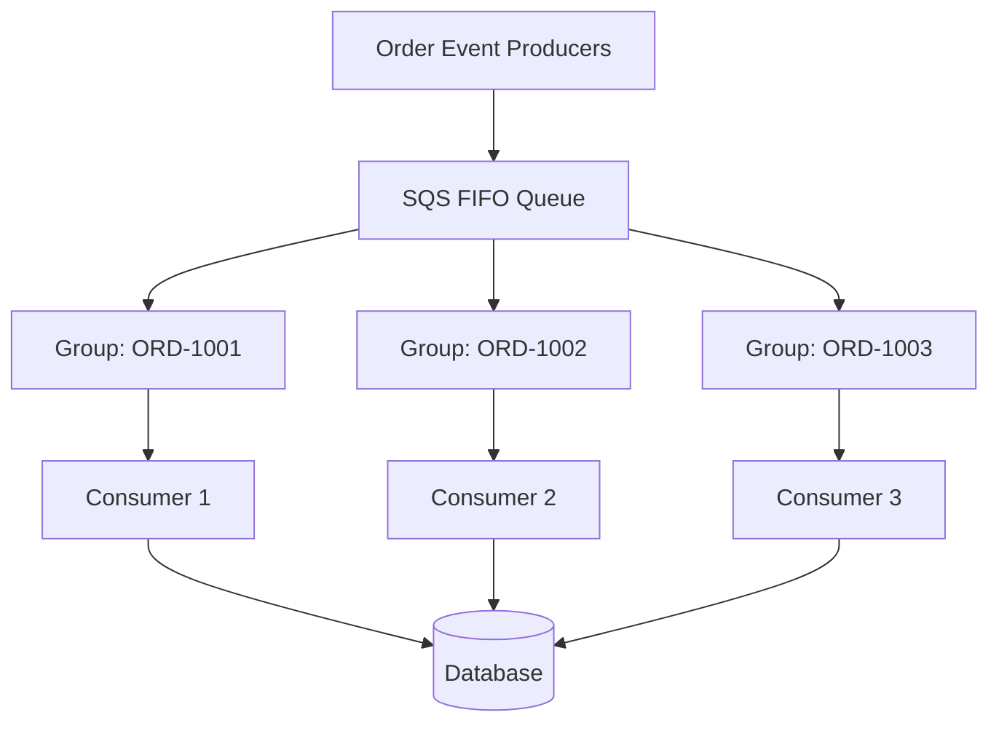
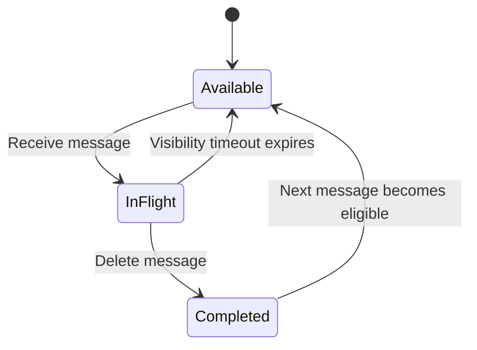
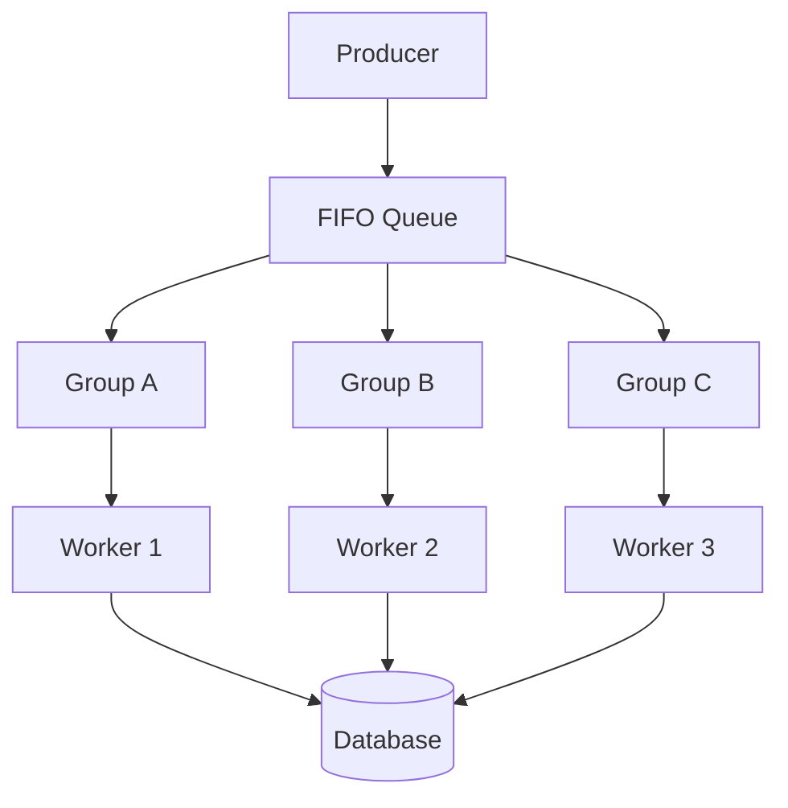
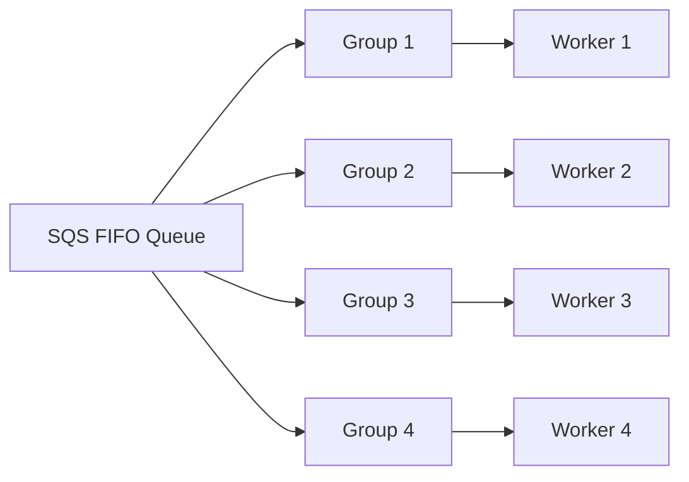
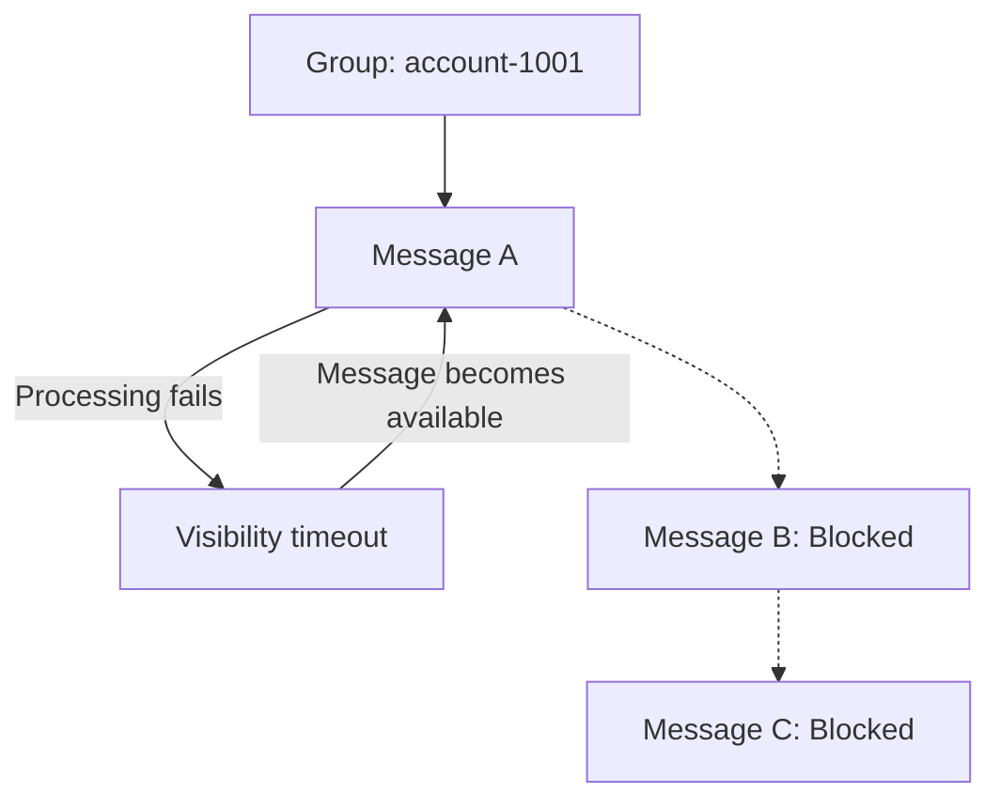
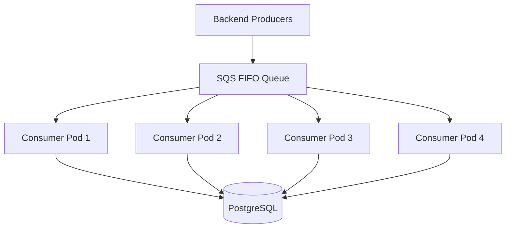

# 01- FIFO Message Groups and Ordering

## Overview

Amazon SQS FIFO queues provide ordered message processing within a message group. Unlike Standard queues, FIFO queues preserve the order of messages within each `MessageGroupId`, making them suitable for workflows where processing order is part of the business contract.

Message groups are also the primary mechanism for controlling concurrency in FIFO queues. Messages belonging to the same group are processed sequentially, while messages belonging to different groups can be processed concurrently.

This creates an important architectural trade-off:

- A single message group provides strict sequential processing but limits concurrency.
- Multiple message groups increase parallelism while preserving ordering within each group.
- Poor message group distribution can create hot groups and reduce effective throughput.

Understanding message groups is essential when designing payment processing, order management, inventory updates, account operations, and other stateful backend workflows.

## FIFO Queue Ordering Fundamentals

SQS FIFO queues preserve the order in which messages are successfully accepted for a given message group.

Every message sent to a FIFO queue must include a `MessageGroupId`.

Example:

```text
Queue: orders.fifo

MessageGroupId: order-1001
    Message A
    Message B
    Message C

MessageGroupId: order-1002
    Message D
    Message E

MessageGroupId: order-1003
    Message F
    Message G
```

SQS preserves ordering within each group:

```text
order-1001: A -> B -> C
order-1002: D -> E
order-1003: F -> G
```

However, SQS does not guarantee a global ordering relationship between different message groups.

Messages from different groups can be delivered and processed concurrently.

### Ordering Scope

| Queue type | Ordering behavior |
|---|---|
| Standard | Best-effort ordering; messages can be delivered out of order |
| FIFO | Strict ordering within each message group |
| FIFO with one message group | Sequential processing across the entire queue |
| FIFO with multiple message groups | Sequential processing within each group, concurrent processing across groups |

A FIFO queue does not provide global ordering across independent message groups.

If an application requires every message to be processed sequentially, it can use one message group. This provides a single ordering boundary but limits parallelism.

## What Is a Message Group?

A message group is a logical collection of related messages identified by the `MessageGroupId` attribute.

SQS uses the group ID to determine which messages must preserve ordering.

The group ID is supplied by the producer when publishing a message.

Example:

```python
import boto3
import json

sqs = boto3.client("sqs", region_name="ap-south-1")

QUEUE_URL = (
    "https://sqs.ap-south-1.amazonaws.com/"
    "123456789012/orders.fifo"
)


def publish_order_event(
    order_id: str,
    event_type: str,
    event_id: str,
) -> str:
    response = sqs.send_message(
        QueueUrl=QUEUE_URL,
        MessageBody=json.dumps({
            "event_id": event_id,
            "order_id": order_id,
            "event_type": event_type,
        }),
        MessageGroupId=order_id,
        MessageDeduplicationId=event_id,
    )

    return response["MessageId"]
```

Here, the order ID is used as the message group ID.

All events belonging to the same order are assigned to the same message group.

For example:

```text
order_id = ORD-1001

MessageGroupId = ORD-1001

Events:
    order.created
    payment.completed
    order.confirmed
    order.shipped
    order.delivered
```

SQS preserves the order of these messages within the group.

## Why Message Groups Exist

Without message groups, a FIFO queue would have a single ordering boundary.

That would restrict processing to sequential execution and limit the ability to scale consumers.

Message groups provide multiple independent ordering boundaries within one queue.

Consider an order-processing system with 10,000 active orders.

A single global message group would force unrelated orders to wait behind one another.

Using the order ID as the group ID allows independent orders to progress concurrently.



The queue can process messages from different groups concurrently while maintaining the required ordering within each group.

## Message Group Processing Behavior

SQS FIFO uses message group identity to coordinate delivery and prevent later messages in the same group from being processed ahead of an earlier in-flight message.

Suppose a queue contains:

```text
Group A:
    A1
    A2
    A3

Group B:
    B1
    B2

Group C:
    C1
    C2
```

A possible processing sequence is:

```text
Consumer 1 -> A1
Consumer 2 -> B1
Consumer 3 -> C1
```

While `A1` is in flight, SQS does not make `A2` available for processing ahead of `A1` in the same group.

Once `A1` is successfully deleted, `A2` becomes eligible for delivery.

The same behavior applies independently to groups B and C.

### Message Group State

A simplified group lifecycle is:



The diagram represents the processing lifecycle of a message. The actual queue coordinates delivery eligibility at the message-group level.

### Visibility Timeout and Ordering

The visibility timeout is particularly important for FIFO queues.

When a consumer receives a message, SQS temporarily hides it from other consumers.

For the same message group, later messages remain blocked until the earlier message is deleted or becomes available again after its visibility timeout expires.

Example:

```text
Group: ORD-1001

Message A -> Received by Consumer 1
Message B -> Waiting
Message C -> Waiting

Consumer 1 fails to delete Message A.

Visibility timeout expires.

Message A becomes available again.
Message B and Message C remain behind it.
```

This behavior protects ordering but can reduce throughput when a message repeatedly fails.

For long-running processing, extend the visibility timeout using `ChangeMessageVisibility` when appropriate. The visibility timeout has a maximum of 12 hours from the initial receive, including extensions.

## Choosing a Message Group ID

The choice of `MessageGroupId` is one of the most important FIFO queue design decisions.

A good group ID represents the smallest business entity whose events must be processed sequentially.

Examples:

| Business workflow | Recommended group ID | Ordering boundary |
|---|---|---|
| Order processing | `order_id` | Individual order |
| Bank account transactions | `account_id` | Individual account |
| Customer profile updates | `customer_id` | Individual customer |
| Inventory updates | `product_id` | Individual product |
| Shipment tracking | `shipment_id` | Individual shipment |
| Device telemetry | `device_id` | Individual device |

The correct choice depends on business invariants.

For example, if inventory updates for a product must be serialized, grouping by product ID is more appropriate than grouping by customer ID.

### Avoid a Single Global Group ID

A single group ID creates one sequential processing stream.

```python
MessageGroupId="global"
```

All messages become part of the same ordering boundary.

This can be appropriate for a genuinely sequential workflow, but it is usually a throughput bottleneck for independent business operations.

### Avoid Excessively Broad Groups

Consider using a tenant ID as the message group ID:

```python
MessageGroupId="tenant-1001"
```

If one tenant generates most of the traffic, that tenant's messages can dominate a single group.

Other independent operations belonging to that tenant will wait behind one another.

Use tenant-level grouping only when all operations for a tenant genuinely require sequential processing.

## Message Group Distribution and Throughput

Message group distribution determines how effectively a FIFO queue can use concurrent consumers.

A queue with many active message groups can expose more parallel processing opportunities than a queue with only a few active groups.

Consider two designs.

### Design A: One Message Group

```text
MessageGroupId = "global"

All messages:
    M1
    M2
    M3
    M4
    M5
    M6
```

Only one message from this group can be processed at a time.

### Design B: Multiple Message Groups

```text
Group A:
    M1
    M2

Group B:
    M3
    M4

Group C:
    M5
    M6
```

Messages from groups A, B, and C can be processed concurrently.



The actual number of concurrently active groups depends on available messages, consumer capacity, queue throughput quotas, and the configured processing architecture.

Having many groups does not guarantee that all of them are processed simultaneously.

## High-Throughput FIFO Queues

SQS FIFO supports high-throughput mode through the `DeduplicationScope` and `FifoThroughputLimit` queue attributes.

For high-throughput FIFO queues, configure:

```text
DeduplicationScope = messageGroup
FifoThroughputLimit = perMessageGroupId
```

These settings allow throughput to scale across message groups rather than treating the entire queue as one deduplication and throughput scope.

Example:

```bash
aws sqs set-queue-attributes \
  --queue-url https://sqs.ap-south-1.amazonaws.com/123456789012/orders.fifo \
  --attributes '{
    "DeduplicationScope": "messageGroup",
    "FifoThroughputLimit": "perMessageGroupId"
  }'
```

High-throughput FIFO is useful when:

- The application has many independent message groups.
- The workload requires higher aggregate throughput.
- Ordering is required within each business entity.
- Producers distribute traffic across message groups.

It does not remove the ordering constraint within an individual group.

A single hot message group remains a serialization bottleneck.

### Important Throughput Considerations

- High-throughput mode does not make one message group process concurrently.
- A large number of groups is useful only when traffic is distributed across them.
- Queue quotas depend on the AWS Region and API operation.
- Batch operations can improve request efficiency.
- Consumer processing capacity must be sufficient to use available queue throughput.

Always verify current regional SQS quotas before designing capacity assumptions.

## FIFO Message Groups and Consumer Concurrency

Message groups provide the concurrency boundary for FIFO consumers.

Suppose an application has:

- 100 active message groups.
- 10 consumer workers.
- A queue with sufficient throughput.
- Messages available in all groups.

The queue can distribute work across multiple groups, allowing workers to process independent business entities concurrently.

However, if all 100 groups are not simultaneously active, the available concurrency may be lower.

### Worker Concurrency Example



A worker should process messages from a group in the order they are delivered and should not independently reorder them through asynchronous task execution.

For example, receiving messages in order and then submitting them to unrelated background tasks can break application-level completion order even if SQS delivered them correctly.

### Batch Processing

FIFO queues support batch receive operations.

A consumer can receive multiple messages, potentially from multiple message groups.

The consumer must preserve the ordering requirements of each group while processing the batch.

For example:

```text
Received batch:

Group A: A1, A2
Group B: B1, B2
Group C: C1
```

A consumer may process independent groups concurrently, but it must not allow `A2` to complete its ordered business operation before `A1`.

For workflows with dependent operations, process each group's messages sequentially.

## Practical Implementation with Python and Boto3

### Create a FIFO Queue

```python
import boto3

sqs = boto3.client("sqs", region_name="ap-south-1")

response = sqs.create_queue(
    QueueName="orders.fifo",
    Attributes={
        "FifoQueue": "true",
        "ContentBasedDeduplication": "false",
        "DeduplicationScope": "messageGroup",
        "FifoThroughputLimit": "perMessageGroupId",
        "VisibilityTimeout": "60",
        "MessageRetentionPeriod": "345600",
    },
)

queue_url = response["QueueUrl"]
```

This creates a FIFO queue with:

- Explicit message deduplication IDs.
- Message-group-scoped deduplication.
- High-throughput FIFO configuration.
- A 60-second visibility timeout.
- Four-day message retention.

### Publish Messages to a Group

```python
import json
import boto3
from botocore.exceptions import BotoCoreError, ClientError

sqs = boto3.client("sqs", region_name="ap-south-1")

QUEUE_URL = (
    "https://sqs.ap-south-1.amazonaws.com/"
    "123456789012/orders.fifo"
)


def publish_order_event(
    order_id: str,
    event_id: str,
    event_type: str,
    sequence_number: int,
) -> str:
    message = {
        "event_id": event_id,
        "order_id": order_id,
        "event_type": event_type,
        "sequence_number": sequence_number,
    }

    try:
        response = sqs.send_message(
            QueueUrl=QUEUE_URL,
            MessageBody=json.dumps(message),
            MessageGroupId=order_id,
            MessageDeduplicationId=event_id,
        )

        return response["MessageId"]

    except (ClientError, BotoCoreError):
        raise
```

The same `order_id` is used for all events belonging to an order.

The stable `event_id` is used as the deduplication ID.

These identifiers serve different purposes:

| Attribute | Purpose |
|---|---|
| `MessageGroupId` | Defines the ordering and concurrency boundary |
| `MessageDeduplicationId` | Identifies duplicate message submissions within the deduplication interval |

Do not use a new random deduplication ID for every retry of the same logical event. Doing so defeats duplicate suppression.

### Consume Messages

```python
import json
import boto3
from botocore.exceptions import BotoCoreError, ClientError

sqs = boto3.client("sqs", region_name="ap-south-1")

QUEUE_URL = (
    "https://sqs.ap-south-1.amazonaws.com/"
    "123456789012/orders.fifo"
)


def receive_order_messages() -> list[dict]:
    try:
        response = sqs.receive_message(
            QueueUrl=QUEUE_URL,
            MaxNumberOfMessages=10,
            WaitTimeSeconds=20,
            VisibilityTimeout=60,
            MessageSystemAttributeNames=[
                "MessageGroupId",
                "SequenceNumber",
                "ApproximateReceiveCount",
            ],
        )

        return response.get("Messages", [])

    except (ClientError, BotoCoreError):
        raise


def process_messages(messages: list[dict]) -> None:
    for message in messages:
        event = json.loads(message["Body"])

        try:
            process_order_event(event)

            sqs.delete_message(
                QueueUrl=QUEUE_URL,
                ReceiptHandle=message["ReceiptHandle"],
            )

        except Exception:
            raise


def process_order_event(event: dict) -> None:
    print(
        f"Processing {event['event_type']} "
        f"for {event['order_id']}"
    )
```

This example processes the returned batch sequentially. A production implementation should also include:

- Durable idempotency.
- Structured logging.
- Bounded processing time.
- Visibility timeout extension when needed.
- DLQ configuration.
- Explicit handling of transient and permanent failures.
- Graceful shutdown behavior.

The consumer should delete a message only after its business operation has committed successfully.

## FIFO Ordering and Database Transactions

SQS ordering does not automatically guarantee that database operations complete in the same order.

Consider two events:

```text
1. order.created
2. payment.completed
```

SQS delivers them in order.

However, if the consumer submits both operations to independent asynchronous tasks, the second database transaction may complete first.

This creates an application-level ordering violation.

A safer processing pattern is:

1. Receive the next eligible message.
2. Validate the event.
3. Start a database transaction.
4. Apply the business update.
5. Commit the transaction.
6. Delete the SQS message.

For example, an order service may enforce state transitions:

```text
PENDING -> PAID -> CONFIRMED -> SHIPPED
```

The database should reject invalid transitions even when the queue preserves message order.

FIFO ordering is a transport guarantee, not a replacement for domain-level consistency checks.

## Failure Handling Within a Message Group

A failed message can block later messages in the same FIFO group.

Consider:

```text
Group: account-1001

Message A: Deposit
Message B: Withdrawal
Message C: Balance Adjustment
```

If Message A fails repeatedly, Messages B and C cannot advance ahead of it within the same group.

This behavior protects ordering but can create head-of-line blocking.

### Failure Scenario



### Mitigation Strategies

- Fix deterministic processing errors quickly.
- Use a suitable visibility timeout.
- Extend visibility for long-running operations.
- Configure a FIFO-compatible dead-letter queue.
- Set an appropriate `maxReceiveCount`.
- Alert on oldest-message age and repeated receives.
- Make replay procedures explicit.

Moving a failed message to a DLQ allows later messages in the source group to progress, but it also breaks the complete processing sequence observed by that consumer.

For stateful workflows, moving a message to a DLQ must be treated as a business recovery decision, not merely a queue maintenance operation.

## Dead-Letter Queues and FIFO Ordering

A FIFO source queue must use a FIFO dead-letter queue.

For example:

```text
Source:
    orders.fifo

DLQ:
    orders-dlq.fifo
```

Configure the source queue's redrive policy:

```json
{
  "deadLetterTargetArn": "arn:aws:sqs:ap-south-1:123456789012:orders-dlq.fifo",
  "maxReceiveCount": 5
}
```

The `maxReceiveCount` value controls how many receives are permitted before SQS moves a message to the DLQ according to the redrive policy.

When a message moves to the DLQ, later messages in the source group can become eligible for delivery.

This creates an important ordering trade-off:

- Keeping the failed message in the source queue preserves the sequence but blocks progress.
- Moving it to the DLQ allows progress but creates a gap in the source consumer's processing history.

For financial or stateful workflows, design a reconciliation process that can determine whether later events are safe to process without the failed event.

## Message Groups and Multi-Consumer Architectures

FIFO message groups allow multiple consumers to share one queue while preserving ordering within each group.

This is useful for horizontally scaled worker deployments.

Example Kubernetes architecture:



Scaling the number of consumer pods can increase processing capacity when enough independent message groups are available.

However, increasing worker count does not increase concurrency within a single message group.

A deployment with 20 workers and one active message group still has a single ordering boundary.

## Monitoring Message Groups

FIFO queue monitoring should include both queue-level metrics and application-level indicators.

Important CloudWatch metrics include:

| Metric | Purpose |
|---|---|
| `ApproximateNumberOfMessagesVisible` | Messages currently available for receiving |
| `ApproximateNumberOfMessagesNotVisible` | Messages currently in flight |
| `ApproximateAgeOfOldestMessage` | Age of the oldest message |
| `NumberOfMessagesSent` | Messages successfully sent |
| `NumberOfMessagesReceived` | Messages received by consumers |
| `NumberOfMessagesDeleted` | Messages deleted after processing |

These metrics are approximate and do not provide a complete per-message-group operational view.

### Application-Level Metrics

Track:

- Messages processed per business group.
- Processing latency per group.
- Failed processing attempts.
- Repeated receives.
- Long-running in-flight operations.
- Group-level traffic distribution.
- Business-level sequence violations.

Avoid using raw customer IDs, account IDs, or other high-cardinality group identifiers as CloudWatch metric dimensions.

Instead, aggregate group-level metrics by workload, tenant tier, or bounded business category.

### Detecting Hot Message Groups

A hot message group receives a disproportionate amount of traffic.

Symptoms include:

- Increasing queue age.
- High processing latency for one business entity.
- Low aggregate consumer utilization despite backlog.
- Repeatedly delayed messages for one group.
- Uneven workload distribution.

Because SQS does not expose a complete built-in per-group performance dashboard, application instrumentation is often necessary to identify hot groups.

## Security Considerations

Message group IDs are part of message metadata and should not contain sensitive information unnecessarily.

Recommended practices:

- Use opaque identifiers where possible.
- Avoid embedding personal or financial information in group IDs.
- Restrict producer permissions to authorized applications.
- Use least-privilege IAM policies.
- Enable SQS encryption.
- Protect DLQs with appropriate queue policies and encryption.
- Avoid logging sensitive message bodies unnecessarily.

Message group IDs are not an authorization boundary. They do not isolate tenants or enforce access control.

If multiple tenants share a queue, enforce tenant authorization in the producer and consumer application layers.

## Common Mistakes and Production Pitfalls

### Using One Global Message Group

All messages become sequential, creating a throughput bottleneck.

**Avoidance:** Use a business entity identifier as the group ID when independent entities can be processed concurrently.

### Using Random Message Group IDs

Random group IDs distribute messages but destroy ordering between related business events.

**Avoidance:** Derive group IDs from stable business identifiers.

### Assuming Global FIFO Ordering

FIFO ordering applies within a message group, not across the entire queue.

**Avoidance:** Identify the actual ordering boundary required by the business workflow.

### Using the Wrong Ordering Boundary

Grouping by tenant when only account-level ordering is required can serialize unrelated account operations.

**Avoidance:** Choose the smallest entity whose operations must remain sequential.

### Assuming More Consumers Always Increase Throughput

Consumers cannot process messages concurrently within one active message group.

**Avoidance:** Ensure the workload has enough independent groups and monitor group distribution.

### Processing Messages Concurrently Without Group Awareness

A consumer may receive messages in order but execute their business operations concurrently.

**Avoidance:** Preserve sequential execution for dependent messages belonging to the same group.

### Ignoring Visibility Timeout

A short timeout can cause messages to become visible again while processing is still running.

**Avoidance:** Set visibility timeout based on processing duration and extend it when required.

### Treating DLQ Movement as a Harmless Retry

Moving a failed message out of a FIFO group can allow later messages to proceed without the missing event.

**Avoidance:** Use business-aware recovery and reconciliation procedures.

### Assuming FIFO Eliminates Duplicate Processing

FIFO deduplication suppresses duplicate sends within its deduplication interval, but consumers can still receive messages again after visibility timeout expiration or failed processing.

**Avoidance:** Implement durable consumer idempotency.

## Production Best Practices

- Select `MessageGroupId` according to the smallest business entity requiring sequential processing.
- Use stable group identifiers across producer instances and deployments.
- Distribute independent workloads across multiple groups.
- Enable high-throughput FIFO mode when workload distribution and throughput requirements justify it.
- Keep processing sequential within each group.
- Use bounded consumer concurrency across independent groups.
- Set visibility timeout according to actual processing duration.
- Extend visibility for long-running work where appropriate.
- Configure FIFO-compatible DLQs and define ordering recovery procedures.
- Implement database-level state validation and idempotency.
- Monitor queue age, in-flight messages, processing latency, and workload skew.
- Test failure scenarios involving retries, visibility expiration, and DLQ movement.

## Key Takeaways

- SQS FIFO preserves message ordering within each `MessageGroupId`, not globally across all groups.
- Message groups define both the ordering boundary and the opportunity for concurrent processing.
- A single hot or global message group limits throughput regardless of consumer count.
- Visibility timeout expiration and repeated failures can block later messages in the same group.
- FIFO ordering must be combined with consumer idempotency, database consistency checks, and business-aware DLQ recovery.