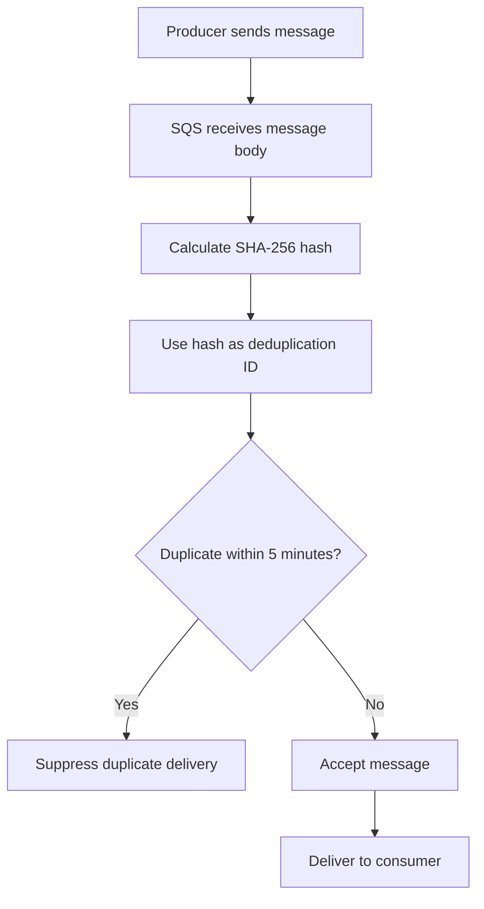
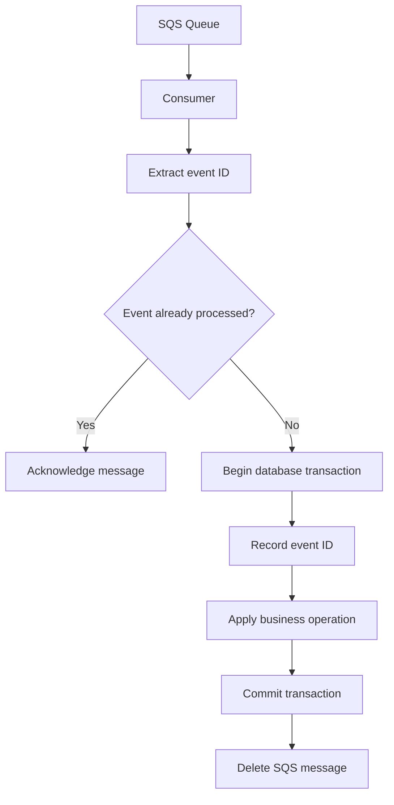
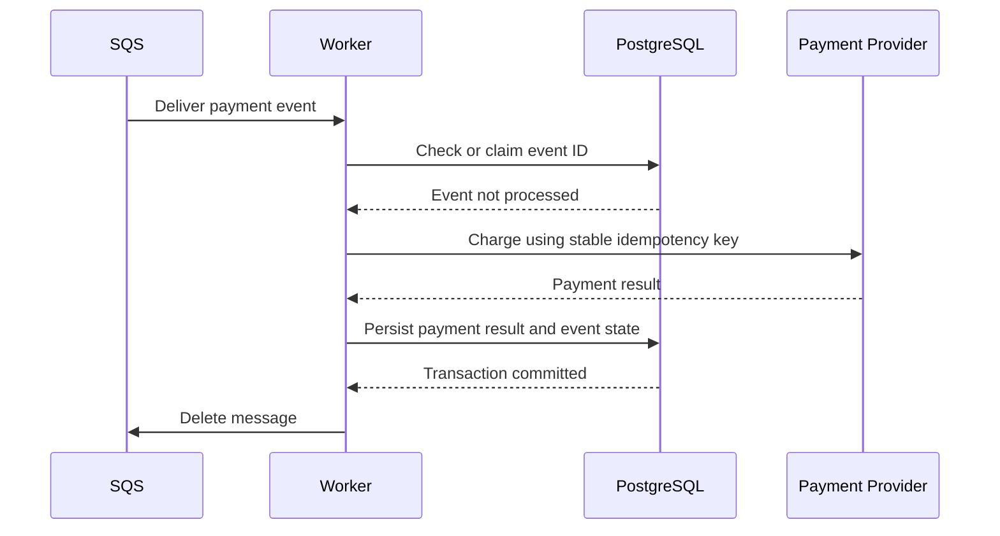
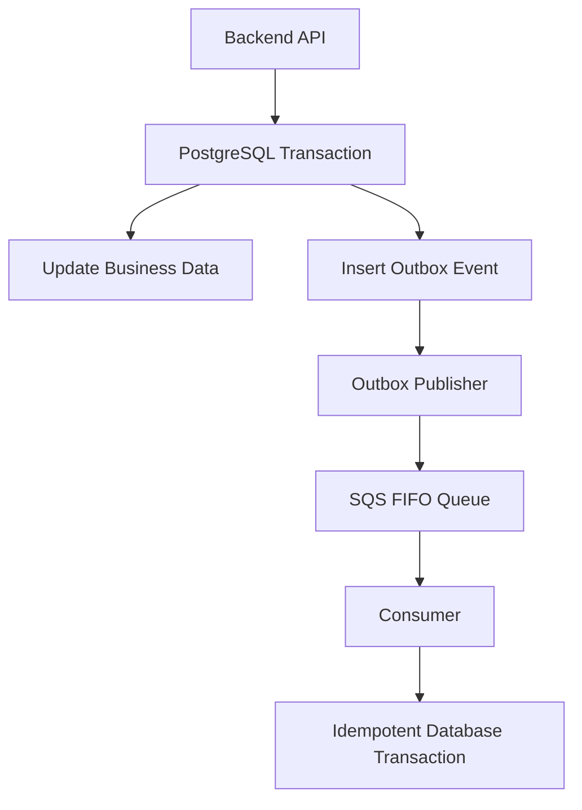

# 02- Message Deduplication and Idempotency

## Overview

Amazon Simple Queue Service (Amazon SQS) provides message deduplication mechanisms for FIFO queues and delivery semantics that require consumers to handle duplicate messages safely. These capabilities address two related but distinct problems:

- **Message deduplication:** Preventing duplicate messages from being accepted or delivered within a defined scope and time window.
- **Idempotency:** Ensuring that processing the same logical operation multiple times produces the same business outcome as processing it once.

These concepts are essential in distributed systems because message delivery, network communication, and consumer execution are not atomic with database transactions or external API calls.

For example, an order-processing service might receive an order event, charge a payment provider, and update a PostgreSQL database. If the consumer crashes after charging the customer but before deleting the SQS message, the message can be delivered again. Without application-level idempotency, the customer may be charged twice.

SQS FIFO deduplication reduces duplicate message acceptance, but it does not replace consumer-side idempotency. Production systems should implement both where appropriate.

## Message Deduplication Fundamentals

### What Is Message Deduplication?

Message deduplication identifies repeated message submissions and prevents the same logical message from being accepted more than once within a configured deduplication scope and interval.

SQS FIFO queues support message deduplication using:

- Explicit message deduplication IDs.
- Content-based deduplication.

SQS Standard queues do not provide FIFO-style producer deduplication. Standard queues use at-least-once delivery, so consumers must tolerate duplicate messages.

### Why Deduplication Matters

Duplicate messages can occur for several reasons:

- A producer successfully sends a message but does not receive the response because of a network timeout.
- A producer retries a request without knowing whether the original request succeeded.
- An application publishes the same event multiple times.
- A retry mechanism resubmits a request after an ambiguous failure.
- A consumer receives a message more than once.

Consider this sequence:

1. A producer sends an order event.
2. SQS accepts the message.
3. The response is lost due to a network interruption.
4. The producer assumes the operation failed.
5. The producer retries the request.
6. Without deduplication, both submissions may be accepted.

Deduplication reduces this risk for FIFO queues.

### Deduplication Characteristics

| Characteristic | SQS FIFO | SQS Standard |
|---|---|---|
| Producer deduplication | Supported | Not supported as a FIFO feature |
| Deduplication ID | Supported | Not supported |
| Content-based deduplication | Supported | Not supported |
| Deduplication interval | 5 minutes | Not applicable |
| Ordering | Per message group | Best-effort |
| Delivery semantics | Exactly-once processing conditions under documented constraints; duplicate delivery must still be handled defensively | At least once |
| Consumer idempotency | Recommended | Required for reliable business processing |

## FIFO Message Deduplication

### Explicit Message Deduplication ID

An explicit `MessageDeduplicationId` identifies a logical message submission.

When a FIFO queue receives multiple messages with the same deduplication ID within the five-minute deduplication interval and applicable deduplication scope, SQS accepts the send request but does not deliver the duplicate message again.

The producer should generate the ID from a stable business event identifier rather than from a random value generated for each retry.

Example:

```python
import boto3

sqs = boto3.client("sqs", region_name="ap-south-1")

QUEUE_URL = "https://sqs.ap-south-1.amazonaws.com/123456789012/orders.fifo"


def publish_order_event(
    order_id: str,
    event_id: str,
    event_type: str,
) -> dict:
    response = sqs.send_message(
        QueueUrl=QUEUE_URL,
        MessageBody=(
            f'{{"event_id":"{event_id}",'
            f'"order_id":"{order_id}",'
            f'"event_type":"{event_type}"}}'
        ),
        MessageGroupId=f"order-{order_id}",
        MessageDeduplicationId=event_id,
    )

    return response
```

The important property is that retries for the same logical event reuse the same `event_id`.

Generating a new UUID for every retry defeats deduplication because SQS sees each submission as a different message.

### Deduplication Interval

SQS FIFO maintains deduplication information for a five-minute interval.

Important behavior:

- Repeated submissions with the same deduplication ID within the interval are suppressed.
- The producer can receive a successful response even when the message is recognized as a duplicate.
- SQS continues tracking deduplication IDs after the original message has been delivered.
- After the deduplication interval expires, the same ID can be accepted as a new message.

This interval is not a permanent business-level uniqueness guarantee.

For example, a producer might retry an ambiguous request after six minutes. SQS may accept the message again because the original deduplication record is no longer within the five-minute interval.

**Production implication:** Use application-level event IDs and consumer-side idempotency even when FIFO deduplication is enabled.

### Deduplication Scope

FIFO queues support two deduplication scopes:

| Scope | Behavior | Use case |
|---|---|---|
| `queue` | Deduplication IDs are scoped to the entire queue | Queue-wide deduplication |
| `messageGroup` | Deduplication IDs are scoped to individual message groups | Independent high-throughput message groups |

The scope affects whether identical deduplication IDs used in different message groups are considered duplicates.

For high-throughput FIFO queues, use the following configuration:

```python
import boto3

sqs = boto3.client("sqs", region_name="ap-south-1")

response = sqs.set_queue_attributes(
    QueueUrl="https://sqs.ap-south-1.amazonaws.com/123456789012/orders.fifo",
    Attributes={
        "DeduplicationScope": "messageGroup",
        "FifoThroughputLimit": "perMessageGroupId",
    },
)
```

These settings enable high-throughput FIFO behavior. They should be selected intentionally because changing the deduplication scope also changes the uniqueness boundary.

## Content-Based Deduplication

### What Is Content-Based Deduplication?

Content-based deduplication allows SQS to generate a deduplication ID automatically by calculating a SHA-256 hash of the message body.

It is enabled when creating a FIFO queue:

```python
import boto3

sqs = boto3.client("sqs", region_name="ap-south-1")

response = sqs.create_queue(
    QueueName="orders.fifo",
    Attributes={
        "FifoQueue": "true",
        "ContentBasedDeduplication": "true",
    },
)
```

When enabled, producers do not need to supply an explicit `MessageDeduplicationId` for every message.

### How It Works



Content-based deduplication uses the message body only. Message attributes are excluded from the generated hash.

For example, these two messages have identical bodies but different attributes:

```python
message_body = '{"order_id":"ORD-1001","status":"created"}'

message_a = {
    "MessageBody": message_body,
    "MessageAttributes": {
        "source": {
            "DataType": "String",
            "StringValue": "checkout-api",
        }
    },
}

message_b = {
    "MessageBody": message_body,
    "MessageAttributes": {
        "source": {
            "DataType": "String",
            "StringValue": "admin-api",
        }
    },
}
```

Because the body is identical, content-based deduplication generates the same deduplication ID.

If message attributes represent meaningful differences in business events, relying exclusively on content-based deduplication can suppress a legitimate message.

### Explicit IDs Override Content-Based Deduplication

When content-based deduplication is enabled, an explicitly supplied `MessageDeduplicationId` takes precedence over the generated hash.

```python
response = sqs.send_message(
    QueueUrl=QUEUE_URL,
    MessageBody='{"order_id":"ORD-1001","status":"created"}',
    MessageGroupId="order-ORD-1001",
    MessageDeduplicationId="order-event-1001",
)
```

This allows applications to define deduplication according to business event identity rather than message content.

### When to Use Content-Based Deduplication

Use content-based deduplication when:

- Identical message bodies always represent the same logical event.
- Message attributes do not distinguish separate business operations.
- Producers cannot conveniently maintain explicit deduplication IDs.
- The message format is stable and deterministic.

Prefer explicit IDs when:

- Events have stable identifiers.
- Identical payloads can represent different business operations.
- Message attributes contain meaningful event metadata.
- The application needs precise control over retry behavior.

## Message Deduplication and Message Groups

`MessageGroupId` and `MessageDeduplicationId` solve different problems.

| Attribute | Responsibility |
|---|---|
| `MessageGroupId` | Defines the ordering and concurrency boundary |
| `MessageDeduplicationId` | Identifies duplicate logical message submissions |

For example:

```python
response = sqs.send_message(
    QueueUrl=QUEUE_URL,
    MessageBody='{"order_id":"ORD-1001","action":"payment_requested"}',
    MessageGroupId="order-ORD-1001",
    MessageDeduplicationId="payment-request-ORD-1001",
)
```

Messages belonging to the same order use the same message group to preserve their processing order. Each distinct business event uses its own deduplication ID.

A common mistake is to use the same deduplication ID for every message in a group. This can suppress legitimate messages within the deduplication interval.

## Idempotency Fundamentals

### What Is Idempotency?

An operation is idempotent when executing it multiple times produces the same effective business result as executing it once.

For example, setting an order's status to `PAID` is naturally idempotent if repeated execution does not create additional effects.

Incrementing an account balance is not inherently idempotent:

```python
account.balance += 100
```

Executing this operation twice increases the balance by 200.

An idempotent implementation identifies the logical operation and ensures that its business effect is applied only once.

### Why Consumer Idempotency Is Necessary

SQS does not participate in the same atomic transaction as an application's database or external services.

A consumer may:

1. Receive a message.
2. Update a database.
3. Crash before deleting the message.
4. Receive the same message again.
5. Repeat the database operation.

This is a fundamental distributed-systems problem: the consumer cannot atomically commit an application transaction and acknowledge the SQS message.

The consumer must therefore tolerate repeated execution.

### Idempotent Consumer Architecture



The event ID and business update should be committed in the same database transaction.

If the consumer crashes before the transaction commits, neither change is persisted. If it crashes after commit but before deleting the message, the next delivery detects the existing event ID and skips the business operation.

## Implementing Idempotency with PostgreSQL

### Idempotency Table

A common implementation stores processed event IDs in a dedicated table.

```sql
CREATE TABLE processed_events (
    event_id VARCHAR(128) PRIMARY KEY,
    event_type VARCHAR(100) NOT NULL,
    processed_at TIMESTAMPTZ NOT NULL DEFAULT NOW()
);
```

The primary key provides a database-enforced uniqueness constraint.

This is important because application-level checks alone are vulnerable to race conditions.

For example, two consumers may concurrently execute:

```sql
SELECT event_id
FROM processed_events
WHERE event_id = 'payment-event-1001';
```

Both can observe that the event does not exist and proceed.

A unique constraint ensures that only one transaction can successfully claim the event ID.

### Atomic Event Processing

The following example uses PostgreSQL and `psycopg` to record an event and update an order within one transaction.

```python
import json
import logging

import psycopg
from psycopg.errors import UniqueViolation

logger = logging.getLogger(__name__)


def process_order_event(
    connection: psycopg.Connection,
    message_body: str,
) -> bool:
    event = json.loads(message_body)

    event_id = event["event_id"]
    order_id = event["order_id"]
    event_type = event["event_type"]

    try:
        with connection.transaction():
            with connection.cursor() as cursor:
                cursor.execute(
                    """
                    INSERT INTO processed_events (
                        event_id,
                        event_type
                    )
                    VALUES (%s, %s)
                    ON CONFLICT (event_id) DO NOTHING
                    RETURNING event_id
                    """,
                    (event_id, event_type),
                )

                inserted = cursor.fetchone()

                if inserted is None:
                    logger.info(
                        "Skipping duplicate event: %s",
                        event_id,
                    )
                    return False

                cursor.execute(
                    """
                    UPDATE orders
                    SET status = 'PAID',
                        updated_at = NOW()
                    WHERE order_id = %s
                      AND status = 'PENDING'
                    """,
                    (order_id,),
                )

                if cursor.rowcount != 1:
                    raise ValueError(
                        f"Order transition failed: {order_id}"
                    )

        logger.info("Processed event: %s", event_id)
        return True

    except Exception:
        logger.exception(
            "Failed to process event: %s",
            event_id,
        )
        raise
```

The important characteristics are:

- Event registration and business updates share one transaction.
- The unique constraint prevents concurrent duplicate claims.
- A duplicate event does not repeat the business update.
- An exception rolls back both the event record and the business update.
- The exception is propagated so the SQS consumer does not acknowledge a failed operation.

The example assumes that the event is valid and that the order transition should occur from `PENDING` to `PAID`. Production systems should define explicit handling for invalid transitions, missing orders, and permanent business errors.

### Database Transaction Boundaries

The following operations should generally be committed atomically:

- Registering the event ID as processed.
- Applying the corresponding database changes.
- Recording any required business audit information.

Do not commit the processed event ID before applying the business operation.

Otherwise, a failure between those operations can permanently mark an event as processed even though its business effect was never applied.

## Idempotent SQS Consumer with Python

The consumer should acknowledge a message only after its business transaction succeeds.

```python
import logging
import boto3
import psycopg

logger = logging.getLogger(__name__)

sqs = boto3.client("sqs", region_name="ap-south-1")

QUEUE_URL = (
    "https://sqs.ap-south-1.amazonaws.com/"
    "123456789012/orders.fifo"
)


def consume_messages(
    connection: psycopg.Connection,
) -> None:
    response = sqs.receive_message(
        QueueUrl=QUEUE_URL,
        MaxNumberOfMessages=10,
        WaitTimeSeconds=20,
        MessageSystemAttributeNames=[
            "ApproximateReceiveCount",
            "MessageGroupId",
            "SequenceNumber",
        ],
    )

    for message in response.get("Messages", []):
        receipt_handle = message["ReceiptHandle"]

        try:
            process_order_event(
                connection,
                message["Body"],
            )

            sqs.delete_message(
                QueueUrl=QUEUE_URL,
                ReceiptHandle=receipt_handle,
            )

        except Exception:
            logger.exception(
                "Message processing failed; leaving message "
                "for retry"
            )
```

This example demonstrates the processing sequence, not a complete worker lifecycle. A production worker should also implement:

- Connection pooling and connection health checks.
- Controlled retry behavior.
- Visibility timeout management.
- Graceful shutdown.
- Dead-letter queue configuration.
- Structured logging and metrics.
- Per-message error classification.

For FIFO queues, preserve sequential processing within each message group. Parallel processing should be designed around independent groups rather than allowing messages from the same group to execute concurrently.

## Idempotency and External Side Effects

Database transactions cannot make external operations atomic.

Consider a payment workflow:

1. Receive a payment event.
2. Call a payment provider.
3. Update the local database.
4. Delete the SQS message.

If the payment provider successfully charges the customer but the application crashes before updating PostgreSQL, the message may be delivered again.

A database idempotency table alone cannot prevent a second external charge because the external operation and database transaction are separate.

### Use Provider-Supported Idempotency Keys

If the external API supports idempotency keys, pass the stable event ID or payment operation ID.

```python
def charge_customer(
    payment_client,
    payment_id: str,
    amount: int,
    currency: str,
):
    return payment_client.create_payment(
        amount=amount,
        currency=currency,
        idempotency_key=payment_id,
    )
```

The exact parameter and behavior depend on the payment provider.

The same logical payment request must reuse the same key across retries. Generating a new key for each attempt can result in duplicate charges.

### Recommended Payment Processing Flow



This sequence illustrates the intended workflow, but the database and payment provider still do not share a distributed transaction.

For high-value operations, use a durable state machine and reconciliation process:

- Persist the payment operation before calling the provider.
- Use a stable provider idempotency key.
- Track states such as `PENDING`, `SUCCEEDED`, and `FAILED`.
- Retry ambiguous requests with the same key.
- Reconcile local state with the provider when the outcome is uncertain.
- Do not mark an operation permanently failed merely because a network request timed out.

## Idempotency Keys and API Design

Idempotency is also important at the REST API boundary.

A client may submit a payment request and lose the HTTP response. Retrying the request should not create another payment.

An API can accept an idempotency key:

```http
POST /api/payments
Idempotency-Key: payment-request-1001
Content-Type: application/json
```

The backend should:

1. Validate the key and request.
2. Associate the key with the authenticated principal and operation.
3. Persist the request identity and processing state.
4. Return the previous result for a completed duplicate request.
5. Prevent concurrent requests with the same key from executing independently.
6. Reject reuse of the same key with a materially different request payload.

A typical database structure is:

```sql
CREATE TABLE api_idempotency_keys (
    principal_id VARCHAR(128) NOT NULL,
    idempotency_key VARCHAR(255) NOT NULL,
    request_hash VARCHAR(64) NOT NULL,
    status VARCHAR(30) NOT NULL,
    response_body JSONB,
    created_at TIMESTAMPTZ NOT NULL DEFAULT NOW(),
    updated_at TIMESTAMPTZ NOT NULL DEFAULT NOW(),

    PRIMARY KEY (principal_id, idempotency_key)
);
```

The request hash helps detect accidental reuse of a key with different input.

For long-running operations, store an explicit state rather than holding an HTTP request open until processing completes.

## Idempotency with Redis

Redis can be used for short-lived idempotency checks, especially when the application needs a fast distributed coordination mechanism.

A basic pattern uses `SET` with `NX` and an expiration:

```python
import redis

redis_client = redis.Redis(
    host="redis",
    port=6379,
    decode_responses=True,
)


def claim_event(event_id: str) -> bool:
    result = redis_client.set(
        f"processed-event:{event_id}",
        "1",
        nx=True,
        ex=86400,
    )

    return result is not None
```

`NX` ensures that the key is created only if it does not already exist.

However, Redis-only deduplication has limitations:

- Keys expire.
- Redis data may be lost depending on persistence and failover configuration.
- A process can claim a key and crash before completing the business operation.
- Redis and PostgreSQL do not share an atomic transaction.

A Redis key should not be treated as proof that a business operation completed unless the workflow is designed to handle incomplete claims and recovery.

For critical business operations, a durable database uniqueness constraint is generally a stronger source of truth. Redis can complement it with caching or short-lived coordination.

## Idempotency and the Transactional Outbox Pattern

The transactional outbox pattern addresses another distributed-systems problem: committing a database change and publishing an event to SQS cannot normally happen in one atomic transaction.

Without an outbox:

1. Update an order in PostgreSQL.
2. Publish an event to SQS.
3. The application crashes between the two operations.

This can leave the database updated without a corresponding event.

The outbox pattern stores the business change and publication intent in the same database transaction.

```sql
CREATE TABLE outbox_events (
    event_id VARCHAR(128) PRIMARY KEY,
    aggregate_id VARCHAR(128) NOT NULL,
    event_type VARCHAR(100) NOT NULL,
    payload JSONB NOT NULL,
    created_at TIMESTAMPTZ NOT NULL DEFAULT NOW(),
    published_at TIMESTAMPTZ
);
```

A transaction updates the business entity and inserts the outbox event:

```sql
BEGIN;

UPDATE orders
SET status = 'PAID',
    updated_at = NOW()
WHERE order_id = 'ORD-1001';

INSERT INTO outbox_events (
    event_id,
    aggregate_id,
    event_type,
    payload
)
VALUES (
    'payment-completed-1001',
    'ORD-1001',
    'OrderPaid',
    '{"order_id":"ORD-1001","status":"PAID"}'
);

COMMIT;
```

A separate publisher reads unpublished events, sends them to SQS, and marks them as published.



The publisher can crash after SQS accepts a message but before it marks the outbox row as published. It will publish the event again.

Use the outbox `event_id` as the SQS `MessageDeduplicationId` and retain consumer-side idempotency. This combination handles publisher retries within the SQS deduplication interval and protects against duplicates beyond that interval.

## FIFO Deduplication and Exactly-Once Processing

SQS FIFO supports exactly-once processing behavior under documented conditions, but this must not be interpreted as a guarantee that arbitrary application side effects execute exactly once.

The relevant conditions include:

- The consumer uses an SQS FIFO queue.
- The queue is correctly configured for FIFO deduplication.
- The consumer processes and deletes the message before the visibility timeout expires.
- Subscription filtering is not used in an SNS FIFO to SQS FIFO workflow.
- Network or service failures do not prevent the required acknowledgment behavior.

Even with FIFO deduplication, applications should use idempotent business operations.

Important distinctions:

| Concept | Meaning |
|---|---|
| Producer deduplication | Suppresses repeated sends within the deduplication interval and scope |
| FIFO ordering | Preserves message order within a message group |
| At-least-once delivery | A message may be delivered more than once |
| Consumer idempotency | Prevents duplicate business effects |
| Exactly-once business outcome | Requires application-level controls across all relevant systems |

A payment provider, database, email service, and SQS do not become one atomic system simply because a FIFO queue is used.

## Failure Scenarios and Recovery

| Failure scenario | Risk | Recommended handling |
|---|---|---|
| Producer timeout after successful send | Producer resubmits the same event | Retry with the same stable deduplication ID |
| Retry after five minutes | SQS may accept the event again | Consumer-side durable idempotency |
| Consumer crashes before database commit | Message is delivered again | Transaction rollback and retry |
| Consumer crashes after database commit | Business update may be repeated | Detect event ID and skip duplicate processing |
| External API succeeds but local update fails | External side effect may repeat | Provider idempotency key and reconciliation |
| Redis key exists but operation failed | Event may be incorrectly skipped | Use durable operation state and recovery |
| Outbox publisher crashes after send | Event may be published again | Stable event ID and consumer idempotency |
| Two consumers process the same event | Concurrent duplicate effects | Database uniqueness constraints and atomic transactions |

### Handling Poison Messages

Idempotency does not make every message valid or processable.

A message may repeatedly fail because of:

- Invalid payload structure.
- Missing required business data.
- Unsupported event versions.
- Permanent business-rule violations.
- Unavailable dependencies.

Configure a dead-letter queue and an appropriate `maxReceiveCount` to prevent endless retries.

For FIFO queues, moving a failed message to a DLQ can allow later messages in the same group to proceed. This may create a business sequence gap, so the application must decide whether later events remain valid without the failed event.

Before redriving messages, verify:

- The original failure has been fixed.
- Reprocessing is safe.
- Event IDs remain stable.
- Ordering dependencies are understood.
- Duplicate business effects are prevented.

## Monitoring and Operational Considerations

Deduplication and idempotency failures are not always visible through queue depth alone. Monitor both queue behavior and application-level processing.

### SQS Metrics

| Metric | Operational value |
|---|---|
| `ApproximateNumberOfMessagesVisible` | Messages waiting for processing |
| `ApproximateNumberOfMessagesNotVisible` | Messages currently in flight |
| `ApproximateAgeOfOldestMessage` | Indicates processing delays |
| `NumberOfMessagesSent` | Tracks producer activity |
| `NumberOfMessagesReceived` | Tracks consumer receive activity |
| `NumberOfMessagesDeleted` | Tracks successful acknowledgments |

SQS metrics are approximate and should be interpreted alongside application metrics.

### Application Metrics

Instrument the consumer with metrics such as:

- `messages_processed_total`
- `messages_duplicate_skipped_total`
- `message_processing_failures_total`
- `idempotency_conflicts_total`
- `external_api_idempotency_retries_total`
- `outbox_pending_events`
- `outbox_oldest_unpublished_age_seconds`

Useful dimensions include queue name, event type, service name, and processing outcome.

Avoid using raw event IDs, customer IDs, or order IDs as metric dimensions because they create high cardinality.

### Logging

Log enough information to trace message processing without exposing sensitive payload data.

Example:

```python
logger.info(
    "Message processing completed",
    extra={
        "event_id": event_id,
        "event_type": event_type,
        "message_group_id": message_group_id,
        "outcome": "duplicate_skipped",
    },
)
```

Use correlation IDs and distributed tracing to connect API requests, outbox publication, SQS consumption, and downstream service calls.

## Security Considerations

Idempotency records and message identifiers are part of the application's operational data and should be protected.

Recommended practices:

- Restrict queue access through IAM policies.
- Use least-privilege permissions for producers and consumers.
- Encrypt SQS messages at rest using SSE-SQS or SSE-KMS as required.
- Protect database idempotency tables with appropriate database permissions.
- Avoid storing payment credentials or sensitive information in deduplication keys.
- Validate message payloads before processing.
- Do not trust event IDs as proof of authorization.
- Scope API idempotency keys to the authenticated principal and operation.
- Apply retention policies to idempotency records based on business and compliance requirements.

An event ID identifies an operation; it does not establish that the sender is authorized to perform it.

## Production Best Practices

### Producer Design

- Generate a stable event ID when the logical business event is created.
- Reuse the same ID for every retry of that event.
- Use explicit deduplication IDs for critical business events.
- Use content-based deduplication only when identical bodies always represent identical logical events.
- Use the transactional outbox pattern when database updates and message publication must remain consistent.
- Implement bounded retries with exponential backoff and jitter.

### Consumer Design

- Assume messages can be delivered more than once.
- Store processed event IDs durably.
- Enforce uniqueness through database constraints.
- Commit the idempotency record and business update in one transaction.
- Acknowledge messages only after successful processing.
- Use external provider idempotency keys for non-database side effects.
- Implement reconciliation for ambiguous external operation outcomes.

### Data Retention

Idempotency records must remain available for at least the period during which an operation can be replayed.

Consider:

- SQS message retention.
- DLQ retention and redrive schedules.
- Manual replay procedures.
- Outbox retry and recovery windows.
- External provider idempotency retention.
- Business and compliance requirements.

Do not automatically expire idempotency records after five minutes simply because FIFO deduplication uses a five-minute interval.

For financial or irreversible business operations, retaining a durable business operation identifier may be necessary for much longer.

### Common Production Mistakes

| Mistake | Why it is problematic | Better approach |
|---|---|---|
| Generating a new deduplication ID on every retry | Every retry looks like a new message | Reuse a stable event ID |
| Treating FIFO deduplication as permanent | The deduplication interval is only five minutes | Maintain durable consumer idempotency |
| Using only Redis for critical deduplication | Cache loss or incomplete processing can cause incorrect outcomes | Use durable database constraints |
| Recording an event before applying its business effect in a separate transaction | A crash can permanently suppress an unprocessed event | Commit both operations atomically |
| Assuming FIFO eliminates all duplicates | Consumer failures and external side effects still require protection | Design idempotent consumers |
| Using content-based deduplication when attributes distinguish events | Different logical events can have identical bodies | Use explicit deduplication IDs |
| Deleting messages before committing business changes | A crash can lose work permanently | Commit first, acknowledge afterward |
| Retrying external operations with new provider keys | The provider may execute the operation again | Reuse the same provider idempotency key |
| Expiring idempotency records too early | Old events can be replayed as new operations | Align retention with replay and business requirements |

## Key Takeaways

- SQS FIFO deduplication suppresses duplicate producer submissions within a five-minute interval; it is not a permanent uniqueness guarantee.
- Use stable `MessageDeduplicationId` values for logical business events, and distinguish them from `MessageGroupId`, which controls ordering and concurrency.
- Consumer idempotency should use durable event identifiers, database uniqueness constraints, and atomic transactions.
- External side effects require their own idempotency mechanisms, such as provider-supported idempotency keys and reconciliation workflows.
- Combine FIFO deduplication, transactional outbox publication, and idempotent consumers to build reliable message-driven backend systems.