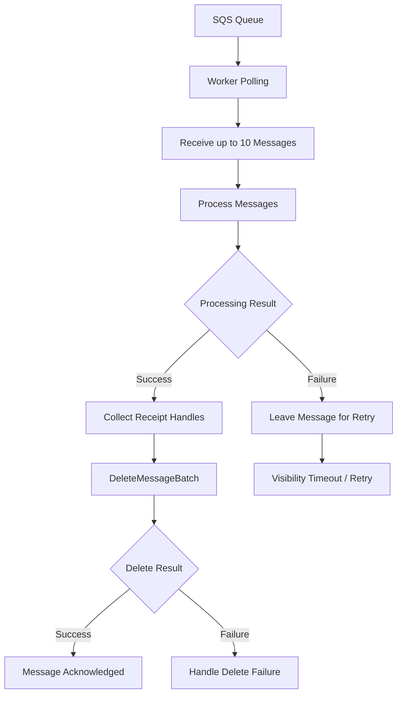

# 03- Batch Message Operations

## Overview

Amazon Simple Queue Service (Amazon SQS) provides batch APIs that allow producers and consumers to perform multiple message operations in a single request.

Batch operations reduce API request overhead, improve throughput, and lower request costs when processing high message volumes. They are particularly useful in event-driven architectures where services continuously publish and consume messages.

SQS supports batch operations for:

- Sending messages using `SendMessageBatch`.
- Receiving multiple messages using `ReceiveMessage`.
- Deleting messages using `DeleteMessageBatch`.
- Changing visibility timeouts using `ChangeMessageVisibilityBatch`.

A batch API does not make the entire batch an atomic transaction. Individual entries can succeed or fail independently, even when the overall API request returns successfully.

This distinction is critical for production systems. Applications must inspect individual batch results and retry only failed operations.

## Batch Operation Fundamentals

### Why Batch Operations Exist

Without batching, a producer sending 1,000 messages would make 1,000 separate API calls.

Batching allows multiple messages to be submitted in one request, reducing:

- Network round trips.
- API request overhead.
- Client-side request processing.
- API request costs.
- Connection utilization.

Batch operations are especially useful for:

- High-throughput event producers.
- Bulk data ingestion.
- Background processing pipelines.
- Microservices publishing multiple related events.
- Consumers acknowledging multiple successfully processed messages.

### Batch API Limits

SQS batch APIs support a maximum of 10 entries per request.

| Operation | API | Maximum entries |
|---|---|---:|
| Send messages | `SendMessageBatch` | 10 |
| Receive messages | `ReceiveMessage` | 10 |
| Delete messages | `DeleteMessageBatch` | 10 |
| Change visibility | `ChangeMessageVisibilityBatch` | 10 |

Additional considerations:

- Each batch entry requires a unique identifier within that request.
- A batch request can contain both successful and failed entries.
- The total message payload must satisfy SQS message-size constraints.
- Batch requests are subject to the same queue type and message-specific restrictions as individual operations.

The maximum SQS message size is 1 MiB. A batch must also satisfy the applicable aggregate batch payload limit, so ten individually valid messages do not necessarily form a valid batch.

## SendMessageBatch

### What It Does

`SendMessageBatch` sends multiple messages to an SQS queue in one API request.

It is useful when an application produces events in groups rather than publishing each event immediately.

Example use cases:

- Publishing order events generated by a bulk operation.
- Sending records produced by an ETL pipeline.
- Publishing notifications for multiple users.
- Forwarding events from an internal processing service.

### Request Structure

Each batch entry contains:

| Field | Description |
|---|---|
| `Id` | Unique identifier within the batch request |
| `MessageBody` | Message payload |
| `DelaySeconds` | Optional per-message delay where supported |
| `MessageAttributes` | Optional application metadata |
| `MessageGroupId` | Required for FIFO messages |
| `MessageDeduplicationId` | Optional or required depending on FIFO deduplication configuration |

For FIFO queues, message group and deduplication semantics still apply. Batch operations do not bypass FIFO ordering or deduplication rules.

### Python Implementation

```python
import boto3
import json
import logging
from botocore.exceptions import BotoCoreError, ClientError

logger = logging.getLogger(__name__)

sqs = boto3.client("sqs", region_name="ap-south-1")

QUEUE_URL = (
    "https://sqs.ap-south-1.amazonaws.com/"
    "123456789012/orders"
)


def send_message_batch(messages: list[dict]) -> dict:
    if not 1 <= len(messages) <= 10:
        raise ValueError("A batch must contain between 1 and 10 messages")

    entries = []

    for index, message in enumerate(messages):
        entries.append(
            {
                "Id": str(index),
                "MessageBody": json.dumps(message),
            }
        )

    try:
        response = sqs.send_message_batch(
            QueueUrl=QUEUE_URL,
            Entries=entries,
        )

        successful = response.get("Successful", [])
        failed = response.get("Failed", [])

        logger.info(
            "SQS batch send completed: successful=%s failed=%s",
            len(successful),
            len(failed),
        )

        return response

    except (ClientError, BotoCoreError):
        logger.exception("SQS batch send request failed")
        raise
```

The example demonstrates a single batch request. A production publisher should also validate message size, handle individual failures, and implement bounded retries.

### Partial Batch Failures

A successful HTTP response does not mean every message was sent successfully.

SQS returns two collections:

- `Successful`: Entries accepted by SQS.
- `Failed`: Entries rejected by SQS.

Example response structure:

```json
{
  "Successful": [
    {
      "Id": "0",
      "MessageId": "message-001",
      "MD5OfMessageBody": "example-hash"
    },
    {
      "Id": "2",
      "MessageId": "message-003",
      "MD5OfMessageBody": "example-hash"
    }
  ],
  "Failed": [
    {
      "Id": "1",
      "SenderFault": false,
      "Code": "InternalError",
      "Message": "Temporary service error"
    }
  ]
}
```

In this example:

- Entries `0` and `2` were accepted.
- Entry `1` failed.
- The producer should retry entry `1` if the failure is retryable.
- Successfully accepted entries should not be blindly resubmitted.

### Retry Only Failed Entries

A production publisher should retain the original batch entry IDs and payloads so it can correlate failures with their corresponding messages.

```python
import json
import logging
import time

import boto3
from botocore.exceptions import BotoCoreError, ClientError

logger = logging.getLogger(__name__)

sqs = boto3.client("sqs", region_name="ap-south-1")

QUEUE_URL = (
    "https://sqs.ap-south-1.amazonaws.com/"
    "123456789012/orders"
)


def send_batch_with_retries(
    entries: list[dict],
    max_attempts: int = 4,
) -> list[dict]:
    if not 1 <= len(entries) <= 10:
        raise ValueError("A batch must contain between 1 and 10 entries")

    pending = entries
    permanently_failed = []

    for attempt in range(max_attempts):
        if not pending:
            break

        try:
            response = sqs.send_message_batch(
                QueueUrl=QUEUE_URL,
                Entries=pending,
            )

        except (ClientError, BotoCoreError):
            logger.exception("Batch request failed")
            raise

        failed = response.get("Failed", [])
        failed_ids = {item["Id"] for item in failed}

        entries_by_id = {
            entry["Id"]: entry
            for entry in pending
        }

        retry_entries = []

        for failure in failed:
            entry_id = failure["Id"]

            if failure.get("SenderFault", False):
                permanently_failed.append(
                    {
                        "entry": entries_by_id[entry_id],
                        "failure": failure,
                    }
                )
            else:
                retry_entries.append(entries_by_id[entry_id])

        if not failed_ids:
            pending = []
            break

        pending = retry_entries

        if pending and attempt < max_attempts - 1:
            delay = min(2 ** attempt, 10)
            time.sleep(delay)

    for entry in pending:
        permanently_failed.append(
            {
                "entry": entry,
                "failure": {
                    "Code": "RetryExhausted",
                    "Message": "Maximum retry attempts exceeded",
                },
            }
        )

    return permanently_failed
```

This example retries failed entries marked as service-side failures and treats sender faults as permanent failures. Production implementations should classify errors explicitly, add jitter to retry delays, and send exhausted entries to a durable failure workflow.

A request-level exception is different from an individual entry failure. If the request times out, the producer may not know whether SQS accepted some or all entries. This is an ambiguous outcome, not proof that nothing was sent.

For FIFO queues, reuse stable deduplication IDs when retrying ambiguous sends. For Standard queues, use consumer-side idempotency because a retry can create another message.

## ReceiveMessage with Batching

### What It Does

`ReceiveMessage` retrieves up to 10 messages from a queue in a single request.

Batch receiving reduces the number of polling requests required by a consumer.

```python
response = sqs.receive_message(
    QueueUrl=QUEUE_URL,
    MaxNumberOfMessages=10,
    WaitTimeSeconds=20,
    VisibilityTimeout=60,
    MessageSystemAttributeNames=[
        "ApproximateReceiveCount",
        "SentTimestamp",
    ],
)
```

Important parameters:

| Parameter | Description |
|---|---|
| `MaxNumberOfMessages` | Maximum number of messages to retrieve, from 1 to 10 |
| `WaitTimeSeconds` | Long-poll duration, from 0 to 20 seconds |
| `VisibilityTimeout` | Visibility period for received messages |
| `MessageSystemAttributeNames` | Requests SQS system attributes |
| `MessageAttributeNames` | Requests application message attributes |

SQS may return fewer messages than requested. `MaxNumberOfMessages=10` is a maximum, not a guarantee.

### Processing Received Messages

A consumer should process each message independently and acknowledge only successfully completed messages.

```python
import json
import logging

logger = logging.getLogger(__name__)


def process_message(message: dict) -> None:
    payload = json.loads(message["Body"])

    order_id = payload["order_id"]

    logger.info(
        "Processing order event",
        extra={"order_id": order_id},
    )

    # Execute the application business operation.
```

The consumer must use the `ReceiptHandle` returned by the receive operation when deleting a message. The receipt handle identifies that particular receive attempt and changes when the message is received again.

### Sequential vs Parallel Processing

Batch receiving does not automatically imply parallel execution.

There are two common strategies:

| Strategy | Advantages | Limitations |
|---|---|---|
| Sequential processing | Simple error handling and predictable execution | Lower throughput for slow operations |
| Parallel processing | Better utilization of worker resources | Requires concurrency control and careful acknowledgment handling |

For Standard queues, independent messages can often be processed concurrently if the application supports it.

For FIFO queues, preserve ordering within each message group. Parallelize across independent groups, not arbitrarily across messages belonging to the same group.

### Visibility Timeout and Batch Processing

When SQS returns a message, it becomes temporarily invisible to other consumers.

The visibility timeout must account for:

- Batch processing time.
- Database operations.
- External API calls.
- Application scheduling delays.
- Network latency.
- Acknowledgment time.

If the timeout expires before processing completes, another consumer may receive the message.

For long-running tasks, extend visibility using `ChangeMessageVisibility` or `ChangeMessageVisibilityBatch`. Extensions do not reset the 12-hour maximum measured from the initial receive.

## DeleteMessageBatch

### What It Does

`DeleteMessageBatch` deletes up to 10 messages using their receipt handles.

Batch deletion is useful after successfully processing a group of messages.

```python
def delete_message_batch(messages: list[dict]) -> dict:
    if not 1 <= len(messages) <= 10:
        raise ValueError("A batch must contain between 1 and 10 messages")

    entries = [
        {
            "Id": str(index),
            "ReceiptHandle": message["ReceiptHandle"],
        }
        for index, message in enumerate(messages)
    ]

    return sqs.delete_message_batch(
        QueueUrl=QUEUE_URL,
        Entries=entries,
    )
```

The receipt handle must come from the latest receive operation. Using an old receipt handle can cause the delete operation to fail or not remove the intended message.

### Partial Delete Failures

Like send operations, batch deletion can partially succeed.

The response contains:

- `Successful`: Messages successfully deleted.
- `Failed`: Messages that could not be deleted.

A consumer must not assume that the entire batch was deleted because the API request succeeded.

Example:

```python
response = sqs.delete_message_batch(
    QueueUrl=QUEUE_URL,
    Entries=entries,
)

for item in response.get("Successful", []):
    logger.info("Message deleted: %s", item["Id"])

for item in response.get("Failed", []):
    logger.error(
        "Message deletion failed: id=%s code=%s",
        item["Id"],
        item["Code"],
    )
```

If deletion fails after business processing succeeds, the message may become visible again after its visibility timeout expires.

This is why consumer idempotency is essential even when batch deletion is used.

### Safe Acknowledgment Strategy

A robust consumer should:

1. Receive a batch.
2. Process messages independently.
3. Commit successful business operations.
4. Collect receipt handles for successfully processed messages.
5. Delete those messages in batches.
6. Leave failed messages undeleted for retry or DLQ handling.

Do not delete an entire received batch if only some messages completed successfully.

## ChangeMessageVisibilityBatch

### What It Does

`ChangeMessageVisibilityBatch` changes the visibility timeout for multiple in-flight messages.

It is useful when a consumer needs to extend processing time for a batch without issuing one request per message.

Example:

```python
def extend_visibility_batch(
    messages: list[dict],
    visibility_timeout: int,
) -> dict:
    if not 1 <= len(messages) <= 10:
        raise ValueError("A batch must contain between 1 and 10 messages")

    entries = [
        {
            "Id": str(index),
            "ReceiptHandle": message["ReceiptHandle"],
            "VisibilityTimeout": visibility_timeout,
        }
        for index, message in enumerate(messages)
    ]

    return sqs.change_message_visibility_batch(
        QueueUrl=QUEUE_URL,
        Entries=entries,
    )
```

The visibility timeout value must be within the supported SQS range.

### Common Use Cases

- Processing batches that take longer than the original visibility timeout.
- Extending visibility for slow external API operations.
- Coordinating long-running data-processing jobs.
- Preventing messages from becoming visible while a worker is still processing them.

Visibility extensions should be based on measured processing duration rather than arbitrary large values.

Remember that SQS limits the total visibility period to 12 hours from the initial receive. Repeated extensions cannot extend a message indefinitely.

## Batch Processing Architecture

A typical production consumer uses receive batching, independent processing, and batch deletion.



The architecture separates business processing from acknowledgment. This makes partial failures easier to manage.

## Production Batch Consumer

The following example demonstrates a sequential consumer that processes messages independently and deletes only successfully processed messages.

```python
import json
import logging

import boto3
from botocore.exceptions import BotoCoreError, ClientError

logger = logging.getLogger(__name__)

sqs = boto3.client("sqs", region_name="ap-south-1")

QUEUE_URL = (
    "https://sqs.ap-south-1.amazonaws.com/"
    "123456789012/orders"
)


def process_order_event(payload: dict) -> None:
    order_id = payload["order_id"]

    # Perform an idempotent database transaction here.
    logger.info("Processed order event: %s", order_id)


def consume_batch() -> None:
    try:
        response = sqs.receive_message(
            QueueUrl=QUEUE_URL,
            MaxNumberOfMessages=10,
            WaitTimeSeconds=20,
            VisibilityTimeout=120,
        )

    except (ClientError, BotoCoreError):
        logger.exception("Failed to receive messages")
        raise

    messages = response.get("Messages", [])
    successful_messages = []

    for message in messages:
        try:
            payload = json.loads(message["Body"])
            process_order_event(payload)
            successful_messages.append(message)

        except (ValueError, KeyError):
            logger.exception(
                "Invalid message payload; leaving message for retry"
            )

        except Exception:
            logger.exception("Message processing failed")

    if not successful_messages:
        return

    entries = [
        {
            "Id": str(index),
            "ReceiptHandle": message["ReceiptHandle"],
        }
        for index, message in enumerate(successful_messages)
    ]

    try:
        result = sqs.delete_message_batch(
            QueueUrl=QUEUE_URL,
            Entries=entries,
        )

    except (ClientError, BotoCoreError):
        logger.exception("Batch deletion request failed")
        raise

    for failure in result.get("Failed", []):
        logger.error(
            "Message deletion failed: id=%s code=%s",
            failure["Id"],
            failure["Code"],
        )
```

This is a reference processing pattern, not a complete worker implementation. In particular:

- Invalid messages should be classified as permanent failures rather than retried indefinitely.
- Retryable failures should use bounded retries and DLQ policies.
- The business operation must be idempotent.
- Failed batch deletions must be monitored.
- FIFO consumers must preserve ordering within message groups.
- Long-running processing must manage visibility timeouts.

For Standard queues, a permanent poison message can be moved to a DLQ after the configured receive threshold. For FIFO queues, consider the ordering implications before allowing a failed message to move to a DLQ.

## Batch Operations and FIFO Queues

Batch APIs work with both Standard and FIFO queues, but FIFO-specific behavior still applies.

### FIFO Send Batches

FIFO send batches support multiple message groups and preserve the ordering rules of each group.

Each entry must include a `MessageGroupId`.

A message can also include an explicit `MessageDeduplicationId` unless content-based deduplication is configured.

Example:

```python
entries = [
    {
        "Id": "order-1-event-1",
        "MessageBody": '{"order_id":"ORD-1001","status":"CREATED"}',
        "MessageGroupId": "ORD-1001",
        "MessageDeduplicationId": "ORD-1001-created",
    },
    {
        "Id": "order-2-event-1",
        "MessageBody": '{"order_id":"ORD-1002","status":"CREATED"}',
        "MessageGroupId": "ORD-1002",
        "MessageDeduplicationId": "ORD-1002-created",
    },
]

response = sqs.send_message_batch(
    QueueUrl="https://sqs.ap-south-1.amazonaws.com/123456789012/orders.fifo",
    Entries=entries,
)
```

The batch entries have different message groups, allowing independent ordering sequences.

Do not assume that arbitrary parallel processing of FIFO messages is safe. Preserve sequence within each group.

### FIFO Batch Failure Considerations

FIFO batches have additional ordering and failure considerations.

- Entries are evaluated according to FIFO ordering rules.
- A failed entry can affect later entries in the same message group.
- A batch can contain messages from multiple groups.
- The producer must inspect individual success and failure results.
- Retries must preserve stable deduplication IDs.

When retrying FIFO batch entries, do not change their business identity or message group.

## Batch Size and Throughput Optimization

### Choosing a Batch Size

The maximum batch size is not always the optimal batch size.

Larger batches reduce request overhead but can increase:

- Memory usage.
- Processing latency for individual messages.
- Time before acknowledgment.
- Visibility timeout pressure.
- Impact of batch-level operational failures.

| Batch size | Characteristics |
|---:|---|
| 1 | Simple processing, higher API overhead |
| 2–5 | Moderate batching with manageable processing time |
| 6–10 | Better request efficiency for suitable workloads |

Choose a batch size based on message volume, payload size, processing duration, and downstream capacity.

### Throughput Considerations

Batching improves request efficiency, but it does not eliminate queue throughput limits.

Consider:

- Queue type and throughput mode.
- FIFO message-group distribution.
- Consumer concurrency.
- Downstream database connection limits.
- External API rate limits.
- Network latency.
- Message processing duration.

For example, increasing a worker from one message per request to ten messages per request reduces polling calls, but it does not make a slow database capable of processing ten times more work.

### Long Polling with Batch Receiving

Use long polling to reduce empty receives and unnecessary API requests.

```python
response = sqs.receive_message(
    QueueUrl=QUEUE_URL,
    MaxNumberOfMessages=10,
    WaitTimeSeconds=20,
)
```

Long polling and batching complement each other:

- Batching reduces requests when messages are available.
- Long polling reduces empty requests when the queue is temporarily idle.

Ensure that the HTTP client's read timeout exceeds the configured long-poll duration. Proxy, load balancer, and service-mesh idle timeouts should also be configured appropriately.

## Batch Operations and Lambda Consumers

AWS Lambda can consume SQS messages through an event source mapping.

The event source mapping handles polling and invokes the function with a batch of messages.

Important configuration considerations include:

- Batch size.
- Maximum batching window.
- Function timeout.
- Queue visibility timeout.
- Concurrency limits.
- Partial batch response handling.

### Partial Batch Failure Reporting

By default, a Lambda invocation failure can cause messages from the batch to become eligible for retry.

Enable partial batch response reporting using `ReportBatchItemFailures` to identify messages that failed individually.

Example configuration:

```bash
aws lambda update-event-source-mapping \
    --uuid <event-source-mapping-uuid> \
    --function-response-types ReportBatchItemFailures
```

A Python Lambda handler can return failed message identifiers:

```python
import json
import logging

logger = logging.getLogger(__name__)


def lambda_handler(event, context):
    batch_item_failures = []

    for record in event["Records"]:
        try:
            payload = json.loads(record["body"])

            process_order_event(payload)

        except Exception:
            logger.exception(
                "Failed to process SQS message: %s",
                record["messageId"],
            )

            batch_item_failures.append(
                {
                    "itemIdentifier": record["messageId"],
                }
            )

    return {
        "batchItemFailures": batch_item_failures,
    }
```

The event source mapping uses the returned identifiers to retry failed messages rather than treating every message in the batch as failed.

For FIFO queues, stop processing subsequent messages from the affected message group after a failure and report the failed and unprocessed messages as failures. This prevents later messages from being acknowledged ahead of an earlier failed message.

For Lambda event source mappings, AWS recommends configuring the queue visibility timeout to at least six times the function timeout, plus the maximum batching window where applicable.

## Error Handling and Retry Strategy

Batch processing introduces two distinct failure levels.

| Failure type | Example | Handling |
|---|---|---|
| Request-level failure | Network timeout or authorization error | Handle the entire request failure |
| Entry-level failure | One message rejected in a batch | Inspect and handle the individual entry |

A robust retry strategy should include:

- Error classification.
- Bounded retry attempts.
- Exponential backoff with jitter.
- Retry of only failed entries when the outcome is known.
- Stable event and deduplication identifiers.
- Dead-letter handling for exhausted messages.
- Monitoring of repeated failures.

Do not retry permanent sender faults such as invalid message structure or unsupported parameters without correcting the underlying issue.

For ambiguous request-level failures, the application may not know which entries were accepted. Use stable producer identifiers and consumer idempotency to make retries safe.

## Security Considerations

Batch APIs do not change SQS authorization requirements.

Recommended practices:

- Grant producers only the required `sqs:SendMessage` permissions.
- Grant consumers only the required receive, delete, and visibility-change permissions.
- Use IAM roles instead of hardcoded AWS credentials.
- Encrypt queues using SSE-SQS or SSE-KMS according to security requirements.
- Protect message payloads from unauthorized access.
- Avoid logging complete message bodies when they contain sensitive information.
- Validate every message independently before processing.
- Apply message-size and payload validation limits at the application boundary.

When using SSE-KMS, verify that the producer and consumer roles have the required KMS permissions and that the KMS key policy permits the intended access.

## Monitoring and Operational Considerations

Batch processing should be monitored at both the API and application levels.

### SQS Metrics

| Metric | Purpose |
|---|---|
| `NumberOfMessagesSent` | Tracks producer activity |
| `NumberOfMessagesReceived` | Tracks consumer receive activity |
| `NumberOfMessagesDeleted` | Tracks acknowledgments |
| `ApproximateNumberOfMessagesVisible` | Measures waiting messages |
| `ApproximateNumberOfMessagesNotVisible` | Measures in-flight messages |
| `ApproximateAgeOfOldestMessage` | Indicates queue processing delays |
| `NumberOfEmptyReceives` | Helps identify inefficient polling |

These metrics are approximate and should be correlated with application-level metrics.

### Application Metrics

Track:

- Batch send requests.
- Batch send entries succeeded.
- Batch send entries failed.
- Batch receive count.
- Batch processing duration.
- Batch deletion failures.
- Visibility extension failures.
- Retry attempts.
- Messages sent to DLQs.

Useful operational indicators include:

- Average and percentile batch processing duration.
- Successful entries per batch.
- Failed entries per batch.
- Queue age trends.
- Consumer throughput.
- Downstream dependency latency.

Avoid high-cardinality metric dimensions such as message IDs and customer IDs.

## Common Mistakes and Production Pitfalls

| Mistake | Impact | Recommended approach |
|---|---|---|
| Assuming batch operations are atomic | Successful entries may be repeated unnecessarily | Inspect `Successful` and `Failed` |
| Retrying the entire batch after partial failure | Duplicate message submissions | Retry only failed entries when the result is known |
| Assuming `MaxNumberOfMessages=10` always returns ten | Consumers may incorrectly depend on full batches | Handle any batch size, including empty responses |
| Deleting all received messages after partial processing | Unprocessed messages can be lost | Delete only successfully processed messages |
| Using stale receipt handles | Message deletion or visibility updates may fail | Use the latest receipt handle |
| Processing FIFO messages concurrently without group awareness | Business ordering can be violated | Preserve order within each message group |
| Using large batches without measuring processing time | Visibility timeouts may expire | Tune batch size and timeout together |
| Ignoring failed batch entries | Messages remain unprocessed or are retried unexpectedly | Log, measure, and handle individual failures |
| Retrying ambiguous sends with new deduplication IDs | Duplicate logical events may be accepted | Reuse stable event identifiers |
| Treating batch size as a throughput guarantee | Downstream systems can become overloaded | Measure end-to-end processing capacity |

## Key Takeaways

- SQS batch APIs support up to 10 entries per request and reduce network and API overhead.
- Batch operations are not atomic; inspect individual successful and failed entries for every send, delete, and visibility-change request.
- Retry only known failed entries, while using stable identifiers and idempotent consumers to handle ambiguous outcomes safely.
- Batch receiving, processing duration, visibility timeout, and acknowledgment strategy must be designed together.
- Preserve FIFO ordering within each message group, and use partial batch failure handling when integrating SQS with AWS Lambda.