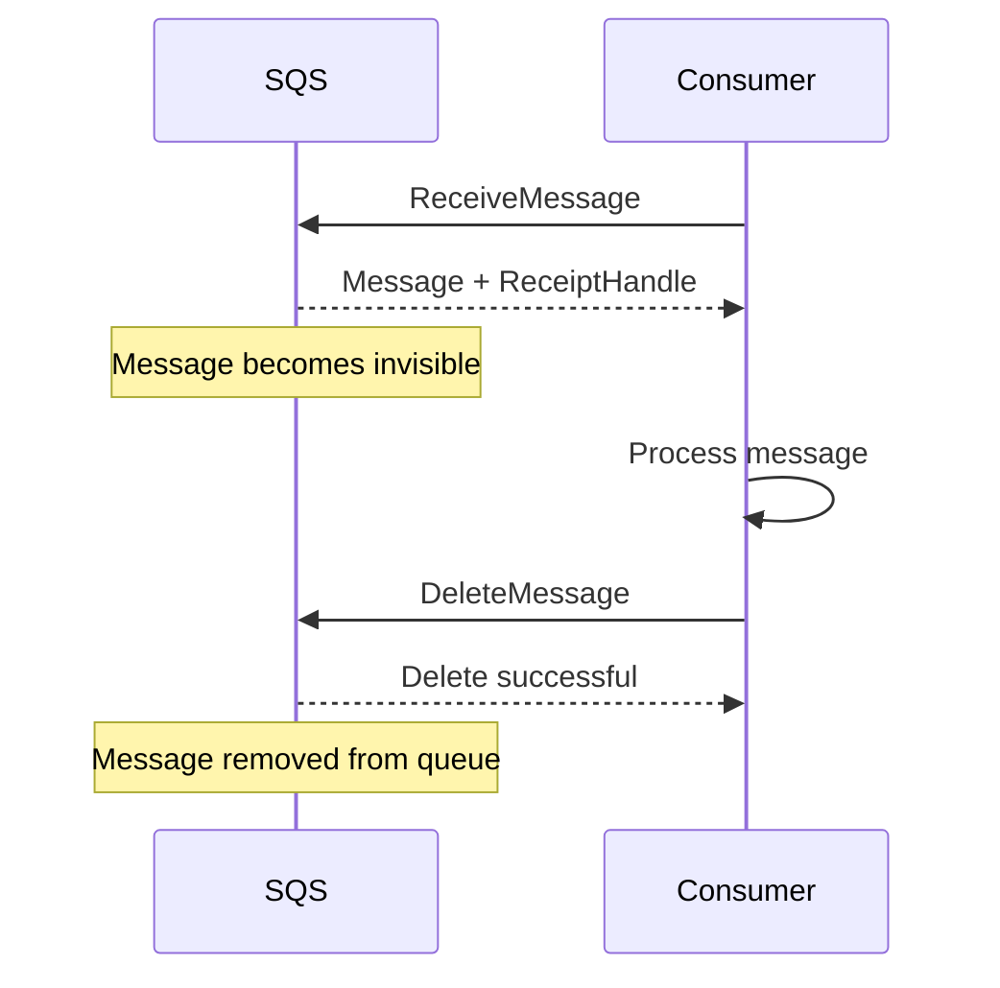
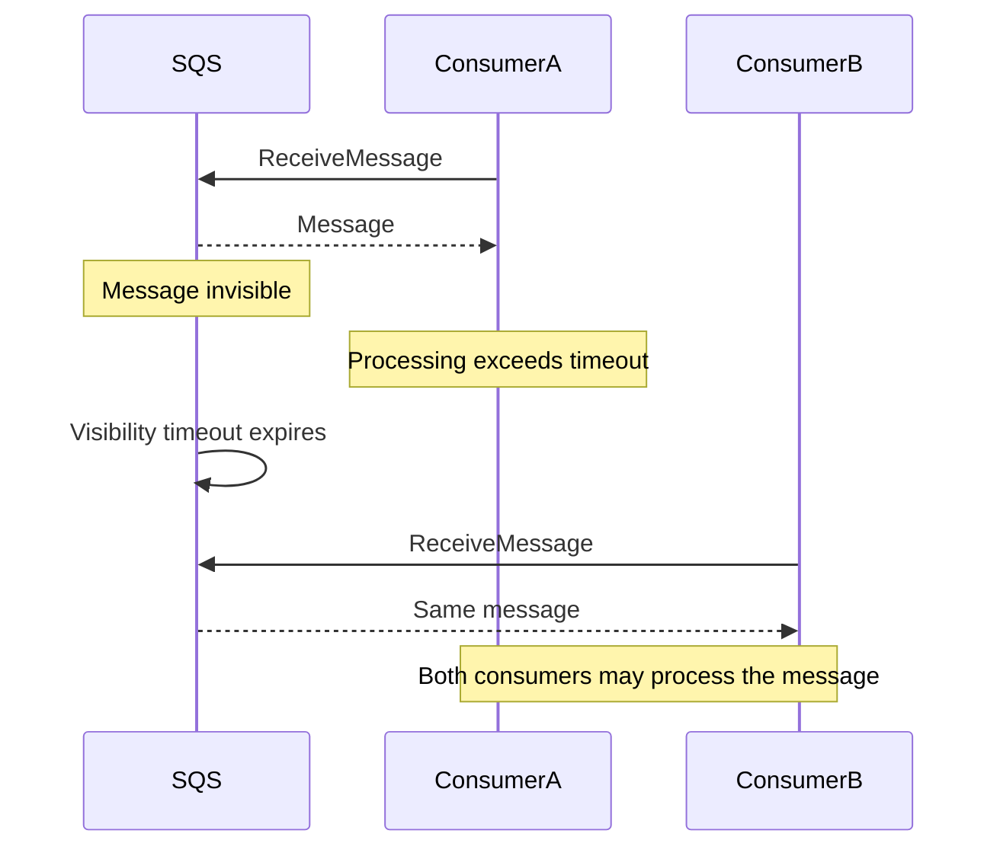
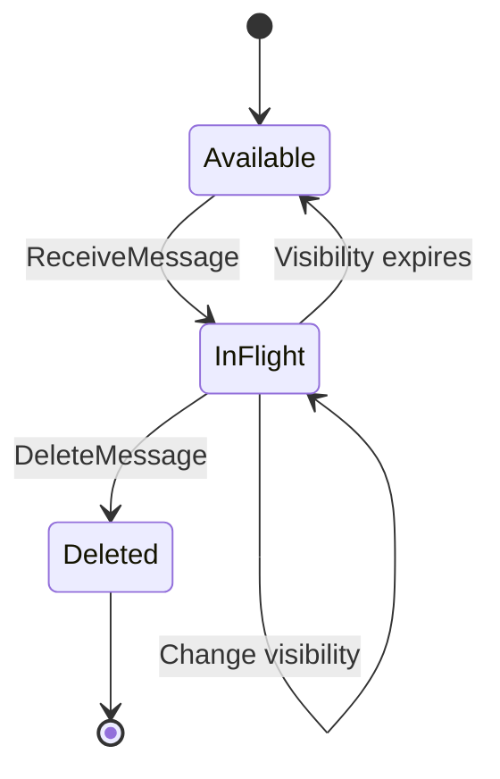
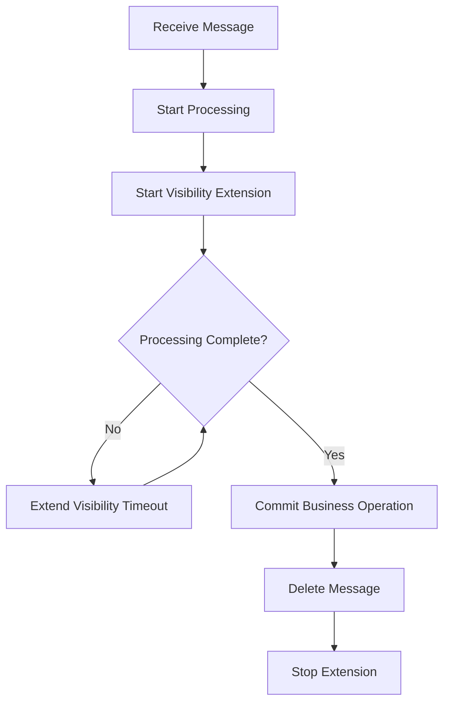
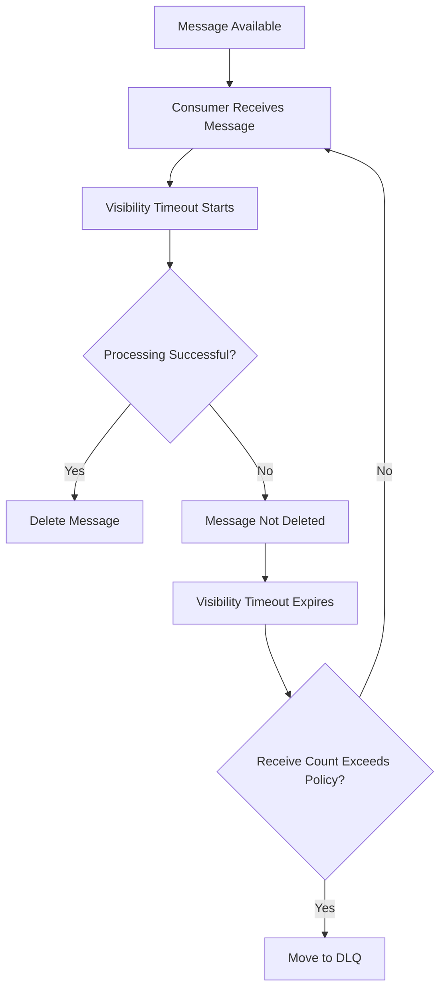

# 04- Advanced Visibility Timeout Management

## Overview

Amazon Simple Queue Service (Amazon SQS) uses visibility timeout to prevent a message from being delivered to other consumers while a consumer is processing it.

When a consumer receives a message, SQS temporarily hides that message from subsequent receive requests. The message becomes visible again when:

- The consumer deletes it after successful processing.
- The visibility timeout expires.
- The consumer explicitly changes the visibility timeout.

Visibility timeout is a core reliability mechanism in distributed message processing. Incorrect configuration can cause duplicate processing, concurrent execution, delayed retries, and unnecessary queue backlogs.

Production systems must coordinate visibility timeout with message processing duration, consumer concurrency, retry behavior, and downstream dependency latency.

## Visibility Timeout Fundamentals

### What Is Visibility Timeout?

Visibility timeout is the period during which a received message remains invisible to other consumers.

The default visibility timeout is 30 seconds. It can be configured from 0 seconds up to 12 hours.

When a message is received:

1. SQS returns the message and a receipt handle.
2. The message becomes temporarily invisible.
3. The consumer processes the message.
4. The consumer deletes the message after successful processing.
5. If the consumer does not delete it before the timeout expires, the message becomes eligible for another delivery.



If processing does not complete before the visibility timeout expires:



Visibility timeout reduces concurrent delivery but does not provide an absolute lock or guarantee exactly-once processing. Standard queues can still deliver a message more than once during the visibility period.

### Why Visibility Timeout Exists

Without visibility timeout, multiple consumers could retrieve the same available message immediately.

For example, consider a queue with three workers:

- Worker A receives an order-processing message.
- Worker B immediately receives the same message.
- Worker C also receives it.
- All three workers execute the same business operation.

Visibility timeout temporarily suppresses repeated delivery while a consumer processes the message.

It provides:

- Reduced concurrent processing of the same message.
- Time for consumers to complete business operations.
- Automatic recovery when a consumer crashes.
- A retry mechanism without requiring the producer to republish the message.

### Visibility Timeout Lifecycle



A message moves between available and in-flight states until it is deleted or otherwise removed through queue operations.

## Configuring Visibility Timeout

Visibility timeout can be configured at the queue level or overridden for individual messages after receiving them.

### Queue-Level Configuration

Queue-level visibility timeout defines the default visibility period for messages received from the queue.

Using AWS CLI:

```bash
aws sqs set-queue-attributes \
    --queue-url https://sqs.ap-south-1.amazonaws.com/123456789012/orders \
    --attributes VisibilityTimeout=120
```

This sets the default visibility timeout to 120 seconds.

Retrieve the configured value:

```bash
aws sqs get-queue-attributes \
    --queue-url https://sqs.ap-south-1.amazonaws.com/123456789012/orders \
    --attribute-names VisibilityTimeout
```

Using Boto3:

```python
import boto3

sqs = boto3.client("sqs", region_name="ap-south-1")

QUEUE_URL = (
    "https://sqs.ap-south-1.amazonaws.com/"
    "123456789012/orders"
)

sqs.set_queue_attributes(
    QueueUrl=QUEUE_URL,
    Attributes={
        "VisibilityTimeout": "120",
    },
)
```

Queue-level configuration is appropriate when messages have relatively predictable processing durations.

### Per-Message Visibility Timeout

A consumer can override visibility timeout for an individual received message using `ChangeMessageVisibility`.

```python
response = sqs.receive_message(
    QueueUrl=QUEUE_URL,
    MaxNumberOfMessages=1,
    WaitTimeSeconds=20,
)

messages = response.get("Messages", [])

if messages:
    message = messages[0]

    sqs.change_message_visibility(
        QueueUrl=QUEUE_URL,
        ReceiptHandle=message["ReceiptHandle"],
        VisibilityTimeout=300,
    )
```

This changes the visibility timeout for that receive attempt.

Use per-message visibility when processing duration varies significantly between messages.

Examples include:

- Document conversion.
- Large file processing.
- Report generation.
- External API workflows.
- Data ingestion tasks with variable workloads.

### Setting Visibility Timeout to Zero

Setting visibility timeout to zero makes the message immediately available for another receive request.

```python
sqs.change_message_visibility(
    QueueUrl=QUEUE_URL,
    ReceiptHandle=receipt_handle,
    VisibilityTimeout=0,
)
```

This can be useful when a consumer determines that it cannot process a message and wants to release it immediately.

However, repeatedly releasing messages can create rapid retry loops. Use this behavior only when another consumer can make progress or when the application has a deliberate retry strategy.

## Choosing the Correct Visibility Timeout

The visibility timeout should be based on the expected processing duration, not an arbitrary constant.

Consider the complete processing lifecycle:

- Message deserialization and validation.
- Database queries and transactions.
- External API requests.
- File processing.
- Retryable operations within the consumer.
- Message deletion.
- Runtime scheduling and network delays.

A useful starting point is:

```text
Visibility Timeout >
    Expected Processing Duration
    + Acknowledgment Overhead
    + Safety Margin
```

For example, if a task normally takes 40 seconds, but can take up to 70 seconds under expected load, a 120-second timeout may provide an appropriate initial buffer.

The final value should be validated using observed processing-time distributions and failure behavior.

### Processing-Time Distribution

Do not tune visibility timeout using only average processing time.

Consider this workload:

| Processing percentile | Duration |
|---|---:|
| p50 | 8 seconds |
| p90 | 25 seconds |
| p95 | 45 seconds |
| p99 | 90 seconds |
| Maximum observed | 150 seconds |

A timeout of 30 seconds would cause a significant portion of messages to become visible before processing completes.

A timeout of 180 seconds may be more appropriate for this workload, subject to acceptable retry delay and the actual processing-time distribution.

### Trade-Off: Short vs Long Visibility Timeout

| Configuration | Advantages | Limitations |
|---|---|---|
| Short timeout | Faster retry after consumer failure | Greater risk of duplicate concurrent processing |
| Long timeout | More time for processing | Slower recovery after consumer crashes |
| Dynamic extension | Adapts to variable processing duration | Requires extension scheduling and failure handling |

The objective is not to maximize visibility timeout. It is to balance duplicate-processing risk against recovery latency.

## Dynamic Visibility Timeout Extension

### Why Dynamic Extension Is Needed

Some workloads have unpredictable processing durations.

For example, a document-processing worker might:

- Download a file.
- Extract content.
- Perform OCR.
- Call an external classification service.
- Store extracted metadata in PostgreSQL.

Processing time may vary depending on file size, OCR complexity, and external service latency.

A fixed visibility timeout large enough for the slowest possible task can delay recovery when a worker crashes early.

Dynamic extension allows a consumer to periodically extend visibility while processing continues.

### Extension Workflow



The consumer should extend visibility before the current timeout expires.

A common approach is to renew visibility at a fraction of the current timeout, leaving enough time for transient API failures.

For example:

- Initial visibility timeout: 120 seconds.
- Renewal interval: 60 seconds.
- Extension duration: 120 seconds.

The values should be based on processing duration and operational requirements.

### Python Implementation

```python
import logging
import threading
import time

import boto3
from botocore.exceptions import BotoCoreError, ClientError

logger = logging.getLogger(__name__)

sqs = boto3.client("sqs", region_name="ap-south-1")

QUEUE_URL = (
    "https://sqs.ap-south-1.amazonaws.com/"
    "123456789012/documents"
)


class VisibilityExtender:
    def __init__(
        self,
        queue_url: str,
        receipt_handle: str,
        visibility_timeout: int = 120,
        renewal_interval: int = 60,
    ):
        if visibility_timeout <= 0:
            raise ValueError("Visibility timeout must be positive")

        if not 0 < renewal_interval < visibility_timeout:
            raise ValueError(
                "Renewal interval must be less than visibility timeout"
            )

        self.queue_url = queue_url
        self.receipt_handle = receipt_handle
        self.visibility_timeout = visibility_timeout
        self.renewal_interval = renewal_interval

        self._stop_event = threading.Event()
        self._thread = threading.Thread(
            target=self._renew,
            daemon=True,
        )

    def start(self) -> None:
        self._thread.start()

    def stop(self) -> None:
        self._stop_event.set()
        self._thread.join()

    def _renew(self) -> None:
        while not self._stop_event.wait(self.renewal_interval):
            try:
                sqs.change_message_visibility(
                    QueueUrl=self.queue_url,
                    ReceiptHandle=self.receipt_handle,
                    VisibilityTimeout=self.visibility_timeout,
                )

                logger.debug("Visibility timeout extended")

            except (ClientError, BotoCoreError):
                logger.exception(
                    "Failed to extend message visibility"
                )

                # The worker must treat a failed renewal as a
                # potential duplicate-processing risk.
                return
```

Usage:

```python
def process_document_message(message: dict) -> None:
    extender = VisibilityExtender(
        queue_url=QUEUE_URL,
        receipt_handle=message["ReceiptHandle"],
        visibility_timeout=120,
        renewal_interval=60,
    )

    extender.start()

    try:
        process_document(message["Body"])

        sqs.delete_message(
            QueueUrl=QUEUE_URL,
            ReceiptHandle=message["ReceiptHandle"],
        )

    finally:
        extender.stop()
```

This implementation demonstrates the renewal lifecycle. A production implementation should also:

- Track whether renewal has failed.
- Coordinate renewal and deletion so they cannot race.
- Stop or cancel processing when ownership is no longer reliable.
- Add bounded retries for transient renewal failures.
- Emit metrics for extension failures and processing duration.
- Enforce the 12-hour maximum from the initial receive.
- Use a worker lifecycle that safely handles shutdown.

A failed extension does not mean the message has definitely become visible. It means the worker can no longer rely on the expected visibility period and must account for possible redelivery.

### Avoid Uncontrolled Extension

Repeatedly extending visibility without a maximum processing deadline can leave messages in-flight for a long time.

A production worker should define:

- Maximum permitted processing duration.
- Maximum number of visibility renewals.
- Dependency timeout limits.
- Graceful cancellation behavior.
- Recovery behavior when processing cannot complete.

For work that routinely approaches the 12-hour limit, redesign the workflow into smaller durable stages rather than relying on one continuously invisible message.

## The 12-Hour Maximum Visibility Period

SQS supports a maximum visibility timeout of 12 hours.

The important detail is that the maximum is measured from the initial receive request.

Repeated calls to `ChangeMessageVisibility` do not reset this 12-hour maximum.

For example:

1. A consumer receives a message.
2. The initial visibility timeout is 60 seconds.
3. The consumer extends visibility repeatedly.
4. The total elapsed time approaches 12 hours.
5. Further extensions cannot keep the message invisible beyond the service limit.

Do not use visibility extension as a substitute for a durable long-running job orchestration system.

For workflows that exceed this duration, consider:

- AWS Step Functions.
- EventBridge Scheduler.
- Splitting work into smaller SQS messages.
- Persisting job state in a database.
- Using a workflow engine with durable checkpoints.

## Visibility Timeout and Retry Behavior

Visibility timeout controls when a message becomes eligible for redelivery. It does not determine whether the message should be retried permanently or discarded.

SQS tracks receive attempts using the approximate receive count.

A message that repeatedly fails processing can eventually be moved to a dead-letter queue according to the source queue's redrive policy.

### Retry Lifecycle



The receive count is not equivalent to the number of completed application processing attempts. A consumer can receive a message and crash before processing it.

### Relationship with Dead-Letter Queues

Configure a dead-letter queue for messages that repeatedly fail.

Example:

```bash
aws sqs set-queue-attributes \
    --queue-url https://sqs.ap-south-1.amazonaws.com/123456789012/orders \
    --attributes '{
      "RedrivePolicy": "{\"deadLetterTargetArn\":\"arn:aws:sqs:ap-south-1:123456789012:orders-dlq\",\"maxReceiveCount\":\"5\"}"
    }'
```

The `maxReceiveCount` setting controls how many receives are permitted before SQS moves a message to the DLQ.

A long visibility timeout can increase the time required to reach the DLQ because each failed receive may be followed by a long wait before the next receive.

Choose the visibility timeout and redrive policy together.

### FIFO Ordering Considerations

For FIFO queues, a message in a message group can block subsequent messages in that group while it remains in-flight.

If its visibility timeout expires, another consumer may receive it. Later messages in that group remain subject to FIFO ordering constraints.

If a failed message is moved to a DLQ, later messages may proceed, potentially creating a business sequence gap.

Do not assume that moving a message to a DLQ is always safe for ordered business workflows.

## Visibility Timeout with Lambda Event Source Mappings

When Lambda consumes SQS messages, the event source mapping manages polling and message deletion.

The Lambda function does not normally call `DeleteMessage` directly. The event source mapping acknowledges messages after successful invocation processing.

### Configuration Requirements

Important settings include:

- Queue visibility timeout.
- Lambda function timeout.
- Batch size.
- Maximum batching window.
- Event source mapping concurrency.
- Partial batch response configuration.

AWS recommends setting the queue visibility timeout to at least six times the Lambda function timeout, plus the maximum batching window where applicable.

This provides room for invocation retries and throttling behavior.

For example:

```text
Lambda function timeout:       30 seconds
Maximum batching window:       5 seconds
Recommended visibility period: At least 185 seconds
```

The actual configured value should account for the function timeout, batching window, and the documented event source mapping recommendation.

### Partial Batch Failure Handling

Enable partial batch response reporting so successful messages are not unnecessarily retried when another message in the batch fails.

```bash
aws lambda update-event-source-mapping \
    --uuid <event-source-mapping-uuid> \
    --function-response-types ReportBatchItemFailures
```

A Python handler can return failed message identifiers:

```python
import json
import logging

logger = logging.getLogger(__name__)


def lambda_handler(event, context):
    failures = []

    for record in event["Records"]:
        try:
            payload = json.loads(record["body"])
            process_order_event(payload)

        except Exception:
            logger.exception(
                "SQS message processing failed: %s",
                record["messageId"],
            )

            failures.append(
                {
                    "itemIdentifier": record["messageId"],
                }
            )

    return {
        "batchItemFailures": failures,
    }
```

For FIFO queues, stop processing subsequent messages from the affected message group after a failure and report the failed and unprocessed messages as failures. This preserves the required ordering behavior.

## Visibility Timeout and Consumer Concurrency

Visibility timeout interacts with worker concurrency and queue throughput.

Consider a queue with 1,000 messages and 10 workers. Each worker receives up to 10 messages and processes them concurrently.

If the worker processes messages slowly, the number of in-flight messages can increase significantly.

SQS has an in-flight message quota. For Standard queues, the approximate in-flight limit is generally 120,000 messages, subject to service behavior and quotas.

When the in-flight limit is reached:

- Short polling can return an `OverLimit` error.
- Long polling may stop returning new messages without an explicit `OverLimit` error.
- Queue throughput can degrade even when visible messages remain.

### Capacity Planning

Monitor:

- Number of visible messages.
- Number of in-flight messages.
- Processing duration.
- Consumer concurrency.
- Downstream dependency capacity.
- Visibility extension frequency.

Do not increase worker concurrency without checking database connection limits and downstream service capacity.

A large number of in-flight messages can indicate:

- Slow consumers.
- A visibility timeout that is too long.
- Messages waiting on downstream dependencies.
- Workers receiving more messages than they can process.
- Consumers failing to acknowledge completed messages.

### Batch Size and Visibility Timeout

A consumer that receives 10 messages and processes them sequentially may need a longer visibility timeout than a consumer processing those messages concurrently.

For sequential processing, the worst-case batch duration can approach the sum of individual processing durations.

For parallel processing, duration is closer to the slowest task, but resource contention and scheduling overhead still matter.

Tune the following together:

- `MaxNumberOfMessages`.
- Worker concurrency.
- Visibility timeout.
- Downstream request limits.
- Message processing duration.

## Visibility Timeout in Kubernetes and Containerized Workers

SQS consumers frequently run as Docker containers or Kubernetes deployments.

Worker lifecycle management matters because containers can be terminated while messages are in-flight.

Common termination scenarios include:

- Kubernetes rolling deployments.
- Pod eviction.
- Node maintenance.
- Horizontal scaling.
- Container crashes.
- Out-of-memory termination.

### Graceful Shutdown Strategy

A worker should:

1. Stop receiving new messages when termination begins.
2. Allow active processing to finish within the shutdown grace period.
3. Extend visibility when necessary and still within the allowed maximum.
4. Commit completed business operations.
5. Delete successfully processed messages.
6. Leave incomplete messages undeleted for retry.

Configure Kubernetes `terminationGracePeriodSeconds` to provide enough time for the worker to stop safely.

Do not rely on graceful shutdown as the only protection. Containers can terminate unexpectedly, so processing must remain idempotent.

### Example Kubernetes Configuration

```yaml
apiVersion: apps/v1
kind: Deployment
metadata:
  name: sqs-order-worker
spec:
  replicas: 3
  selector:
    matchLabels:
      app: sqs-order-worker
  template:
    metadata:
      labels:
        app: sqs-order-worker
    spec:
      terminationGracePeriodSeconds: 120
      containers:
        - name: worker
          image: example.com/order-worker:1.0.0
          env:
            - name: SQS_QUEUE_URL
              value: "https://sqs.ap-south-1.amazonaws.com/123456789012/orders"
            - name: VISIBILITY_TIMEOUT
              value: "120"
```

The application must implement signal handling and stop polling when termination begins. The grace period should be aligned with actual processing duration and deployment strategy.

## Monitoring Visibility Timeout

Visibility timeout problems are often visible through queue metrics and application-level measurements.

### SQS Metrics

| Metric | What it indicates |
|---|---|
| `ApproximateNumberOfMessagesVisible` | Messages waiting to be received |
| `ApproximateNumberOfMessagesNotVisible` | Messages currently in-flight |
| `ApproximateAgeOfOldestMessage` | Age of the oldest message available for processing |
| `NumberOfMessagesReceived` | Number of receive operations returning messages |
| `NumberOfMessagesDeleted` | Number of deleted messages |
| `NumberOfEmptyReceives` | Number of receive requests returning no messages |

These metrics are approximate and should be interpreted together.

For example, a high `ApproximateNumberOfMessagesNotVisible` value combined with a low deletion rate may indicate slow processing, stuck workers, or insufficient acknowledgment capacity.

### Application Metrics

Track application-level metrics such as:

- `message_processing_duration_seconds`
- `message_visibility_extension_total`
- `message_visibility_extension_failures_total`
- `message_processing_timeout_total`
- `message_duplicate_processing_total`
- `message_delete_failures_total`
- `message_retry_count`

Use queue name, service name, and event type as metric dimensions where appropriate.

Avoid using message IDs, customer IDs, or order IDs as metric dimensions because they create high cardinality.

### Alerting Recommendations

Useful alerts include:

- Sustained growth in in-flight messages.
- Oldest-message age exceeding the service objective.
- Repeated visibility extension failures.
- Processing duration approaching the configured timeout.
- Increasing receive-to-delete ratio.
- DLQ message count above the expected baseline.

Alerts should be based on sustained conditions rather than isolated metric spikes.

## Security and Reliability Considerations

Visibility timeout is not an authorization or distributed-locking mechanism.

Recommended practices:

- Use IAM roles with least-privilege SQS permissions.
- Restrict `ReceiveMessage`, `DeleteMessage`, and `ChangeMessageVisibility` permissions to the required queues.
- Use SSE-SQS or SSE-KMS where encryption requirements apply.
- Avoid logging sensitive message payloads during visibility renewal failures.
- Use durable idempotency for business operations.
- Monitor receipt-handle-related errors.
- Apply bounded processing deadlines.
- Configure DLQs and operational redrive procedures.
- Test worker crash and network failure scenarios.

The receipt handle identifies a particular receive attempt. It is not a permanent message identifier and should not be stored as a long-term business reference.

## Common Mistakes and Production Pitfalls

| Mistake | Impact | Recommended approach |
|---|---|---|
| Using a timeout shorter than normal processing duration | Duplicate delivery while the original consumer is still working | Measure processing percentiles and configure an appropriate timeout |
| Setting an excessively long timeout | Slow recovery after consumer crashes | Use dynamic extension for variable workloads |
| Assuming visibility timeout guarantees exclusive processing | Duplicate delivery can still occur | Implement idempotent consumers |
| Extending visibility without a maximum deadline | Messages can remain in-flight for excessive periods | Enforce a processing deadline and the 12-hour limit |
| Ignoring extension failures | Another consumer may receive the message during processing | Treat failed renewal as a duplicate-processing risk |
| Deleting before committing business changes | A crash can permanently lose the operation | Commit first, acknowledge afterward |
| Receiving more messages than workers can process | Messages remain in-flight while waiting locally | Align batch size with available processing capacity |
| Ignoring DLQ interaction | Failed messages can take too long to reach the DLQ | Design timeout and redrive policy together |
| Using visibility timeout as a long-running scheduler | Delayed work becomes difficult to recover and operate | Use Step Functions or EventBridge Scheduler |
| Failing to handle container shutdown | Messages may be redelivered during deployments | Implement graceful shutdown and idempotency |

## Production Best Practices

- Set queue-level visibility timeout based on measured processing duration, including acknowledgment overhead and a safety margin.
- Use dynamic visibility extension when processing duration is unpredictable.
- Renew visibility before the existing timeout expires.
- Treat extension failures as a possible loss of exclusive processing time.
- Enforce a maximum processing duration and account for the 12-hour limit.
- Make every consumer operation idempotent because visibility timeout does not eliminate duplicate delivery.
- Delete messages only after the business transaction commits successfully.
- Align visibility timeout, batch size, worker concurrency, and downstream capacity.
- Configure DLQs and monitor receive counts and message age.
- Test worker crashes, network interruptions, slow dependencies, and deployment shutdown behavior.

## Key Takeaways

- Visibility timeout temporarily hides a received message while a consumer processes it; it is not a permanent lock or exactly-once guarantee.
- Configure visibility timeout using measured processing duration, acknowledgment overhead, and an appropriate safety margin.
- Use dynamic visibility extension for variable-duration workloads, while enforcing the 12-hour maximum from the initial receive.
- Coordinate visibility timeout with retries, DLQ policies, batch size, worker concurrency, and downstream capacity.
- Commit business operations before deleting messages, and use idempotent consumers to remain safe when messages are delivered again.