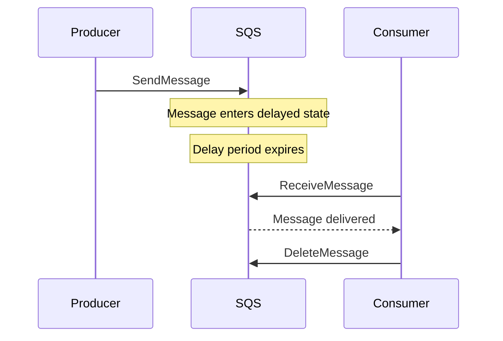
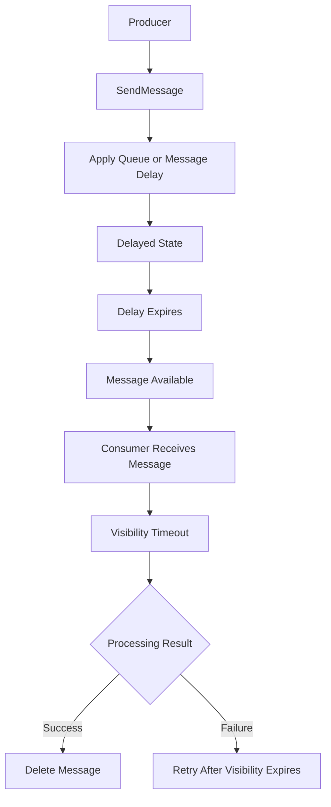
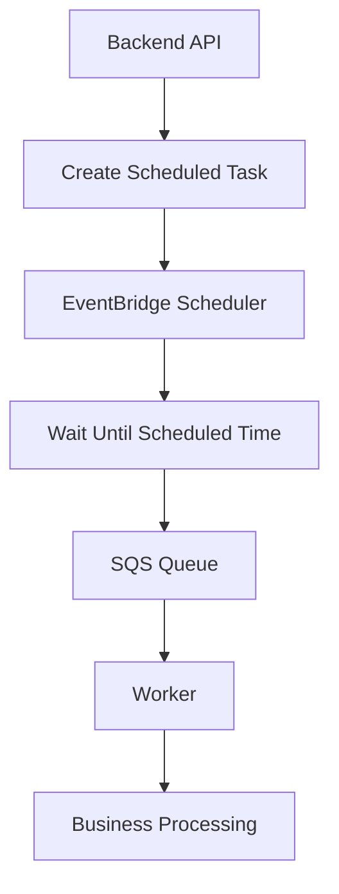

# 05- Queue-Level and Per-Message Delay

## Overview

Amazon Simple Queue Service (Amazon SQS) supports message delay mechanisms that allow producers to postpone when messages become available for consumption.

A delayed message remains unavailable to consumers until its configured delay period expires. Once the delay expires, the message becomes available for normal processing.

SQS provides two delay mechanisms:

- **Queue-level delay:** Applies a default delay to messages sent to a queue.
- **Per-message delay:** Allows a producer to specify a delay for an individual message in a Standard queue.

Delay queues are useful when an application needs short-term deferred processing without implementing its own scheduling mechanism.

Typical use cases include:

- Delaying retry attempts after transient failures.
- Deferring notifications.
- Scheduling short-term background tasks.
- Introducing processing buffers between services.
- Implementing simple workflow delays.

SQS delay is not a general-purpose scheduler. The maximum delay is 15 minutes, and FIFO queues do not support per-message timers. For longer-term or precise scheduled execution, use Amazon EventBridge Scheduler or an appropriate workflow orchestration service.

## Delay Queue Fundamentals

### What Is a Delay Queue?

A delay queue is an SQS queue configured with a delay period that controls when newly sent messages become available to consumers.

When a producer sends a message:

1. SQS accepts the message.
2. The configured delay is applied.
3. The message remains unavailable to consumers during the delay.
4. The delay expires.
5. The message becomes available for normal consumption.



A delayed message is not the same as an in-flight message.

| Message state | Description |
|---|---|
| Delayed | Accepted by SQS but unavailable until its delay expires |
| Available | Ready to be received by a consumer |
| In-flight | Received by a consumer and temporarily invisible |
| Deleted | Successfully removed from the queue |

### Why Message Delays Exist

Without delay support, producers would need to implement their own scheduling logic using:

- Database-backed scheduled jobs.
- Redis sorted sets.
- Background schedulers.
- Periodic polling services.
- Custom timer workers.

SQS delay queues provide a managed mechanism for short-term deferral.

They are particularly useful when the application already uses SQS and does not require precise execution at a specific timestamp.

## Queue-Level Delay

### What Is Queue-Level Delay?

Queue-level delay defines the default delay applied to messages sent to a queue.

It is configured through the queue's `DelaySeconds` attribute.

The supported range is:

- Minimum: 0 seconds.
- Maximum: 900 seconds (15 minutes).
- Default: 0 seconds.

Example:

```bash
aws sqs set-queue-attributes \
    --queue-url https://sqs.ap-south-1.amazonaws.com/123456789012/notifications \
    --attributes DelaySeconds=60
```

All newly sent messages receive a 60-second delay unless the applicable message-level behavior overrides it.

### Retrieve Queue Delay Configuration

```bash
aws sqs get-queue-attributes \
    --queue-url https://sqs.ap-south-1.amazonaws.com/123456789012/notifications \
    --attribute-names DelaySeconds
```

Example response:

```json
{
  "Attributes": {
    "DelaySeconds": "60"
  }
}
```

### Configure Queue Delay with Boto3

```python
import boto3

sqs = boto3.client("sqs", region_name="ap-south-1")

QUEUE_URL = (
    "https://sqs.ap-south-1.amazonaws.com/"
    "123456789012/notifications"
)


def configure_queue_delay(delay_seconds: int) -> None:
    if not 0 <= delay_seconds <= 900:
        raise ValueError(
            "Delay must be between 0 and 900 seconds"
        )

    sqs.set_queue_attributes(
        QueueUrl=QUEUE_URL,
        Attributes={
            "DelaySeconds": str(delay_seconds),
        },
    )
```

Queue-level delay is appropriate when most messages in a queue should follow the same delay policy.

Examples:

- A notification queue where every notification should wait 30 seconds.
- A background processing queue where tasks should not start immediately.
- A queue used to introduce a short processing buffer.

### Changing Queue-Level Delay

Changing the queue's delay configuration does not retroactively change the delay of messages that have already been sent.

For Standard queues, a queue-level delay change affects messages sent after the change. For messages already in the queue, the existing delay behavior remains applicable.

Do not use queue-level delay changes as a mechanism to reschedule messages already waiting in the queue.

## Per-Message Delay

### What Is Per-Message Delay?

Per-message delay allows a producer to specify a delay for an individual message using the `DelaySeconds` parameter of `SendMessage`.

It is supported by Standard queues.

Example:

```python
import boto3
import json

sqs = boto3.client("sqs", region_name="ap-south-1")

QUEUE_URL = (
    "https://sqs.ap-south-1.amazonaws.com/"
    "123456789012/notifications"
)


def publish_notification(
    user_id: str,
    notification_type: str,
    delay_seconds: int,
) -> dict:
    if not 0 <= delay_seconds <= 900:
        raise ValueError(
            "Delay must be between 0 and 900 seconds"
        )

    response = sqs.send_message(
        QueueUrl=QUEUE_URL,
        MessageBody=json.dumps(
            {
                "user_id": user_id,
                "notification_type": notification_type,
            }
        ),
        DelaySeconds=delay_seconds,
    )

    return response
```

Different messages can have different delay periods even when they belong to the same Standard queue.

For example:

| Message | Delay |
|---|---:|
| Welcome notification | 10 seconds |
| Payment confirmation reminder | 60 seconds |
| Retry notification | 180 seconds |
| Delayed report generation | 300 seconds |

### Queue-Level vs Per-Message Delay

| Feature | Queue-level delay | Per-message delay |
|---|---|---|
| Configuration | Queue attribute | `SendMessage` parameter |
| Scope | Default for messages in the queue | Individual message |
| Maximum delay | 15 minutes | 15 minutes |
| Standard queues | Supported | Supported |
| FIFO queues | Supported | Not supported |
| Best suited for | Shared delay policy | Different delay per message |

For Standard queues, a message-level delay can override the queue-level default.

### Important FIFO Limitation

FIFO queues support queue-level delay but do not support per-message timers.

The `DelaySeconds` parameter cannot be used to assign an individual delay to a message sent to a FIFO queue.

If different FIFO messages require different scheduled execution times, consider:

- EventBridge Scheduler publishing to the FIFO queue.
- A separate scheduling service that releases messages at the required time.
- A workflow orchestration service.

Do not attempt to implement per-message delay on FIFO queues by relying on unsupported message parameters.

## Queue Delay Configuration with Terraform

Queue-level delay can be managed through infrastructure as code.

Example Standard queue:

```hcl
resource "aws_sqs_queue" "notifications" {
  name                       = "notifications"
  delay_seconds              = 60
  visibility_timeout_seconds = 120
  message_retention_seconds  = 345600
  receive_wait_time_seconds  = 20

  tags = {
    Environment = "production"
    Service     = "notification-service"
  }
}
```

Example FIFO queue:

```hcl
resource "aws_sqs_queue" "orders" {
  name                        = "orders.fifo"
  fifo_queue                  = true
  delay_seconds               = 30
  content_based_deduplication = false

  visibility_timeout_seconds = 120
  message_retention_seconds  = 345600

  tags = {
    Environment = "production"
    Service     = "order-service"
  }
}
```

The FIFO queue uses a queue-level delay. It does not support individual message delay timers.

Manage queue attributes through Terraform or another infrastructure-as-code system rather than changing production configuration manually without tracking the change.

## Delay Queue Processing Lifecycle

A delay queue controls when a message first becomes available. Once available, the message follows the normal SQS receive, visibility, retry, and deletion lifecycle.



Important distinction:

- Delay controls when a message becomes available for its initial consumption.
- Visibility timeout controls how long a received message remains invisible.
- Message retention controls how long SQS retains a message before deletion or expiration.

These settings solve different problems and should not be treated as interchangeable.

## Delayed Messages and Retry Strategies

### Using Delay for Retry Backoff

A common use case is delaying a message before retrying a failed operation.

For example, a service may call an external API and receive a temporary rate-limit response.

Instead of retrying immediately, the application can schedule another attempt after a short delay.

```python
import boto3
import json

sqs = boto3.client("sqs", region_name="ap-south-1")

RETRY_QUEUE_URL = (
    "https://sqs.ap-south-1.amazonaws.com/"
    "123456789012/payment-retries"
)


def schedule_retry(
    payment_id: str,
    attempt: int,
) -> dict:
    delay_seconds = min(
        30 * (2 ** max(attempt - 1, 0)),
        900,
    )

    payload = {
        "payment_id": payment_id,
        "attempt": attempt + 1,
    }

    return sqs.send_message(
        QueueUrl=RETRY_QUEUE_URL,
        MessageBody=json.dumps(payload),
        DelaySeconds=delay_seconds,
    )
```

This example implements a simple exponential delay:

| Attempt | Delay |
|---:|---:|
| 1 | 30 seconds |
| 2 | 60 seconds |
| 3 | 120 seconds |
| 4 | 240 seconds |
| 5 | 480 seconds |
| 6 and later | 900 seconds |

Production retry logic should also include:

- A maximum retry count.
- Exponential backoff with jitter.
- Error classification.
- Idempotency.
- Dead-letter handling.
- Retry metrics.

A fixed delay across many failed messages can cause synchronized retries and overload a recovering dependency. Jitter helps distribute retry traffic.

### Delay Queues vs Visibility Timeout

A delay queue is not the same as changing the visibility timeout.

| Property | Delay queue | Visibility timeout |
|---|---|---|
| Applied when | Message is sent | Message is received |
| Purpose | Delay initial availability | Temporarily hide an in-flight message |
| Configuration | Queue attribute or Standard message parameter | Queue attribute or message visibility API |
| Typical use | Deferred execution | Processing and retry control |
| Consumer has received message? | No | Yes |

A failed SQS message does not automatically receive a custom retry delay through the queue's delay configuration.

When a consumer fails to process a message and does not delete it, the message becomes visible again after its visibility timeout expires.

For custom retry delays, an application may explicitly republish the message to a retry queue with a delay. This must be designed carefully to avoid losing the original message or creating duplicate business operations.

## Implementing Delayed Retries Safely

A custom retry workflow should avoid deleting the original message before the retry message is durably accepted.

A safe high-level sequence is:

1. Receive the original message.
2. Determine whether the failure is retryable.
3. Publish a retry message with a stable business event ID.
4. Confirm that SQS accepted the retry message.
5. Delete the original message.
6. Process the retry message later.

However, this sequence is not atomic. The publisher can crash after publishing the retry message but before deleting the original message.

The retry may therefore be published more than once.

Use consumer-side idempotency and stable event identifiers to prevent duplicate business effects.

For more complex workflows, persist retry state in a database or use a durable workflow engine.

## Delay Queues and EventBridge Scheduler

SQS delay queues are designed for short delays, not arbitrary scheduled execution.

Use EventBridge Scheduler when the requirement involves:

- Scheduling execution at a specific timestamp.
- Delays longer than 15 minutes.
- One-time scheduled events.
- Recurring schedules.
- Time-zone-aware scheduling.
- Large numbers of independent scheduled tasks.

### Architecture Comparison

| Requirement | Recommended service |
|---|---|
| Delay a message by 30 seconds | SQS delay |
| Apply a shared 5-minute queue delay | SQS delay queue |
| Schedule a task for tomorrow | EventBridge Scheduler |
| Schedule a task for a specific date and time | EventBridge Scheduler |
| Run a recurring job | EventBridge Scheduler |
| Coordinate a multi-step business workflow | AWS Step Functions |
| Schedule a short retry in an existing SQS workflow | SQS delay or visibility-based retry, depending on design |

### EventBridge Scheduler to SQS

A common architecture uses EventBridge Scheduler to publish a message to SQS at the scheduled time.



The backend stores the business operation and its scheduled execution time. EventBridge Scheduler triggers the target at the appropriate time, and the worker processes the resulting message.

This separates scheduling from message consumption.

For FIFO queues, use a supported scheduling target and configure the required FIFO message parameters. EventBridge Scheduler can target supported AWS services, but the target configuration must satisfy the destination queue's requirements.

## Delayed Messages and Message Retention

Message retention determines how long SQS retains a message before automatically deleting it.

The retention period is configurable from 1 minute to 14 days.

Delay and retention are separate settings.

For example:

- Queue delay: 300 seconds.
- Message retention: 4 days.

The message is unavailable for the initial five minutes and remains subject to the queue's retention policy.

Do not configure retention without considering the delay period and the operational time needed to process messages.

A delayed message can expire if its retention period is exhausted before successful processing.

## Delayed Messages and FIFO Ordering

FIFO queues preserve ordering within a message group.

A queue-level delay applies to messages sent to the queue, while FIFO ordering still governs how messages are delivered within each group.

Important considerations:

- FIFO queues support queue-level delay.
- FIFO queues do not support per-message timers.
- Messages in the same group must follow FIFO ordering rules.
- A delayed queue configuration does not create independent scheduled execution for individual messages.

If different messages within one FIFO group require different execution times, use an external scheduler to control when messages are published.

Do not use separate message groups merely to simulate scheduling if doing so changes required business ordering semantics.

## Monitoring Delayed Messages

SQS provides queue metrics that help monitor delayed messages and overall processing behavior.

### Relevant Metrics

| Metric | Purpose |
|---|---|
| `ApproximateNumberOfMessagesDelayed` | Approximate number of messages delayed and not yet available |
| `ApproximateNumberOfMessagesVisible` | Approximate number of messages available for consumption |
| `ApproximateNumberOfMessagesNotVisible` | Approximate number of in-flight messages |
| `ApproximateAgeOfOldestMessage` | Indicates age of the oldest message available for processing |
| `NumberOfMessagesSent` | Tracks producer activity |
| `NumberOfMessagesReceived` | Tracks consumer receive activity |

These metrics are approximate and should be interpreted together.

For example, a high delayed-message count may be expected during a scheduled retry workload. A high visible-message count combined with increasing message age may indicate insufficient consumer capacity.

### Application-Level Metrics

Track:

- Delayed messages published.
- Retry messages scheduled.
- Retry delay duration.
- Retry attempt count.
- Messages processed after delay.
- Retry scheduling failures.
- Messages sent to DLQs.

Use event type, queue name, and processing outcome as metric dimensions.

Avoid using message IDs or customer IDs as CloudWatch metric dimensions because they create high cardinality.

## Security and Operational Considerations

Delay configuration does not change SQS authorization or encryption behavior.

Recommended practices:

- Use IAM roles with least-privilege permissions.
- Restrict producers to the queues they are allowed to publish to.
- Use SSE-SQS or SSE-KMS where encryption requirements apply.
- Validate delay values at the application boundary.
- Prevent untrusted clients from requesting excessive retry delays.
- Keep retry metadata separate from sensitive business payloads.
- Monitor delayed-message volume and queue age.
- Use infrastructure as code to manage queue-level delay settings.

For retry workflows, also protect against retry amplification. A downstream outage can generate a large number of delayed messages that become available together.

Use jitter, bounded retries, concurrency limits, and circuit breakers where appropriate.

## Common Mistakes and Production Pitfalls

| Mistake | Impact | Recommended approach |
|---|---|---|
| Assuming SQS delay supports more than 15 minutes | Required scheduling behavior cannot be implemented | Use EventBridge Scheduler |
| Using per-message delay on FIFO queues | Unsupported configuration | Use queue-level delay or an external scheduler |
| Confusing delay with visibility timeout | Incorrect retry and availability behavior | Understand initial availability versus in-flight visibility |
| Assuming queue delay changes existing messages | Existing messages retain their original delay behavior | Apply configuration changes before publishing new messages |
| Using fixed retry delays for large workloads | Many messages become available simultaneously | Add exponential backoff and jitter |
| Deleting the original message before publishing a retry | A failed publish can lose the operation | Publish and confirm retry acceptance before deleting |
| Assuming retry publication is atomic with deletion | Duplicate retry messages can occur | Use stable event IDs and idempotent consumers |
| Using delay queues as a long-term scheduler | Scheduling is limited to 15 minutes | Use EventBridge Scheduler |
| Ignoring message retention | Delayed messages can expire before processing | Align retention with delay and recovery requirements |
| Retrying permanent failures | Wastes capacity and increases queue load | Classify errors and route permanent failures to a DLQ |

## Production Best Practices

- Use queue-level delay when messages share a common short-term delay policy.
- Use per-message `DelaySeconds` for individual Standard queue messages that require different delays.
- Remember that the maximum SQS delay is 15 minutes.
- Do not use per-message delay with FIFO queues.
- Use EventBridge Scheduler for longer-term or timestamp-based scheduling.
- Distinguish delayed-message availability from visibility timeout and message retention.
- Implement bounded retries with exponential backoff and jitter.
- Use stable event IDs and idempotent consumers when republishing retry messages.
- Monitor delayed-message counts, visible-message age, and retry scheduling failures.
- Manage queue delay configuration through infrastructure as code.

## Key Takeaways

- SQS delay queues postpone initial message availability, while visibility timeout controls how long a received message remains invisible.
- Queue-level delay applies a default delay to messages; per-message delay provides individual control for Standard queues.
- SQS supports delays of up to 15 minutes, and FIFO queues do not support per-message timers.
- Use EventBridge Scheduler for longer delays, specific execution timestamps, and recurring schedules.
- Implement bounded retries, jitter, stable event identifiers, and consumer idempotency to make delayed retry workflows reliable.