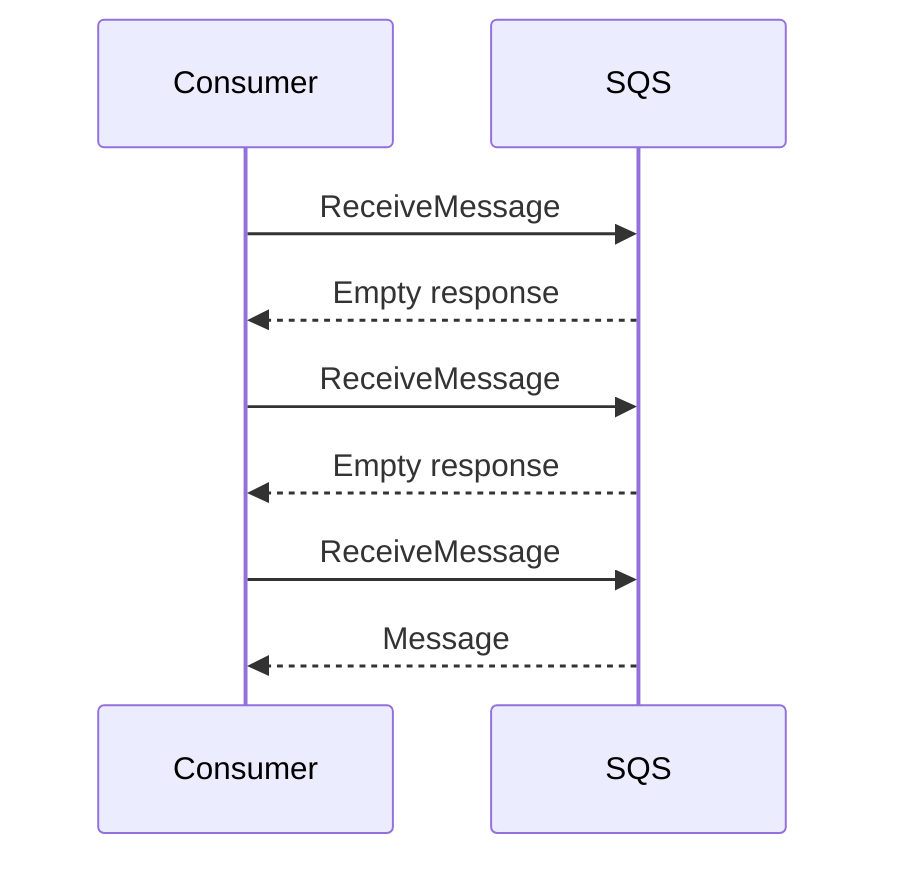
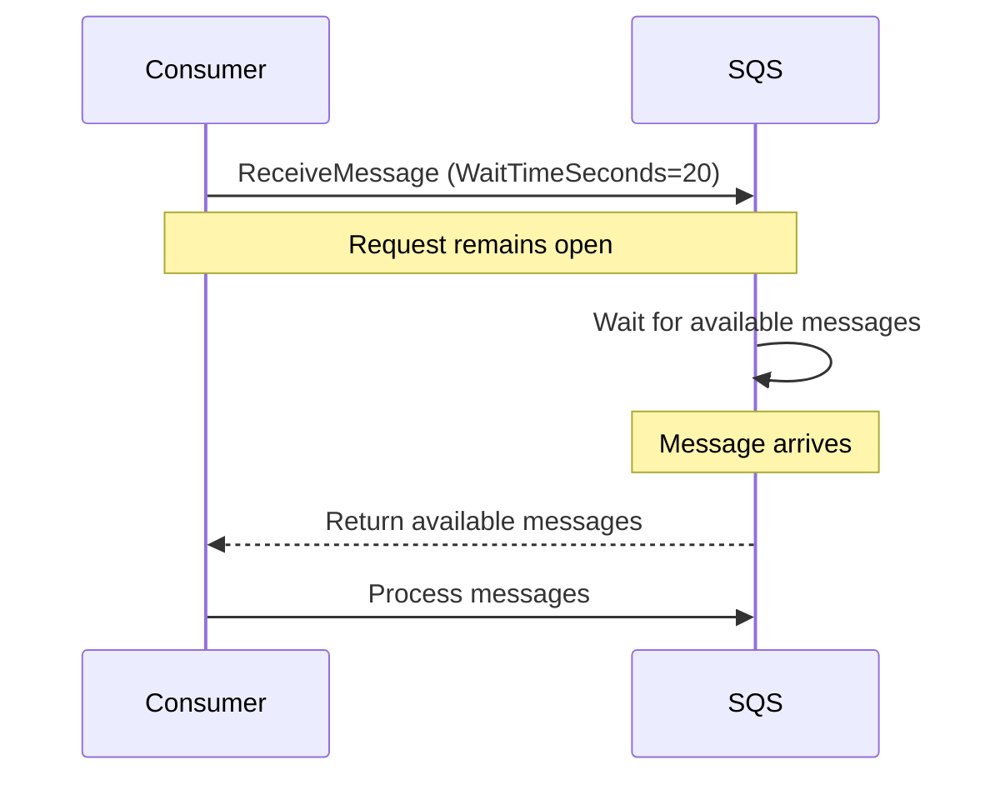
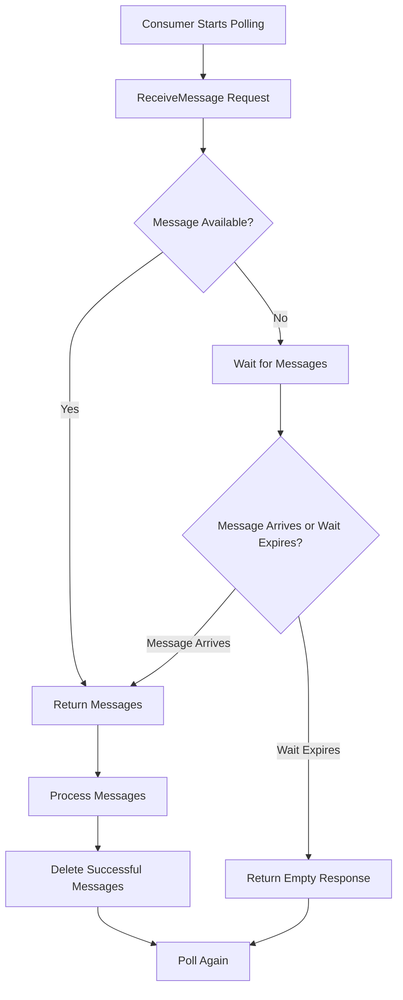
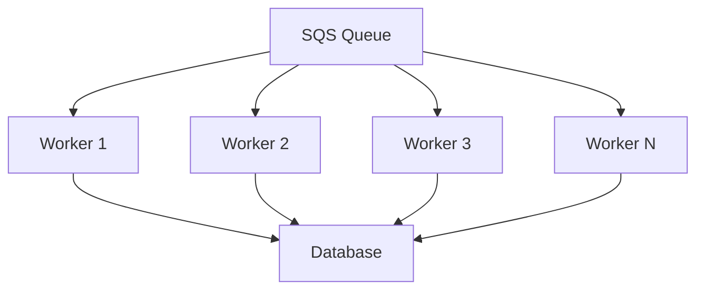

# 06- Long Polling Optimization

## Overview

Amazon Simple Queue Service (Amazon SQS) supports short polling and long polling for retrieving messages from a queue.

Long polling allows a consumer to wait for messages to become available instead of repeatedly sending receive requests when the queue is empty.

When a consumer uses long polling, SQS waits for messages to arrive or until the configured wait duration expires. If messages become available during that period, SQS returns them immediately.

Long polling improves consumer efficiency by reducing:

- Empty receive requests.
- Unnecessary network round trips.
- API request costs.
- Consumer CPU utilization.
- Polling overhead during low traffic periods.

It is particularly useful for backend workers, microservices, event-driven applications, and containerized SQS consumers.

## Short Polling vs Long Polling

### Short Polling

Short polling is the default behavior when `WaitTimeSeconds` is set to `0`.

SQS samples a subset of its servers and returns messages available from the sampled servers. Consequently, a short-poll request can return an empty response even when messages exist elsewhere in the queue.

Consumers typically compensate by polling repeatedly.



Short polling can be useful when an application needs frequent polling with minimal request wait time, but it can generate unnecessary requests when traffic is low.

### Long Polling

Long polling is enabled by setting `WaitTimeSeconds` to a value greater than zero.

The maximum supported wait time is 20 seconds.

SQS waits for messages to become available and returns them as soon as messages are available or the wait period expires.



Long polling reduces empty responses and improves request efficiency.

### Comparison

| Characteristic | Short Polling | Long Polling |
|---|---|---|
| `WaitTimeSeconds` | 0 | Greater than 0, up to 20 |
| Server sampling | Samples a subset of servers | Queries across all SQS servers |
| Empty responses | More likely | Less likely |
| Request frequency | Usually higher | Usually lower |
| API overhead | Higher under low traffic | Lower under low traffic |
| Response latency | Immediate response | Waits for messages or timeout |
| Cost efficiency | Can generate unnecessary requests | Generally more efficient |
| Recommended usage | Specialized low-latency polling scenarios | Most production consumers |

Long polling does not guarantee that every receive request returns a message. It reduces empty responses but can still return an empty result when no messages become available during the wait period.

## Configuring Long Polling

SQS supports long polling through two configuration mechanisms:

- Queue-level configuration using `ReceiveMessageWaitTimeSeconds`.
- Request-level configuration using `WaitTimeSeconds`.

### Queue-Level Configuration

Queue-level configuration establishes the default wait duration for receive requests.

Using AWS CLI:

```bash
aws sqs set-queue-attributes \
    --queue-url https://sqs.ap-south-1.amazonaws.com/123456789012/orders \
    --attributes ReceiveMessageWaitTimeSeconds=20
```

Retrieve the configured value:

```bash
aws sqs get-queue-attributes \
    --queue-url https://sqs.ap-south-1.amazonaws.com/123456789012/orders \
    --attribute-names ReceiveMessageWaitTimeSeconds
```

Using Boto3:

```python
import boto3

sqs = boto3.client("sqs", region_name="ap-south-1")

QUEUE_URL = (
    "https://sqs.ap-south-1.amazonaws.com/"
    "123456789012/orders"
)


def configure_long_polling(wait_seconds: int = 20) -> None:
    if not 0 <= wait_seconds <= 20:
        raise ValueError(
            "Long polling wait must be between 0 and 20 seconds"
        )

    sqs.set_queue_attributes(
        QueueUrl=QUEUE_URL,
        Attributes={
            "ReceiveMessageWaitTimeSeconds": str(wait_seconds),
        },
    )
```

This configuration applies to receive requests that do not explicitly override the wait duration.

### Request-Level Configuration

A consumer can specify the wait duration directly in `ReceiveMessage`.

```python
response = sqs.receive_message(
    QueueUrl=QUEUE_URL,
    MaxNumberOfMessages=10,
    WaitTimeSeconds=20,
)
```

Request-level configuration is useful when different consumers need different polling behavior.

For example:

- A latency-sensitive worker may use a shorter wait duration.
- A background worker may use the maximum 20-second wait.
- A diagnostic consumer may temporarily use short polling.

When both queue-level and request-level values are configured, the request-level `WaitTimeSeconds` takes precedence for that receive operation.

## Long Polling Request Lifecycle

Long polling changes how the consumer waits for messages, but it does not change the message processing lifecycle.



The consumer should continue polling after an empty response. An empty response is a normal outcome, not necessarily an application failure.

Long polling does not change:

- Visibility timeout behavior.
- Message retention.
- Delivery guarantees.
- FIFO ordering.
- Dead-letter queue behavior.
- Consumer idempotency requirements.

## Optimizing ReceiveMessage

Long polling should generally be combined with message batching.

`ReceiveMessage` supports retrieving up to 10 messages per request.

```python
response = sqs.receive_message(
    QueueUrl=QUEUE_URL,
    MaxNumberOfMessages=10,
    WaitTimeSeconds=20,
    VisibilityTimeout=120,
    MessageSystemAttributeNames=[
        "ApproximateReceiveCount",
        "SentTimestamp",
    ],
)
```

This configuration combines:

- Long polling to reduce empty requests.
- Batch receiving to reduce API calls.
- Visibility timeout to provide processing time.
- System attributes for operational diagnostics.

SQS may return fewer messages than requested. `MaxNumberOfMessages=10` is an upper limit, not a guarantee that every response contains ten messages.

### Batch Size Considerations

| Batch size | Characteristics |
|---:|---|
| 1 | Simple processing, more receive requests |
| 2–5 | Moderate batching and manageable processing |
| 6–10 | Better request efficiency for suitable workloads |

Choose a batch size based on processing duration, available worker concurrency, downstream capacity, and visibility timeout.

Receiving ten messages does not mean the application should necessarily process all ten concurrently.

For FIFO queues, preserve ordering within each message group. Parallel processing should be limited to independent groups.

## Python Consumer with Long Polling

A production consumer should handle empty responses, process messages independently, and acknowledge only successfully processed messages.

```python
import json
import logging
import time

import boto3
from botocore.exceptions import BotoCoreError, ClientError

logger = logging.getLogger(__name__)

sqs = boto3.client("sqs", region_name="ap-south-1")

QUEUE_URL = (
    "https://sqs.ap-south-1.amazonaws.com/"
    "123456789012/orders"
)


def process_order_event(payload: dict) -> None:
    order_id = payload["order_id"]

    # Execute an idempotent database transaction here.
    logger.info("Processed order: %s", order_id)


def poll_messages() -> None:
    while True:
        try:
            response = sqs.receive_message(
                QueueUrl=QUEUE_URL,
                MaxNumberOfMessages=10,
                WaitTimeSeconds=20,
                VisibilityTimeout=120,
                MessageSystemAttributeNames=[
                    "ApproximateReceiveCount",
                    "SentTimestamp",
                ],
            )

            messages = response.get("Messages", [])

            if not messages:
                continue

            for message in messages:
                try:
                    payload = json.loads(message["Body"])
                    process_order_event(payload)

                    sqs.delete_message(
                        QueueUrl=QUEUE_URL,
                        ReceiptHandle=message["ReceiptHandle"],
                    )

                except (ValueError, KeyError):
                    logger.exception(
                        "Invalid message payload"
                    )

                except Exception:
                    logger.exception(
                        "Message processing failed"
                    )

        except (ClientError, BotoCoreError):
            logger.exception("SQS polling failed")
            time.sleep(5)
```

This example illustrates the polling and acknowledgment pattern. A production worker should additionally implement:

- Graceful shutdown.
- Structured logging and metrics.
- Durable idempotency.
- Bounded retry behavior.
- Dead-letter queue handling.
- Connection and dependency management.
- Visibility timeout extension for long-running operations.

For FIFO queues, do not process messages from the same message group concurrently without preserving sequence. If a message fails, later messages from that group must not be acknowledged ahead of it.

## Network Timeout Configuration

Long polling keeps an HTTP request open while SQS waits for messages.

The HTTP client's read timeout must be greater than the configured `WaitTimeSeconds`.

If the client read timeout is shorter than the SQS wait duration, the client may terminate the request before SQS returns a response.

Example:

```python
import boto3
from botocore.config import Config

sqs = boto3.client(
    "sqs",
    region_name="ap-south-1",
    config=Config(
        connect_timeout=5,
        read_timeout=30,
        retries={
            "mode": "standard",
            "max_attempts": 5,
        },
    ),
)
```

With `WaitTimeSeconds=20`, a 30-second read timeout provides additional time for response transmission and network overhead.

### Timeout Configuration Guidelines

| Setting | Example | Purpose |
|---|---:|---|
| Connection timeout | 5 seconds | Limits connection establishment time |
| Long-poll wait | 20 seconds | Maximum SQS long-poll wait |
| HTTP read timeout | 30 seconds | Allows the long-poll response to arrive |
| Retry attempts | 5 | Handles eligible transient request failures |

These are starting values, not universal production defaults.

The read timeout should exceed the long-poll duration with a reasonable safety margin. Also check:

- NAT gateway and firewall behavior.
- Proxy idle connection timeouts.
- Service mesh request timeouts.
- Container networking.
- Load balancer idle timeouts, if traffic passes through one.

Avoid placing a short HTTP request timeout around a 20-second long-poll operation.

## Long Polling and Worker Concurrency

Long polling reduces unnecessary receive requests, but it does not increase the processing capacity of a worker.

Consider a deployment with five workers, each receiving up to ten messages.

The total number of messages that can be received in a polling cycle depends on available messages and service behavior. Actual processing throughput depends on worker concurrency and message processing duration.

Important factors include:

- Number of worker processes.
- Number of concurrent receive requests.
- Batch size.
- Message processing duration.
- Database connection pool size.
- External API rate limits.
- Visibility timeout.

### Multiple Consumers



Each worker can use long polling independently.

Adding consumers can improve throughput when the workload is parallelizable and downstream dependencies have sufficient capacity.

However, excessive consumer concurrency can overload databases and external APIs.

Use controlled scaling rather than increasing worker count without measuring downstream capacity.

### Kubernetes and Containerized Workers

For Kubernetes deployments, long polling works well with multiple worker replicas.

Important considerations:

- Each worker should use an independent receive loop.
- Configure graceful shutdown so workers stop polling before termination.
- Ensure HTTP read timeouts exceed the long-poll duration.
- Align worker concurrency with downstream connection limits.
- Use autoscaling signals that reflect queue backlog and processing capacity.

Avoid using CPU utilization as the only scaling signal. An idle worker waiting in a long-poll request may consume very little CPU while the queue backlog grows.

## Long Polling and AWS Lambda

When Lambda consumes SQS through an event source mapping, AWS manages polling on behalf of the function.

The event source mapping controls message retrieval and batching.

Application developers generally do not implement their own long-polling loop inside the Lambda function.

Relevant configuration includes:

- Batch size.
- Maximum batching window.
- Function timeout.
- Queue visibility timeout.
- Maximum concurrency.
- Partial batch response configuration.

Use partial batch responses when individual messages can fail independently.

Enable the `ReportBatchItemFailures` response type and return failed message identifiers from the handler.

For FIFO queues, stop processing later messages in the affected message group after a failure and report those messages as failures to preserve ordering.

## Long Polling and Cost Optimization

SQS charges for API requests, subject to the applicable pricing model and free-tier allowances.

Short polling can generate many empty receive requests when a queue has little traffic.

Long polling reduces unnecessary requests by allowing a single receive request to wait for messages.

### Example

Consider a consumer that polls every second for one hour while the queue is empty.

```text
Short polling:
    1 request/second
    3,600 requests/hour
```

With a 20-second long-poll wait:

```text
Long polling:
    Approximately 180 requests/hour
```

This illustrates the potential reduction in empty polling requests.

Actual request counts depend on message arrivals, consumer concurrency, and request timing.

### Additional Cost Considerations

Long polling does not eliminate costs associated with:

- Send requests.
- Delete requests.
- Message processing.
- Data transfer.
- KMS requests where applicable.
- Downstream infrastructure.

Batch receiving and batch deletion can further reduce API request overhead.

Use CloudWatch metrics and application telemetry to compare receive request volume before and after enabling long polling.

## Monitoring Long Polling

Long polling should be monitored through SQS metrics and application-level instrumentation.

### SQS Metrics

| Metric | Purpose |
|---|---|
| `NumberOfEmptyReceives` | Tracks receive requests that return no messages |
| `NumberOfMessagesReceived` | Tracks messages returned by receive requests |
| `NumberOfMessagesDeleted` | Tracks successful acknowledgments |
| `ApproximateNumberOfMessagesVisible` | Measures messages waiting for consumers |
| `ApproximateNumberOfMessagesNotVisible` | Measures in-flight messages |
| `ApproximateAgeOfOldestMessage` | Indicates queue processing delays |

These metrics are approximate and should be correlated with worker-level telemetry.

### Application Metrics

Track:

- Receive request count.
- Empty receive count.
- Receive request duration.
- Messages returned per receive request.
- Message processing duration.
- Receive request failures.
- Message deletion failures.
- Worker concurrency.
- Queue backlog.

Useful derived metrics include:

```text
Average batch size =
    Messages received / Receive requests
```

```text
Empty receive ratio =
    Empty receive requests / Total receive requests
```

A high empty receive ratio may indicate:

- Low message traffic.
- Excessive consumer concurrency.
- Inefficient polling configuration.
- Consumers polling queues that are rarely used.

A high queue backlog combined with a high empty receive ratio may indicate that the metrics are being interpreted incorrectly or that receive and processing behavior needs further investigation.

### Alerting Recommendations

Consider alerts for:

- Sustained growth in visible messages.
- Oldest-message age exceeding the processing objective.
- Receive request failures.
- Low deletion rate relative to receive activity.
- Increasing in-flight messages.
- Consumer capacity falling below expected demand.

Do not alert solely because a long-poll request returns an empty response. Empty responses are normal when the queue has no available messages.

## Error Handling and Reliability

Long polling does not eliminate network failures.

A consumer may experience:

- Connection timeouts.
- Read timeouts.
- Temporary AWS service errors.
- Throttling.
- Network interruptions.
- Worker termination during a receive request.

Use the SDK's retry behavior for eligible transient errors and implement application-level handling for persistent failures.

Avoid aggressive retry loops that continuously issue receive requests after repeated network errors.

A practical strategy includes:

- Standard SDK retries.
- Bounded application-level backoff for repeated failures.
- Exponential backoff with jitter.
- Structured error logging.
- Graceful worker shutdown.
- Health checks and operational alerts.

An interrupted long-poll request does not prove that no messages were available. The consumer should safely resume polling and rely on idempotent processing.

## Security Considerations

Long polling does not change SQS security requirements.

Recommended practices:

- Use IAM roles instead of hardcoded AWS credentials.
- Grant only the required SQS receive and delete permissions.
- Encrypt queues using SSE-SQS or SSE-KMS where required.
- Avoid exposing queue URLs or message payloads in public logs.
- Use private networking and VPC endpoints where appropriate.
- Configure HTTP client timeouts without disabling TLS verification.
- Rotate and manage credentials through standard AWS identity mechanisms.

For KMS-encrypted queues, verify that the consumer role and KMS key policy permit the required operations.

## Common Mistakes and Production Pitfalls

| Mistake | Impact | Recommended approach |
|---|---|---|
| Using short polling for low-traffic queues | Excessive empty receive requests | Enable long polling |
| Setting `WaitTimeSeconds` above 20 | Invalid request configuration | Use a value between 0 and 20 |
| Configuring HTTP read timeout below the polling duration | Client terminates requests prematurely | Set read timeout above the long-poll wait |
| Assuming every long poll returns a message | Incorrect consumer logic | Handle empty responses normally |
| Assuming long polling increases processing throughput | Worker capacity remains unchanged | Scale consumers based on workload and dependency capacity |
| Receiving large batches without sufficient capacity | Messages remain in-flight while waiting locally | Align batch size with worker concurrency |
| Treating empty responses as failures | Unnecessary error logs and alerts | Treat empty responses as normal |
| Scaling only on CPU utilization | Workers may be idle while backlog grows | Include queue backlog and message age |
| Ignoring proxy and service mesh timeouts | Long-poll connections terminate unexpectedly | Align network idle timeouts with the polling duration |
| Implementing long polling inside Lambda handlers | Duplicates managed event source polling behavior | Let Lambda event source mappings manage polling |

## Production Best Practices

- Enable long polling for most SQS consumers.
- Use `WaitTimeSeconds=20` as a practical starting point for background workers.
- Configure the HTTP read timeout to exceed the long-poll duration.
- Combine long polling with batch receiving to reduce request overhead.
- Handle empty responses as normal outcomes.
- Align batch size, worker concurrency, visibility timeout, and downstream capacity.
- Use graceful shutdown for containerized consumers.
- Monitor empty receives, queue age, in-flight messages, and processing throughput.
- Use SDK retries and bounded backoff for transient network failures.
- Preserve idempotency and FIFO message-group ordering regardless of polling strategy.

## Key Takeaways

- Long polling allows SQS consumers to wait up to 20 seconds for messages, reducing empty receive requests and API overhead.
- Configure long polling through `ReceiveMessageWaitTimeSeconds` at queue level or `WaitTimeSeconds` at request level.
- Set HTTP read timeouts above the configured long-poll duration and account for proxy and network idle timeouts.
- Combine long polling with batch receiving, controlled concurrency, and appropriate visibility timeout configuration.
- Long polling improves polling efficiency, not processing capacity or delivery guarantees.