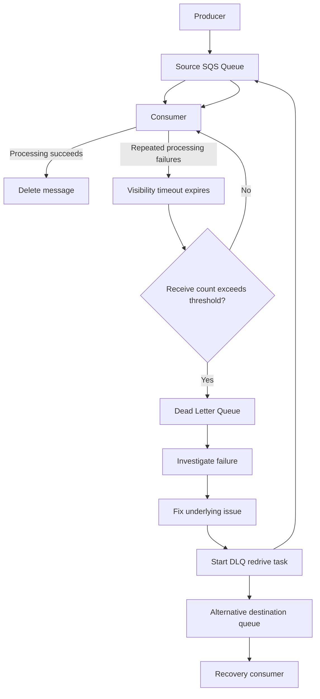
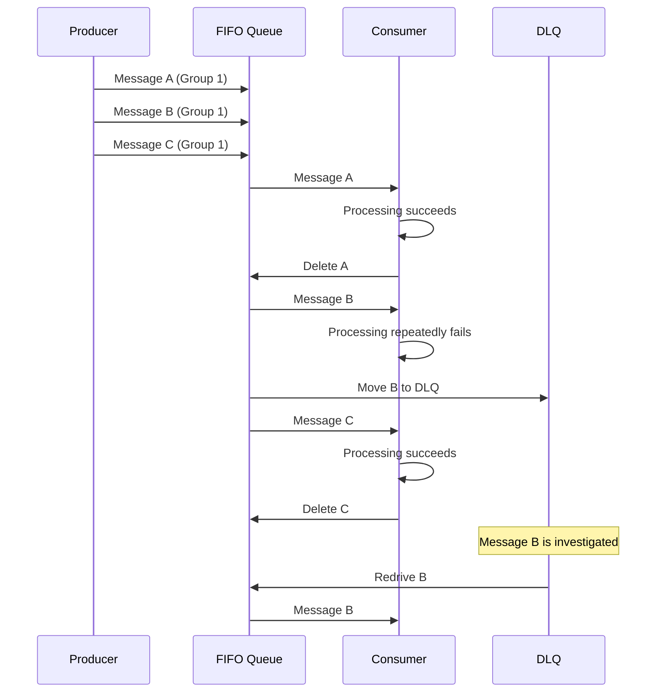
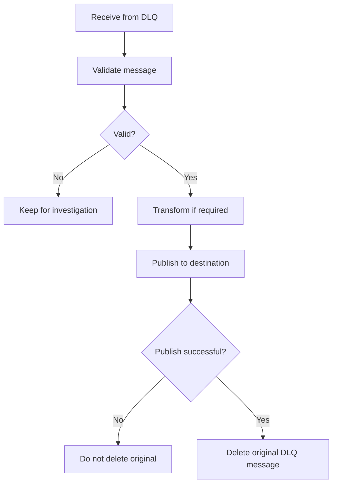

# 07- Dead Letter Queue Redrive

## Overview

Dead Letter Queue (DLQ) redrive is the process of moving messages from an Amazon SQS dead-letter queue back into a source queue or another destination queue for reprocessing.

A DLQ isolates messages that repeatedly fail processing. Redrive provides a controlled recovery mechanism without requiring applications to manually read, transform, and republish every failed message.

In production systems, DLQ redrive is part of the message recovery lifecycle. It helps recover from:

- Temporary downstream service failures.
- Incorrect application deployments.
- Database outages or connectivity problems.
- Invalid configuration or dependency changes.
- Consumer bugs that have been fixed.
- Messages that require controlled reprocessing after investigation.

Redrive should not be treated as an unconditional retry mechanism. Messages must be investigated, the underlying failure must be addressed, and the destination consumer must be capable of processing them safely.

## DLQ Redrive Architecture

An SQS queue can be configured with a redrive policy that moves messages to a DLQ after they exceed a configured receive count.

Once the issue is resolved, a redrive task can move messages from the DLQ back to the original source queue or another supported destination queue.



The main components are:

| Component | Responsibility |
|---|---|
| Source queue | Holds messages awaiting normal processing |
| Consumer | Processes messages and deletes successfully handled messages |
| Redrive policy | Defines the DLQ and receive-count threshold |
| Dead Letter Queue | Stores messages that exceeded the configured receive count |
| Redrive task | Moves messages from the DLQ to a destination queue |
| Recovery consumer | Processes messages after redrive |

## Understanding SQS Redrive Mechanisms

SQS provides two related configuration mechanisms and a set of APIs for moving messages.

### Redrive Policy

A redrive policy is configured on the source queue. It identifies the DLQ and the maximum number of receives allowed before a message is moved.

The policy uses:

- `deadLetterTargetArn`: ARN of the destination DLQ.
- `maxReceiveCount`: Maximum receive count before SQS moves the message to the DLQ.

Example:

```json
{
  "deadLetterTargetArn": "arn:aws:sqs:ap-south-1:123456789012:orders-dlq",
  "maxReceiveCount": 5
}
```

If a message repeatedly becomes visible without being deleted, its receive count increases. When the configured threshold is exceeded, SQS moves it to the DLQ.

The receive count is not equivalent to the number of completed application processing attempts. A consumer can receive a message and crash before performing any useful work.

### Redrive Allow Policy

A redrive allow policy is configured on the DLQ. It controls which source queues are allowed to use that DLQ.

Supported permissions include:

| Permission | Behavior |
|---|---|
| `allowAll` | Allows any eligible source queue to use the DLQ |
| `denyAll` | Prevents source queues from using the DLQ |
| `byQueue` | Allows only explicitly listed source queue ARNs |

For production systems, `byQueue` provides tighter control when multiple queues exist in the same account.

Example:

```json
{
  "redrivePermission": "byQueue",
  "sourceQueueArns": [
    "arn:aws:sqs:ap-south-1:123456789012:orders-queue"
  ]
}
```

This policy is separate from the SQS resource-based queue policy. It controls DLQ association, not general message access.

## Native DLQ Redrive

Amazon SQS provides native redrive APIs that move messages from a DLQ to a destination queue.

The main APIs are:

| API | Purpose |
|---|---|
| `StartMessageMoveTask` | Starts an asynchronous message movement task |
| `ListMessageMoveTasks` | Retrieves the status of recent redrive tasks |
| `CancelMessageMoveTask` | Cancels an active redrive task |

Native redrive avoids implementing a custom consumer that receives messages from the DLQ and republishes them manually.

### StartMessageMoveTask

This API starts a redrive task for a DLQ.

The destination can be:

- The original source queue associated with the DLQ.
- Another supported SQS queue.

The destination queue must be compatible with the DLQ type. Standard and FIFO queue types must match.

Example AWS CLI command:

```bash
aws sqs start-message-move-task \
    --source-arn arn:aws:sqs:ap-south-1:123456789012:orders-dlq \
    --destination-arn arn:aws:sqs:ap-south-1:123456789012:orders-queue \
    --max-number-of-messages-per-second 100 \
    --region ap-south-1
```

The `--max-number-of-messages-per-second` parameter controls the approximate movement rate.

If omitted, SQS determines the movement rate.

For large DLQs, rate limiting helps prevent a recovery operation from overwhelming downstream services.

### Redrive to the Original Source Queue

When the destination ARN is omitted, SQS uses the original source queue associated with the DLQ, provided the association is available.

```bash
aws sqs start-message-move-task \
    --source-arn arn:aws:sqs:ap-south-1:123456789012:orders-dlq \
    --region ap-south-1
```

This is useful when recovering messages after a temporary consumer or dependency failure.

### Redrive to an Alternative Queue

A different destination can be useful when:

- The original consumer is still being deployed.
- Messages require processing through a dedicated recovery pipeline.
- A new queue has been configured with different processing capacity.
- Messages need to be isolated for controlled migration.

Example:

```bash
aws sqs start-message-move-task \
    --source-arn arn:aws:sqs:ap-south-1:123456789012:orders-dlq \
    --destination-arn arn:aws:sqs:ap-south-1:123456789012:orders-recovery-queue \
    --max-number-of-messages-per-second 25 \
    --region ap-south-1
```

The alternative queue must have the same queue type as the source DLQ.

## Monitoring Redrive Tasks

Redrive tasks run asynchronously. A successful API response means that SQS accepted the task, not that all messages have already reached the destination.

Use `ListMessageMoveTasks` to inspect progress.

```bash
aws sqs list-message-move-tasks \
    --source-arn arn:aws:sqs:ap-south-1:123456789012:orders-dlq \
    --max-results 10 \
    --region ap-south-1
```

A task response can contain:

| Field | Description |
|---|---|
| `TaskHandle` | Identifier used to cancel the task |
| `Status` | Current task status |
| `SourceArn` | Source DLQ ARN |
| `DestinationArn` | Destination queue ARN |
| `MaxNumberOfMessagesPerSecond` | Configured movement rate |
| `ApproximateNumberOfMessagesMoved` | Approximate number of messages moved |
| `ApproximateNumberOfMessagesToMove` | Approximate number of messages remaining |
| `FailureReason` | Failure details when available |
| `StartedTimestamp` | Task start timestamp |

Task status can indicate whether the task is pending, running, completed, failed, or cancelled.

The number of moved messages is approximate. Do not use it as the sole proof that every intended business event was successfully processed.

### Canceling a Redrive Task

Use `CancelMessageMoveTask` when a redrive operation needs to be stopped.

```bash
aws sqs cancel-message-move-task \
    --task-handle "TASK_HANDLE_RETURNED_BY_START_API" \
    --region ap-south-1
```

Cancellation stops further movement, but messages already moved are not automatically returned to the DLQ.

A cancellation procedure should therefore include:

1. Stop or cancel the movement task.
2. Inspect the destination queue.
3. Determine which messages have already been moved.
4. Confirm whether consumers have processed any of them.
5. Decide whether additional recovery or isolation is necessary.

## Controlling Redrive Through Python and Boto3

A backend operations service can initiate and monitor redrive tasks using Boto3.

This is useful when recovery operations must be integrated with internal administrative tools, deployment workflows, or incident management procedures.

### Start a Redrive Task

```python
import boto3
from botocore.exceptions import BotoCoreError, ClientError

sqs = boto3.client("sqs", region_name="ap-south-1")


def start_redrive(
    source_dlq_arn: str,
    destination_queue_arn: str | None = None,
    max_messages_per_second: int | None = None,
) -> str:
    request = {
        "sourceArn": source_dlq_arn,
    }

    if destination_queue_arn:
        request["destinationArn"] = destination_queue_arn

    if max_messages_per_second is not None:
        if max_messages_per_second <= 0:
            raise ValueError("Redrive rate must be positive")

        request["maxNumberOfMessagesPerSecond"] = (
            max_messages_per_second
        )

    try:
        response = sqs.start_message_move_task(**request)
        return response["TaskHandle"]

    except (ClientError, BotoCoreError):
        raise
```

Usage:

```python
task_handle = start_redrive(
    source_dlq_arn=(
        "arn:aws:sqs:ap-south-1:123456789012:orders-dlq"
    ),
    destination_queue_arn=(
        "arn:aws:sqs:ap-south-1:123456789012:orders-queue"
    ),
    max_messages_per_second=50,
)

print(f"Redrive task started: {task_handle}")
```

The function returns a task handle, not a completion result. Production applications should persist the handle and monitor the task separately.

### Monitor a Redrive Task

```python
def list_redrive_tasks(
    source_dlq_arn: str,
    max_results: int = 10,
) -> list[dict]:
    if not 1 <= max_results <= 10:
        raise ValueError("max_results must be between 1 and 10")

    try:
        response = sqs.list_message_move_tasks(
            SourceArn=source_dlq_arn,
            MaxResults=max_results,
        )

        return response.get("Results", [])

    except (ClientError, BotoCoreError):
        raise
```

Example:

```python
tasks = list_redrive_tasks(
    "arn:aws:sqs:ap-south-1:123456789012:orders-dlq"
)

for task in tasks:
    print(
        task.get("Status"),
        task.get("ApproximateNumberOfMessagesMoved"),
        task.get("ApproximateNumberOfMessagesToMove"),
        task.get("FailureReason"),
    )
```

A production monitoring service should:

- Store the task handle and associated incident or change request.
- Record the source and destination queue ARNs.
- Track task status and failure reason.
- Alert when a task fails or remains active unexpectedly.
- Compare queue depth before and after the operation.
- Confirm application-level processing independently.

## Terraform Configuration

Terraform can configure the source queue, DLQ, redrive policy, and redrive allow policy.

### Standard Queue with DLQ

```hcl
resource "aws_sqs_queue" "orders_dlq" {
  name                      = "orders-dlq"
  message_retention_seconds = 1209600

  redrive_allow_policy = jsonencode({
    redrivePermission = "byQueue"
    sourceQueueArns = [
      aws_sqs_queue.orders.arn
    ]
  })
}

resource "aws_sqs_queue" "orders" {
  name                       = "orders-queue"
  visibility_timeout_seconds = 120
  message_retention_seconds  = 345600

  redrive_policy = jsonencode({
    deadLetterTargetArn = aws_sqs_queue.orders_dlq.arn
    maxReceiveCount     = 5
  })
}
```

The DLQ retention period is configured to 14 days, allowing additional time for investigation and recovery.

For Standard queues, the original enqueue timestamp is retained when a message moves to the DLQ. The DLQ's age metric reflects the time since the message moved into the DLQ, while the original retention timeline continues to apply.

Therefore, a DLQ should generally have a retention period longer than its source queue.

### FIFO Queue with DLQ

Both the source queue and DLQ must be FIFO queues.

```hcl
resource "aws_sqs_queue" "orders_fifo_dlq" {
  name                        = "orders-fifo-dlq.fifo"
  fifo_queue                  = true
  content_based_deduplication = false
  message_retention_seconds   = 1209600

  redrive_allow_policy = jsonencode({
    redrivePermission = "byQueue"
    sourceQueueArns = [
      aws_sqs_queue.orders_fifo.arn
    ]
  })
}

resource "aws_sqs_queue" "orders_fifo" {
  name                        = "orders.fifo"
  fifo_queue                  = true
  content_based_deduplication = false
  visibility_timeout_seconds  = 120
  message_retention_seconds   = 345600

  redrive_policy = jsonencode({
    deadLetterTargetArn = aws_sqs_queue.orders_fifo_dlq.arn
    maxReceiveCount     = 5
  })
}
```

For FIFO queues, moving a failed message to a DLQ can allow later messages in its message group to proceed. This can create gaps in the business sequence.

Redrive does not automatically restore the original business ordering relative to messages already processed.

## FIFO Redrive and Message Ordering

FIFO redrive requires additional care because message ordering is guaranteed within a message group during normal queue processing.

Consider an order workflow:

```text
OrderCreated
    |
    v
PaymentAuthorized
    |
    v
InventoryReserved
    |
    v
OrderShipped
```

Suppose `PaymentAuthorized` repeatedly fails and is moved to the DLQ. Later messages in the same group may become available for processing.

If the failed message is redriven after later messages have already been processed, the original business sequence is not automatically reconstructed.



Message B can now be processed after Message C.

For business workflows that require strict sequence integrity:

- Treat DLQ movement as a business-level exception.
- Track aggregate or entity sequence numbers.
- Validate expected state transitions before applying an event.
- Consider pausing affected message groups or using a dedicated recovery workflow.
- Do not assume redrive restores the original sequence.
- Use idempotent consumers and durable event processing records.

For Standard queues, ordering is best-effort, so redrive cannot provide strict ordering guarantees.

## Redrive Rate and Backpressure

A large DLQ can contain thousands or millions of messages. Moving all messages into a source queue at once can overload consumers and downstream dependencies.

For example, an order-processing service may depend on:

- PostgreSQL for order state.
- A payment provider API.
- Redis for caching.
- Inventory services over HTTP or gRPC.

A sudden replay can create a large increase in database connections, API requests, lock contention, and queue processing latency.

### Rate-Limited Redrive

Use the redrive rate to control how quickly messages are moved.

```bash
aws sqs start-message-move-task \
    --source-arn arn:aws:sqs:ap-south-1:123456789012:orders-dlq \
    --destination-arn arn:aws:sqs:ap-south-1:123456789012:orders-queue \
    --max-number-of-messages-per-second 50 \
    --region ap-south-1
```

The configured rate is an approximate movement limit, not a guarantee of an exact processing rate.

It does not replace consumer-side concurrency controls or downstream rate limiting.

### Recovery Capacity Planning

Before redriving, evaluate:

| Concern | Operational question |
|---|---|
| DLQ size | How many messages need recovery? |
| Consumer capacity | How many messages can consumers process safely per second? |
| Database capacity | Can the database handle the additional write load? |
| External APIs | Are provider rate limits sufficient? |
| Visibility timeout | Is it appropriate for the recovery workload? |
| Retry behavior | Could replayed messages fail and return to the DLQ? |
| Message age | Are messages still within their retention period? |
| FIFO ordering | Can replay create business sequence violations? |

A controlled recovery process should start at a conservative rate, observe system behavior, and increase throughput only when downstream services remain healthy.

## Native Redrive vs Custom Redrive

Native redrive is generally preferable when messages can be moved without application-level transformation.

Custom redrive can be appropriate when recovery requires inspecting, filtering, modifying, or selectively replaying messages.

| Capability | Native redrive | Custom redrive |
|---|---|---|
| Message movement | Managed by SQS | Implemented by application |
| Rate control | Supported | Application-defined |
| Message transformation | Not supported | Supported |
| Selective business filtering | Limited | Supported |
| Operational complexity | Lower | Higher |
| Application-level validation | Consumer responsibility | Can be implemented before publishing |
| Message metadata preservation | Managed by SQS | Must be handled explicitly |
| Failure handling | Managed movement task | Application-managed retries and recovery |

### When to Use Native Redrive

Use native redrive when:

- The message payload is still valid.
- The original processing logic is fixed.
- Messages can be replayed without transformation.
- The destination queue has compatible semantics.
- Controlled movement is sufficient.

### When to Use Custom Redrive

Use a custom recovery workflow when:

- Messages need schema transformation.
- Only selected messages should be replayed.
- Messages need business-level validation before reprocessing.
- Recovery requires routing to different destinations.
- The original payload format is no longer supported.

A custom redrive implementation must handle partial failures, duplicate publishing, visibility timeouts, receipt handles, and idempotency.

## Building a Custom Redrive Workflow

A custom redrive process typically:

1. Receives a message from the DLQ.
2. Validates the payload.
3. Applies optional transformation or filtering.
4. Publishes the message to a destination queue.
5. Deletes the original DLQ message only after successful publication.



A basic Standard queue implementation:

```python
import json
import logging

import boto3
from botocore.exceptions import BotoCoreError, ClientError

logger = logging.getLogger(__name__)

sqs = boto3.client("sqs", region_name="ap-south-1")

DLQ_URL = "https://sqs.ap-south-1.amazonaws.com/123456789012/orders-dlq"
DESTINATION_URL = (
    "https://sqs.ap-south-1.amazonaws.com/123456789012/orders-queue"
)


def redrive_batch() -> int:
    response = sqs.receive_message(
        QueueUrl=DLQ_URL,
        MaxNumberOfMessages=10,
        WaitTimeSeconds=10,
        VisibilityTimeout=120,
        AttributeNames=["ApproximateReceiveCount"],
        MessageAttributeNames=["All"],
    )

    messages = response.get("Messages", [])
    moved = 0

    for message in messages:
        try:
            payload = json.loads(message["Body"])

            if not isinstance(payload, dict):
                raise ValueError("Expected a JSON object")

            send_response = sqs.send_message(
                QueueUrl=DESTINATION_URL,
                MessageBody=json.dumps(payload),
                MessageAttributes=message.get(
                    "MessageAttributes", {}
                ),
            )

            if not send_response.get("MessageId"):
                raise RuntimeError("Destination publish was not confirmed")

            sqs.delete_message(
                QueueUrl=DLQ_URL,
                ReceiptHandle=message["ReceiptHandle"],
            )

            moved += 1

        except (ValueError, RuntimeError, ClientError, BotoCoreError):
            logger.exception(
                "Failed to redrive DLQ message",
                extra={"message_id": message.get("MessageId")},
            )

    return moved
```

This example demonstrates the basic receive-publish-delete sequence. It is not a complete replacement for native redrive.

Production considerations:

- A crash after publishing but before deleting can cause duplicate publication.
- A network timeout can leave the publisher uncertain whether the destination accepted the message.
- The destination may receive a message more than once.
- A message can become visible again if the redrive worker exceeds its visibility timeout.
- FIFO queues require preservation of `MessageGroupId` and appropriate deduplication IDs.
- Custom recovery must account for system attributes that cannot be copied as ordinary message attributes.
- Do not delete the original message before the destination publication is confirmed.

For business-critical recovery, include a stable application event ID and make the destination consumer idempotent.

## Redrive Reliability and Idempotency

Redrive is a message movement operation, not a guarantee of exactly-once business processing.

A message can be delivered more than once because of:

- Ambiguous publisher responses.
- Worker crashes after destination publication.
- Visibility timeout expiration.
- Consumer failures after performing a side effect but before deleting the message.
- Repeated recovery operations.

A robust application should use an idempotency key derived from the original business event.

For example, an order event might contain:

```json
{
  "event_id": "evt-8f2a91",
  "event_type": "order.created",
  "order_id": "ORD-10025",
  "schema_version": 2
}
```

A PostgreSQL consumer can maintain a durable processing record:

```sql
CREATE TABLE processed_events (
    event_id TEXT PRIMARY KEY,
    processed_at TIMESTAMPTZ NOT NULL DEFAULT NOW()
);
```

The consumer should record the event and apply the corresponding business update in the same database transaction.

```python
from django.db import transaction
from django.utils import timezone

from orders.models import Order, ProcessedEvent


def process_order_event(event: dict) -> bool:
    event_id = event["event_id"]

    with transaction.atomic():
        _, created = ProcessedEvent.objects.get_or_create(
            event_id=event_id,
            defaults={"processed_at": timezone.now()},
        )

        if not created:
            return False

        order = Order.objects.select_for_update().get(
            external_id=event["order_id"]
        )

        order.status = "created"
        order.save(update_fields=["status"])

    return True
```

The database uniqueness constraint protects against concurrent duplicate processing.

The event record and business update must participate in the same transaction. Otherwise, a crash between the two operations can leave inconsistent processing state.

For external side effects, such as payment-provider calls, use provider-supported idempotency keys or a durable workflow/outbox pattern. A PostgreSQL transaction cannot atomically commit an external HTTP request.

## Operational Recovery Procedure

A controlled DLQ redrive should follow an incident-driven process.

### Inspect the DLQ

Retrieve approximate queue attributes:

```bash
aws sqs get-queue-attributes \
    --queue-url https://sqs.ap-south-1.amazonaws.com/123456789012/orders-dlq \
    --attribute-names \
        ApproximateNumberOfMessages \
        ApproximateNumberOfMessagesNotVisible \
        ApproximateNumberOfMessagesDelayed \
        RedrivePolicy \
    --region ap-south-1
```

Inspect representative messages without deleting them. Identify:

- Common failure reasons.
- Message schema versions.
- Original event timestamps.
- Affected business entities.
- Whether the underlying issue is resolved.

### Validate the Destination

Before redrive:

- Confirm that the destination queue exists.
- Verify the source and destination queue types are compatible.
- Verify queue policies and KMS permissions.
- Confirm consumer deployment and health.
- Confirm database and external service capacity.
- Validate that the consumer supports the message schema.
- Confirm idempotency behavior.

### Start at a Controlled Rate

Start with a conservative rate when the DLQ is large or downstream capacity is uncertain.

```bash
aws sqs start-message-move-task \
    --source-arn arn:aws:sqs:ap-south-1:123456789012:orders-dlq \
    --max-number-of-messages-per-second 20 \
    --region ap-south-1
```

Observe the queue and downstream systems before increasing the rate.

### Verify Recovery

After the task completes:

- Check the redrive task status.
- Inspect remaining DLQ messages.
- Monitor source queue depth.
- Monitor consumer error rates.
- Check oldest message age.
- Verify business-level processing results.
- Investigate messages that return to the DLQ.

A completed movement task does not prove that every message was successfully processed by the application.

## Monitoring and Observability

DLQ redrive should be observable as an operational workflow.

### Important CloudWatch Metrics

| Metric | Purpose |
|---|---|
| `ApproximateNumberOfMessagesVisible` | Messages waiting in the DLQ |
| `ApproximateNumberOfMessagesNotVisible` | Messages currently in flight |
| `ApproximateAgeOfOldestMessage` | Age of the oldest visible message |
| `NumberOfMessagesSent` | Messages entering a queue |
| `NumberOfMessagesReceived` | Messages received by consumers |
| `NumberOfMessagesDeleted` | Messages deleted after processing |
| `ApproximateNumberOfMessagesDelayed` | Messages waiting for delivery |

Use CloudWatch metrics together with application logs and redrive task status.

Queue metrics are approximate and do not provide a complete business-level audit trail.

### Application-Level Metrics

For a recovery service, track:

```text
dlq_redrive_tasks_started_total
dlq_redrive_tasks_completed_total
dlq_redrive_tasks_failed_total
dlq_redrive_messages_moved_total
dlq_redrive_messages_rejected_total
dlq_redrive_processing_errors_total
dlq_redrive_duration_seconds
```

Include structured log fields such as:

```json
{
  "operation": "dlq_redrive",
  "task_id": "redrive-task-001",
  "source_queue": "orders-dlq",
  "destination_queue": "orders-queue",
  "status": "RUNNING",
  "configured_rate": 50
}
```

Do not log sensitive message payloads or credentials.

### Alerting Recommendations

Create alerts for:

- DLQ message count exceeding an operational threshold.
- Oldest DLQ message age exceeding the recovery SLA.
- Redrive task failures.
- Repeated message returns to the DLQ.
- High destination queue backlog during recovery.
- Consumer error rate or database latency increasing during replay.

A DLQ should have an owner and an operational response process. Messages should not remain there indefinitely without investigation.

## Security Considerations

Redrive permissions can move large volumes of business data and should be restricted.

### IAM Permissions

A redrive operator or automation role may require permissions such as:

- `sqs:StartMessageMoveTask`
- `sqs:ListMessageMoveTasks`
- `sqs:CancelMessageMoveTask`
- `sqs:GetQueueAttributes`

Use resource-level restrictions where supported and scope access to approved DLQ ARNs.

Example IAM policy:

```json
{
  "Version": "2012-10-17",
  "Statement": [
    {
      "Sid": "ManageOrdersDlqRedrive",
      "Effect": "Allow",
      "Action": [
        "sqs:StartMessageMoveTask",
        "sqs:ListMessageMoveTasks",
        "sqs:CancelMessageMoveTask",
        "sqs:GetQueueAttributes"
      ],
      "Resource": "arn:aws:sqs:ap-south-1:123456789012:orders-dlq"
    }
  ]
}
```

Validate the exact resource requirements for each API and destination configuration in the deployed environment.

### Encryption

If queues use SSE-KMS, ensure the relevant IAM roles and KMS key policies permit the required operations.

The recovery workflow should not bypass encryption or introduce unencrypted intermediate storage.

### Auditability

For production systems:

- Restrict redrive initiation to authorized operators or approved automation.
- Record who initiated the operation.
- Record source and destination queue ARNs.
- Associate the operation with an incident or change request.
- Retain task status and execution logs.
- Require approval for high-volume or business-critical replay operations.

## Cost Considerations

DLQ redrive introduces additional SQS API activity and downstream processing work.

Consider:

- Message movement and queue API request charges.
- KMS request charges when using customer-managed keys.
- Additional consumer compute costs.
- Database and external API usage.
- Logging and monitoring costs.
- Repeated processing caused by messages returning to the DLQ.

Rate limiting does not eliminate processing costs. It spreads recovery work over time and reduces the risk of overwhelming dependent systems.

## Common Mistakes and Production Pitfalls

| Mistake | Why it is problematic | Recommended approach |
|---|---|---|
| Redriving without investigating failures | Messages may immediately fail again | Fix the root cause first |
| Redriving the entire DLQ at maximum speed | Can overload consumers and dependencies | Use controlled movement rates |
| Assuming task completion means business recovery | Movement and processing are separate operations | Verify application-level outcomes |
| Ignoring idempotency | Replayed messages can duplicate side effects | Use durable event IDs and transactional processing |
| Using incompatible queue types | Standard and FIFO queues cannot be mixed for redrive | Match queue types |
| Ignoring FIFO sequence gaps | Later events may already have been processed | Validate business sequence and state |
| Deleting DLQ messages before publishing in custom redrive | A failure can permanently lose a message | Publish successfully before deleting |
| Treating receive count as completed attempts | Consumers may crash before processing | Track application-level attempts separately |
| Ignoring message retention | Messages can expire before recovery | Configure appropriate retention periods |
| Giving broad redrive permissions | Unauthorized replay can affect production systems | Apply least privilege and audit operations |
| Replaying obsolete schemas | Consumers may reject old payloads | Validate schema compatibility before recovery |

## Best Practices

- Use native SQS redrive for straightforward message movement.
- Use custom redrive only when transformation, filtering, or business validation is required.
- Investigate and resolve the original failure before replaying messages.
- Configure DLQ retention longer than source queue retention where appropriate.
- Restrict DLQ associations with redrive allow policies.
- Apply conservative movement rates and monitor downstream capacity.
- Preserve stable event identifiers across retries and replay.
- Make consumers idempotent, including external side effects.
- Treat FIFO redrive as a business-ordering concern, not merely a queue operation.
- Monitor redrive tasks and verify business-level recovery.
- Maintain an auditable recovery procedure with clear ownership and approval.

## Key Takeaways

- SQS native redrive uses asynchronous movement tasks to move messages from a DLQ to a compatible destination queue.
- `StartMessageMoveTask`, `ListMessageMoveTasks`, and `CancelMessageMoveTask` provide the core redrive lifecycle.
- Redrive rate controls help protect consumers and downstream dependencies from recovery traffic spikes.
- FIFO redrive can introduce business sequence gaps even when normal queue processing preserves message-group ordering.
- Redrive does not guarantee exactly-once business processing; durable idempotency and operational verification remain essential.