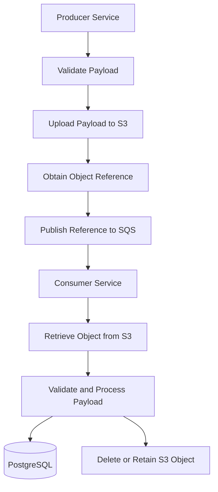
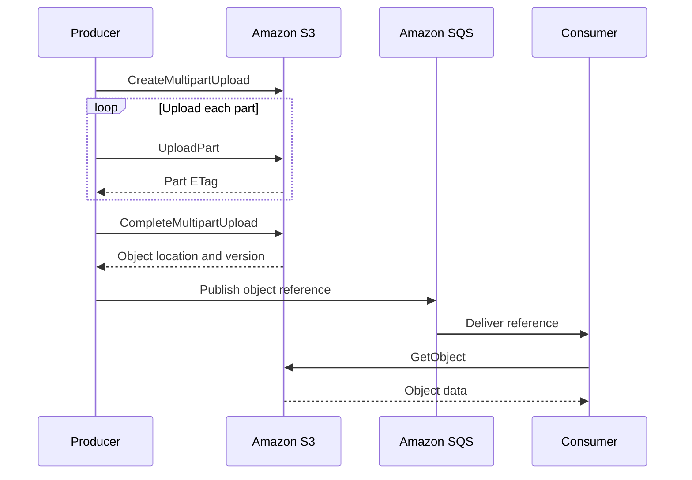
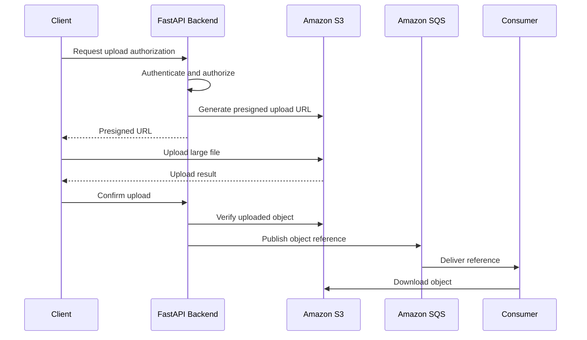
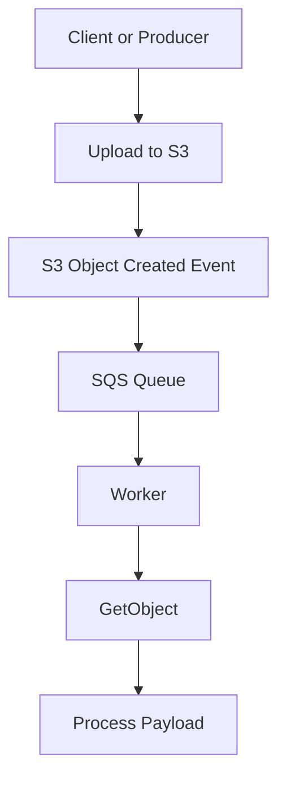

# 08- Large Message Payload Handling

## Overview

Amazon SQS is designed to transport messages between distributed application components. However, SQS imposes a maximum message size of **1 MiB (1,048,576 bytes)** per message.

Backend systems frequently need to exchange payloads larger than this limit, including:

- Large JSON documents.
- PDF and image files.
- Data exports and reports.
- Bulk database records.
- Machine learning inputs.
- Event payloads containing extensive metadata.
- Batch processing instructions with large datasets.

Sending large payloads directly through SQS is not possible when they exceed the service limit. Increasing the queue size or changing queue attributes does not remove this restriction.

A common architectural solution is to store the actual payload in Amazon S3 and publish a small reference message through SQS.

This pattern separates **data storage** from **message transport**:

- Amazon S3 stores the large payload.
- Amazon SQS transports a reference to that payload.
- Consumers retrieve the payload from S3 when processing the message.

This approach is commonly called the *S3 payload offloading pattern*.

## SQS Message Size Limit

SQS supports message bodies up to 1 MiB.

The message size includes the message body and message attributes. A message that exceeds the supported limit is rejected.

For example, consider an application that needs to process a 15 MB PDF document.

Sending the complete document through SQS is not supported. Instead, upload the document to S3 and send its object reference through SQS.

| Payload | Direct SQS delivery |
|---|---|
| Small JSON event | Supported |
| JSON document below 1 MiB | Supported if total message size is within the limit |
| 2 MB JSON document | Not supported |
| 15 MB PDF | Not supported |
| 100 MB archive | Not supported |
| S3 object reference | Supported |

The SQS message should contain enough information for the consumer to retrieve and validate the original payload.

## Large Payload Handling Architecture

The S3 offloading pattern introduces an additional storage operation but avoids transporting large binary or structured payloads through SQS.



### Request Lifecycle

1. The producer receives a large payload through an API, file upload, or internal processing workflow.
2. The producer validates the payload and determines its storage key.
3. The payload is uploaded to an S3 bucket.
4. After successful upload, the producer creates a compact SQS message containing the bucket, object key, and metadata.
5. The consumer receives the SQS message.
6. The consumer retrieves the corresponding object from S3.
7. The consumer validates and processes the payload.
8. After successful processing, the consumer deletes the SQS message.
9. The S3 object is retained or deleted according to the application's lifecycle policy.

The important ordering constraint is that the S3 upload must succeed before the SQS reference message is published.

Otherwise, a consumer could receive a message pointing to an object that does not exist.

## S3 Payload Offloading Pattern

### What Is Payload Offloading?

Payload offloading means storing the actual message data outside the messaging service and sending only a reference through the queue.

The reference typically contains:

- S3 bucket name.
- S3 object key.
- Object version ID, when versioning is enabled.
- Payload content type.
- Payload size.
- Application event ID.
- Schema version.
- Optional checksum.

Example SQS message:

```json
{
  "event_id": "evt-8f2a91",
  "event_type": "document.uploaded",
  "schema_version": 1,
  "payload": {
    "storage": "s3",
    "bucket": "application-large-payloads",
    "key": "documents/2026/11/evt-8f2a91/document.pdf",
    "version_id": "3Lg...example",
    "content_type": "application/pdf",
    "size_bytes": 15728640
  }
}
```

The message remains small, while the complete document is stored in S3.

### Advantages

- Avoids SQS message-size limitations.
- Supports large binary and structured payloads.
- Reduces message transport overhead.
- Allows payload storage and message delivery to scale independently.
- Supports S3 lifecycle management and archival.
- Makes it easier to reuse large objects across multiple processing stages.

### Limitations

- Introduces an additional S3 dependency.
- Requires coordination between object upload and message publication.
- Creates object lifecycle and cleanup responsibilities.
- Adds storage retrieval latency and cost.
- Requires additional IAM permissions.
- Requires protection against missing, expired, or overwritten objects.

## Designing the SQS Reference Message

A reference message should contain stable identifiers and enough metadata to retrieve and validate the payload.

Avoid embedding temporary local filesystem paths or application-specific in-memory references.

A recommended structure:

```json
{
  "event_id": "evt-8f2a91",
  "event_type": "document.processing.requested",
  "occurred_at": "2026-11-20T10:30:00Z",
  "schema_version": 1,
  "payload": {
    "bucket": "application-large-payloads",
    "key": "incoming/documents/evt-8f2a91.pdf",
    "version_id": "3Lg...example",
    "content_type": "application/pdf",
    "size_bytes": 15728640,
    "checksum_sha256": "f3a1...example"
  },
  "correlation_id": "req-91283"
}
```

### Message Design Recommendations

| Field | Purpose |
|---|---|
| `event_id` | Stable identifier for idempotency |
| `event_type` | Identifies the business operation |
| `occurred_at` | Original event timestamp |
| `schema_version` | Supports message evolution |
| `bucket` | S3 bucket containing the object |
| `key` | Object location |
| `version_id` | Identifies an immutable object version |
| `content_type` | Describes payload format |
| `size_bytes` | Supports size validation |
| `checksum_sha256` | Supports integrity verification |
| `correlation_id` | Connects related operations across services |

Do not rely on the S3 object key alone as a globally unique event identifier.

For reliable processing, preserve the original event ID independently of the object location.

## Implementing Large Payload Handling with Python and Boto3

Consider a document-processing backend built with FastAPI or Django.

The API receives a document, uploads it to S3, and publishes a reference to SQS.

### Producer Implementation

```python
import hashlib
import json
import logging
import uuid
from datetime import datetime, timezone

import boto3
from botocore.exceptions import BotoCoreError, ClientError

logger = logging.getLogger(__name__)

s3 = boto3.client("s3", region_name="ap-south-1")
sqs = boto3.client("sqs", region_name="ap-south-1")

BUCKET_NAME = "application-large-payloads"
QUEUE_URL = (
    "https://sqs.ap-south-1.amazonaws.com/"
    "123456789012/document-processing-queue"
)


def publish_document(document: bytes) -> str:
    if not document:
        raise ValueError("Document cannot be empty")

    event_id = str(uuid.uuid4())
    object_key = f"incoming/documents/{event_id}.pdf"

    checksum = hashlib.sha256(document).hexdigest()

    try:
        upload_response = s3.put_object(
            Bucket=BUCKET_NAME,
            Key=object_key,
            Body=document,
            ContentType="application/pdf",
            ChecksumAlgorithm="SHA256",
            Metadata={
                "event-id": event_id,
                "checksum-sha256": checksum,
            },
        )

        event = {
            "event_id": event_id,
            "event_type": "document.processing.requested",
            "occurred_at": datetime.now(
                timezone.utc
            ).isoformat(),
            "schema_version": 1,
            "payload": {
                "bucket": BUCKET_NAME,
                "key": object_key,
                "version_id": upload_response.get("VersionId"),
                "content_type": "application/pdf",
                "size_bytes": len(document),
                "checksum_sha256": checksum,
            },
        }

        sqs.send_message(
            QueueUrl=QUEUE_URL,
            MessageBody=json.dumps(event),
        )

        return event_id

    except (ClientError, BotoCoreError):
        logger.exception(
            "Failed to upload or publish document",
            extra={"event_id": event_id},
        )
        raise
```

This example demonstrates the basic upload-then-publish flow.

It does not make the S3 upload and SQS publication atomic. If the upload succeeds but message publication fails, the S3 object remains without a corresponding queue message.

Production implementations should address this failure mode explicitly.

### Consumer Implementation

The consumer receives a reference message, retrieves the object, validates it, and processes the document.

```python
import hashlib
import json
import logging

import boto3
from botocore.exceptions import BotoCoreError, ClientError

logger = logging.getLogger(__name__)

s3 = boto3.client("s3", region_name="ap-south-1")
sqs = boto3.client("sqs", region_name="ap-south-1")

QUEUE_URL = (
    "https://sqs.ap-south-1.amazonaws.com/"
    "123456789012/document-processing-queue"
)


def process_document_message(message: dict) -> None:
    event = json.loads(message["Body"])
    payload = event["payload"]

    response = s3.get_object(
        Bucket=payload["bucket"],
        Key=payload["key"],
        **(
            {"VersionId": payload["version_id"]}
            if payload.get("version_id")
            else {}
        ),
    )

    try:
        body = response["Body"]

        try:
            document = body.read()
        finally:
            body.close()

        if len(document) != payload["size_bytes"]:
            raise ValueError("Payload size mismatch")

        checksum = hashlib.sha256(document).hexdigest()

        if checksum != payload["checksum_sha256"]:
            raise ValueError("Payload checksum mismatch")

        process_document(document, event)

        sqs.delete_message(
            QueueUrl=QUEUE_URL,
            ReceiptHandle=message["ReceiptHandle"],
        )

    except (ClientError, BotoCoreError):
        logger.exception(
            "Failed to process document",
            extra={"event_id": event.get("event_id")},
        )
        raise


def process_document(document: bytes, event: dict) -> None:
    logger.info(
        "Processing document",
        extra={
            "event_id": event["event_id"],
            "document_size": len(document),
        },
    )
```

`process_document()` represents the application's actual document-processing logic.

The consumer should delete the SQS message only after the business operation has completed successfully.

If processing fails, the message should remain eligible for retry and eventually move to the DLQ according to the queue's redrive policy.

### Memory Considerations

The example reads the complete object into memory. This is reasonable for bounded payload sizes but can become problematic for very large files.

For large documents:

- Use streaming processing where supported.
- Download to temporary storage when random access is required.
- Use multipart download or range requests for appropriate workloads.
- Avoid loading multiple large documents into memory concurrently.
- Set explicit maximum payload sizes.
- Control consumer concurrency based on memory limits.

For example, if each consumer downloads a 500 MB object and ten messages are processed concurrently, payload memory alone can approach 5 GB, excluding application overhead.

## Handling Very Large Files with Multipart Upload

S3 supports multipart upload for large objects.

Multipart upload divides an object into smaller parts that can be uploaded independently and combined into a final object.

It is useful when:

- Files are large.
- Network reliability is variable.
- Uploads need retryable parts.
- Upload throughput needs to be increased.
- The producer streams data instead of holding the complete file in memory.

The high-level process is:

1. Initiate a multipart upload.
2. Upload individual parts.
3. Record each part's ETag and part number.
4. Complete the multipart upload.
5. Publish the S3 object reference through SQS.



### Boto3 Multipart Upload

Boto3's high-level transfer manager can handle multipart uploads automatically for sufficiently large files.

```python
import boto3
from boto3.s3.transfer import TransferConfig

s3 = boto3.client("s3", region_name="ap-south-1")

transfer_config = TransferConfig(
    multipart_threshold=64 * 1024 * 1024,
    multipart_chunksize=16 * 1024 * 1024,
    max_concurrency=4,
    use_threads=True,
)

s3.upload_file(
    Filename="/data/large-document.zip",
    Bucket="application-large-payloads",
    Key="archives/large-document.zip",
    Config=transfer_config,
)
```

The transfer manager selects multipart upload when the file meets the configured threshold.

Important considerations:

- Configure multipart concurrency based on available network bandwidth and memory.
- Use appropriate part sizes.
- Configure lifecycle cleanup for incomplete multipart uploads.
- Handle upload failures and retry behavior.
- Publish the SQS reference only after the upload has completed successfully.

Incomplete multipart uploads can incur storage charges for uploaded parts. Configure an S3 lifecycle rule to abort incomplete multipart uploads after an appropriate period.

## Presigned URLs and Large Payload Uploads

For browser or mobile clients uploading large files, routing the entire file through a backend API can create unnecessary application-server load.

A common alternative is direct-to-S3 upload using presigned URLs.

The backend authorizes the upload and generates a temporary URL. The client uploads the file directly to S3.



### FastAPI Presigned URL Example

```python
from datetime import timedelta

import boto3
from fastapi import FastAPI, HTTPException
from pydantic import BaseModel

app = FastAPI()

s3 = boto3.client("s3", region_name="ap-south-1")

BUCKET_NAME = "application-large-payloads"


class UploadRequest(BaseModel):
    filename: str
    content_type: str


@app.post("/uploads/presigned-url")
def create_upload_url(request: UploadRequest):
    object_key = f"uploads/{request.filename}"

    try:
        url = s3.generate_presigned_url(
            ClientMethod="put_object",
            Params={
                "Bucket": BUCKET_NAME,
                "Key": object_key,
                "ContentType": request.content_type,
            },
            ExpiresIn=int(timedelta(minutes=10).total_seconds()),
        )

        return {
            "upload_url": url,
            "object_key": object_key,
            "expires_in": 600,
        }

    except Exception as exc:
        raise HTTPException(
            status_code=500,
            detail="Unable to create upload URL",
        ) from exc
```

This endpoint is illustrative. Production implementations should validate filenames, restrict content types and upload sizes, authorize the requested operation, and generate server-controlled object keys rather than trusting arbitrary client-provided paths.

For browser uploads, configure S3 CORS with only the required origins, methods, and headers.

### Upload Confirmation

A client reporting that an upload succeeded is not sufficient proof that the expected object exists.

Before publishing the SQS reference, the backend should verify:

- The object exists.
- The object belongs to the authenticated upload request.
- The size is within the permitted limit.
- The content type and format are acceptable.
- The expected checksum matches, when applicable.
- The object has not already been processed.

For stronger reliability, use an S3 event notification or a durable upload-state workflow rather than relying entirely on a client confirmation request.

## S3 Event Notifications and SQS

Another architecture uses S3 event notifications to publish object-created events to SQS.

This removes the requirement for the producer to explicitly publish a message after uploading the object.



This pattern is useful for file-ingestion pipelines where object creation itself is the event that triggers processing.

Important considerations:

- S3 event notifications are delivered at least once.
- Event notifications can be duplicated and are not guaranteed to arrive in the same order as object operations.
- Consumers must be idempotent.
- The event contains object metadata and a reference, not the complete object.
- Object keys in event notifications are URL encoded and must be decoded correctly.
- The consumer should handle objects that have been deleted or replaced before processing.
- Configure the S3 bucket notification destination policy to permit the bucket to publish to the SQS queue.

For FIFO processing, S3 event notifications cannot directly target an SQS FIFO queue. An intermediary such as EventBridge or Lambda can be used when FIFO delivery is required.

## Failure Handling and Reliability

The S3 upload and SQS publication are separate operations. There is no distributed transaction that atomically commits both.

This creates several failure scenarios.

| Failure scenario | Result | Recommended handling |
|---|---|---|
| S3 upload fails | No object available | Do not publish SQS message |
| Upload succeeds, SQS publish fails | Orphaned S3 object | Retry publication or reconcile |
| SQS publish succeeds, producer times out | Publication outcome may be uncertain | Retry with stable event identity and consumer idempotency |
| Object is deleted before consumption | Consumer cannot retrieve payload | Retain objects until processing completes |
| Consumer crashes during processing | Message may be delivered again | Use idempotent processing |
| Consumer processes object but fails to delete message | Duplicate delivery possible | Persist processing state |
| S3 object is overwritten | Consumer may retrieve different content | Use unique keys or object version IDs |

### The Orphaned Object Problem

Consider this sequence:

1. The producer uploads a document to S3.
2. S3 confirms the upload.
3. The producer attempts to publish the SQS message.
4. SQS publication fails.
5. The object remains in S3 without a corresponding queue message.

A robust architecture should maintain a durable record of upload and publication state.

Example state model:

| State | Meaning |
|---|---|
| `PENDING_UPLOAD` | Upload has been initiated |
| `UPLOADED` | S3 object exists |
| `PENDING_PUBLISH` | Object is ready, but message publication is outstanding |
| `PUBLISHED` | SQS publication has been confirmed |
| `PROCESSING` | Consumer is processing the payload |
| `COMPLETED` | Business processing has completed |
| `FAILED` | Processing failed and requires investigation |

A reconciliation worker can identify uploads that remain in `UPLOADED` or `PENDING_PUBLISH` for too long and retry publication.

### Transactional Outbox Pattern

For systems where the upload request is associated with a database transaction, a transactional outbox can make publication intent durable.

A typical workflow:

1. Create an upload or processing record in PostgreSQL.
2. Upload the object to S3.
3. Update the record to indicate that the object is available.
4. Insert an outbox event in the same database transaction as the state update.
5. An outbox publisher reads pending events and publishes them to SQS.
6. The publisher marks events as published after confirmation.

The outbox does not make S3 and PostgreSQL atomic. It makes the intent to publish durable after the object has been uploaded and the database state has been updated.

A reconciliation process is still required for failures between S3 upload and database commit.

## Payload Integrity and Object Versioning

Large payload processing should verify that the consumer retrieves the intended object.

### Checksums

A checksum detects accidental corruption or unexpected payload changes.

SHA-256 is suitable for application-level integrity verification.

The producer can calculate a checksum before uploading and include it in the reference message.

The consumer calculates the checksum after retrieval and compares it with the expected value.

Do not treat an ETag as a universal MD5 checksum. Multipart uploads and encryption configurations can cause ETags to differ from the MD5 digest of the complete object.

Use S3 checksum features or an explicitly calculated application checksum when integrity verification is required.

### Object Versioning

Enable S3 versioning when object replacement or recovery is a concern.

Include the object version ID in the SQS message.

The consumer can then retrieve the exact version:

```python
response = s3.get_object(
    Bucket="application-large-payloads",
    Key="incoming/documents/document.pdf",
    VersionId="3Lg...example",
)
```

This prevents a later upload to the same key from silently changing the payload associated with an earlier message.

Unique object keys per event are another useful protection.

## Security Considerations

Large payload handling introduces access to both SQS and S3. Secure both services independently.

### IAM Permissions

Use separate producer and consumer roles.

| Role | Typical permissions |
|---|---|
| Producer | `s3:PutObject`, `sqs:SendMessage` |
| Consumer | `s3:GetObject`, `sqs:ReceiveMessage`, `sqs:DeleteMessage`, `sqs:ChangeMessageVisibility` |
| Cleanup worker | `s3:DeleteObject`, scoped to eligible objects |
| Operations role | Required queue and bucket inspection permissions |

Restrict access to specific buckets, object prefixes, and queue ARNs.

Avoid granting broad `s3:*` or `sqs:*` permissions.

### Encryption

Use encryption at rest for large payload objects.

Common options include:

- SSE-S3 for S3-managed encryption keys.
- SSE-KMS for customer-managed key control and auditing.

When using SSE-KMS, ensure the producer and consumer roles have the required KMS permissions and that the key policy permits the operations.

Use TLS for communication between applications and AWS services.

### Presigned URL Security

Presigned URLs are bearer credentials. Anyone possessing a valid URL may be able to perform the permitted operation until expiration, subject to the signing credentials and applicable policies.

Apply these controls:

- Use short expiration periods.
- Generate URLs only after authentication and authorization.
- Use unique, server-generated object keys.
- Restrict permitted HTTP methods.
- Validate uploaded objects after completion.
- Avoid logging complete presigned URLs.
- Never expose AWS access keys to browser or mobile clients.

### Payload Validation

S3 object metadata and content types are not proof that the payload is safe.

Validate file formats, size, encoding, and schema before processing.

For untrusted files, consider malware scanning and content inspection before allowing downstream processing.

## Performance and Scalability

Offloading large payloads changes the system's performance characteristics.

Instead of sending one large message through SQS, the application performs an S3 upload and later an S3 download.

| Concern | Engineering consideration |
|---|---|
| Upload throughput | Use multipart upload for large objects |
| Download throughput | Use streaming or parallel range downloads where appropriate |
| Consumer memory | Limit concurrent payload downloads |
| Network bandwidth | Account for S3 transfer and application network capacity |
| SQS throughput | Reference messages are small, but consumer capacity still matters |
| S3 request volume | Account for PUT, GET, HEAD, and multipart operations |
| Retry behavior | Avoid repeatedly downloading large objects for transient downstream failures |
| Object retention | Align lifecycle policies with processing and recovery requirements |

### Consumer Concurrency

A consumer's concurrency should account for payload size.

For example:

```text
Maximum consumer memory: 8 GB
Application overhead:    2 GB
Memory reserved per task: 500 MB
```

Available memory for payload-processing tasks is approximately 6 GB.

A conservative initial concurrency limit is:

```text
6 GB / 500 MB = 12 concurrent tasks
```

The actual limit should include Python runtime overhead, temporary buffers, native libraries, and other workloads.

In Kubernetes, configure CPU and memory requests and limits based on measured payload-processing behavior.

### Streaming Instead of Full Memory Loading

For large files, stream data rather than reading the entire object into memory.

```python
import boto3

s3 = boto3.client("s3", region_name="ap-south-1")


def download_to_file(
    bucket: str,
    key: str,
    destination: str,
) -> None:
    s3.download_file(
        Bucket=bucket,
        Key=key,
        Filename=destination,
    )
```

For very large objects, this avoids holding the complete payload in Python memory.

Use controlled temporary storage, secure file permissions, cleanup after processing, and sufficient ephemeral storage capacity.

## S3 Lifecycle and Cleanup Strategy

Large payloads can accumulate storage costs if objects are never removed.

Define an explicit retention policy based on business, compliance, and recovery requirements.

Possible lifecycle stages:

| Stage | Storage action |
|---|---|
| Upload | Store in S3 Standard |
| Active processing | Retain for consumer retries |
| Completed processing | Retain according to audit requirements |
| Inactive archive | Transition to a suitable storage class |
| Expired payload | Delete according to retention policy |

Do not delete an object immediately after publishing the SQS message.

The consumer may not process the message immediately, and the message may be retried or moved to a DLQ.

A cleanup process should consider:

- Processing status.
- Queue and DLQ recovery windows.
- Object versioning.
- Regulatory retention requirements.
- Failed or abandoned uploads.
- Reconciliation state.

For incomplete multipart uploads, configure a lifecycle rule to abort uploads that remain incomplete beyond the selected retention period.

## Alternative Approaches

S3 is the most common option for large SQS payloads, but other architectures may be appropriate depending on the workload.

| Approach | Suitable use case | Main trade-off |
|---|---|---|
| S3 payload offloading | Large documents, files, JSON datasets | Adds object-storage dependency |
| Database object storage | Transactionally related binary data | Can increase database storage and backup costs |
| Kafka with external object storage | High-throughput event streaming | Requires Kafka infrastructure and operational expertise |
| Streaming APIs | Continuous data transfer | Requires long-lived connection management |
| Direct service-to-service transfer | Large synchronous payload exchange | Couples producer and consumer availability |

For asynchronous document processing, S3 plus SQS provides a practical separation between object storage and message delivery.

For continuous event streams or very high-throughput data pipelines, Kafka or Kinesis may be more appropriate.

## Common Mistakes and Production Pitfalls

| Mistake | Why it causes problems | Recommended approach |
|---|---|---|
| Sending large files directly through SQS | Exceeds the message-size limit | Store payloads in S3 |
| Publishing before upload completes | Consumers may receive unavailable references | Publish only after successful upload |
| Using predictable object keys | Can cause accidental overwrites or unauthorized access | Use server-generated unique keys |
| Reading huge objects fully into memory | Can exhaust worker memory | Use streaming or temporary files |
| Deleting objects immediately after publication | Consumers may not have processed the message | Retain objects through retry and recovery windows |
| Ignoring orphaned objects | Creates storage waste and missing processing events | Use reconciliation and lifecycle cleanup |
| Treating ETag as a universal checksum | Multipart and encryption behavior can invalidate assumptions | Use explicit checksums |
| Omitting object version IDs | Consumers may retrieve a newer object version | Use versioning or immutable unique keys |
| Trusting client upload confirmation | The object may be missing, incomplete, or invalid | Verify the object before publishing |
| Ignoring duplicate S3 events | Consumers may process the same object more than once | Use idempotent processing |
| Using unrestricted presigned URLs | Can expose object access | Apply short expiry and strict authorization |
| Ignoring DLQ retention | Recovery may fail because referenced objects have expired | Align object retention with queue recovery requirements |

## Key Takeaways

- SQS supports messages up to 1 MiB; larger payloads should generally be stored in S3 with a compact reference published through SQS.
- Upload the payload before publishing its reference, and use durable reconciliation to handle failures between the two operations.
- Use unique object keys, version IDs, and checksums to ensure consumers retrieve the intended payload.
- Stream or download large objects to controlled temporary storage to prevent excessive worker memory consumption.
- Align S3 retention, cleanup, encryption, and IAM policies with message retries, DLQ recovery, and business processing requirements.