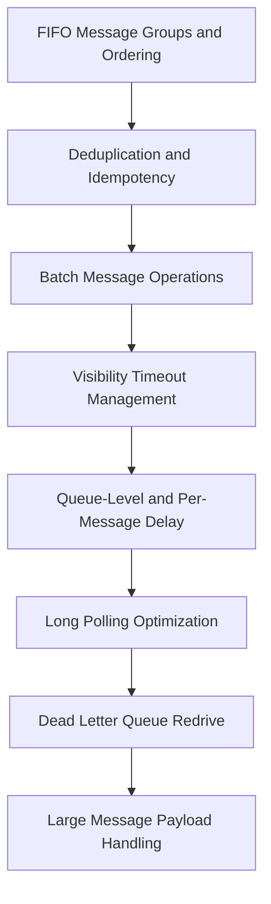
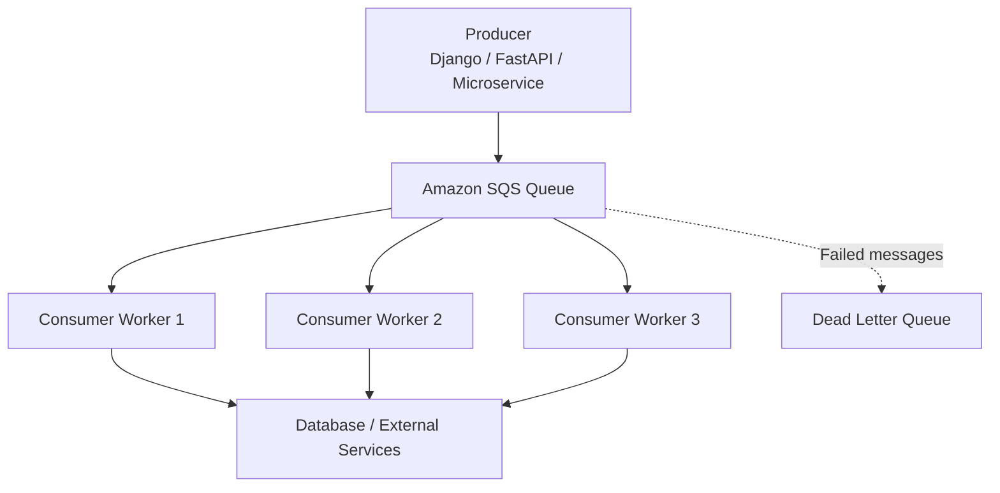
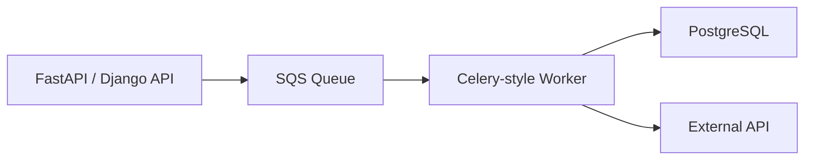
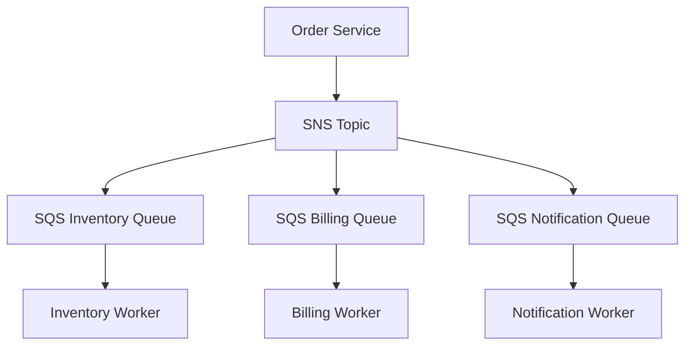

# README

## Overview

Amazon Simple Queue Service (Amazon SQS) is a fully managed message queuing service used to decouple application components and distribute work asynchronously.

This directory covers advanced SQS capabilities used to build reliable, scalable, and fault-tolerant backend systems.

The documentation focuses on production-level queue management, message ordering, deduplication, batch operations, visibility timeout optimization, delayed delivery, dead-letter queue recovery, and large-payload handling.

These capabilities are particularly relevant to microservices architectures where independent services communicate through asynchronous messages instead of relying exclusively on synchronous REST or gRPC calls.

## Documentation Structure

| File | Topic | Description |
|---|---|---|
| [01- FIFO Message Groups and Ordering.md](./01-%20FIFO%20Message%20Groups%20and%20Ordering.md) | FIFO Message Groups and Ordering | Explains message groups, ordering boundaries, parallel processing, concurrency, and FIFO throughput considerations. |
| [02- Message Deduplication and Idempotency.md](./02-%20Message%20Deduplication%20and%20Idempotency.md) | Message Deduplication and Idempotency | Covers FIFO deduplication, deduplication IDs, content-based deduplication, consumer idempotency, and reliable business processing. |
| [03- Batch Message Operations.md](./03-%20Batch%20Message%20Operations.md) | Batch Message Operations | Explains batch sending, receiving, and deletion, partial failures, throughput optimization, and Boto3 implementation patterns. |
| [04- Advanced Visibility Timeout Management.md](./04-%20Advanced%20Visibility%20Timeout%20Management.md) | Advanced Visibility Timeout Management | Covers visibility timeout configuration, heartbeat-based extensions, processing deadlines, and long-running consumer workflows. |
| [05- Queue-Level and Per-Message Delay.md](./05-%20Queue-Level%20and%20Per-Message%20Delay.md) | Queue-Level and Per-Message Delay | Explains delay queues, message timers, scheduling limitations, retry delays, and integration with EventBridge Scheduler. |
| [06- Long Polling Optimization.md](./06-%20Long%20Polling%20Optimization.md) | Long Polling Optimization | Covers `WaitTimeSeconds`, empty receives, HTTP timeout configuration, polling efficiency, and consumer performance. |
| [07- Dead Letter Queue Redrive.md](./07-%20Dead%20Letter%20Queue%20Redrive.md) | Dead Letter Queue Redrive | Explains DLQ configuration, redrive policies, message recovery, managed redrive tasks, and controlled reprocessing. |
| [08- Large Message Payload Handling.md](./08-%20Large%20Message%20Payload%20Handling.md) | Large Message Payload Handling | Covers S3-based payload offloading, message references, multipart uploads, presigned URLs, and payload lifecycle management. |

## Learning Path

Follow the documentation in sequence to understand advanced queue behavior and production reliability patterns.

The sequence progresses from message ordering and duplicate prevention to consumer optimization, failure recovery, and large-payload architecture.

## Core SQS Architecture

SQS provides a durable queue between producers and consumers. Producers send messages without requiring consumers to be available at publication time.

Consumers retrieve messages, process them, and delete them after successful completion.

SQS supports two queue types:

| Queue Type | Characteristics | Typical Use Case |
|---|---|---|
| Standard | At-least-once delivery and best-effort ordering | High-throughput background processing |
| FIFO | Ordering within message groups and producer-side deduplication | Ordered business workflows |

Both queue types require consumers to handle duplicate processing safely.

## Key Engineering Concepts

### FIFO Message Groups and Ordering

FIFO message groups define ordering boundaries.

Messages within the same group are processed in order, while different groups can be processed concurrently.

This allows applications to preserve ordering for related business entities without serializing the entire queue.

### Deduplication and Idempotency

FIFO producer-side deduplication suppresses duplicate sends within the five-minute deduplication interval.

Consumer-side idempotency protects business operations against repeated delivery, retries, and application failures.

These are separate reliability mechanisms and should be designed together.

### Batch Message Operations

Batch APIs reduce request overhead by processing multiple messages in a single API request.

SQS supports batch operations for:
- Sending messages.
- Receiving messages.
- Deleting messages.

Batch operations can partially succeed, so applications must inspect individual entry results.

### Visibility Timeout Management

Visibility timeout temporarily hides a received message from other consumers.

It provides an opportunity for a consumer to process a message without immediate concurrent redelivery.

Long-running processing workflows may need visibility timeout extensions.

### Queue-Level and Per-Message Delay

Delay queues and message timers postpone message availability.

They are useful for short-duration delayed workflows, retry scheduling, and deferred processing.

For long-term or precise scheduled execution, use EventBridge Scheduler rather than treating SQS delay as a general-purpose scheduling system.

### Long Polling

Long polling allows a consumer to wait for messages instead of repeatedly making short polling requests.

It reduces empty receives and unnecessary API calls.

### Dead Letter Queue Redrive

A dead-letter queue isolates messages that repeatedly fail processing.

Redrive operations allow controlled movement of messages back into a source queue or another destination after the underlying failure has been investigated.

### Large Message Payload Handling

SQS supports message bodies up to 1 MiB.

For larger application payloads, store the content in Amazon S3 and publish a reference containing the object key, version, and relevant metadata.

This keeps queue messages compact while allowing consumers to retrieve the full payload.

## Common Backend Integration Patterns

### Asynchronous Task Processing

A backend API publishes a task to SQS and returns without waiting for the complete background operation.

Typical use cases:
- Report generation.
- Document processing.
- Email and notification delivery.
- Image processing.
- Payment reconciliation.

### SNS to SQS Fan-Out

SNS distributes an event to multiple SQS queues so that independent services can process their own copies.

This pattern separates event distribution from downstream processing and allows each service to scale independently.

### SQS with Lambda

Lambda event source mappings allow Lambda functions to poll SQS queues and process received messages.

For production systems:
- Configure visibility timeout appropriately.
- Use partial batch failure reporting.
- Monitor queue age and DLQ depth.
- Make processing idempotent.
- Control function concurrency to protect downstream systems.

## Production Considerations

### Reliability

- Use idempotent consumers.
- Configure visibility timeout according to processing duration.
- Implement bounded retries and dead-letter queues.
- Inspect partial batch failures.
- Use durable checkpoints for long-running workflows where appropriate.
- Test recovery from worker crashes and downstream outages.

### Scalability

- Scale consumers according to queue depth and processing latency.
- Use multiple FIFO message groups to enable parallel processing.
- Avoid excessive concurrency against constrained databases.
- Use batch operations to reduce API overhead.
- Apply backpressure when downstream dependencies become saturated.

### Security

- Apply least-privilege IAM permissions.
- Restrict queue access through resource policies.
- Use server-side encryption.
- Review KMS permissions for customer-managed keys.
- Restrict SNS-to-SQS permissions to the intended topic ARN.
- Avoid storing sensitive data directly in messages when references are sufficient.

### Monitoring

| Area | Operational Focus |
|---|---|
| Queue Depth | Approximate visible messages |
| In-Flight Messages | Approximate messages not visible |
| Queue Latency | Approximate age of oldest message |
| Consumer Activity | Receive, delete, and empty-receive behavior |
| DLQ | Message accumulation and recovery activity |
| FIFO | Message-group contention and throughput |
| Application | Processing failures, duration, and duplicate handling |

Use CloudWatch metrics, structured application logs, and distributed tracing to correlate message publication with downstream processing.

### Cost Optimization

- Use long polling to reduce unnecessary receive requests.
- Batch send and delete operations.
- Keep message payloads compact.
- Select Standard or FIFO based on actual delivery requirements.
- Configure retention periods according to recovery needs.
- Avoid unnecessary message movement and repeated polling.
- Monitor KMS requests and S3 storage costs for large-payload architectures.

## Repository Conventions

When adding or updating SQS documentation:

1. Place the document in this directory.
2. Preserve the existing numbered filename sequence.
3. Use descriptive filenames that identify the SQS feature or engineering pattern.
4. Update this README with the filename, topic, and description.
5. Maintain relative links between related documents where useful.
6. Keep examples production-oriented and consistent with AWS service behavior.

## Key Takeaways

- SQS decouples backend services through durable asynchronous message queues.
- FIFO message groups provide ordering boundaries while allowing concurrency across independent groups.
- Deduplication and consumer idempotency solve different problems and are both important for reliable processing.
- Visibility timeout, long polling, batching, and DLQ redrive directly influence consumer efficiency and recovery behavior.
- Production SQS architectures require controlled retries, observability, least-privilege security, and tested failure-recovery procedures.