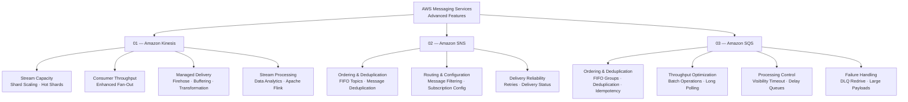
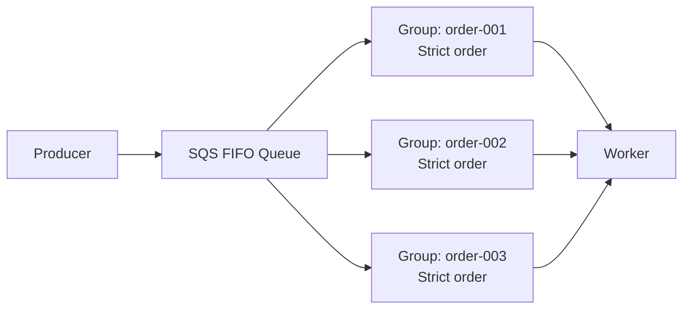
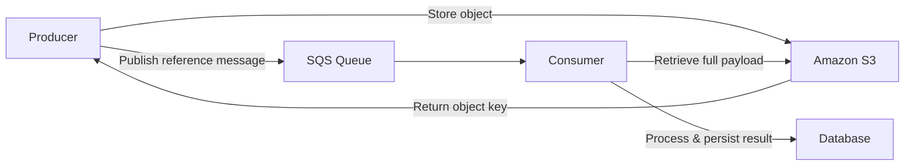

# AWS Messaging Services — Advanced Features

## Overview

This section covers advanced capabilities of the three core AWS messaging services used in production backend systems: Amazon Kinesis, Amazon SNS, and Amazon SQS.

The documents focus on **production-level configuration, operational behavior, performance tuning, and reliability patterns** that go beyond basic service fundamentals. Each topic addresses the deeper mechanics needed to operate messaging infrastructure at scale.

---

## Contents

| # | Section | Documents | Focus |
|---|---|---|---|
| 01 | [Amazon Kinesis](./01-%20Amazon%20Kinesis/README.md) | 7 | Shard scaling, partition-key distribution, enhanced fan-out, Firehose, Flink, and data transformation |
| 02 | [Amazon SNS](./02-%20Amazon%20SNS/README.md) | 5 | FIFO ordering, deduplication, message filtering, subscription configuration, and delivery reliability |
| 03 | [Amazon SQS](./03-%20Amazon%20SQS/README.md) | 8 | FIFO message groups, deduplication, batch operations, visibility timeout, delay, long polling, DLQ redrive, and large payloads |

**Total: 20 advanced feature documents**

---

## Topic Map

---

## Section Summaries

### [01 — Amazon Kinesis](./01-%20Amazon%20Kinesis/README.md)

Advanced Kinesis capabilities for scaling stream throughput, optimizing consumer models, managing data delivery, and building real-time processing pipelines.

| # | Document | Description |
|---|---|---|
| 01 | [Shard Scaling and Resharding](./01-%20Amazon%20Kinesis/01-%20Shard%20Scaling%20and%20Resharding.md) | Shard capacity, scaling strategies, shard splits and merges, and operational considerations during resharding. |
| 02 | [Hot Shards and Partition Key Distribution](./01-%20Amazon%20Kinesis/02-%20Hot%20Shards%20and%20Partition%20Key%20Distribution.md) | Partition-key distribution, shard imbalance, hot partitions, key design, and throughput optimization. |
| 03 | [Enhanced Fan-Out](./01-%20Amazon%20Kinesis/03-%20Enhanced%20Fan-Out.md) | Dedicated consumer throughput via `SubscribeToShard`, HTTP/2 streaming, consumer registration, and independent consumption. |
| 04 | [Kinesis Data Firehose](./01-%20Amazon%20Kinesis/04-%20Kinesis%20Data%20Firehose.md) | Managed streaming delivery, buffering, transformation, compression, format conversion, and destination integration. |
| 05 | [Kinesis Data Analytics](./01-%20Amazon%20Kinesis/05-%20Kinesis%20Data%20Analytics.md) | Real-time stream processing with Apache Flink, event-time windows, watermarks, state management, checkpointing, and fault tolerance. |
| 06 | [Stream Processing with Apache Flink](./01-%20Amazon%20Kinesis/06-%20Stream%20Processing%20with%20Apache%20Flink.md) | Flink processing architecture, transformations, stateful operators, event-time processing, and production stream-processing patterns. |
| 07 | [Buffering and Data Transformation](./01-%20Amazon%20Kinesis/07-%20Buffering%20and%20Data%20Transformation.md) | Buffering strategies, batching, transformation pipelines, data serialization, throughput optimization, and delivery considerations. |

---

### [02 — Amazon SNS](./02-%20Amazon%20SNS/README.md)

Advanced SNS capabilities for controlling message ordering, suppressing duplicates, routing events selectively to subscribers, and operating reliable notification systems.

| # | Document | Description |
|---|---|---|
| 01 | [FIFO Topics and Message Ordering](./02-%20Amazon%20SNS/01-%20FIFO%20Topics%20and%20Message%20Ordering.md) | FIFO topic behavior, message groups, ordering guarantees, and high-throughput considerations. |
| 02 | [Message Deduplication](./02-%20Amazon%20SNS/02-%20Message%20Deduplication.md) | Explicit and content-based deduplication, deduplication scope, transactional outbox, and consumer idempotency. |
| 03 | [Message Filtering and Filter Policies](./02-%20Amazon%20SNS/03-%20Message%20Filtering%20and%20Filter%20Policies.md) | Attribute-based and body-based filtering, matching operators, subscription routing, and filter policy deployment. |
| 04 | [Advanced Subscription Configuration](./02-%20Amazon%20SNS/04-%20Advanced%20Subscription%20Configuration.md) | Raw message delivery, subscription retry policies, dead-letter queues, protocol configuration, and security. |
| 05 | [Delivery Retries and Delivery Status](./02-%20Amazon%20SNS/05-%20Delivery%20Retries%20and%20Delivery%20Status.md) | Delivery retry behavior, delivery status logging, CloudWatch monitoring, failure recovery, and idempotency. |

---

### [03 — Amazon SQS](./03-%20Amazon%20SQS/README.md)

Advanced SQS capabilities for ordering, deduplication, throughput optimization, processing control, failure recovery, and large-payload handling in production queue systems.

| # | Document | Description |
|---|---|---|
| 01 | [FIFO Message Groups and Ordering](./03-%20Amazon%20SQS/01-%20FIFO%20Message%20Groups%20and%20Ordering.md) | Message groups, ordering boundaries, parallel processing, concurrency, and FIFO throughput considerations. |
| 02 | [Message Deduplication and Idempotency](./03-%20Amazon%20SQS/02-%20Message%20Deduplication%20and%20Idempotency.md) | FIFO deduplication, deduplication IDs, content-based deduplication, consumer idempotency, and reliable business processing. |
| 03 | [Batch Message Operations](./03-%20Amazon%20SQS/03-%20Batch%20Message%20Operations.md) | Batch sending, receiving, and deletion, partial failures, throughput optimization, and Boto3 implementation patterns. |
| 04 | [Advanced Visibility Timeout Management](./03-%20Amazon%20SQS/04-%20Advanced%20Visibility%20Timeout%20Management.md) | Visibility timeout configuration, heartbeat-based extensions, processing deadlines, and long-running consumer workflows. |
| 05 | [Queue-Level and Per-Message Delay](./03-%20Amazon%20SQS/05-%20Queue-Level%20and%20Per-Message%20Delay.md) | Delay queues, message timers, scheduling limitations, retry delays, and integration with EventBridge Scheduler. |
| 06 | [Long Polling Optimization](./03-%20Amazon%20SQS/06-%20Long%20Polling%20Optimization.md) | `WaitTimeSeconds`, empty receives, HTTP timeout configuration, polling efficiency, and consumer performance. |
| 07 | [Dead Letter Queue Redrive](./03-%20Amazon%20SQS/07-%20Dead%20Letter%20Queue%20Redrive.md) | DLQ configuration, redrive policies, message recovery, managed redrive tasks, and controlled reprocessing. |
| 08 | [Large Message Payload Handling](./03-%20Amazon%20SQS/08-%20Large%20Message%20Payload%20Handling.md) | S3-based payload offloading, message references, multipart uploads, presigned URLs, and payload lifecycle management. |

---

## Advanced Capability Reference

| Capability | Kinesis | SNS | SQS |
|---|---|---|---|
| Ordering guarantees | Per shard | FIFO topics — per message group | FIFO queues — per message group |
| Deduplication | Consumer-managed | Explicit ID or content-based (5-min window) | Explicit ID or content-based (5-min window) |
| Fan-out / multiple consumers | Yes — standard or enhanced fan-out | Yes — per topic subscription | No — competing consumers only |
| Dedicated consumer throughput | Enhanced Fan-Out (2 MB/s per consumer) | — | — |
| Managed delivery to destinations | Amazon Data Firehose | — | — |
| Stateful stream processing | Managed Apache Flink | — | — |
| Message filtering | — | Subscription filter policies | — |
| Batch operations | — | — | Send, receive, delete |
| Visibility timeout | — | — | Configurable, with extension support |
| Message delay | — | — | Queue-level or per-message |
| Long polling | Consumer-managed | — | Native (`WaitTimeSeconds`) |
| DLQ redrive | Consumer-managed | Subscription DLQ | Queue DLQ with managed redrive |
| Large payloads | Record up to 1 MiB | Message up to 256 KB | Message up to 256 KB (S3 offload for larger) |

---

## Key Engineering Patterns

### FIFO Ordering with Parallel Processing

Both SNS FIFO and SQS FIFO use **message groups** to scope ordering. Messages within the same group are processed in strict order, while messages in different groups can be processed concurrently.

> [!IMPORTANT]
> A hot message group — where all traffic concentrates into one group — eliminates concurrency benefits and caps throughput. Distribute across multiple groups when parallelism is required.

### Deduplication vs. Idempotency

These are complementary, not interchangeable:

| Mechanism | Scope | What it protects against |
|---|---|---|
| SNS / SQS FIFO deduplication | Transport layer — 5-minute window | Duplicate sends from the same producer |
| Consumer idempotency | Application layer | Duplicate deliveries, retries, worker crashes, replays |

Both are required. Transport deduplication does not eliminate the need for application-level idempotency.

### Enhanced Fan-Out vs. Standard Consumers (Kinesis)

| Model | Throughput per consumer | Delivery mechanism | Best for |
|---|---|---|---|
| Standard | Shared 2 MB/s per shard across all consumers | Pull (HTTP polling) | Low consumer count or cost-sensitive workloads |
| Enhanced Fan-Out | Dedicated 2 MB/s per shard per consumer | Push (HTTP/2 streaming) | Multiple independent consumers needing consistent throughput |

### Large Payload Strategy (SQS)

SQS messages are capped at 256 KB. For larger payloads:

---

## Production Engineering Checklist

### Kinesis
- [ ] Distribute partition keys to avoid hot shards
- [ ] Size provisioned shard count based on measured write and read throughput
- [ ] Choose Enhanced Fan-Out when multiple consumers need dedicated throughput
- [ ] Configure Firehose buffering, transformation, and destination settings explicitly
- [ ] Checkpoint consumers durably and handle shard splits during resharding
- [ ] Monitor iterator age, write throttling, and consumer lag

### SNS
- [ ] Select Standard or FIFO topic based on ordering and throughput requirements
- [ ] Define stable message group IDs and deduplication IDs for FIFO workflows
- [ ] Author and test subscription filter policies against real event payloads
- [ ] Configure raw message delivery where downstream consumers require it
- [ ] Set up subscription DLQs and SQS consumer DLQs as separate failure boundaries
- [ ] Enable delivery status logging and monitor CloudWatch delivery metrics
- [ ] Implement consumer-side idempotency independent of transport deduplication

### SQS
- [ ] Design FIFO message groups to balance ordering scope and processing concurrency
- [ ] Configure visibility timeout to match the actual processing duration with margin
- [ ] Use heartbeat-based extensions for long-running processing workflows
- [ ] Enable long polling (`WaitTimeSeconds = 20`) on all receive calls
- [ ] Use batch operations for send, receive, and delete to reduce API overhead
- [ ] Inspect partial batch failure results and handle them explicitly
- [ ] Configure DLQ redrive policies and document investigation and replay procedures
- [ ] Use S3 payload offloading for messages exceeding the 256 KB limit

---

## Key Takeaways

- **Kinesis advanced features** address stream capacity scaling, consumer throughput isolation (Enhanced Fan-Out), managed data delivery (Firehose), and stateful real-time processing (Apache Flink).
- **SNS advanced features** address ordered and deduplicated event distribution (FIFO), selective routing (filter policies), subscription reliability configuration, and delivery observability.
- **SQS advanced features** address ordered processing within message groups (FIFO), duplicate suppression, throughput optimization (batching, long polling), processing lifecycle control (visibility timeout, delay), failure isolation (DLQ), and large-payload handling.
- **Deduplication at the transport layer and idempotency at the application layer are both required** — they protect against different failure modes.
- **FIFO ordering is scoped to message groups**, not to the entire topic or queue; design group IDs deliberately to balance ordering guarantees with processing concurrency.
- Production-grade messaging systems require observability across the full event lifecycle, least-privilege security, controlled failure recovery, and explicitly tested edge cases.
